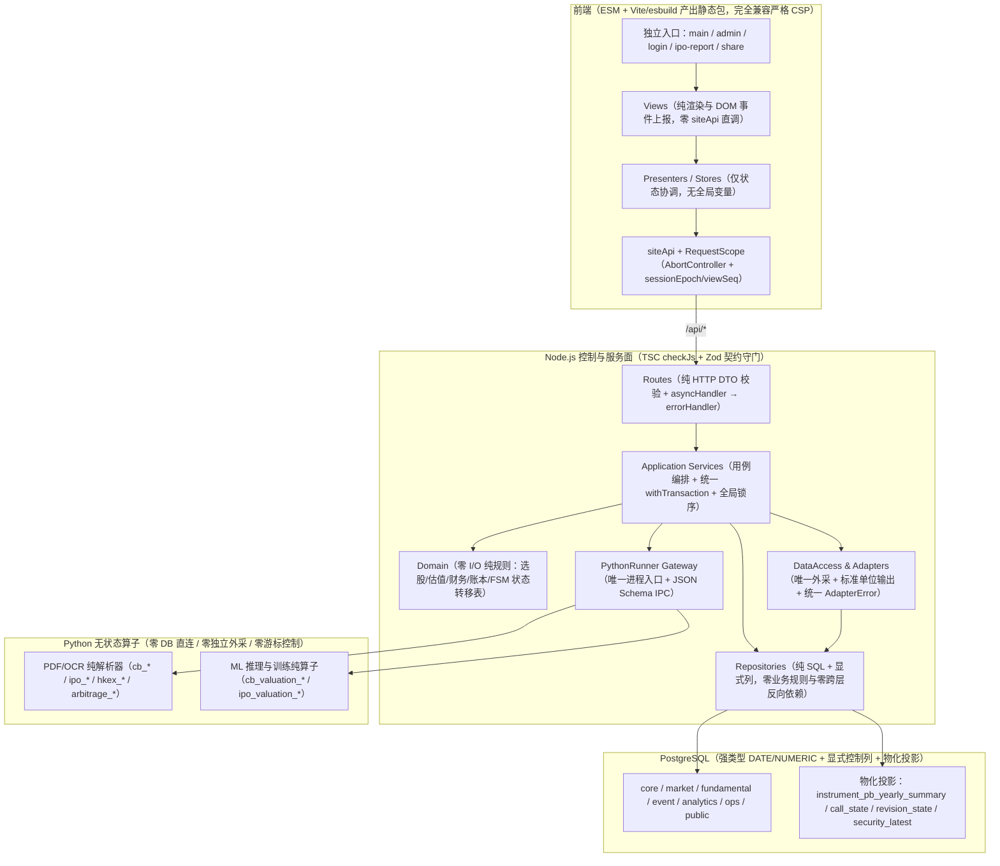

# 全站架构与工程治理深度重构研发方案（2026-11-20·一次性整体实施合同）

> 文档职责：专项方案（待评审 / 待实施）
> 截至日期及范围：2026-11-20；源码审计固定基线 `966417e50db695cfa17937d3393997ec33e5a0b2`（`0.9.4.9`），已同步核对至 `master` 最新提交 `9289ca37ea5149df1262ac4673550de1164aea5e`（`0.9.4.10`）；覆盖全仓 7 大模块源码、31 个迁移文件（206 步迁移）、`governance/architecture-boundaries.json` 及近期架构/事故文档
> 当前结论：**待评审 / 待实施**。本方案将**代码交付、数据库切换与不可逆清理**分离为安全演进阶段，在**单一任务卡（登记独占文件）、单一工作树/分支、不拆多卡分批上线**下按第 4 节检查点与序级接续契约施工并一次性整体交付；当前仅完成方案编制与二轮评审修订，未修改业务代码、未运行业务迁移、未触碰生产环境
> 权威与证据：[AGENTS.md](../AGENTS.md)、[知识索引](知识索引.md)、[技术架构](技术架构.md)、[生产部署流程](生产部署流程.md)、[tasks/README.md](tasks/README.md)、[应用分层与MVP架构整改方案](应用分层与MVP架构整改方案_20261027.md)、[项目可持续维护与交付闭环整改方案](项目可持续维护与交付闭环整改方案_20261030.md)、[INC-0050](incidents/INC-0050-选股交互异步状态与结果解释缺口.md)、[INC-0051](incidents/INC-0051-财报样本误写本机业务库与字段错配.md)、[INC-0052](incidents/INC-0052-收盘候选价误判与净值缺口.md)
> 未验证/未完成：序 0 只读生产计量报告、全部代码改造、数据库“扩展→回填→切换→清理”四阶段实施、隔离库与真实环境验收、开发交接验证与最终发布树全量回归、以及生产部署均待立项实施；未连接生产 PostgreSQL 实例采集线上表体积/索引命中/慢查询/WAL 实况；既有业务与金融计算公式口径不在本方案中擅自变更
> **本方案明确不做的 3 件事**：
> 1. **不擅自变更金融/会计口径与业务规则阈值**（净值算法、税费率、可转债强赎/下修业务裁决阈值、选股 R01–R05 金融定义保持原意，除[附录 A](#附录-a显式缺陷修复清单fix-总表)明列修复外，其余一律要求 `diff=0`）；
> 2. **不拆分为微服务或多仓库，不在首次代码上线窗口内执行破坏性 `DROP` / `ALTER TYPE` / `SET NOT NULL` 清理**；
> 3. **不在本次编案或无明确授权下连接、探测或修改生产 PostgreSQL 与线上服务**（序 0 只读计量与最终上线均须届时单独授权）。

---

## 0. 问题基线与一次性解决原则

### 0.1 为什么要做架构级根治（而非继续单点补丁）

截至基线 `966417e50db6`（`0.9.4.9`），全仓已累计 **679 个发版**、**206 步数据库迁移**、**55 份事故文件**（至 `INC-0052`）、**50 份活动任务卡**，仅 2026-10-20 ~ 11-20 一个月内单日发布多次达到 **9～13 版**，且连续出现单需求 7～14 轮返工（评论通知 14 轮、持仓统一估值 7 轮、盘后就绪等待 11 轮、选股 V2 十余版、三表展示 4 版）。

源码审计确认，高频返工并非孤立代码失误，而是由 **6 个底层结构裂缝**持续放大产生：

1. **双运行时分裂**：Python（`ipo-report/` 与 `server/scripts/`）独立直连 PostgreSQL、直调外部 HTTP、独立写 `ops.sync_cursors` / `ops.ingestion_runs`，并与 Node 重复维护 Guard（694/664 行）、PDF 缓存（117/135 行）、身份映射、Tushare 客户端、日历及 8 套 Python 启动探测链。
2. **数据层弱类型 + 可空唯一漏洞 + JSONB 承载控制流**：账本子表主键仍绑自然键 `(username, account_name)`、日期多处为 `TEXT`、4 张核心表存在可空列参与 `UNIQUE`（PG 下 `NULL != NULL` 无法去重）；16 张表把关键状态/关联键塞进 JSONB，多处用无锁 `||` 浅合并覆盖，全仓仅 1 个 JSONB GIN 索引。
3. **接入层未对齐语义，迫使读取 SQL 打满补丁**：`lixingerDatasetAdapter` 先将标准元/小数换算成 Tushare 单位再由下游还原；适配层存在 10 处明确静默吞错和 3 套缩水版 `ABORT_CODES`；选股、A 股分析、港股分析、三表展示各自维护一套财报优选与币种屏蔽 SQL。
4. **跨层反转与事务/锁序冲突**：`server/db/accounts.js`（1,239 行）反向依赖 `services/*`、`repositories/*`、`public/shared/*` 甚至内联复制 SQL；账本域并存 3 套事务机制与 **3 组相反行锁顺序**（`accounts` ↔ `account_data` ↔ `nav_history` ↔ `nav_import_batches`）；`jobOrchestrator.js` 白名单实际截断多类任务参数。
5. **千万级大表无投影 + 运行时视图穿越未来**：`market.daily_valuations` 在 `loadPbWindow` 对 1,220 万行做全历史排序耗时 60s+；`convertible_bond_call_latest` 叠三层视图，且与 `convertible_bond_revision_latest`（6 个 `LATERAL`）内嵌 `CURRENT_DATE`，历史回测读视图泄露未来状态。
6. **前端经典脚本全局共享 + 门禁失焦**：`public/index.html`（1,831 行）混装 13 个一级页、82 个 `<script>` 与 492 行内联脚本；`audit-layer-coupling.js` 对 `siteApi.*` 放行且对浏览器无 `import` 的全局回调完全失效；`acceptanceRepositorySql.js` 跳过全部动态 `${}` SQL 且未接入 CI；`server/test/*.test.js` 共 376 个文件（全测试入口约 384 个）纯串行冷启动。

### 0.2 一并解决与边界红线（唯一任务卡、会话接续与分离交付/切换/清理）

- **唯一任务卡、不拆多卡、不分批交付（对齐 [AGENTS.md](../AGENTS.md) 与 [tasks/README.md](tasks/README.md)）**：“不拆分任务卡”指**只建唯一 1 张总任务卡**（`docs/tasks/active/YYYYMMDD-全站架构与工程治理深度重构.md`），不按域拆分成多张独立上线卡或分批交付。总任务卡必须登记工作树/分支与**独占文件清单**（含 `server/db/accounts.js`、`server/db/migrations*`、`stockSelection*.js`、`jobOrchestrator.js`、`jobScheduleSlots*.js`、`public/index.html`、`public/js/**` 等），防止并行任务修改冲突。
- **序级会话接续契约（防长会话上下文溢出重做）**：考虑到全仓级改造与 376+ 测试体量可能超出单个模型上下文窗口，本方案允许在总任务卡内按第 4 节**每序结束强制写入标准化“接续包”**（当前 `HEAD` SHA、已完成 `FIX-xx` 编号、未闭环停止条件、下一序进入点、测试与计量证据路径），供下一会话接手无缝续跑；仍坚持单一分支、整体验收后一次交由发布对话整合。
- **代码交付、数据库切换与不可逆清理严格分离**：本方案的实施交付包含兼容扩展、体检回填与**强制双写**下的双读验证切换；**所有破坏性删除旧列/旧表、不可逆缩窄类型的清理操作全部移至生产稳定观察期之后单独批准执行**，避免代码回退被不可逆 DDL 锁死。
- **先冻结业务行为，再做结构调整**：严格区分“纯结构搬迁（要求结果逐项 `diff=0`）”与“[附录 A](#附录-a显式缺陷修复清单fix-总表) 明确登记的缺陷修复”。不推倒重写，不擅自更改金融公式、税务规则、账本会计口径、已批准规则阈值和权限策略；**除附录 A 登记的 `FIX-01 ~ FIX-29` 外，任何可观测业务/接口/DOM 差异一律视为回归缺陷并阻止进入下一序**。
- **以真实风险门禁取代数字指标**：不把“全仓 `checkJs` 通过率”“目录搬空数量”“固定并发数”与业务正确性等权；类型契约、SQL 实执、行为基线对照与故障注入反例才是强制验收核心。

### 0.3 主线同步与审计基线对照（`0.9.4.9` → `0.9.4.10`）

本方案的源码级逐行审计完成于基线 `966417e50db6`（`0.9.4.9`，分支 `wb/alert-dryrun-preview`）。核对 `master` 主线最新提交 `9289ca37ea51`（`0.9.4.10`，增量提交 `a477faeb..9289ca37`）的真实 `git diff` 后，基线差异与本方案适用性对照如下：

| 主题 | 主线 `9289ca37ea51`（`0.9.4.10`）增量事实 | 对本方案结论的影响 | 实施立项状态 |
|---|---|---|---|
| **IPO 行业读取** | `ipo-report/ipo_history_sync.py` 新增 `read_shared_sw_industry()`，优先直查 `core.company_industry_memberships` 申万 2021 分类 | Python 直连 PG 游标与双栈割裂问题**仍成立**，且新增了一处 Python 直查共享层 SQL | **仍待重构**（域 C 收口） |
| **港股金融权益映射** | `server/dataAccess/adapters/lixingerDatasetAdapter.js` 将 `bs.tetshaoehopc` 扩展到 `bank / insurance / security` | 局部缓解港股金融类归母权益缺口；单位往返折算、3 套 `ABORT_CODES` 与静默吞错**仍成立** | **局部已缓解；契约仍待重构**（域 B） |
| **A 股市值口径过滤** | `server/dataAccess/marketDatasets.js` (`readTotalAShareMarketCap`) 与 `stockRepository.js` (`totalMarketCap`) 增加 `i.market='CN' AND v.currency_code='CNY'` 过滤 | 修复单处 A 股总市值混入港股/美元行；4 套财报优选与多源口径分散问题**仍成立** | **单点已修复；全局待统一**（域 B/F） |
| **港股选股原币与未上市保护** | `stockSelectionService.js` (`annualFactsOf`) 改取最新年报币种、`stockSelectionRules.js` 按市场原币比较并区分跨币种不可比；`stockSelectionInputsSync.js` 与 `stockSelectionRepository.js` (`listCodesWithRecentBars`) 跳过 `list_date > asOfDate` | 修复特定港股跨币种与未上市误判；巨型仓储规则 SQL、V1/V2 分叉、`loadPbWindow` 千万行排序问题**仍成立** | **局部已修复；核心架构仍待重构**（域 A/F） |
| **市场周期历史告警恢复** | `server/services/jobRunners.js` 与 `server/jobs/marketVolatilitySync.js` 新增 `revalidateHistoricalMarketVolatility()` 只读复验 | 又增加一处 Runner 内设 `publishDatasets:false` 并直调 `datasetPartitions` 的特例旁路，更加验证统一 `DatasetPublicationGateway` 与 FSM 的必要性 | **仍待重构**（域 D） |

> **实施基线冻结约定**：开发对话正式施工前，必须从最新 `master`（`>= 9289ca37ea51`）拉出独立工作树与分支，重核上述已改文件最新行号并记录最终实施基线 SHA，禁止用旧分支代码直接施工覆盖主线增量。

---

## 1. 已有能力、可复用能力与真正缺口

| 领域 | 已有/可复用能力 | 真正缺口（本方案改造范围） |
|---|---|---|
| **数据库与身份** | `core`/`market`/`fundamental`/`event`/`analytics`/`ops` 六大 Schema、`users.subject_id`、`accounts.id`、`core.instruments`、`securityIdentity.js`、`withTransaction` (`server/db/transaction.js`) | 账户子表主键/外键未收口到 `account_id`；`TEXT` 日期与 `REAL` 金额列残留；可空 `UNIQUE` 漏洞；16 张表 JSONB 控制流与无锁浅合并；`daily_valuations` 缺年度投影；三层视图含 `CURRENT_DATE` 穿越；3 套事务机制与相反锁序 |
| **外部数据与 Guard** | `externalCallGuard.js`、`sourceEndpointPolicy.js`、`marketDatasets.js`、`documentPdfCache.js`、`ops.raw_records` | 23 个 `data_adapter`/`data_access` 文件滞留 `server/services/`；单位往返折算；10 处静默吞错与多套 `ABORT_CODES`；部分适配器绕过 Guard；Node/Python 双套 Guard/缓存/Tushare/日历 |
| **调度与发布门禁** | `jobDefinitions.js`、`jobOrchestrator.js`、`jobScheduleSlots.js`、`datasetPartitionRegistry.js`、`jobRecoveryEvidence.js`、`jobAlertMailer.js` | `ops.job_schedule_slots` 隐式多字段无正式 FSM；`update_2/3/4/6/9/25` 与 `retryJobSlot` 缺乐观锁；`runContext` 白名单截断多任务参数；3 条并行分区发布通道与 `publishDatasets:false` 绕过；`DURABLE_SCHEDULER='0'` 老双轨与 Web 停机未排空 |
| **持仓/估值/净值** | `effectivePrice.js`、`effectivePriceRepository.js`、`navAttribution.js`、`accountCash.js`、`fxRate.js`、`marketState.js`、`public/shared/{core-date,nav-math}.js` | `server/db/accounts.js` 反向依赖业务层；`replayNav`/`navSnapshot`/`navAttribution`/`anchorPrices` 未统一调用 `effectivePrice`；7 处自写日历、5 处独立汇率；`PATCH /settings` 全表锁 `accounts`；`core-fees.js` 读全局 `data` |
| **选股与个股财报** | `stockSelectionRules*.js`、`stockSelectionPortfolio.js`、`statementPresentation.js`、`statement_*_{cas,hkfrs}` 宽表 | `stockSelectionRepository.js`（2,455 行）SQL 内嵌规则与 `loadPbWindow` 60s+ 全表扫描；4 套互不一致的财报优选 SQL 与 3 套币种拦截；`stockSelectionService.js`（2,449 行）V1/V2 混杂与 `inputsDigestOf` 漏哈希 V2 字段 |
| **可转债与 IPO** | `extractHkIpoAllotment.py`（stdin 无网无库纯算子范式）、`convertibleBondAnalysisRules.js`、`documentPdfCache.js` | Python 直连 PG/HTTP/写游标；8 套 Python 探测器和非 JSON 输出协议；`ipo_lib_fetch.py`（3,979 行）、`convertibleBondAnalysisSync.js`（1,839 行）、`convertibleBondValuation.py`（1,793 行）巨型混杂 |
| **路由、前端与门禁** | `app.js` 中间件基础顺序、`errorHandler.js`、`siteApi` (`client.js`)、`access-policy.js`、`testRunControl.js`、`acceptanceRepositorySql.js` | 路由自建 `try/catch` 泄露 500 细节或吞错、动态 `WHERE` 拼接与重事务编排；`index.html`（492 行内联）等 82 个全局 `<script>` 缺模块化与统一 `RequestScope`；`session.js` 监听器累加；无 `checkJs`/Zod；`acceptanceRepositorySql` 未入 CI；387 测试全串行 |

---

## 2. 总体目标架构

**目标架构五条铁律**：
1. **单向依赖，禁止反转**：`Routes → Application → Domain / DataAccess / Repositories → db/connection`。`server/db/` 只含连接池、事务原语与迁移引擎，绝不 `require` 任何 `services/`、`repositories/` 或 `public/`。
2. **Python 纯算子化**：Node 是唯一的 PostgreSQL 读写者、Guard 持有者和 `ops.sync_cursors` 推进者；Python 只接收本地文件/JSON/stdin 字节并返回结构化 JSON（若 4B 阶段个别交易所站点因反爬触发止损开关暂留纯 HTTP 抓取在无库 Python，须在总任务卡登记为受控临时例外并附退场条件，且必须由 Node 下发请求、统一落库与推进游标）。
3. **接入即标准化，读侧零补丁**：单位（元/小数/股）、币种、复权口径、错误分类与缺口证据全部在 `dataAccess` 落库前归一化；标准层升格显式状态列，不在仓储 SQL 里堆积历史脏数据屏蔽补丁。
4. **状态机显式化与锁序单一化**：槽位流转走唯一 FSM 转移表；账户写入统一 `withTransaction` 与单一加锁序（`accounts → account_data → nav_import_batches → nav_history → 明细表`）。
5. **编译器与运行期契约取代人工记忆**：`tsc --noEmit`（`checkJs`）+ Zod Schema + ESLint 禁吞错 + `acceptanceRepositorySql` 入 CI + 前端 ESM 与 `RequestScope`。

---

## 3. 分域源码级与表结构精确改造合同

### 3.1 域 A：数据库 Schema 演进（扩展→回填→切换→清理）、JSONB 显性化与投影/视图重构

> **已核实底层约束与工具决策**：
> - **迁移通道决策（`CONCURRENTLY` 必改）**：现行 [server/db/migrations.js](../server/db/migrations.js) 通过单次 `pool.query(...)` 执行多语句（PostgreSQL 隐含事务块），且现有 206 步迁移中 `CONCURRENTLY` 使用量为 **0**。直接写入 `CREATE INDEX CONCURRENTLY` 必然触发 `cannot run inside a transaction block`。**明确决策：扩展 `server/db/migrations.js` 增加「非事务单语句通道（`nonTransactional: true`）」**：仍在 `pg_advisory_lock(904000)` 保护下，为每条并发索引语句分配独立 `pool.connect()` 非事务会话逐条执行；**执行前必须检查 `pg_index.indisvalid`，若存在同名但 `indisvalid = false` 的残缺索引，先执行 `DROP INDEX CONCURRENTLY IF EXISTS <idx>` 后重建**，严禁 `IF NOT EXISTS` 静默跳过无效索引。
> - **PG 版本与 `NULLS NOT DISTINCT` 依据**：已核对 [技术架构](技术架构.md#L1689) 与生产记录，生产 PostgreSQL 为 **16.14**，开发机为 **17.2 / 17.11**，均满足 PostgreSQL 15+ 原生 `UNIQUE ... NULLS NOT DISTINCT` 语法要求。
> - 所有 DDL 变更必须新增独立幂等迁移模块（如 `server/db/migrations/era17ArchitectureRefactor.js` 并登记于 `server/db/migrations.js`），严禁修改历史迁移（1–206），遵守 `CREATE SCHEMA` 先查 `information_schema.schemata` 权限约束。
>
> **四阶段演进硬约束**（代码交付、数据库切换与不可逆清理必须解耦）：
> 1. **阶段 1 · 扩展（Expand）**：仅做非破坏性增补（新增兼容列、新关联表、新投影表、走非事务通道的 `CREATE INDEX CONCURRENTLY`、以及 `NOT VALID` 外键/约束），**严禁改写或删除任何旧列、旧约束、旧表**；所有在线 DDL 必须显式设置 `SET lock_timeout = '2s'` 与 `SET statement_timeout = '60s'`，超时即中止退出而不拖死在线连接。
> 2. **阶段 2 · 体检与分批回填（Audit & Backfill）**：以**序 0 只读生产计量报告**为前提，回填脚本启动写操作前再跑一次只读体检输出**孤儿行、重复键（含 4 张可空唯一表的 `NULL` 重复行）、非法 `TEXT` 日期值、非 `NUMERIC` 字符串、缺失 `account_id`** 五类审计报告；**发现未预期异常行一律中止并留证交人工裁决，绝不默认静默删除或覆盖业务事实**。大表回填按 `(instrument_id)` 或 `(year)` 分批幂等执行并持久化断点游标。
> 3. **阶段 3 · 强制双写与影子双读切换（Switch）**：应用层先做新旧读取结果一致性校验（`diff=0`）后再切向新列/新投影。**强制契约：阶段 3 起所有写入口对兼容新旧列强制双写，禁止“只写新列”，确保紧急回退旧版本代码时旧代码读旧列不发生静默数据丢失！双写退出条件 = 阶段 4 正式获批清理完毕**。特别说明：**序 3 期间 Python 写入权尚未收回（序 4A 才收回），因此序 3 期间凡仍存在 Python 直写的表（如 `analytics.convertible_bond_valuation_alerts` 及相关游标/工单表），其兼容列必须由数据库级轻量触发器兜底双写，或把对应表的新列切换后置至序 4A 收回 Python 写库权之后**。
> 4. **阶段 4 · 不可逆清理（Drop & Alter，移出本次自动交付窗口）**：所有 `DROP COLUMN`、`DROP TABLE`、`ALTER COLUMN ... TYPE`、`SET NOT NULL` 收紧动作，**不与本方案代码首次上线混在同一窗口**，须在生产稳定观察期结束、确认无需回退并获得单独批准后再按第 A3.4 节量化清单执行。

#### A1. 账户域主键、外键与强类型化（按四阶段演进）
1. **扩展与收口 `account_id` + 补齐外键**：
   - 涉及表：`public.positions`、`trades`、`nav_history`、`cash_flows`、`daily_prices`、`index_history`、`account_data`、`nav_import_batches`、`nav_position_snapshots`、`index_baseline_settled`（原定义在 `era01CoreSchema.js:26-98`、`era02PlatformOps.js:388,435,578`、`era15DailyPriceMarketKey.js:16`）。
   - 阶段 1–3：补全缺失 `account_id` 映射后，为上述表并列建立以 `account_id` 为前导列的并发唯一索引；对 `event.stock_swap_settlements` 新增 `case_id_v2 BIGINT` / `NOT VALID` 外键、`job_runs.slot_id` ↔ `ops.job_schedule_slots`、`stock_selection_candidates/portfolio_members`、`stock_selection_backtest_periods`、`stock_selection_publication_events`、`statement_*_{cas,hkfrs}` 补建 `NOT VALID` 外键；异常记录清零后低锁 `VALIDATE CONSTRAINT`；**阶段 3 全写入口保持 `account_id` 与 `(username, account_name)` 双写并保留旧自然键供回退**。
2. **`TEXT` 日期与 `REAL` 数值兼容扩展（强制双写，不直接原地 `ALTER TYPE` 锁表）**：
   - `public.nav_history.date`、`public.daily_prices.date`、`public.trades.trade_date`：阶段 1 新增 `DATE` 镜像列（`nav_date DATE` / `price_date DATE` / `trade_date_d DATE`）并通过非事务通道建并发索引；阶段 2 对现存 `TEXT` 日期做历法合法性只读审计并分批回填；**阶段 3 起所有读写切换为“写必双写 `TEXT` + `DATE`、读优先 `DATE`”，绝不允许仅写新列**；`analytics.stock_selection_universe_artifacts.knowledge_cutoff`（`era13StockSelectionV2.js:238`）、`predictions`/`sector_heat`/`stock_gain`/`convertible_bond_profiles.maturity_call_price` 遵循同一强制双写演进合同。
3. **修复可空列参与唯一约束（`NULLS NOT DISTINCT` + 全仓 `ON CONFLICT` 审计）**：
   - **前置强制审计（建索引前必做）**：已初步核实全仓存在多处 `ON CONFLICT` 调用，建立新唯一索引前必须逐点审计以下 4 张表的全部 `INSERT / ON CONFLICT / UPDATE` 调用方，判定“原先被 `NULL != NULL` 放行重复写入”变为“触发冲突”后的语义（是合并 `DO UPDATE` 还是忽略 `DO NOTHING` 或调整冲突列）：
     - `ops.data_quality_issues`（`instrument_id, dataset_code, field_code, issue_type, status`）——核查 `stockProjectionRepository.js:291,396`、`convertibleBondRedemptionSyncRepository.js:57`、`datasetCursors.js:118` 的 `ON CONFLICT ... DO UPDATE` 对 `instrument_id IS NULL` 工单的合并影响；
     - `core.instrument_identifiers`（`source_id, identifier_type, identifier_value, valid_from`）——核查 `tradeLotRepository.js:141`、`securityIdentity.js:282,394`、`rebuildBondCallProjection.js:253` 的 `ON CONFLICT DO NOTHING`；
     - `analytics.convertible_bond_valuation_alerts`（`instrument_id, trade_date, alert_type, current_state, model_version`）——核查 `convertibleBondValuation.py:1431,1452` 与 `test_valuation_regression.py:407` 裸 `INSERT` 是否存在空字段重复写入从而在切换后抛出 `23505 unique_violation`；
     - `analytics.metric_statistics`（`instrument_id, metric_code, as_of_date, window_start, window_end`）——核查 `stockProjectionRepository.js:248`（`window_start` 显式允许为 `null`）的 `ON CONFLICT ... DO UPDATE`。
   - 先对序 0 / 阶段 2 查出的存量 `NULL` 重复行按留证裁决清理去重，再经迁移**非事务通道**执行 `CREATE UNIQUE INDEX CONCURRENTLY ... NULLS NOT DISTINCT` + `indisvalid` 校验，确认成功后再替换旧索引，并为 4 张表各配 1 条“改回可空旧索引必红”的回归反例。

#### A2. JSONB 关键控制流显性化与关系拆表（强制双写至阶段 4）
1. **升格核心控制流列（阶段 1 增列，阶段 2 体检回填，阶段 3 强制新旧列双写，阶段 4 观察后删 JSONB 冗余键）**：
   - `fundamental.financial_reports`：新增 `ts_code TEXT`, `report_currency CHAR(3)`, `fs_table_type TEXT`, `value_basis TEXT`, `statement_coverage_complete BOOLEAN` 及并发复合索引 `(company_id, ts_code, report_kind, period_end)` 与 `(market_scope, report_kind, period_end)`。
   - `fundamental.convertible_bond_no_revision_history`：新增 `lock_declared BOOLEAN`, `no_revision_evidence BOOLEAN`, `parser_version TEXT`, `reparse_status TEXT`, `reparse_attempts INT NOT NULL DEFAULT 0`, `symbolic_reference_type TEXT`, `symbolic_resolution_status TEXT`。
   - `event.convertible_bond_call_events`：新增 `call_kind TEXT`, `next_count_start_date DATE`。
   - `ops.job_schedule_slots`：新增 `slot_mode TEXT NOT NULL DEFAULT 'core'`, `request_id TEXT`, `selection_business_key TEXT`, `readiness_expired_at TIMESTAMPTZ`, `slot_external_calls_total INT NOT NULL DEFAULT 0` 与对应并发部分唯一索引。
   - `ops.dataset_partitions`：新增 `quality_status TEXT`, `query_status TEXT`，并新建子表 `ops.dataset_partition_coverages(partition_id BIGINT REFERENCES ops.dataset_partitions(partition_id) ON DELETE CASCADE, coverage_kind TEXT NOT NULL, expected_count INT NOT NULL, covered_count INT NOT NULL, coverage_status TEXT NOT NULL, updated_at TIMESTAMPTZ NOT NULL DEFAULT now(), PRIMARY KEY (partition_id, coverage_kind))`。
   - `public.accounts`：新增 `cash_income_enabled BOOLEAN NOT NULL DEFAULT false`, `cash_recalc_status TEXT`, `cash_recalc_target_date DATE`。
2. **拆分膨胀 JSONB 为正规关联表**：
   - 新建 `public.user_arbitrage_seen_cases(subject_id UUID NOT NULL, case_id BIGINT NOT NULL, seen_at TIMESTAMPTZ NOT NULL DEFAULT now(), PRIMARY KEY (subject_id, case_id))`；
   - 新建 `analytics.bond_safety_snapshot_items(snapshot_date DATE NOT NULL, instrument_id BIGINT NOT NULL REFERENCES core.instruments(instrument_id), total_score NUMERIC, safety_level TEXT, metrics JSONB, PRIMARY KEY (snapshot_date, instrument_id))`；
   - 为仍需查询的诊断 JSONB（`ops.data_quality_issues.details`、`public.ipo_history.data_quality_status`、`event.documents.raw_payload`）经非事务通道按高频路径建 `CONCURRENTLY` 表达式或 GIN 索引。

#### A3. PB 每日唯一选源与年度投影、重算触发面、可转债历史隔离与阶段 4 量化清单
1. **修正 PB 年度投影架构：先“每日唯一选源”，再“按年聚合”（不可按 `source_id` 分组汇总）**：
   - **语义依据**：`stockSelectionRepository.loadPbWindow`（`L348-439`）对每只证券、每个交易日先选唯一胜出数据源（`ORDER BY CASE WHEN source_code LIKE 'lixinger%' THEN 0 ELSE 1 END, v.source_id`），再基于该唯一日序列计算极值、极值日期、覆盖统计与 `series_digest`。
   - **正确两步投影**：
     - **步骤 ① 每日唯一选源事实表 `analytics.stock_daily_pb_picked`**：主键 `(instrument_id, trade_date)`，存当日胜出 `{ source_id, pb, picked_at }`；
     - **步骤 ② 年度汇总表 `analytics.instrument_pb_yearly_summary`**：主键 **`(instrument_id, fiscal_year)`（不含 `source_id`）**，由 `stock_daily_pb_picked` 按自然年聚合：`observed_days`、`covered_days`（`pb > 0`）、`non_positive_days`、`invalid_days`、`max_pb`、`max_positive_pb`、`max_pb_date`（同值取最早 `trade_date ASC`）、`min_positive_pb`、`min_pb_date`（同值取最早 `trade_date ASC`）、`effective_start`、`series_digest`（逐行 32 位 md5 累加和）、`series_rows`、`picked_version`；
     - **步骤 ③ 十年窗口分段查询**：头年与尾年读取 `stock_daily_pb_picked` 明细切片，中间完整自然年读取 `instrument_pb_yearly_summary`；停牌豁免 `exempt_days` 仍结合 `market.stock_suspend_calendar` 与 `stock_daily_pb_picked` 缺失日交互计算。
   - **4 类重算触发面全部闭环（防止派生表腐化）**：统一收口至唯一入口 `pbProjectionSync.reconcilePickedPbDates(tx, affectedPairs)`：
     1. **日常增量日行情/日估值入库**：对本批写入的 `(instrument_id, trade_date)` 集合当事务内重选胜出日记录并刷新受影响 `(instrument_id, fiscal_year)`；
     2. **历史纠错 / 高优先级源补录或删改**：凡对 `market.daily_valuations` 执行修订或删改的同步任务与修复脚本，必须携带受影响日期集调用 `reconcilePickedPbDates`；
     3. **`ops.data_sources` 新数据源接入或优先级变动**：后台改动数据源权重/启用状态提交后，入队并执行受影响证券与年份的标脏重建任务；
     4. **证券合并 / 身份重绑（`core.instruments` merge）**：在 `auditInstrumentMerges` / 合并事务内同步重算旧证券与目标证券的 `stock_daily_pb_picked` 与年度汇总，并新增“4 类触发各自触发重算后逐日对照原 SQL `diff=0`”的回归用例。
   - **可判定性能门禁**：以序 0 实测的 `loadPbWindow` 生产基线耗时与缓冲页为基准，新架构在生产同量级数据下 `EXPLAIN ANALYZE` 耗时须 **`<= 现网基线的 1/5`**；未达标视为序 4 未通过。
2. **新增 `core.instrument_market_coverage`（消除 `loadUniverse`/`loadUniverseRoster` 全历史 `EXISTS` 扫描）**：
   - 维护 `first_bar_date DATE`, `last_bar_date DATE`, `first_valuation_date DATE`, `last_valuation_date DATE`，由日行情/估值入库入口单调更新；旧的 `EXISTS` 逻辑保留对照开关至阶段 3 双读验证完成。
3. **可转债状态投影与历史 `knowledgeCutoff` 严格隔离（消除未来函数穿越）**：
   - 新建在线最新态投影表 `analytics.convertible_bond_call_state` 与 `analytics.convertible_bond_revision_state`，将三层视图（`era03ConvertibleBond.js:709-1589`）和 6 个 `LATERAL`（`era04ConvertibleBondRevision.js:97-270`）中的业务裁决前移至 Node 服务层落表；`convertible_bond_call_latest` 与 `convertible_bond_revision_latest` 重建为读自状态表的薄视图。
   - **关键时间边界铁律**：上述两张 `*_state` 最新投影表**仅服务在线当前展示页面，严禁任何历史回放或历史估值特征读取**；历史回放/估值特征构建（含 `convertibleBondValuation.py` 回填）必须同时以 **业务生效日（`effective_from` / `announced_at` / `trade_date`）** 与 **证据可见时间（`available_at <= knowledgeCutoff`）** 双维度过滤；缺 `available_at` 的历史字段按既定保守口径显式标“历史可见性未知”。
4. **阶段 4 破坏性清理量化清单（观察期后单独批准执行，序 0 补齐精确行数）**：

| 清理目标（表/列） | 拟执行动作 | 预期锁行为与风险评估 | 前置校验 SQL / 审批门槛（行数由序 0 计量报告填入） |
|---|---|---|---|
| `public.account_data.data`、`nav_history_backup`、`users.accounts`、`users.knowledge_enabled`、`accounts.hk_rate`、`nav_history.hk_rate`、`positions.price` | `DROP COLUMN` / `DROP TABLE` | `ACCESS EXCLUSIVE` **元数据瞬间修改（不重写表数据）**，仅需 `lock_timeout='2s'` 避开长查询；`positions.price` 须确认无任何读引用 | 核查代码 0 引用；序 0 统计表行数（预期为万级及以下）；回滚快照在阶段 3 已观测满观察期 |
| `public.market_instruments`、`public.market_quote_cache` | `DROP TABLE` | 元数据级 `ACCESS EXCLUSIVE`，无大表重写 | 确认全仓仅剩 0 调用点，先 `REVOKE` / 重命名观测后再 `DROP` |
| `public.positions`/`trades`/`nav_history`/`cash_flows`/`account_data` 旧自然键主键收缩 | `DROP CONSTRAINT` + 提升 `account_id` 主键 / `SET NOT NULL` | `SET NOT NULL` 走全表扫描（可先加 `CHECK (account_id IS NOT NULL) NOT VALID` + `VALIDATE` 降为低锁后，PG 12+ 可免全表重扫直接升级） | 校验 SQL：`SELECT COUNT(*) FROM <table> WHERE account_id IS NULL` 必须 `= 0`；行数由序 0 报告填入 |
| `trades.trade_date`/`nav_history.date`/`daily_prices.date` 旧 `TEXT` 列退场与重命名 | `DROP COLUMN`（旧列）+ `RENAME COLUMN`（新 `DATE` 列） | **`DROP` + `RENAME` 不做 `ALTER TYPE` 全表重写**，锁表仅毫秒级，严禁直接原地 `ALTER COLUMN TYPE DATE` 锁大表 | 校验 SQL：`SELECT COUNT(*) FROM <table> WHERE <date_col> IS NULL`（确认新列全回填且与旧列一致）；行数由序 0 填入 |
| `analytics.stock_selection_universe_artifacts.knowledge_cutoff` 等 `TIMESTAMPTZ` / `NUMERIC` 切换 | 扩展镜像列切换后 `DROP COLUMN` + `RENAME` | 同上，避免 `ALTER COLUMN TYPE` 重写百万级表与 `WAL` 暴涨 | `SELECT COUNT(*) FROM <table> WHERE <new_col> IS NULL AND <old_col> IS NOT NULL` 必须 `= 0` |

---

### 3.2 域 B：外部数据适配层（`dataAccess`）物理归位、吞错清理与语义对齐

1. **物理迁出 `server/services/` 全部 23 个数据层文件（先建稳定导出，调用方切换后清理原路径或仅留短过渡转发）**：
   - **16 个 `data_adapter` 迁至 `server/dataAccess/adapters/`**：`tushare.js`, `lixingerOfficial.js`, `tencentQuote.js`, `hkexAnnouncement.js`, `cninfoAnnouncement.js`, `marketHttpSource.js`, `marketVolatilitySource.js`, `hkRateSource.js`, `hkIpoMarketSource.js`, `bondSafetyFetcher.js`, `tushareHealthSource.js`, `wechatShareSource.js`, `knowledgeSource.js`, `arbitrageDocumentSource.js`, `ai.js`, `vision.js`。
     - 其中从 `tencentQuote.js` 剥离 `ensureInstrumentIdentity` 写主档和 `tencentQuoteCacheRepository` 读写，适配器只返回标准报价 DTO；
     - 为 `hkIpoMarketSource.js`、`wechatShareSource.js`、`knowledgeSource.js`、`tushareHealthSource.js`、`marketHttpSource.js`、`tencentQuote.requestTencentHkKline` 统一接入 `withExternalCallGuard`；统一 `marketVolatilitySource.js` 与 `hkRateSource.js` 超时错误码为 `NETWORK_TIMEOUT` (`retryable=true`)。
   - **7 个 `data_access` 职责拆净**：`bondDataService.js`、`stockDataService.js`、`convertibleBondAnalysisStore.js`、`cashDividendFacts.js`、`datasetCursors.js`、`datasetPartitions.js`、`datasetPartitionRegistry.js` 内的裸 SQL 全部拆至 `server/repositories/`（如 `datasetPartitionsRepository.js`, `datasetCursorsRepository.js`, `cashDividendFactsRepository.js`），使 `dataAccess` 与 `repositories` 职责不混杂。
2. **内部标准单位唯一契约（废除 Tushare 中间单位折算）**：
   - 在 `server/dataAccess/contracts/marketSchemas.js` 定义内部标准单位 Zod Schema：
     - 金额（市值、成交额、净利润、净资产、分红）= **元**（附显式 `currency: 'CNY' | 'HKD' | 'USD'`）；
     - 比例（股息率、ROE、ROA、涨跌幅）= **小数**（如 `0.035` 而非 `3.5`）；
     - 数量（成交量、股本）= **股 / 张**；
     - 日期 = **`YYYY-MM-DD`**；复权 = **`price_adjust: 'none' | 'qfq' | 'hfq'`**。
   - 修改 `server/dataAccess/adapters/lixingerDatasetAdapter.js`（移除 L157-159, L493-494, L806-807 的 `/10000`, `*100`, `/100`, `/1000` 逆向适配）与 `financialDataArchitecture.js`（移除 L71-74 重复还原乘法），改为在 `tushare` 适配器输出边界统一执行「万元→元、百分数→小数、手→股」一次归一化。
   - 修复 `server/dataAccess/marketDatasets.js` 四处口径分歧：
     - `readIndexCloseSeries` (L251, L274)：腾讯恒指取消 `qfq`、新浪取消硬编码 `datalen=500`；
     - `readStockDailyBatch` (L508-523)：理杏仁与 Tushare 路径统一补 `price_adjust: 'none'`；
     - `readFinancialStatementSeries` (L760-770) 与 `readFinancialReportRows` (L775-825)：统一标准化输出 `period_type`, `currency`, `report_period_label`；
     - `readIndexValuationSeries` (L338-366)：统一 `marketCap`（元）与 `total_mv`（万元→元）口径。
3. **统一 `AdapterError`、`ABORT_CODES` 与逐点清零静默吞错**：
   - 新建 `server/dataAccess/adapters/errors.js` 统一导出 `AdapterError` 与完整 `ABORT_CODES`（`CANCELLED`, `DEADLINE_EXCEEDED`, `JOB_BUDGET_EXCEEDED`, `POLICY_NOT_CONFIGURED`, `DATASET_LOCKED`, `RATE_LIMIT`, `QUOTA_EXHAUSTED`, `CIRCUIT_OPEN`, `INVALID_CREDENTIAL`, `PERMISSION_DENIED`），替换 `lixingerDatasetAdapter.js:823`、`announcementDatasets.js:12` 的缩水版清单，并修复 `stockAnalysis.js:73` 仅重抛 `JOB_BUDGET_EXCEEDED` 的漏洞。
   - 清理 `announcementSourceAdapter.js:26,216,435,451`、`marketDatasets.js:261,284,309-336,422,642`、`tencentQuote.js:164,196`、`market.js:134,196-263`、`bondSafetyTushare.js:202,236`、`knowledgeSource.js:48-50`、`datasetCursors.js:44-106` 的静默 `catch`：
     - 数据库错误与控制类错误**强制向上抛出**；
     - 单源采集失败若存在显式缓存兜底策略，必须返回 `{ ok: false, degraded: true, errorCode, cachedData }` 并写入 `ops.data_quality_issues`，**禁止返回 `[]` / `null` 伪装成“上游成功返回空数据”**。

---

### 3.3 域 C：Node ↔ Python 双栈边界收敛与巨型模块拆解

1. **统一 `server/services/pythonRunner.js` 与 JSON IPC 契约**：
   - 收口分散在 `convertibleBondAnalysisStore.js:414`、`convertibleBondLifecycleSync.js:63`、`ipoHistorySync.js:77`、`ipoCalendarRefresh.js:35`、`convertibleBondRefresh.js:27`、`hkexIpoCore.js:276`、`arbitrageDocumentSource.js:12`、`convertibleBondRedemptionSync.js:173` 的 8 套 Python 探测与启动代码，统一由 `pythonRunner.runPythonOperator({ script, args, stdinPayload, timeoutMs, outputSchema })` 执行。
   - Python 脚本统一输出标准 JSON（Node 侧 Zod 校验，Python 侧 `json.dumps(..., ensure_ascii=False)` + Pydantic/dataclass 校验），废弃 `backfill_bond_shd.py` 中文 stdout 正则匹配、`convertibleBondValuation.py` 读末 3 行输出，以及 `_common.py` 中 `subprocess` 调 `psql` CLI 拼 SQL 的写法。
2. **两段式收回 Python 数据库直连、游标控制权与 HTTP 外采（可控止损）**：
   - **第一段（必保底线·收库、收游标、共用 Guard/缓存）**：效仿 `extractHkIpoAllotment.py` / `extractHkIpoProspectus.py` 范式，把 `db_pg.py`（SQLite→PG 垫片）、`bond_data_layer.py`（写库与质量工单）、`convertibleBondValuation.py:141` (`_advance_valuation_cursor`)、`ipo_history_sync.py:1367-1432` (`mark_cursor`, `start_ingestion_run`, `finish_ingestion_run`) 的写库和游标控制全部收回 Node 服务层/仓储层；4 个可转债提取器（`CallEvent`, `Lifecycle`, `NoRevision`, `PriceChange`）改为接收 Node 已下载并缓存（`documentPdfCache.js`）的本地路径/文本；整体退役 `ipo-report/external_call_guard.py`（664 行）、`document_pdf_cache.py`（135 行）、`instrument_identity.py`（258 行）、`db_pg.py`（295 行）及 `_common.py` 内独立 `_tushare` 客户端。
   - **第二段（逐源迁 HTTP 外采·含站点级止损开关）**：在第一段全部走通后，在同一工作树内按 **CNINFO → SSE → SZSE → BSE → 行情** 顺序，将 `ipo-report/ipo_lib_fetch.py`（3,979 行）与 `ipo_history_sync.py`（1,814 行）中的外部 HTTP 采集迁回 Node `dataAccess/adapters/`，并逐源做新旧抓包结果比对（`diff=0`）；如遇个别交易所页面改版或反爬规则差异触发序 4 停止条件且短期无法收敛，可通过按源配置的采集委派开关保留该站点的纯 HTTP 抓取在无库 Python 脚本执行（仍由 Node 下发请求并统一落库/记游标），避免单一站点拖垮整次一次性交付。
3. **拆解三大双栈上帝文件**：
   - **`ipo-report/ipo_lib_fetch.py`（3,979 行）**：剥离全部 HTTP 与写库副作用（包括 `calc_circulation_scale` 内写库）后，剩余纯解析逻辑拆为 `ipo-report/parsers/cb_listing_parser.py`、`ipo_prospectus_parser.py`、`ipo_issuance_parser.py`。
   - **`server/services/convertibleBondAnalysisSync.js`（1,839 行）**：拆分为 4 个职责单一模块——`convertibleBondDailySync.js`（L233-407 缺口队列与腾讯兜底）、`convertibleBondAnnouncementSync.js`（L36-224, 1301-1617 公告抓取与象征性锁定消解）、`convertibleBondIssueSync.js`（L417-563 发行/首日/流动性同步）、`stockMarketBackfill.js`（L1618-1800 正股回填归位股票域）；瘦身 `syncConvertibleBondUniverse`（451 行）。
   - **`server/scripts/convertibleBondValuation.py`（1,793 行）**：拆为纯离线训练 `cb_valuation_train.py` 与纯推理 `cb_valuation_infer.py`（接收 JSON 特征矩阵，输出预测分/分位数）；把事实装配、历史安全度/强赎快照构造（**强制按 `trade_date` 与 `knowledgeCutoff`（`available_at <= cutoff`）双维度点查历史表，严禁读在线 `*_state` 最新投影**）、`ops.sync_cursors` 推进与 `_generate_alerts` 状态机迁回 Node `convertibleBondValuationSync.js` + 仓储。
   - 同步拆分 `extractArbitrageDocument.py`（1,113 行，按 6 类套利公告拆策略解析器）与 `convertibleBondAnalysisStore.js`（1,138 行，剥离 Python 调用，回归纯仓储）。

---

### 3.4 域 D：后台调度显式状态机（FSM）、真实副作用防重与门禁重构

1. **槽位显式有限状态机 `SlotStateMachine`**：
   - 新建 `server/domain/jobSlotStateMachine.js` 定义唯一合法状态转换矩阵（覆盖 `pending`, `running`, `waiting_readiness`, `waiting_external`, `succeeded`, `degraded`, `skipped`, `blocked`, `failed`），并在 `server/services/jobScheduleSlots.js` + `jobScheduleSlotsRepository.js` 落地统一推进入口 `transitionSlot(slotId, event, ctx, tx)`：
     - 全部状态变更（包含 `reconcileSlot`、`claimSlot`、`listDueSlots`、`retryJobSlot`）必须携带 `updated_at_exact` 乐观锁；`running` → 终态/等待/续批必须同时校验 `execution_token=$n AND lease_until > clock_timestamp()`（补齐 `update_2/3/4/6/9/25` 与 `retryJobSlot` 的缺失锁）；
     - 将 `mergeSlotExternalCallSummary`（`update_14`）与 `completeSlot`/`deferSlot`/`waitForExternalSlot`/`waitForReadinessSlot`/`continueSlot` 合并为**单条原子 SQL**，消灭两步非原子写入；
     - `result_summary` 按命名空间结构化合并（`readiness`, `externalWait`, `continuation`, `breaker`, `metrics`），保留跨调用只增观测（`firstReadyAt` 等），并移除 `adminRepository.markJobSlotForce`、`cashIncomeQueueRepository.moveSlotBusinessDate`、`jobScheduleSlots.recoverNavDependencies:829-832` 绕过状态机直接改槽位的旁路；删除死代码 `jobOrchestratorRepository.update_ops_job_schedule_slots`、`update_10` 与重复的 `jobScheduleSlots.js:979-1019` 内联 `queries`。
2. **调度防重必须贯通到真实业务写入与外部副作用（不阻塞心跳、复用现有告警表）**：
   - **同库业务写入提交前微秒级复核执行权（防阻塞心跳）**：因为 Worker 心跳会持续 `UPDATE ops.job_schedule_slots SET heartbeat_at=now(), lease_until=...`（`jobScheduleSlotsRepository.js:332`），若在长业务事务开头对槽位行加 `FOR SHARE` / `FOR UPDATE`，将直接阻塞心跳并导致租约过期！**硬约束：`assertSlotLeaseActive(tx, slotId, executionToken)` 必须放在事务最后一步、即将 `COMMIT` 前执行**（持锁微秒级即提交），长耗时任务必须拆成多个短事务并在每段提交前复核一次。租约一旦过期或被接管，业务写入连同游标/分区整事务回滚。
   - **外部不可逆副作用复用 `ops.alert_notifications` 做 Outbox 幂等**：不新建平行 Outbox 表，直接复用现有 `ops.alert_notifications`（`era02PlatformOps.js:131` 建表、062–065 已含投递重试与发送状态列），补齐固定幂等键（如 `dedupe_key` / `alert_key + slot_id + generation`）并在持有有效租约的本地事务内写入，确认落盘后再发外部邮件/通知。
   - **部分完成（事实已落但槽位确认前进程退出）接管收敛合同**：新接管 Worker 重跑槽位前先检查分区与游标幂等证据；若目标业务日事实与分区质量均已完整通过，转入**证据核验收敛路径**直接补齐确认与标 `succeeded`，不重复外采、不重复发通知。
3. **修复 `jobOrchestrator.js` 上下文白名单截断与 Mode 契约分裂**：
   - 在 `server/services/jobDefinitions.js` 为每个 `(jobCode, mode)` 显式声明 `contextSchema`（Zod），替换 `jobOrchestrator.js:61-84` (`selectionContextOf`) 与 `L886-938` (`runContext`) 的硬编码白名单，彻底修复并回归测试已发现的 5 处截断：
     1. `company_financial_incremental_sync (stock_analysis)` 透传 `request_payload.targetDate`（修复 L910 丢弃）；
     2. `stock_analysis_refresh (selection_backtest)` 透传 `startDate`, `endDate`, `currency`；
     3. `convertible_bond_announcement_history_sync` 透传 `tsCodes`, `bondCodes`, `fromDate`, `toDate`, `limit`；
     4. `convertible_bond_announcement_reparse` / `convertible_bond_revision_motive_inputs_sync` / `account_price_backfill` 透传 `limit`；
     5. `convertible_bond_universe_refresh` 透传 `windowDays`。
   - 统一 `slotMode()` 与 `requestedMode` 推导为唯一纯函数；在 `validateJobDefinitionSources({ datasetRegistry, strict: true })` 强制校验 `additionalSchedules[*].mode` 与 `datasetPublicationByMode` / `modeDependencyCodes` 一致性（修正 `ipo_calendar_refresh.enrichment` 和 `hk_ipo_postclose` 隐式 `postclose`），并消除 `enqueueManualJob` 非选股任务用 `request_payload @> $3` 包含去重导致的子集误碰撞。
4. **统一分区发布管线与彻底移除老调度双轨（以真实 Worker 为停机排空主入口）**：
   - 将 `jobRunnerProcess.js:52` 的 `publishJobDatasets` 与 Runner/Service 直调的 `publishDatasetPartition` / `publishCoveragePartition`（含 `0.9.4.10` 新增 `marketVolatilitySync.revalidateHistoricalMarketVolatility` 旁路）合一为 `DatasetPublicationGateway`（支持 `sourceId`, `coverageKind` 写入 `ops.dataset_partition_coverages` 子表、事务内已发布句柄复用及带 `executionToken` 守卫），废除 `publishDatasets:false` 与改写 `publishDatasetCodes` 规避门禁的做法；移除 `routes/bondSafety.js:131` 路由直发分区，统一 `datasetDependencyState` 与 `isPublishedDatasetEvidence` 判据。
   - 下线 `server/scheduler.js` 的 `DURABLE_SCHEDULER === '0'` 老定时器分支，清理 `jobs/*.js` 内冗余 `schedule*`/`tryClaimJob`/`startJobRun`；**停机排空验收以真实调度入口 `server/worker.js`（`stopJobOrchestrationObserver` → `waitForStartupTasks` → `stopDurableExecutor`）为主**，同时在 `server/app.js:shutdown()` 补齐调度排空防线作为 Web 兼容模式兜底。

---

### 3.5 域 E：持仓账本、事务与锁序统一、`effectivePrice` 与 `db/accounts.js` 拆解

> **业务行为冻结红线（先冻结、再搬迁）**：结构重构开始前，先用固定真实样本账户对**成交、现金流、费用、汇率、净值与归因**生成基线快照；纯搬迁改动必须逐项 `diff=0`，任何非零变化只允许对应本方案明确批准的缺陷修复（如 `core-fees` 消除全局 `data`、`navSnapshot#heldQty` 修同形代码键、`replayNav` 补 `confirmed/final` 门控）并附专属回归断言，不得把口径漂移归因于“重构顺带调整”。

1. **拆解 `server/db/accounts.js`（1,239 行），斩断基础设施反向依赖**：
   - `Pure/Shared`：迁出 `normalizeSecurityRow`、`dedupeByKey`、`resolveHkRateEvidence`（去掉 `0.868` 作为确认汇率语义）；改造 `public/shared/core-fees.js` 的 `getFeeSettings` 与 `calcTradeFees(direction, amount, subtype, feeSettings)` 为显式传参，消除未声明全局 `data` 导致的 Node 调用 `ReferenceError`。
   - `Repositories`（全部 `require('../db/connection')`，同步修正 `accountsRepository.js:3` 等仓储对 `../db` 的引用）：
     - `accountReadRepository.js`（读 `positions`, `trades`, `nav_history`, `nav_position_snapshots`, `cash_flows`, `accounts`, `account_data`, `index_history`, `core.instruments`）；
     - `accountLifecycleRepository.js`（`deleteAccountData`, `renameAccountData`, `migrateAccountsTable`, `getAccountMeta`）；
     - `navHistoryRepository.js`（`writeNavHistoryBoth`, `readEffectiveNavHistory`, `backup/restore/clearNavHistory`, `upsertNav` SQL、`syncConfirmedCloseToPositions` 复用 `bumpPositionVersion`，删除 `accounts.js:754-765` 重复内联 SQL）。
   - `Application`：
     - `accountQueryService.js`（`loadAccountData`, `loadAccountSummary`, `applyUnifiedValuation`）；
     - `navMaintenanceService.js`（`upsertNav`, `backup/restore/clearNavHistory`, `saveAccountData` 且修复 `buildInstrumentIdMap` 在事务内误用 `pool.query`）；
     - `navImportService.js`（从 `routes/accounts.js` 下沉 `POST /nav/import` 230 行、`rollback`、`preview`、`buildAnchorPositions`、`loadAnchorPrices`）。
   - 短期保留 `server/db/accounts.js` 仅作为薄兼容门面，待全仓切换完毕且阶段 3 观测稳态后再评估退场。
2. **统一事务模型与全局单一账户锁序（彻底消除 3 组死锁）**：
   - 全仓废除 `txControl` + 裸 `pool.connect()`/`BEGIN`/`COMMIT`，统一收口到 `server/db/transaction.js#withTransaction(fn, { isolation, readOnly, tx })`；修复 `routes/accounts.js:1008` 回滚事务漏传 `client` 给 `readAccountId` 的 bug，并收口 `DELETE /ledger/trades/:tradeId` / `cash-flows/:flowId` 与 `recomputeNav` 间的断层。
   - 新增唯一入口 `lockAccountScope(tx, accountIdOrKey)`，全仓写事务强制遵守单一拓扑加锁序：
     > **`accounts`（`FOR UPDATE`） → `account_data`（`FOR UPDATE`） → `nav_import_batches`（如涉及导入） → `nav_history` → 业务明细表（`positions` / `trades` / `cash_flows` / `account_cash_income_pending`）**
   - 依此调整 `tradeLedger`、`stockSwapSettlement`、`saveAccountData`、`DELETE /nav/:date`、`POST /nav/import`、`/rollback` 的锁顺序；`PATCH /accounts/:name/settings`（`routes/accounts.js:673`）保持全局汇率一致语义，但把全局汇率写同步（`upsertHkdCnyRate` + `syncLegacyAccountHkRate`）拆出单账户行锁事务改走独立短事务/全局配置入口，消除单账户设置锁定全表 `accounts` 引起的并发阻塞；重构 `cashIncome.settleCashIncome` 两段式事务，避免跨锁释放窗口。
3. **收口 `effectivePrice`、交易日历与汇率体系**：
   - 扩展 `effectivePrice.js` 提供批量历史取价接口 `resolveHistoricalEffectivePrices`，将 `navSnapshot.js`、`replayNav.js`、`navAttribution.js`、`accountsRepository.readExactAnchorPrices` / `readPreviousCompleteAnchorPrices`、`accountPriceBackfillRepository.insertBasisSnapshotsFromPositions`、`routes/accounts.js:357` (`previousPrices`) 全部收归统一取价口，修复 `navSnapshot.js#heldQty`（L195-226）按裸代码建 Map 与 `replayNav.js` 忽略 `market`/`quality`/`is_final` 的缺陷。
   - 清除 `replayNav.js:16-24`、`marketClose.js:35-84`、`cashIncome.js:38-64`、`market.js:31-36,293`、`accountPriceBackfill.js:11-23`、`effectivePrice.js:28-49`、`navAttribution.js:19-25` 的 **7 处重复日期/交易日历实现**，全部收敛到 `shared/pure/core-date.js` 与 `server/services/marketState.js`。
   - 清除 `db/accounts.js`、`replayNav.js`、`navSnapshot.js`、`navAttribution.js`、`positionComparison.js`（仍在读 `accounts.hk_rate || 0.868`）的 **5 处独立汇率逻辑**，统一由 `services/fxRate.js` 提供开市/休市一致口径。

---

### 3.6 域 F：选股中心与个股财报口径统一（规则脱离 SQL + 服务拆分）

1. **剥离 `stockSelectionRepository.js`（2,455 行）内嵌业务规则**：
   - 将 `RISK_NAME_SQL`（ST/退市正则）、`loadUniverse` 60 天交易窗口/停牌/PB-PE 现算、`loadDividendWindow`（L693-746 送转累乘与 A/H 校验）以及 `loadAnnualDividends`（L762-986 五路 `known` 状态机）迁入 `server/domain/` 纯函数，仓储层只负责标准数据批量返回，合并 3 份重复的分红两阶段去重 SQL。
   - 消费域 A 新增的 **`analytics.stock_daily_pb_picked` + `analytics.instrument_pb_yearly_summary`（按 `(instrument_id, fiscal_year)` 聚合）** 与 `core.instrument_market_coverage`，替代 `loadPbWindow` 全历史排序（仅头尾两段读日选源序列、中间完整自然年读年度汇总，再同窗口合并停牌豁免）与 `loadUniverse`/`loadUniverseRoster` 的重复 `EXISTS` 扫描；消除隐式 `source_id DESC`，全部显式按 `ops.data_sources` 优先级排序。
2. **统一选源机制，严守“同参数消费者一致”边界**：
   - 消费域 A 升格的 `fundamental.financial_reports` 显式列（`ts_code`, `report_currency`, `fs_table_type`, `value_basis`, `statement_coverage_complete`），建立唯一的 `server/dataAccess/financialReportReader.js`，收口选股中心、`stockAnalysisRepository.js`、`hkSecurityAnalysisRepository.js`、`stockStatementsRepository.js` 的选版与币种拦截机制。
   - **口径一致性限定边界**：共享底层的选源与排序优先级机制，但**只有当消费者使用相同的 `knowledgeCutoff`、相同的报表范围（`consolidated`/`parent`）与相同的币种策略时，才要求读取结果完全一致**；允许选股（严格 PIT + `consolidated`）与三表展示（实时最新 + 允许切 `parent`/`all`）保留各自声明的过滤参数，禁止为强求数字相等而混改业务截止语义。
   - 核对并统一 `stockFacts.FACT_MAP`（写 `financial_facts`）与 `HK_FACT_COLUMNS`（读 HKFRS 宽表）在港股归母利润/净资产上的映射优先级。
3. **拆分 `stockSelectionService.js`（2,449 行）与解耦 `NOT_APPLICABLE`**：
   - 按内聚边界拆分为 5 个模块：`stockSelectionSnapshotAssembler.js`（按策略裁剪 `loadTtmInputs`、唯一 `annualFactsOf`、补齐 V2 字段的 `inputsDigestOf`）、`stockSelectionRunner.js`、`stockSelectionScheduler.js`、`stockSelectionPersonalService.js`（修复 `getPortfolio:1625,1646` 读 `RULES.DEFAULT_PARAMS` 未读 `run.parameters`）、`stockSelectionInputAuditor.js`。
   - 将 R01/R02/R04/R05 偷窥 `facts.annual.years.length === 0` 判 `NOT_APPLICABLE` 改为消费显式生命期事实字段（`hasAnyFinancialReport`, `listingYear`, `sourceGapEvidence`）。

---

### 3.7 域 G：HTTP 路由瘦身、前端 ESM + `RequestScope`、务实工程门禁

1. **HTTP 路由瘦身与异常模型统一**：
   - 定义 `server/errors/AppError.js`（`ValidationError`, `ConflictError`, `NotFoundError`, `ForbiddenError`），全路由禁止包整段 handler 的 `try/catch { res.status(500)... }`；统一交由 `asyncHandler` → `errorHandler`（`errorHandler.js` 统一输出 `{ error, code, requestId }`，移除重复 `rid`，清除 `routes/accounts.js` 4 处直吐 `e.message` 泄露 500 细节的漏洞与 `routes/admin.js:775` `req.session.user.username` 为 `undefined` 的 bug）。
   - 路由职责收口：
     - `routes/accounts.js`（1,076 行）：账本/净值导入/`saveAccountData`/导出装配下沉至 `application`；
     - `routes/knowledge.js`（1,036 行） & `routes/admin.js`（826 行）：消除路由内动态拼接 SQL `WHERE` 与手写 `pool.connect()`/`txControl` 事务；删除 `knowledge.js:317-326` 死 SQL；将 `import-url` 抓取/SSRF/转码下沉 `dataAccess/adapters/knowledgeSource.js`；
     - `routes/ipo.js`（692 行）：将 `buildCnStockLiveReport` / `buildCalendarReport` / 港股 Markdown 渲染下沉 `ipoReportService.js`。
   - 中间件清理：合并 `auth.js` 中 `resolveSessionUser` 与 `requireAdmin` 的重复查库与主体校验；`failMap` / `regIpMap` 锁定态从进程内存 `Map` 迁至 Redis；`errorHandler.js` 的 `eventLoopDelay` 定时器移入显式 `startRuntimeMonitors()`（注：`bond-revision-motive.html` 无内联脚本，无需入 `security.js:52` 的 `inlineHashes`）。
2. **前端 ESM 模块化（基线先行 + 两步拆解 + 部署产物闭环）与 `RequestScope` 统一并发守卫**：
   - **纯函数物理隔离**：将真正零 DOM/零网络的 `core-date.js`、`nav-math.js`、`code-classify.js`、参数化后的 `core-fees.js` 移至根级共享包 `shared/pure/`（由 Node `require` 与前端 ES `import` 共用）；将混杂 DOM/网络的 `core-trade.js`（1,879 行）、`core-account.js`、`core-quote.js`、`core-earnings.js`、`core-returns.js`、`core-tables.js` 彻底归为前端模块，从 `core-trade.js` 抽离 `getTradeCurrencyMeta`、`normalizeSmartDate`、`convertRowUnit` 到 `shared/pure/`。
   - **Step A · 先冻结基线并只改加载方式（保留全局挂载与初始化序，行为 `diff=0`）**：在序 1 先用 `jsdom` 采集关键页面/交互（登录切账号、持仓加载、交易表单、选股筛选、笔记编辑保存）的 **API 请求序列与关键 DOM 状态快照**；鉴于 ES Modules 默认延迟执行且为模块级作用域，**Step A 在迁移 82 个经典 `<script>` 与内联脚本至 ES Modules 入口时，显式保留现有全局挂载（`window.X = ...`）与原有初始化加载顺序**（暂不拆 View、不改模块内部逻辑），对照前端基线验证 **请求序列与 DOM 渲染逐项 `diff=0`**。
   - **构建产物哈希、部署包与回滚链路闭环**：现行 [deploy_password.py](../deploy/deploy_password.py#L724-L793) 上线与 `git reset --hard` 回滚均只运行 `npm ci --omit=dev`，生产机不装 Vite/esbuild 等 `devDependencies`。**明确设计：静态构建产物（`public/dist/` + `manifest.json`）在 CI/发布构建阶段生成并随发布包或发布分支构建物下发（与代码 SHA 严格绑定）**，服务端无需安装构建依赖，且任意历史版本回滚均可取回对应前端产物；同步改造 `deploy/deploy_password.py`、`.github/workflows/ci.yml` 及 `/health` 版本核验。HTML 响应保留 [server/app.js](../server/app.js#L131-L148) 与 [versionedStaticPages.js](../server/middleware/versionedStaticPages.js#L15-L28) 的 `no-cache`、`__APP_VERSION__` 与严格 CSP，带内容哈希的 `assets/*` 允许长缓存而发版互不撞旧资源。
   - **Step B · 再去掉全局挂载、落地 `RequestScope` 与拆解巨型 View**：在 Step A 稳态基线上，移除过渡期 `window.*` 全局挂载；在 `public/js/api/client.js` 引入 `createRequestScope({ session, viewId })`（基于 `AbortController` + 不可变 `{ username, accountIdentity, sessionEpoch, scopeSeq }`），修复 `fetchResponse` 覆盖遥测头的缺陷；淘汰 10 余套手写并发序号；拆解 `core-trade.js`（1,879 行）、`admin.js`（1,650 行，清理 `onkeydown` 内联属性与 `window.__externalEndpointPolicies`）、`knowledge.js`（1,410 行，收回 `ksSearchMentions`）；修复 `session.js:166` 重复监听器与 `stock-analysis.js:44-55` 全局匿名监听；同步更新 `architecture-boundaries.json`。
3. **务实的风险门禁与测试基建（关键门禁前移至序 1）**：
   - **新增 `tsconfig.json` 与 `npm.cmd run check:types`（序 1 落地，现 `package.json` 尚无此脚本）**：序 1 新增 `typescript`/`zod` 依赖与 `package.json#scripts["check:types"] = "tsc --noEmit"`（`allowJs: true, checkJs: true, noEmit: true`），优先锁定跨边界契约（`jobOrchestrator` 上下文、Node↔Python JSON IPC、外部适配器输出 DTO、`effectivePrice`/账户 DTO 与前端 API Client），**不把“全仓 100% checkJs 零告警”当作阻塞业务正确性的硬指标**；ESLint 禁止业务层静默空 `catch` 吞错。
   - **SQL 门禁真闭环**：将 `acceptanceRepositorySql.js` 正式接入 `.github/workflows/ci.yml`；对必须保留的受控动态查询（如白名单分页排序/多条件筛选），用**代表性参数组合覆盖全部动态分支在隔离库做真实执行与 `PREPARE` 验证**，不以“机械消灭所有动态 SQL 凑零”作为目标。
   - **测试库安全锁与无 DB 纯单测并发（同步前移至序 1）**：鉴于 `server/test/run-all.js` 现为 376 个测试文件纯串行冷启动，序 1 即同步交付：① 强制 `NODE_ENV === 'test'` 禁止 `.env` 覆盖 `PGDATABASE`/`DATABASE_URL` 并校验测试库指纹（物理封死 `INC-0051`）；② 将无 DB 纯单元测试脱离 `pgResource` 排他锁并发执行，真实 PG 迁移集成测试在同轮模板克隆下按本机低性能模式实测稳态隔离运行；自动发现 `ipo-report/test_*.py`；**序 5** 收口登录切账号、持仓、选股、笔记保存与 CSP/评论重发最小 Playwright 无头浏览器冒烟集。

---

## 4. 唯一任务卡内的一次性实施顺序、会话接续与检查点合同（可停、可测、可回退）

> **执行合同与会话接续契约**：
> - 全程仅建立**唯一 1 张总任务卡**（`docs/tasks/active/YYYYMMDD-全站架构与工程治理深度重构.md`，登记独占修改文件边界，不拆多张上线卡、不分批发布），在**单一独立 worktree / 分支（基于最新 `master` >= `9289ca37ea51` 冻结基线）**按序 0 → 序 5 施工并一次性整体验收交付。
> - **序级会话接续包（防跨上下文重做）**：每完成一序并通过其“通过证据”，必须在上述同一总任务卡内写入标准检查点：**① 实施基线 SHA 与当前 `HEAD`；② 本序已完成并验证通过的 `FIX-xx` 编号列表；③ 未闭环风险或触发过的停止条件记录；④ 下一序精确进入点；⑤ 测试命令、计量报告与 Golden 基线产物路径**。若因上下文长度切换新会话，接手方必须从总任务卡最新检查点接着施工，严禁跳过门禁或推翻已通过序重做。

### 序 0：生产只读计量与基线采集（只读、零写入、不改库、不部署）
- **主要交付物**：
  - 采集并落档**《重构前生产只读计量基线报告》**：① 大表及核心表 `pg_total_relation_size` / 行数估算与 `WAL`/磁盘余量；② 先只读检查 `SHOW shared_preload_libraries` 确认 `pg_stat_statements` 是否启用（依据[网站性能优化研发方案](网站性能优化研发方案_20260904.md)，生产此前未预加载且启用需重启实例，**不强求为此重启生产**；慢查询与现网 `loadPbWindow` 基准耗时/缓冲页改用 **`EXPLAIN (ANALYZE, BUFFERS)` 在已恢复的同构生产只读快照上实测**，从而无需直连生产跑重分析 SQL）；③ `pg_index.indisvalid = false` 遗留无效索引排查；④ 4 张可空唯一表存量 `NULL` 重复行计数；⑤ `TEXT` 日期非法值、`REAL`/非数字串及缺失 `account_id` 孤儿行统计。
- **进入条件**：用户授权只读采集或提供已授权同步的同构生产只读快照。
- **通过证据**：计量报告入卡且上述 5 类数字全部真实实测；**无序 0 计量报告禁止开启序 2**。
- **停止条件**：既无生产只读授权又无可用同构生产快照时暂停（严禁改走写库或未授权探测）。
- **回退动作**：全程零写入、零 DDL、零重启、零配置修改，无需回退。

### 序 1：唯一总卡登记、测试并发与防误写锁、`check:types` 落地及行为基线冻结
- **主要交付物**：
  - 创建唯一总任务卡 `docs/tasks/active/YYYYMMDD-全站架构与工程治理深度重构.md`（冻结 `master >= 9289ca37ea51` 基线并登记全仓独占文件列表）；
  - 落地测试库防 `.env` 覆盖硬锁（`NODE_ENV=test` 库名断言），并**前移完成 `server/test/run-all.js` + `testRunControl.js` 分层并发改造**（无 DB 纯单元测试脱离 `pgResource` 排他锁并发执行）；
  - 在 `package.json` 新增 `typescript`、`zod` 与 `"check:types": "tsc --noEmit"` 脚本，落地 `tsconfig.json`、`AppError`、`AdapterError`/`ABORT_CODES`、`withTransaction`、`lockAccountScope`、`pythonRunner.js`；
  - 冻结四域行为基线：**账本**（成交/现金流/费用/汇率/净值样本）、**财报**（按相同 `knowledgeCutoff`/范围/币种分组）、**调度**参数快照，以及**前端 `jsdom` 关键交互 API 请求序列与 DOM 状态基线**；
  - 更新总任务卡序 1 **接续包**。
- **进入条件**：主线工作区干净；本地 `portfolio_test` 与 Python venv 可用。
- **通过证据**：`npm.cmd run check:types`（新增脚本，底座模块）通过；测试库强制拦截模拟 `.env` 误连 `portfolio` 失败反例通过；`run-all.js` 纯单测并发实测稳定；四域 Golden 基线夹具全部记录且 100% 匹配现行 `master` 行为。
- **停止条件**：基线快照本身在 `master` 上出现不稳定或未归属的既有失败，未查明前不得进入序 2。
- **回退动作**：本序未改业务 DDL 与业务逻辑，直接回退底座/测试脚本改动即可恢复基线。

### 序 2：迁移非事务通道、`era17` 扩展（Expand）、`ON CONFLICT` 审计、只读体检与强双写备妥
- **主要交付物**：
  - 升级 `server/db/migrations.js` 支持 **`nonTransactional: true` 单语句非事务通道** + `pg_index.indisvalid` 检测与 `DROP INDEX CONCURRENTLY` 自愈重建；
  - 产出 4 张可空唯一表的全仓 `ON CONFLICT` / upsert 调用点语义审计报告，确定 `NULLS NOT DISTINCT` 生效后的 `DO UPDATE` / `DO NOTHING` / 异常捕获修正策略；
  - 落地 `era17` 扩展迁移（仅 `ADD COLUMN` / 新表 / `NOT VALID` 外键 / 非事务通道 `CREATE INDEX CONCURRENTLY`、`lock_timeout='2s'`），含 `stock_daily_pb_picked`、`instrument_pb_yearly_summary`、`convertible_bond_call_state`/`revision_state`、控制流显性列、`dataset_partition_coverages` 等；
  - 落地隔离库复验的只读体检脚本与可断点分批回填脚本、以及阶段 3 **全写入口强制双写**开关/兜底触发器（确保阶段 4 前绝不只写新列）；更新总任务卡序 2 **接续包**。
- **进入条件**：序 0 与序 1 通过；隔离空库与含真实样例模板库均已备份。
- **通过证据**：空库与旧库快照均幂等迁移至 `era17`；`CONCURRENTLY` 中断模拟留下 `INVALID` 索引时二次运行可自动清理重建至 `indisvalid=true`；`acceptance:repo-sql` 通过；只读体检无未裁决阻塞；回填后新旧结构只读对照 `diff=0`；**旧代码连新扩展库可读可写可回退运行**。
- **停止条件**：① 只读体检发现未预期的孤儿行、跨市场冲突、非法日期或未审计的 `ON CONFLICT` 崩溃风险；② `lock_timeout` 超时；③ 阶段 3 前任何写路径存在漏双写导致回退旧代码丢数据；④ 新旧双读差异无法解释——立即停止。
- **回退动作**：未进入破坏性清理，直接停用回填/双写并回滚扩展表/列（若有），原库结构与业务完全无损。

### 序 3：数据适配层归位、调度防重 FSM 与持仓账本锁序落地（仅允许附录 A 对应 FIX 差异）
- **主要交付物**：
  - 23 个 `data_adapter`/`data_access` 文件迁出 `services/`，完成单位标准契约与 [附录 A](#附录-a显式缺陷修复清单fix-总表) 中 `FIX-14 ~ FIX-16`（静默吞错清零、`ABORT_CODES` 对齐、`stockAnalysis.js:73`）；
  - 落地 `SlotStateMachine`、提交前微秒级 `assertSlotLeaseActive`（严禁事务开头锁槽位）、复用 `ops.alert_notifications` 做幂等 Outbox、部分完成收敛路径、修复 `jobOrchestrator` 5 处参数截断（`FIX-07 ~ FIX-12`）；
  - 拆解 `server/db/accounts.js`，全账本写事务切至单一锁序 `lockAccountScope` 与 `withTransaction`（完成 `FIX-01 ~ FIX-06C`），收口 `effectivePrice`、日历与 `fxRate`；完成 Node 写入方的阶段 3 **强制双写**切换（序 3 期间仍由 Python 直写的表由触发器兜底双写，或推迟至序 4A 后切换）；更新总任务卡序 3 **接续包**。
- **进入条件**：序 2 通过，扩展结构与强制双写通道（含 Python 直写表触发器兜底边界）可用。
- **通过证据**：账本高并发锁序压测 0 死锁且对照序 1 基线快照逐项闭合（非零变化**仅限附录 A 对应 `FIX-01 ~ FIX-06C` 且各有专属必红反例**）；`server/worker.js` 真实入口排空、双 Worker 租约竞争、**长事务期间心跳不被阻塞**、发布后确认前强退恢复测试全部通过；旧版本回退开关验证“切换期间写入的新记录在回退旧列读取时零丢失”。
- **停止条件**：出现附录 A 清单外的金额/净值/调度行为偏差、并发死锁、心跳被阻塞、僵尸锁或回退读取新数据静默丢失。
- **回退动作**：按领域提交/Git 补丁回退对应模块并保持旧列读取，数据库强制双写未销毁旧列。

### 序 4：Python 两段收权、PB 投影（<=1/5 基线 + 4 类重算）与财报/可转债/选股拆解
- **主要交付物**：
  - **Python 收权两段落地**：① **4A（必保）**：彻底收回 Python 直连 PG 写入、`ops.sync_cursors` 推进权与 Guard/PDF 缓存，退役冗余镜像，拆解 `convertibleBondValuation.py` 与 `convertibleBondAnalysisSync.js`（历史特征强制走 `trade_date + knowledgeCutoff`）；② **4B（可控切换）**：逐源将 `ipo_lib_fetch.py` / `ipo_history_sync.py` 外部 HTTP 采集迁回 Node（配站点级止损开关）；
  - 切换 `loadPbWindow` 使用 `stock_daily_pb_picked` + `instrument_pb_yearly_summary`，落地统一重算入口 `pbProjectionSync.reconcilePickedPbDates` 闭环**日常增量、历史纠错、数据源权重变更、证券合并** 4 类触发面；
  - 拆解 `stockSelectionRepository.js` 与 `stockSelectionService.js`（完成 `FIX-17 ~ FIX-19`）；统一 `financialReportReader.js` 选源机制；更新总任务卡序 4 **接续包**。
- **进入条件**：序 3 通过；`stock_daily_pb_picked` 与 `instrument_pb_yearly_summary` 回填完成。
- **通过证据**：① 十年 `loadPbWindow` 对全部证券逐只比对极值、极值日期、覆盖统计、`pbSeriesDigest` 与 R02 结论 `diff=0`（覆盖跨源交错、历史纠错、年首尾三反例 + **4 类重算触发回归**），且同量级 `EXPLAIN ANALYZE` 实测耗时 **`<= 序 0 现网基线的 1/5`**；② 可转债“生效日在前、`available_at` 在后”补录不污染冻结回测；③ 同 `knowledgeCutoff`/范围/币种财报消费者输出 `diff=0`；④ Python 4A 纯算子断网/无 DB 凭据通过。
- **停止条件**：PB 实测未达 `<= 基线 1/5` 或 `pbSeriesDigest`/4 类重算有差异；历史回测出现未来时间泄露；4A 仍存在 Python 写库/写游标；若 4B 某外部站点触发接口阻断，按止损开关保留该站点纯 HTTP 采集退守，不得静默改口径。
- **回退动作**：回退 PB 读取开关至原明细查询或回退对应域拆分模块，保持序 3 稳定状态。

### 序 5：路由瘦身、前端两步走（Step A 等价切 ESM → Step B 拆 View/`RequestScope`）、部署产物链与交接
- **主要交付物**：
  - 收口 `routes/{accounts,knowledge,admin,ipo}.js`，完成 `FIX-20 ~ FIX-24`；
  - **前端 Step A**：实施 `shared/pure/` 物理隔离，启用 Vite/esbuild 产出带内容哈希资源与 manifest（HTML 保留 `no-cache`、`__APP_VERSION__` 与严格 CSP），清零内联脚本并切换 ES Modules 加载（**保留 `window.*` 全局挂载与原有初始化序**），**对照序 1 前端 `jsdom` 基线 API 序列与 DOM 快照 `diff=0`**；
  - **前端 Step B**：移除过渡期全局挂载、落地 `RequestScope`、拆解 `core-trade.js`/`admin.js`/`knowledge.js`、修复 `FIX-22 ~ FIX-23`；
  - 改造 `deploy/deploy_password.py`、`.github/workflows/ci.yml` 与 `/health` 版本核验，确保构建产物随发布/回滚闭环（服务端维持 `npm ci --omit=dev` 无需装 Vite）；`acceptanceRepositorySql.js`（含代表性动态参数分支实执）与 `check:types` 入 CI；最小 Playwright 核心冒烟集；同步第 5.3 节权威文档并写完总任务卡交接包。
- **进入条件**：序 4 全部后端与数据口径通过。
- **通过证据**：前端 Step A 基线对照 `diff=0`、Step B + Playwright 核心冒烟与严格 CSP 零报错通过；`RequestScope` 切账号/快点取消反例通过；代表性动态 SQL 全分支实测通过；部署包构建与回滚产物对应演练通过；本分支完成全部开发交接专项与全量门禁并绑定提交指纹。
- **停止条件**：Step A 出现未登记基线差异、打包违背现有 CSP、部署/回滚缺静态构建产物、`check:knowledge` 失败或核心冒烟出现界面阻断/账号串台。
- **回退动作**：回退前端打包入口至原有经典 `<script>` 配置及路由旧适配器；整个分支处于可随时退回状态。

> **独立后置窗口（阶段 4：破坏性清理）**：上述 5 序统一发布上线并在生产观测稳定后，凭单独用户授权按第 3.1 节 A3.4 量化清单执行 `DROP` / `RENAME` 收口并同步关闭阶段 3 强制双写。

---

## 5. 整体验收矩阵、分级门禁与文档同步清单

### 5.1 核心必测场景、关联 FIX 与判定责任方

| 域 | 必测集成与破坏性反例（须构造“改回旧写法必红”的反例） | 关联 FIX | 验证方式 | 判定责任方 |
|---|---|---|---|---|
| **数据库与演进安全** | ① 序 0 计量报告齐全（`SHOW shared_preload_libraries` + 快照 `EXPLAIN`）；② 空库与旧结构快照幂等跑通 `era17`，模拟 `CONCURRENTLY` 失败留 `INVALID` 索引时二次运行自动清理重建；③ 4 张可空唯一表先审计 `ON CONFLICT` 再加 `NULLS NOT DISTINCT` 并各配 1 条重复空键拦截反例；④ 强制双写下**旧版代码连新扩展库回退可读写且不丢切换后新增数据**；⑤ `NODE_ENV=test` 下 `.env` 配 `PGDATABASE=portfolio` 硬拒连接 | `FIX-13`, `FIX-24` | 隔离 PG + `acceptance:repo-sql`（含动态参数覆盖） | **双方共签**（开发实测 + 发布复核） |
| **账本事务与死锁** | ① `tradeLedger` + `cashIncome` + `nav/import` + `rollback` + `PATCH /settings` 高并发混合 0 死锁，对照序 1 基线逐项闭合（非零差异仅限登记 FIX）；② `navSnapshot`/`replayNav`/`navAttribution` 对同形代码 `CN|000001` 与 `HK|00001` 分别正确取价且非 confirmed 价不入账；③ `core-fees` 在 Node 无全局 `data` 下直接调用不抛错 | `FIX-01` ~ `FIX-06C` | 真实 PG 并发压测 + 基线对照 | **双方共签** |
| **数据源与双栈** | ① 适配器遇 429/超时/网络断流返回明确 `AdapterError`/`degraded` 而非 `[]`；② 理杏仁/Tushare 同证券同日输出单位（元/小数/股）完全一致；③ Python 4A 纯算子断网/无 DB 凭据完成解析与推理，游标仅由 Node 推进 | `FIX-14` ~ `FIX-16` | 离线契约 + Node/Python 子进程集成 | **开发自验** + **发布抽核** |
| **调度防重与真实副作用** | ① 5 类入队参数完整透传至 Runner；② **租约到期双 Worker 竞争**：过期 token 写游标/分区/业务表/状态因 `assertSlotLeaseActive` 整体回滚；③ **长事务期间心跳不被阻塞**：提交前微秒级复核槽位，长作业执行期心跳正常续租；④ **发布后确认前强退**：恢复 Worker 走证据收敛不重复外采/发告警；⑤ **真实 `server/worker.js` 入口停机排空**通过（辅以 `app.js:shutdown` 兜底） | `FIX-07` ~ `FIX-12` | 真实 PG + 多进程故障注入 + `worker.js` 实测 | **双方共签** |
| **选股 PB 投影与 `knowledgeCutoff`** | ① 十年 `loadPbWindow` 逐只校验极值、`min_pb_date`/`max_pb_date`/`effective_start`、覆盖计数、`pbSeriesDigest` 与 R02 结果 `diff=0`，覆盖跨源交错/纠错/跨年及 **4 类重算触发**，且同量级 `EXPLAIN ANALYZE` 耗时 **`<= 序 0 基线 1/5`**；② 构造“生效日在前、`available_at` 在后”可转债补录证明已冻结回测结果不变；③ 同 `knowledgeCutoff`/范围/币种财报消费者 `diff=0` | `FIX-17` ~ `FIX-19` | 隔离 PG 对比 + 性能基线实测 + 历史回放 | **双方共签** |
| **前端、路由与部署闭环** | ① 前端 Step A 切 ESM 加载后对照序 1 `jsdom` 基线 API 序列与 DOM `diff=0`；② Step B 下 `RequestScope` 切账号/快点取消零旧数据回填，静态哈希产物 + `__APP_VERSION__` 正常且严格 CSP 零报错；③ 验证 `deploy_password.py` 无服务端 Vite 依赖部署与版本回滚产物匹配；④ 路由异常处理不泄露 500 细节、`admin.js:775` 操作人准确写入 `reviewed_by` | `FIX-20` ~ `FIX-23` | `jsdom` 基线 + Playwright 核心冒烟 + 部署演练 + API 测试 | **开发自验**（冒烟/真机边界与部署链按[部署流程](生产部署流程.md)交由**发布对话复核**） |

### 5.2 分级验收门禁（开发交接 vs 最终发布树）

严格遵守[生产部署流程「测试分级与全量结果复用」](生产部署流程.md#测试分级与全量结果复用)，区分两个阶段门禁：

1. **开发分支交接验证（本工作树施工完成并写入总任务卡最后一份接续包后，交接前必须全部通过）**：
   - 序 0（只读计量报告）与序 1～序 5 全部检查点通过证据、以及上表全部破坏性反例与故障注入通过；
   - 关键契约边界 `npm.cmd run check:types`（**序 1 新增脚本**）、`npm.cmd run acceptance:repo-sql`（含动态 SQL 代表性参数覆盖）、`npm.cmd run check:data-architecture`、`npm.cmd run check:date`、`npm.cmd run check:knowledge` 全部通过；
   - 真实 `server/worker.js` 排空与 Playwright 核心冒烟集通过；受低性能限制未启真机的范围在总任务卡如实标为待验；
   - 若交接分支即最终代码树且全量测试在当前代码树执行完毕，绑定精确 `HEAD` 与代码树指纹留证；若尚待发布对话整合冲突，按测试分级执行全覆盖受影响域回归，由发布对话复核最终整合树全量。
2. **最终发布树全量验收（整合定版并推送/部署前由发布对话执行或核验可复用条件）**：
   - 核对总任务卡接续包与附录 A `FIX-01 ~ FIX-29` 逐条闭合；在最终整合代码树上确认无代码/测试/依赖/配置/迁移漂移后，运行（或依完整代码树指纹核对可复用的）`npm.cmd run test:all`（覆盖 Node + Python + 迁移集成 + 全部破坏性反例，0 失败、0 非法跳过）+ CI 全部必需作业绿色；
   - 生产部署按四阶段分离原则：先备份并依据序 0 报告估算磁盘/WAL，执行阶段 1–3 扩展、回填、强制双写切换与代码版本/`/health`/`worker.js`/回退演练验证；阶段 4 破坏性清理移至观测期后另行批准。

### 5.3 交付时须同步更新的仓库权威文档与配置
实施完成后（非本次编案阶段），必须随代码提交一并原位同步：
- [docs/技术架构.md](技术架构.md)（更新目录职责、第 5 节前端 ESM/RequestScope、第 6 节真分层、第 8 节表/投影/视图/FSM、第 10 节适配器标准契约、第 11 节调度与排空、第 13 节测试与 CI 门禁）；
- [docs/知识索引.md](知识索引.md) & [governance/knowledge-map.json](../governance/knowledge-map.json)（登记新共享纯模块、状态机、视图/投影与门禁路径路由）；
- [governance/architecture-boundaries.json](../governance/architecture-boundaries.json)（更新迁出 `services/` 的 23 个文件、`shared/pure/`、ESM 前端入口并清零已解决的过渡例外）；
- [governance/rule-traceability.json](../governance/rule-traceability.json) & [docs/任务接口数据集矩阵.generated.md](任务接口数据集矩阵.generated.md)（通过 `scripts/generate-job-matrix.js` 重生成）；
- 重大不可逆技术决策补登 `docs/decisions/` ADR（如《Python 纯算子化与 Node 单一控制面》《前端 ESM 与 RequestScope》《账本域单一全局锁序与标准单位契约》《PB 每日选源与年度聚合投影》《迁移四阶段演进、非事务通道与阶段 4 清理分离》）；
- [docs/生产部署流程.md](生产部署流程.md)（登记 `era17` 扩展迁移的 `lock_timeout`/磁盘/WAL 预算、断点回填步骤、阶段 3 强制双写切换与回退演练、**`deploy_password.py` 前端构建物下发与回滚同步策略**，以及阶段 4 观测期后清理的独立审批流程；生产数据写入与部署仍需届时单独获得用户授权）；
- 更新唯一总任务卡 `docs/tasks/active/YYYYMMDD-全站架构与工程治理深度重构.md` 的完成证据与发布回执。

---

## 附录 A：显式缺陷修复清单（FIX 总表，1 编号 = 1 独立可观测变更）

> **执行铁律**：本方案将“纯结构搬迁”与“显式缺陷修复”严格隔离。除下表 `FIX-01 ~ FIX-29` 外，其余全站迁移、拆文件、换加载器、投影替换、查询收敛均须保证业务输出/接口响应/基线快照逐项 **`diff=0`**；任何未列入下表的行为变化一律按 BUG 阻止验收。

| 编号 | 文件与定位 | 现网缺陷 | 修复动作 | 预期可观测行为变化 | 专属回归断言（改回旧写法必红） | 所属序 |
|---|---|---|---|---|---|---|
| **FIX-01** | `public/shared/core-fees.js` | `getFeeSettings` 读取未声明全局变量 `data`，Node 下直接调用抛 `ReferenceError` | 改造为 `calcTradeFees(direction, amount, subtype, feeSettings)` 显式传参 | Node 服务端纯函数调用不再抛异常，与前端费率结果一致 | Node 直接调用无全局 `data` 的 `calcTradeFees` 断言成功并校验手续费金额 | 序 3 |
| **FIX-02** | `server/services/navSnapshot.js:195-226` | `#heldQty` 按裸代码建 Map，混叠同形代码 `CN|000001` 与 `HK|00001` | 改为标准身份键（`instrument_id` 或 `market + '|' + code`）索引 | 同账号同时持有同名 A/H 代码时不再互相覆盖持仓数量与估值 | 构造同时含 `CN|000001` 与 `HK|00001` 账户的快照计算断言各自数量与市值独立 | 序 3 |
| **FIX-03** | `server/services/replayNav.js` | 未经 `effectivePrice`、忽略 `market` 与 `confirmed/final` 门控 | 收口至 `resolveHistoricalEffectivePrices`，严格校验质量与 `is_final` | 盘中未确认行情不再混入历史净值重演 | 注入未确认价格记录，断言 `replayNav` 拒绝采用而旧写法误采 | 序 3 |
| **FIX-04** | `server/routes/accounts.js:673` / `navImportRepository.js:37` | `PATCH /accounts/:name/settings` 在单账户行锁事务内调 `syncLegacyAccountHkRate` 全表 `UPDATE accounts`，扩大锁范围引发并发阻塞 | 保留全局汇率一致语义，将 `upsertHkdCnyRate` + `syncLegacyAccountHkRate` 拆出单账户事务改为独立短事务/全局配置入口 | 全局 `hk_rate` 同步语义不变，但单账户配置不再锁全表账户行 | 模拟账户 B 持行锁时并发执行账户 A `PATCH /settings`（含 `hkRate`）与单账户配置提交不互相长时间阻塞 | 序 3 |
| **FIX-05** | `server/routes/accounts.js:1008` | `/nav/import/rollback` 事务内 `readAccountId` 漏传 `client` | 全链路事务内查询强制透传 `tx` | 回滚批次与账户 ID 读取处于同一隔离事务快照下 | 并发修改/隔离测试下验证 `readAccountId` 绑定事务 `client` | 序 3 |
| **FIX-06A** | `tradeLedger` / `stockSwapSettlement` / `saveAccountData` / `cashIncome` | 3 套事务机制与 3 组相反行锁序导致高并发死锁 | 统一 `withTransaction` + `lockAccountScope` 单一加锁序 | 高并发混合写入下彻底消除锁序冲突死锁 | 5 线程混合并发账本压测 0 死锁 | 序 3 |
| **FIX-06B** | `db/accounts.js` / `positionComparison.js` 等 5 处汇率 | 无实时权威汇率时部分路径以 `accounts.hk_rate || 0.868` 伪造已确认汇率 | 收口至 `services/fxRate.js`，去除 `0.868` 确认语义 | 缺失汇率时显式降级标记而非静默按 `0.868` 确认计算 | 缺汇率样本下断言按 `fxRate` 缺失降级处理而非返回 `0.868` 确认价 | 序 3 |
| **FIX-06C** | `replayNav` / `marketClose` / `cashIncome` 等 7 处日历 | 7 处自写交易日历与边界判断互相漂移 | 收口至 `shared/pure/core-date.js` 与 `server/services/marketState.js` | 全站节假日/半日市/下一交易日推算完全一致 | 节假日/半日市样本集断言 7 处旧边界输出统一 | 序 3 |
| **FIX-07** | `server/services/jobOrchestrator.js:910` | `company_financial_incremental_sync (stock_analysis)` 丢弃 `request_payload.targetDate` | 改为每个 `(jobCode, mode)` Zod `contextSchema` 声明透传 `targetDate` | 管理员指定目标日补数时按请求日执行而非被槽位业务日覆盖 | 手动入队带 `targetDate` 触发 `stock_analysis` 断言 Runner 收到准确目标日 | 序 3 |
| **FIX-08** | `server/services/jobOrchestrator.js:61-84,886-938` | `stock_analysis_refresh (selection_backtest)` 截断 `startDate`/`endDate`/`currency` | Zod `contextSchema` 声明并透传三字段 | 回测入队可按管理员指定的起止区间与币种执行 | 入队自定义区间与币种的回测参数，断言 Runner 收到完整字段 | 序 3 |
| **FIX-09** | `server/services/jobOrchestrator.js:886-938` | `convertible_bond_announcement_history_sync` 截断 `tsCodes`/`bondCodes`/`fromDate`/`toDate`/`limit` | Zod `contextSchema` 声明并透传 5 字段 | 定向可转债公告补数不再退化成全量无界扫描 | 入队指定 `bondCodes` + `limit=5` 断言实际仅处理目标转债 | 序 3 |
| **FIX-10** | `server/services/jobOrchestrator.js:886-938` | `convertible_bond_announcement_reparse` / `revision_motive_inputs_sync` / `account_price_backfill` 截断 `limit`，`universe_refresh` 截断 `windowDays` | Zod `contextSchema` 补齐 `limit` 与 `windowDays` 透传 | 批量重跑与窗口刷新尊重入队配额/窗口天数 | 传入 `limit=10` 与 `windowDays=30`，断言上下文无丢字 | 序 3 |
| **FIX-11A** | `server/services/jobOrchestrator.js` (`enqueueManualJob`) | 非选股任务使用 `request_payload @> $3` 包含去重，导致子集参数误碰撞跳过 | 改为精确规范化业务去重键比对 | 不同范围/目标的手工补数请求不再被前序超集槽位误吞 | 入队先全量后定向子集请求，断言子集不再被 `@>` 误判为重复 | 序 3 |
| **FIX-11B** | `server/services/jobDefinitions.js` | `ipo_calendar_refresh.enrichment` 与 `hk_ipo_postclose` 存在隐式 `mode` 错配 | `validateJobDefinitionSources({ strict: true })` 强校验并修正定义 | `slotMode` 与数据集发布声明严格一一对应 | 构造 `mode` 错配定义断言校验器立即拒绝启动 | 序 3 |
| **FIX-11C** | `jobScheduleSlots.js` / `jobScheduleSlotsRepository.js` / `adminRepository` / `cashIncomeQueueRepository` / `ops.alert_notifications` | 3 处旁路直改槽位；`update_2/3/4/6/9/25` 与 `retryJobSlot` 缺乐观/租约锁；缺提交前复核与告警幂等 | 全变更走 `SlotStateMachine` + 提交前微秒级 `assertSlotLeaseActive` + `ops.alert_notifications` 幂等键 | 过期租约 Worker 无法改写状态/游标/重发告警，且不阻塞正常心跳 | 构造过期 token 竞争整事务回滚反例 + **长事务执行期心跳不被阻塞**测试 | 序 3 |
| **FIX-12** | `server/scheduler.js` / `server/worker.js` / `server/app.js` / `routes/bondSafety.js:131` | 保留 `DURABLE_SCHEDULER='0'` 老双轨；路由直发分区；`revalidateHistoricalMarketVolatility` 等旁路 `publishDatasets:false`；Web/Worker 排空边界不清 | 下线 `DURABLE_SCHEDULER='0'`，分区合一至 `DatasetPublicationGateway`，移除路由直发分区；以 `worker.js` 为排空主入口并补全 `app.js:shutdown()` | 停机优雅排空不遗留运行中僵尸槽位；所有分区发布具备一致质量门禁 | `worker.js` 接收 SIGTERM 时等待在途任务完结再退出；旁路发布被静态检查拒绝 | 序 3 |
| **FIX-13** | 4 张可空唯一表（`data_quality_issues`、`instrument_identifiers`、`convertible_bond_valuation_alerts`、`metric_statistics`） | 可空列参与普通 `UNIQUE`，PG 下 `NULL != NULL` 导致重复垃圾行（尤其 `window_start IS NULL` 与 `instrument_id IS NULL`） | 先审计全仓 `ON CONFLICT`/写入语义，再走非事务通道建 `NULLS NOT DISTINCT` 并发唯一索引 | 空维度相同记录按语义去重或 `DO UPDATE` 更新，不再无限新增重复行 | 4 张表各插两条关键可空列为 `NULL` 的相同记录，断言触发去重/更新而非两行 | 序 2 |
| **FIX-14** | `server/dataAccess/adapters/errors.js` / `lixingerDatasetAdapter.js:823` / `announcementDatasets.js:12` / `stockAnalysis.js:73` | 3 套缩水版 `ABORT_CODES`；`stockAnalysis.js:73` 只重抛 `JOB_BUDGET_EXCEEDED` 而吞掉配额耗尽/熔断/取消错误 | 统一完整 `ABORT_CODES`（10 码）与 `AdapterError`；`stockAnalysis` 等重抛全部不可吞错误 | 遇 `QUOTA_EXHAUSTED`/`CIRCUIT_OPEN`/`CANCELLED` 正确中止任务并上抛状态 | 模拟 `CIRCUIT_OPEN` / `QUOTA_EXHAUSTED`，断言任务中止失败而非被吞成部分成功 | 序 3 |
| **FIX-15** | `announcementSourceAdapter.js`、`marketDatasets.js`、`tencentQuote.js`、`market.js`、`bondSafetyTushare.js`、`knowledgeSource.js`、`datasetCursors.js` 等 10 处静默吞错 | `catch` 静默返回 `[]`/`null` 伪装成“上游成功无数据” | DB/控制错误一律上抛；显式缓存兜底须返回 `{ ok: false, degraded: true, errorCode, cachedData }` 并记录工单 | 上游超时/限流不再误写“无公告/无行情”空白缓存或漏记质量问题 | 模拟 429/超时，断言返回 `degraded:true` + 入库工单而非静默 `[]` | 序 3 |
| **FIX-16** | `lixingerDatasetAdapter.js` / `marketDatasets.js` (`L251,274,338,508,760,775`) / `tencentQuote.js` | 理杏仁→Tushare 单位往返折算；恒指误带 `qfq`、新浪硬截 `datalen=500`、日线缺 `price_adjust`；未接 `withExternalCallGuard` 的 6 处入口 | 内部统一元/小数/股标准契约，消除恒指 `qfq` 与 `datalen=500`，补齐 Guard 与统一 `NETWORK_TIMEOUT` | 恒指历史不再被错误前复权/截断 500 条；全外部接口受统一限流与熔断保护 | 对比恒指长序列>500 条无截断无 `qfq`、理杏仁/Tushare 输出单位逐字对齐、6 入口触发 Guard 计数 | 序 3 |
| **FIX-17** | `analytics.convertible_bond_call_state` / `revision_state` & `convertibleBondValuation.py` | 三层/6 `LATERAL` 视图内嵌 `CURRENT_DATE`，历史回测与估值特征训练误读当前未来状态 | 状态表仅服务在线展示；历史回测与特征构造强制双维度过滤 `trade_date` 与 `available_at <= knowledgeCutoff` | 在线页面保留最新判决；历史回测彻底杜绝事后公告补录导致的未来函数穿越 | **反例必红**：构造“生效日在回测日前、`available_at` 在回测日后”的可转债公告，重跑已冻结回测结果不变 | 序 4 |
| **FIX-18** | `server/services/stockSelectionService.js:1625,1646` (`getPortfolio`) | 读取 `RULES.DEFAULT_PARAMS` 硬编码阈值而非该次运行实际保存的 `run.parameters` | 改为读取 `run.parameters`（缺失时按默认兜底） | 个性化/历史参数的组合构建严格还原当时运行参数 | 使用自定义 `slotsPerMarket`/`industryLimitRatio` 的运行记录调用 `getPortfolio`，断言生效值为自定义参数 | 序 4 |
| **FIX-19** | `stockSelectionRules*.js`（R01/R02/R04/R05） | 通过 `facts.annual.years.length === 0` 隐式偷窥判断 `NOT_APPLICABLE` | 改为消费显式生命期字段 `hasAnyFinancialReport`, `listingYear`, `sourceGapEvidence` | 真正“从未发财报/未上市”与“财报采集缺失断档”可被准确区分 | 构造“已上市但财报采集缺失”证券，断言触发缺失警告而非错判 `NOT_APPLICABLE` | 序 4 |
| **FIX-20** | `server/routes/accounts.js`（4 处） & `server/middleware/errorHandler.js` | 路由自带 `try/catch` 直接把原始 `e.message`（含 SQL/内部堆栈词）返回前端，响应兼含 `rid`/`requestId` | 统一 `AppError` + `asyncHandler` → `errorHandler` 脱敏输出 `{ error, code, requestId }` | 500 未预期异常不泄露数据库表名/SQL 细节；业务校验返回稳定语义码 | 路由内模拟数据库异常，断言 HTTP 500 响应体无 SQL/字段泄露且含唯一 `requestId` | 序 5 |
| **FIX-21A** | `server/routes/admin.js:775` / `arbitrageServiceRepository.js:267` | `admin.js:775` 取 `req.session.user.username` 实际恒为 `undefined` | 直接取会话用户名字符串（兼容对象）写入 `reviewed_by` | 套利人工审核操作人真实可追踪 | PATCH `/arbitrage/:caseId` 断言数据库 `reviewed_by` 为真实管理员用户名而非 `'admin'`/`undefined` | 序 5 |
| **FIX-21B** | `server/routes/knowledge.js:317-326` | 路由存在死 SQL 且多处动态拼接 SQL `WHERE` | 删除死 SQL，收口参数化仓储查询 | 消除路由死代码与动态 SQL 风险 | 静态 SQL 检查与知识库筛选代表性组合测试通过 | 序 5 |
| **FIX-21C** | `server/middleware/auth.js` | `failMap` / `regIpMap` 登录防暴刷锁定态存于进程内存 `Map` | 迁至 Redis 持久化计数 | 多实例或重启后暴力防刷锁定态不丢失 | 模拟重启服务或跨实例请求，断言错误次数与锁定窗口在 Redis 中保持生效 | 序 5 |
| **FIX-22** | `public/js/api/client.js` | `fetchResponse` 覆盖遥测头；10 余套手写并发序号无法彻底取消在途请求 | Step B `RequestScope` 基于 `AbortController` 自动取消旧请求并保留遥测头 | 切账号/快速切换视图时过期响应被真正 abort，彻底杜绝旧账号/旧标的回填 | 快速切账号/切股并发压测，断言在途请求 `signal.aborted === true` 且界面零旧数据闪现 | 序 5 |
| **FIX-23** | `public/js/session.js:166` & `public/js/stock-analysis.js:44-55` | `renderTopUser` 每次调用向 `document` 累加匿名 `click` 监听；`stock-analysis` 注册全局匿名监听无销毁生命周期 | 收敛至幂等单实例事件委托并在作用域销毁时解绑 | 多次登录刷新头部或反复切页不再出现事件监听器泄漏与重复触发 | 连续调用 `renderTopUser` 10 次后检查 `document` 监听数固定且仅触发 1 次关闭回调 | 序 5 |
| **FIX-24** | `server/scripts/` & `server/test/run-all.js` | `NODE_ENV=test` 可被 `.env` 的 `PGDATABASE=portfolio` 覆盖导致误写业务库风险（`INC-0051` 类） | 强制测试库硬锁拒绝 `.env` 覆盖并检验测试库指纹 | 测试误指生产/本地开发库会在创建任何连接前立即硬报错中止 | `NODE_ENV=test PGDATABASE=portfolio` 启动脚本测试，断言进程以非零退出并零数据库写入 | 序 1 |
