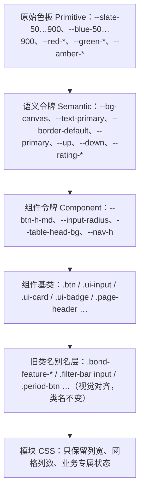

# 前端 UI 设计系统重构研发方案（2026-11-21）

> 文档职责：全站 UI 设计系统与凭据误填防护专项方案。
> 截至日期及范围：2026-11-21；只读核对基线 `966417e5`（分支 `wb/alert-dryrun-preview`，`0.9.4.9`）。核对了 `public/shared/style.css`（1941 行）、`public/css/*.css` 15 个模块样式、7 个 HTML 入口（`index/login/admin/ipo-report/share-knowledge/bond-revision-motive.html` 与 `server/views/share.html`）、`server/middleware/security.js` 的 CSP，以及 14 个断言了样式事实的前端测试文件。
> 当前结论（2026-11-24 核对发布记录）：已随 0.9.4.12 上线，生产验收范围见[发布回执](生产部署历史记录_截至20261124.md#release-09412)。下文保留原设计决策和验收合同。
> 权威与证据：[AGENTS.md](../AGENTS.md)「全局表格样式」「前端移动端适配开发标准」；[技术架构 5.0—5.3](技术架构.md)；[知识库公共规则](知识库公共规则.md)第 3—6 节。
> 设计决策：2026-11-21 用户已逐项确认第 12 节 D1—D5（科技蓝 `#2563eb`、自托管 Inter、表格保持 12px、后台侧栏改浅色、图表配色本期一并改），正文已按决策收敛，不再保留备选。
> 未验证/未完成：浏览器多尺寸视觉、真机（iOS Safari / Android Chrome / 微信内置）、对比度实测。 按原验收项确认。

---

<details>
<summary>2026-11-21 设计时的原始状态</summary>

> 当前结论：**待评审 / 待实施**。用户 2026-11-21 已确认：参考方向采用「方案 A：理杏仁 / Koyfin 的金融数据排版 + Linear / Stripe Dashboard 的现代组件质感」；顶栏采用**清爽浅色/白底现代顶栏**；各模块深色渐变大横幅改为**现代清爽型页头**。本文只做设计与研发合同，未修改任何代码、样式或测试。
> 未验证/未完成：全部实施、浏览器多尺寸视觉、真机（iOS Safari / Android Chrome / 微信内置）、对比度实测。

</details>

## 0. 本方案明确不做的事

1. **不改业务**：不改任何接口、数据库、任务、金融公式、权限、取数链路；不改 DOM `id`、`data-act` / `data-*` 事件钩子和 Presenter/View 职责。**唯一例外**是第 5.6.1 节“防浏览器凭据误填”：需要给少量密码/密钥输入加独立 `<form>` 包裹、调整 `autocomplete` 与输入类型，属于表单语义修正，不改字段 `id`、取值读取方式和提交接口。
2. **不引入前端框架或构建链**：继续原生 HTML/CSS/JS；不引入 Tailwind、React、CSS-in-JS；不新增外部 CDN（CSP `default-src 'self'` 也不允许）。
3. **不改中国市场涨跌习惯**：保持红涨绿跌，只调校色值使其更耐看并满足对比度。
4. **不改布局契约**：一级顶栏 52px、二级导航 46px（`BusinessTable` 浮动表头 `top=98px` 依赖该值）、正文 760px / 导航 900px 双分界、触控 ≥44px、手机输入 16px 全部保留。
5. **不做暗色模式**：令牌结构为后续暗色模式预留，但本次不交付。
6. **不重命名现有业务类名**：`.bond-feature-*`、`.biz-table*`、`.bond-sub-tab` 等被 AGENTS 规则、测试和业务 JS 引用的类名全部保留，只改其视觉实现（见第 7 节“旧类名映射”）。

---

## 1. 现状诊断（为什么“老气”）

| 问题 | 代码证据 | 影响 |
|---|---|---|
| 高饱和老派靛蓝 + 警报黄 | `.nav` 渐变 `#1a237e→#283593`、激活条 `#ffc107`；`.admin-sidebar` 同色；`html{background:#1a237e}` | 典型 2016 年政企后台观感 |
| 深色渐变大横幅泛滥且不统一 | `.bond-feature-hero` `#3f51b5→#5c6bc0`；`.stock-analysis-hero` `#182848→#294f78`；`.ks-hero` `#111858→#3949ab`；另有 `.bond-safety-hero/.bond-list-hero/.bond-cycle-hero/.bond-val-hero/.bond-redemption-hero` 各写一份 | 压抑、占首屏、7 处重复 |
| 荧光原色标签 | `bond-safety.css` `.bond-rating-medium{#ffff00}`、`.bond-rating-safe{#00b050}`；三表矩阵米黄表头 `#f2f0e8` + 青色斜体数值 `#008e88` | Excel 2007 质感 |
| 主色碎片化 | 主色同时存在 `#1a237e/#3f51b5/#1a73e8/#2563eb/#294f78/#1769aa/#245f9e/#5c6bc0` | 不同页面像不同产品 |
| 灰阶/边框碎片化 | 背景 `#f0f2f5/#fafbfc/#f5f6f8/#f6f7fb`；边框 `#eee/#e0e0e0/#d8dee8/#dfe3eb/#e7ebf0/#e2e8f0/#dbe3ef` | 层级混乱 |
| 同一控件多套实现 | 输入框在 `.form-group/.filter-bar/.bond-feature-toolbar/.bond-list-toolbar/.bond-safety-toolbar/.bond-val-toolbar/.bond-redemption-toolbar/.stock-analysis-toolbar/.fb-toolbar/.an-field/.ss-settings-grid/.mv-controls/.acct-add/.u-input*` 各写一份；分段按钮有 `.period-btn/.trade-mode-btn/.stock-analysis-view-tabs/.ks-admin-tabs/.bond-val-range-tabs/.mv-control-group/.analytics-tab/.an-mode/.fee-tab` 9 套 | 交互手感不一致，改一处漏多处 |
| 控件缺少现代微交互 | `.btn` 仅 `transition:.2s` 改背景；无 `:focus-visible`、无按压反馈、无加载态；输入框无 hover 态 | 质感单薄 |
| 登录页残留 | `login.html` 内仍有一份完整内联 `<style>`（与 `css/login.css` 重复），且样式引用写死 `?v=0.8.2.1`、`mobile-ui.js?v=1` | 版本缓存失效、两份事实 |
| 普通输入框被浏览器当成账号密码框 | 主站 `index.html` 个人中心常驻 `pwd-old/pwd-new/pwd-new2` 三个密码框且**不在任何 `<form>` 内**，紧挨其前的是昵称框 `profile-nickname`；后台 `admin.js` 的大模型表单（`model-url` 后接 `model-key` 密码框）、外部 API 主备（`set-tushare-primary/backup` 密码框）、重置用户密码弹窗均用 `type="password"`；`autofill-guard.js` 只能写 `autocomplete="off"`，而 Chrome 的密码管理器不遵守 `off` | 昵称、API 地址、邀请码等普通框被自动填入已保存账号，提交反馈等普通操作弹出“保存密码”（反馈 #25 即同源问题，当时以 `new-password` 单点绕过） |

---

## 2. 设计方向与参考

| 参考 | 学什么 | 不学什么 |
|---|---|---|
| 理杏仁 lixinger.com、Koyfin | 高密度财务表、估值分位图的克制配色；数字等宽对齐；表头浅灰、正文深墨 | 其品牌色与具体布局 |
| Linear | 浅色顶栏 + 细边框层级；按钮/输入的 hover、focus 环、按压反馈；克制的动效 | 深色主题、大量渐变 |
| Stripe Dashboard | 卡片 1px 边框 + 轻阴影、页头“标题 + 描述 + 右侧操作”结构、柔和语义徽标 | 紫色品牌 |

设计关键词：**浅、净、准、稳**——浅色画布、干净层级、数字精准对齐、交互稳定一致。

---

## 3. 架构：设计令牌三层结构



规则：
- **唯一事实源**：令牌只定义在 `public/shared/style.css` 文件顶部的 `:root` 区块（不新增 `tokens.css`，避免改 7 个 HTML 入口和缓存版本）。
- 业务/模块 CSS **禁止再写十六进制颜色**，只能用 `var(--*)`；例外（图表系列色、证券类型色）也必须走令牌。
- 旧变量 `--bond-feature-*` 保留并重新指向新令牌，保证存量引用不断。

---

## 4. 设计令牌规格

### 4.1 颜色

**中性色（Slate）**

| 令牌 | 值 | 用途 |
|---|---|---|
| `--bg-canvas` | `#f6f7f9` | 页面画布（替代 `#f0f2f5`），`html` 背景同此值 |
| `--bg-surface` | `#ffffff` | 卡片、表格、顶栏、弹窗 |
| `--bg-subtle` | `#f8fafc` | 表头、只读输入、次级区块 |
| `--bg-muted` | `#f1f5f9` | hover 底、分段控件轨道、骨架屏 |
| `--border-subtle` | `#eef1f5` | 表格行分隔 |
| `--border-default` | `#e5e7eb` | 卡片、分区边框 |
| `--border-strong` | `#cbd5e1` | 输入框、次按钮边框 |
| `--border-hover` | `#94a3b8` | 输入框 hover |
| `--text-primary` | `#0f172a` | 标题、表格数值 |
| `--text-secondary` | `#475569` | 正文说明、表头 |
| `--text-muted` | `#64748b` | 辅助信息（白底 4.8:1，满足 AA，延续 U-11 口径） |
| `--text-placeholder` | `#94a3b8` | 仅占位符/禁用 |
| `--text-inverse` | `#ffffff` | 深底文字 |

**品牌主色（科技蓝 Blue，D1 已确认）**：

| 令牌 | 值 |
|---|---|
| `--primary` | `#2563eb` |
| `--primary-hover` | `#1d4ed8` |
| `--primary-active` | `#1e40af` |
| `--primary-soft` | `#eff6ff` |
| `--primary-soft-border` | `#bfdbfe` |
| `--primary-text` | `#1d4ed8`（浅底上的主色文字） |
| `--focus-ring` | `0 0 0 3px rgba(37,99,235,.28)` |
| `--link` | `#2563eb`；hover `#1d4ed8` + 下划线 |

**金融语义色（保持红涨绿跌）**

| 令牌 | 值 | 说明 |
|---|---|---|
| `--up` | `#dc2626` | 上涨/正收益（白底 4.8:1） |
| `--up-soft` | `#fef2f2` | 上涨徽标底 |
| `--down` | `#15803d` | 下跌/负收益（白底 5.0:1；原 `#137333` 同级） |
| `--down-soft` | `#f0fdf4` | 下跌徽标底 |
| `--flat` | `var(--text-secondary)` | 零/平 |
| `--danger` / `--danger-soft` | `#dc2626` / `#fef2f2` | 危险操作、错误 |
| `--success` / `--success-soft` | `#15803d` / `#f0fdf4` | 成功状态 |
| `--warning` / `--warning-soft` | `#b45309` / `#fffbeb` | 警告、过期数据 |
| `--info` / `--info-soft` | `#0369a1` / `#f0f9ff` | 提示 |

**可转债安全评级四档（替换荧光色）**

| 档位 | 底色 | 文字 | 边框 |
|---|---|---|---|
| 安全 `--rating-safe-*` | `#dcfce7` | `#166534` | `#bbf7d0` |
| 低风险 `--rating-low-*` | `#ecfccb` | `#3f6212` | `#d9f99d` |
| 中风险 `--rating-medium-*` | `#fef9c3` | `#854d0e` | `#fde68a` |
| 高风险 `--rating-high-*` | `#ffedd5` | `#9a3412` | `#fed7aa` |
| 无评级 | `--bg-muted` | `--text-muted` | `--border-default` |

到期感叹号（反馈 #30 约定“与风险评级同色”）改为：半年 = `--rating-high-text`（`#ea580c` 系），一年 = `--rating-medium-accent` `#ca8a04`（白底可辨，原 `#ffff00` 在白底几乎不可见）；强赎/临近退市保持 `--up` 红。

**证券类型色（`.tag-a/.tag-hk/…`、持仓代码色）**：保留原有色相区分（沪红、深橙、北绿、港紫、美靛、转债青、基金深红），统一改为 `soft 底 + 700 号文字` 两级令牌 `--sec-{a|sz|bj|hk|us|cb|bond|fund}-{bg|fg}`。

**图表系列色**：`--chart-1 #2563eb`、`--chart-2 #f59e0b`、`--chart-3 #10b981`、`--chart-4 #8b5cf6`、`--chart-5 #ef4444`、`--chart-6 #06b6d4`；网格 `#eef2f6`；坐标轴文字 `--text-muted`；分位带 20/50/80 用 `#16a34a / #64748b / #dc2626` 虚线。

### 4.2 字体与字号

- `--font-sans`：`"Inter", -apple-system, BlinkMacSystemFont, "Segoe UI", "PingFang SC", "Hiragino Sans GB", "Microsoft YaHei", Roboto, sans-serif`
  - **自托管 Inter（D2 已确认）**：CSP 只允许同源字体（`font-src` 回落 `default-src 'self'`），因此把 OFL 授权的 Inter 可变字体拉丁子集 woff2（约 100KB，仅覆盖数字、英文与常用符号）放入 `public/vendor/fonts/inter/`，同目录附 `OFL.txt` 许可；在 `shared/style.css` 顶部用 `@font-face` 声明（`font-weight:100 900`、`font-display:swap`、`unicode-range` 限定拉丁区），中文自动回落系统字体；资源 URL 带固定版本参数，不引用任何外部 CDN。加载失败时按字体栈回落，视觉不破版。
- `--font-mono`：`ui-monospace, "SF Mono", "JetBrains Mono", Menlo, Consolas, monospace`（证券代码、哈希、日期可选）。
- **所有数字**（金额、涨跌幅、代码、日期、表格数值）强制 `font-variant-numeric: tabular-nums`。

| 令牌 | 字号/行高/字重 | 用途 |
|---|---|---|
| `--fs-xs` | 12 / 1.5 | 辅助说明、徽标、表格（D3 已确认：表格正文与表头保持 5.1 规范 12px） |
| `--fs-sm` | 13 / 1.5 | 控件、工具栏、表单标签 |
| `--fs-base` | 14 / 1.6 | 正文（body 由当前隐式 13–14 统一为 14） |
| `--fs-md` | 16 / 1.5 | 卡片标题、区块标题 |
| `--fs-lg` | 18 / 1.4 | 二级标题 |
| `--fs-xl` | 22 / 1.35 · 600 | 页头标题 |
| `--fs-2xl` | 24 / 1.25 · 600 | 统计卡数值 |
| `--fs-3xl` | 30 / 1.2 · 700 | 首页/登录主标题 |

手机（≤760px）：正文 15px、输入 16px（沿用 5.3）、表格 13px。

### 4.3 间距、圆角、阴影、动效、层级

- 间距：4px 栅格 `--sp-1…--sp-10` = 4/8/12/16/20/24/32/40/48/64。
- 圆角：`--r-xs 4`（徽标内角）、`--r-sm 6`（小按钮/菜单项）、`--r-md 8`（按钮、输入框，取代 7px）、`--r-lg 12`（卡片、表格容器，取代 10px）、`--r-xl 16`（弹窗、登录卡）、`--r-full 999px`。
- 阴影：
  - `--shadow-xs: 0 1px 2px rgba(15,23,42,.05)`（卡片静态）
  - `--shadow-sm: 0 1px 3px rgba(15,23,42,.08), 0 1px 2px rgba(15,23,42,.04)`（hover、浮动表头）
  - `--shadow-md: 0 6px 16px -4px rgba(15,23,42,.10)`（下拉、提示）
  - `--shadow-lg: 0 16px 40px -12px rgba(15,23,42,.22)`（弹窗、抽屉）
- 动效：`--dur-fast 120ms`、`--dur-base 180ms`、`--dur-slow 240ms`；缓动 `--ease: cubic-bezier(.2,0,0,1)`；`@media (prefers-reduced-motion: reduce)` 下全部降为 0。
- 层级（沿用现值，只命名）：`--z-subnav 90`、`--z-floating-head 89`、`--z-floating-scroll 95`、`--z-nav 100`、`--z-dropdown 1000`、`--z-modal 1000`、`--z-mobile-nav 1100`、`--z-dialog 3000`、`--z-toast 9999`、`--z-tooltip 10001`。

---

## 5. 组件规格（全站统一）

### 5.1 一级顶栏 `.nav`（浅色）

- 背景 `rgba(255,255,255,.86)` + `backdrop-filter: saturate(180%) blur(12px)`；不支持时回退纯白 `@supports not (backdrop-filter…)`；底部 `1px solid var(--border-default)`；无投影，滚动后（可选）加 `--shadow-xs`。高度 52px、`position:fixed` 不变。
- 品牌：`--text-primary` 16px/700，左侧可加 20px 站点图标（`/favicon.svg`）。
- 一级栏目 `.main-tab`：`--text-secondary` 14px/500；hover `--text-primary` + `--bg-muted` 圆角 6px 胶囊底；active `--primary-text` 600 + 底部 2px `--primary` 指示条（替换黄条）。
- 铃铛 `.nav-bell`：图标 `--text-secondary`，hover `--bg-muted`；徽标 `--danger` 底、外描 2px 白环（替换深蓝环）。
- 头像 `.nav-avatar`：1px `--border-default` 描边；游客登录按钮改为 `.btn-secondary .btn-sm` 视觉。
- 套利红点 `.arb-nav-badge` 保持红底白字。
- `html` 画布改 `--bg-canvas`（反馈 #21 的“回弹露色与顶栏同色”在浅色顶栏下自然成立，测试断言需同步改为“与顶栏背景一致的浅色”）。
- 手机（≤900px）：`.mobile-nav-toggle` 改为 `.btn-secondary` 视觉（36→44px）；折叠面板沿用现有白卡，激活项 `--primary-soft` 底 + `--primary-text`。

### 5.2 二级导航（`.holdings-header/.sub-nav .nav-tab`、`.bond-header/.bond-sub-tab`、`.mv-header/.mv-sub-tab`、反馈/通知子导航）

三套实现收敛为一套规则，类名不变：
- 容器：白底、46px、`border-bottom 1px var(--border-default)`，去掉现有 `0 2px 6px` 投影，吸顶时加 `--shadow-xs`。
- 标签：13px `--text-secondary`；hover `--text-primary` + `--bg-subtle`；active `--primary-text` 600 + 贴底 2px `--primary`（`::after`，`left/right:12px`）。
- `market-volatility.css` 里另一套 `.mv-sub-tab`（`#2563eb` 下划线）删除，统一走共享规则。
- 持仓账户工具（刷新、账户下拉、+、⚙）：统一为 `.btn-secondary.btn-sm` 与 `.ui-select` 视觉。

### 5.3 现代清爽型页头 `.page-header`

替换 7 处深色渐变横幅。**保留原类名**（`.bond-feature-hero`、`.bond-safety-hero`、`.bond-list-hero`、`.bond-cycle-hero`、`.bond-val-hero`、`.bond-redemption-hero`、`.stock-analysis-hero`、`.ks-hero`、`.mv-hero`、`.motive-hero`）作为 `.page-header` 的别名，DOM 不改。

```text
┌──────────────────────────────────────────────────────────────┐
│ 可转债 · 安全性                       ● 数据截至 2026-11-20 15:00 │  ← eyebrow 12px primary / 右侧状态
│ 可转债安全性                                       [导出][刷新] │  ← 标题 22px/600 + 主次操作
│ 基于偿债能力、条款与评级的四档安全性评估……                         │  ← 描述 13px muted，最多 2 行
└──────────────────────────────────────────────────────────────┘
```

- 默认（卡片型）：`--bg-surface` + `1px var(--border-default)` + `--r-lg` + `--shadow-xs`，内边距 20px 24px；顶部可选 3px 渐隐色带 `linear-gradient(90deg, var(--primary), transparent 60%)`（克制的品牌点缀，替代整块渐变）。
- 标题 `h1/h2`：`--fs-xl` `--text-primary`；描述 `p`：13px `--text-muted`、`max-width:720px`。
- 更新时间（`.bond-feature-updated`、`.bond-*-updated`、`#stock-analysis-updated`）：12px `--text-muted`，前置 6px 圆点（新鲜=`--success`，过期=`--warning`，由现有 `stale` 类控制；无状态时灰点）。
- 主操作按钮（如投资笔记 `.ks-primary-action`「写文章」）：改为 `.btn-primary`。
- 页头内原 `.bond-val-beta-warning` 等深底专用浅色字全部改为 `.ui-badge--danger`。
- 手机：纵向堆叠，内边距 16px，更新时间换行左对齐（沿用现有断点逻辑）。
- 首页 `.home-latest-feature-head`、`.home-section-head` 的“英文小眉标 + 大标题”保留结构，眉标统一 `--primary-text` 12px/600 字距 .08em。

### 5.4 卡片 `.ui-card` 与统计卡

- `.ui-card`：`--bg-surface`、`1px var(--border-default)`、`--r-lg`、`--shadow-xs`、内边距 16/20px。可点击卡加 `.is-interactive`：hover `--border-strong` + `--shadow-sm` + `translateY(-1px)`，`:focus-visible` 焦点环。
- 统计卡（`.stat-card`、`.bond-feature-stat`、`.bond-safety-stat`、`.bond-redemption-stat`、`.bond-cycle-card`、`.bond-val-card`、`.mv-cards>div`、`.pc-ov-item`、`.stock-analysis-metric`、`.motive-summary-card`）：标签 12px `--text-muted`；数值 `--fs-2xl` 600 `--text-primary` tabular；辅助行 12px；涨跌值套 `--up/--down`；可选右上角 32px 图标位（`.stat-icon` 改为 `--primary-soft` 圆角方块 + 主色图标）。
- 区块卡（`.chart-box`、`.table-wrap`、`.stock-analysis-section`、`.home-detail-card`、`.home-cycle-card`、`.fb-panel`、`.an-card`、`.ops-card`、`.profile-card`、`.ss-detail`、`.analytics-card`、`.motive-section`、`.nt-*` 面板）：统一 `.ui-card` 视觉，区块标题 `--fs-md` 600。

### 5.5 按钮 `.btn`

| 尺寸 | 高 | 字号 | 内边距 | 圆角 |
|---|---|---|---|---|
| `.btn-xs` | 24 | 12 | 0 8 | 6 |
| `.btn-sm` | 28 | 12 | 0 10 | 6 |
| `.btn`（默认） | 32 | 13 | 0 14 | 8 |
| `.btn-lg` | 40 | 14 | 0 18 | 8 |
| 工具栏上下文（`.filter-bar`、各 `*-toolbar`） | 36 | 13 | 0 14 | 8 |
| 手机 ≤760px / 触屏 | ≥44 | 不变 | — | — |

| 变体 | 默认 | hover | active | 说明 |
|---|---|---|---|---|
| `.btn-primary` | `--primary` 底白字 + `--shadow-xs` + 顶部 1px `rgba(255,255,255,.12)` 内高光 | `--primary-hover` | `--primary-active` | 每个区域最多一个 |
| `.btn-secondary`（新增，`.btn-outline`/`.btn-ghost`/`.btn-refresh` 别名） | 白底、`1px var(--border-strong)`、`--text-primary` | `--bg-subtle` + `--border-hover` | `--bg-muted` | 默认次操作 |
| `.btn-ghost` | 透明、`--text-secondary` | `--bg-muted` | `--border-default` 底 | 表格行内、工具图标 |
| `.btn-soft`（新增，`.btn-info` 别名） | `--primary-soft` 底、`--primary-text` | `#dbeafe` | `#bfdbfe` | 低强调主色 |
| `.btn-danger` | `--danger` 底白字 | `#b91c1c` | `#991b1b` | 删除等不可逆操作 |
| `.btn-danger-soft`（新增） | `--danger-soft` 底红字 | `#fee2e2` | — | 撤回、排除 |
| `.btn-success`、`.btn-warning` | 保留，改用令牌色 | — | — | 兼容存量 |
| `.btn-link`（新增） | 无底，`--link` | 下划线 | — | 文字链接按钮（如“查看全部 →”） |

统一交互状态：
- 过渡：`background-color, border-color, color, box-shadow, transform` `var(--dur-fast) var(--ease)`。
- 按压：`:active:not(:disabled){ transform: scale(.98); }`。
- 焦点：`:focus-visible{ outline:none; box-shadow: var(--focus-ring); }`（鼠标点击不出现，键盘可见）。
- 禁用：`:disabled, [aria-disabled=true]`：`opacity:.5; cursor:not-allowed; box-shadow:none; transform:none`。
- 加载：`.is-loading` / `[aria-busy=true]`：文字透明，`::after` 14px 旋转圆环（主按钮白色、其他主色），禁止点击；**纯 CSS**，不新增 JS，现有 JS 只需切换类即可（未接入的按钮保持原行为）。
- 图标按钮 `.btn-icon`：正方形（32/36/44），内部 SVG 16px。
- 按钮组 `.btn-group`：相邻按钮合并边框，首尾圆角（替代 `.u-trade-mode-first/last`）。
- 文案规范沿用 5.1：中文全称、不用全大写英文；去掉按钮文字里的 emoji 前缀（📥🛠＋ 改为可选 SVG 图标或纯文字），实施时逐处清点。

### 5.6 输入类控件

统一基类 `.ui-input`、`.ui-select`、`.ui-textarea`，同时以**上下文别名选择器**覆盖存量容器内的原生控件（不改 HTML/JS 模板）：
`.form-group, .filter-bar, .bond-feature-toolbar, .bond-list-toolbar, .bond-safety-toolbar, .bond-val-toolbar, .bond-redemption-toolbar, .stock-analysis-toolbar, .stock-analysis-statements-controls, .fb-toolbar, .fb-field, .an-field, .an-search, .an-filter-grid, .ss-settings-grid, .ss-source-panel, .mv-controls, .mvc-boundary-controls, .acct-add, .acct-broker, .date-range-control, .pc-controls, .cash-income-form`，以及 `.u-input/.u-input-lg/.u-input-sm/.u-input-xs/.u-input-plainbox/.project-dialog-input/.pc-select`。各模块 CSS 中的重复声明删除。

| 状态 | 规格 |
|---|---|
| 默认 | 高 36px（表单大号 `.ui-input--lg` 40px，登录页 44px）；`--bg-surface`；`1px var(--border-strong)`；`--r-md`；13px `--text-primary`；左右内边距 10–12px |
| 占位符 | `--text-placeholder` |
| hover | 边框 `--border-hover` |
| focus | 边框 `--primary` + `--focus-ring`；去掉浏览器默认黑框（`outline:none`） |
| 错误 | `.is-invalid` / `[aria-invalid=true]`：边框 `--danger` + 红色 3px 环；下方 `.ui-field-error` 12px 红字 |
| 只读 | `[readonly]` / `.u-input-plain`：`--bg-subtle`、边框 `--border-default`、文字 `--text-secondary` |
| 禁用 | `--bg-muted`、`--text-placeholder`、`cursor:not-allowed` |
| 手机 | ≥44px、16px（沿用现有 `!important` 全局规则） |

- **下拉框**：`appearance:none` + 右侧 16px 下箭头。CSP `img-src` 已含 `data:`，可用 SVG Data URI 作 `background-image`；为可维护性推荐同源文件 `public/shared/icons/chevron-down.svg`。多选 `select[multiple]` 保持原生。
- **搜索框**：`input[type=search]` 左侧 16px 放大镜（同上方式）、左内边距 32px；清除按钮沿用浏览器原生。
- **日期框**：外观同输入框，`width:150px`（工具栏）；保留 `ui-actions.js` 的 `showPicker()` 与“鼠标按下不选中分段”行为，不改 JS。
- **复选框/单选框**：16px，`accent-color: var(--primary)`；工具栏内 14px 规格保留（5.2 规则）；可选 `.ui-check` 自定义外观作为后续增强，本期不强制。
- **开关**：新增 `.ui-switch`（36×20 轨道、16px 圆钮、checked 为主色），**不得用 `.switch` 命名**（登录页已占用为“切换登录/注册”文字）。用于通知提醒设置等布尔项时须保持原 `<input type=checkbox>` 与事件不变。
- **字段结构**：`.form-group label` 12px/500 `--text-secondary`、间距 6px；必填星号 `--danger`；帮助文字 `.ui-field-hint` 12px muted；`.auto-hint` 改为 `.ui-badge--neutral` 小号。
- **联想下拉**（`.security-analysis-suggestions`）：改用 5.10 菜单规格，激活项 `--primary-soft`。

### 5.6.1 防浏览器凭据误填（输入框不再被当成账号密码框）

**根因（2026-11-21 源码核对）**

1. **无表单的密码框会把整页变成“登录表单”**：Chrome/Edge 会把页面里不属于任何 `<form>` 的输入框归为同一个“无表单组”。主站 `index.html` 个人中心的 `pwd-old`（`current-password`）、`pwd-new`、`pwd-new2` 常驻在 DOM 中（即使页面隐藏），它们与昵称、交易代码、搜索框、反馈面板等全站普通输入框同属一组，浏览器据此判定“这里是登录/改密表单”，于是把紧挨密码框前的文本框（如 `profile-nickname`）当用户名框自动填入，并在提交反馈等普通操作时弹“保存密码”。反馈 #25 的 `new-password` 只是对两个反馈字段的单点绕过。
2. **`autocomplete="off"` 对密码管理器无效**：Chrome 明确忽略 `off` 对凭据填充的约束，`autofill-guard.js` 统一写 `off` 拦不住。
3. **非登录场景滥用 `type="password"`**：后台 API Key、Tushare Token、管理员重置他人密码都用密码框。浏览器把其前面的文本框（`model-url`、同一 DOM 中的邀请码 `set-register-code` 等）当用户名框填入，并提示把 Token 存成“本站密码”。
4. **守门器覆盖过度**：`autofill-guard.js` 把未登记的输入统一改成 `off`，连验证码框原有的 `one-time-code` 也被覆盖，手机端失去短信验证码自动填充。

**统一规范：每个输入框必须声明自己属于以下四类之一**

| 类别 | 标记 | 典型字段 | 规则 |
|---|---|---|---|
| A 账号凭据 | `data-autofill="credential"`（兼容旧 `data-autofill-credential`） | 登录账号/密码、注册、找回密码、个人中心修改密码 | **必须放在独立的 `<form data-autofill-scope="credential">` 内**，表单内只放该流程字段；使用标准令牌：`username`、`current-password`、`new-password`、`email`、`one-time-code`。改密表单内放一个隐藏的 `<input type="text" autocomplete="username" hidden>` 写当前账号，让浏览器把新密码关联到正确账号。提交统一 `preventDefault`（沿用 `ui-actions.js` 的 `data-prevent` 机制，不新增内联事件），由原有 JS 发请求；Enter 键可提交。 |
| B 机密配置 | `data-autofill="secret"`，组件 `.ui-secret-input` | API Key、Tushare Token、管理员为他人重置的密码 | **不得使用 `type="password"`**。改为 `type="text"` + `autocomplete="off"` + `spellcheck="false"` + `autocapitalize="off"`，用 CSS `-webkit-text-security: disc` 显示圆点；右侧 `.btn-ghost.btn-icon` “显示/隐藏”切换（切换类名，不写内联样式）。浏览器不支持 `-webkit-text-security` 时（启动时 `CSS.supports` 检测），回退为 `type="password"` 但必须包在独立的 `<form autocomplete="off" data-autofill-scope="secret">` 中，且同表单内不放任何文本框。永不提示“保存密码”。 |
| C 一次性/业务验证 | `data-autofill="otp"` | 邮箱验证码、注册验证码 | `autocomplete="one-time-code"`、`inputmode="numeric"`；守门器不得覆盖。 |
| D 普通业务输入（默认） | 无需标记 | 昵称、搜索、证券代码、金额、日期、备注、反馈标题/页面地址、选股排除代码等 | 不在任何凭据表单内；`autocomplete="off"`（搜索框已有 `data-autofill-ignore` 继续兼容）；守门器补 `data-lpignore`、`data-1p-ignore`、`data-bwignore`，屏蔽第三方密码管理器插件。 |

**页面级硬约束**

- **主站、后台等业务页面的“无表单组”里禁止出现任何 `type="password"` 输入**（含隐藏页面、懒加载模板、弹窗模板）。这是根治条件：只要无表单组里没有密码框，浏览器就不会把普通文本框当用户名框。
- 凭据表单只在需要时出现：个人中心“修改密码”保留折叠卡片，但三个密码框移入 `<form id="pwd-form" data-autofill-scope="credential">`；后台重置他人密码弹窗、API Key、Token 改用 B 类组件。
- 反馈 #25 的 `new-password` 特例在 A/B 两项落地并经浏览器复验后移除（`FEEDBACK_FIELD_IDS` 白名单下线），反馈字段回到 D 类默认值；复验未通过前保留，不提前删。
- `login.html` 当前无 `<form>`：登录、注册、找回密码三个流程各自包进独立 `<form data-autofill-scope="credential">`（同页切换显示，不改字段 `id` 与 `doLogin` 等现有处理函数），使浏览器能正确保存/填充真正的账号密码，同时不污染其他字段。邀请码 `code` 归 D 类。

**`autofill-guard.js` 改造（规则改为“分类处理”，仍零内联、仍用 MutationObserver 覆盖动态节点）**

| 类别 | 守门器动作 |
|---|---|
| A | 只校验：若不在 `[data-autofill-scope="credential"]` 表单内，开发环境 `console.warn` 并由第 10.2 节静态门禁拦截；不改写其 `autocomplete` |
| B | 写入 `autocomplete="off"`、`spellcheck="false"`、`data-lpignore/1p-ignore/bwignore`；若检测到 `type="password"` 且不在 `secret` 表单内，按回退规则处理并告警 |
| C | 保留 `one-time-code`，只补插件屏蔽属性 |
| D | 现有行为：`autocomplete="off"` + 插件屏蔽属性 |

**视觉规格**

- `.ui-secret-input`：与 `.ui-input` 同尺寸；右侧预留 36px 放显示/隐藏按钮；等宽字体 `--font-mono`；已配置时占位符显示服务端返回的掩码（现有逻辑不变），旁边 `.ui-badge--success` 小号“已配置”。
- 密码可见切换（登录页 `.pwd-toggle`、个人中心）统一为 `.btn-ghost.btn-icon`，眼睛图标 SVG，`aria-pressed` 表示状态，`aria-label` “显示密码/隐藏密码”，手机 44px 点击区。

**当前需整改的位置（实施时以全文检索 `type="password"`、`type='password'` 复核，不以本表为全集）**

| 位置 | 现状 | 整改为 |
|---|---|---|
| `public/index.html` 个人中心 `pwd-old/pwd-new/pwd-new2` | 无表单、常驻 DOM | A 类独立表单 + 隐藏 `username` 字段 |
| `public/login.html` 登录/注册/找回 | 无表单 | 三个 A 类独立表单 |
| `public/js/admin.js` `admin-pwd-input`（重置他人密码） | `type="password"` + `new-password` | B 类（管理员不应把他人密码存进自己的密码管理器） |
| `public/js/admin.js` `set-tushare-primary/backup` | `type="password"` | B 类 |
| `public/js/admin.js` `model-key` | `type="password"`，前面紧挨 `model-url` | B 类 |
| `public/login.html` `reset-email-code`、`email-code` | `one-time-code` 被守门器改为 `off` | C 类，保留 `one-time-code` |
| `bond-revision-motive.html`、`server/views/share.html` | 未加载 `autofill-guard.js` | 统一加载，保持全站行为一致 |

### 5.7 分段控件、标签页、筛选片

- **分段控件 `.ui-segmented`**：轨道 `--bg-muted` + `--r-md` + 内边距 3px；选项 28–32px、13px `--text-secondary`；选中项白底 `--shadow-xs` `--text-primary` 600（Linear 风格，替代“实心深蓝块”）。映射：`.period-btn` 组、`.stock-analysis-view-tabs`、`.stock-analysis-valuation-tabs`、`.ks-admin-tabs`、`.trade-mode-btn` 组、`.bond-val-range-tabs`、`.mv-control-group button`、`.analytics-tabs`、`.an-mode-group`、`.fee-tabs`、`.date-range-presets`。手机选项 ≥44px、可横滑。
- **筛选片 `.ui-chip`**：28px 胶囊、白底、`1px var(--border-default)`；选中 `--primary-soft` 底 + `--primary-soft-border` 边 + `--primary-text`；计数用 `--text-muted` tabular。映射 `.fb-chip`、`.bond-val-count`、`.an-chip`（可删除型带 × 按钮）。

### 5.8 业务数据表格（`.biz-table*`，5.1 规范的视觉升级）

结构、吸顶、横滑、身份列、中点换行等行为**全部不变**；只换视觉：

| 部位 | 现值 | 新值 |
|---|---|---|
| 容器 | 白底 10px 圆角 | `.ui-card` 规格（12px、1px 边框、`--shadow-xs`） |
| 表头 | `#fafbfc` 底、`#555` 12px 700 | `--bg-subtle` 底、`--text-secondary` 12px **600**、底边 `1px var(--border-default)`，高度仍 ≥52px |
| 表头 hover / 已排序 | `#edf5ff` / `#e4effa` + `#2a67a0` 内底线 | `--bg-muted` / `--primary-soft` + `--primary-text` + 2px `--primary` 内底线；排序箭头 `--primary` |
| 单元格 | `#303a49`、底线 `#eef1f5` | `--text-primary`、底线 `--border-subtle`；数值列 tabular |
| 行 hover | `#f7fbff` | `#f5f8ff`（`--primary-soft` 再浅半档） |
| 涨/跌 | `#d93025` / `#137333` 600 | `--up` / `--down` 600 |
| 空/缺数据 | `#9aa0a6` | `--text-placeholder`，缺值显示“—” |
| 浮动表头 | `0 2px 6px` 阴影 | `--shadow-sm`，底边 1px |
| 底部同步滚动条 | 18px 白底 | 12px、轨道 `--bg-subtle`、滑块 `--border-strong`（webkit/firefox 两套） |
| 身份列吸附阴影 | `2px 0 3px rgba(0,0,0,.06)` | `1px 0 0 var(--border-default), 4px 0 8px -4px rgba(15,23,42,.12)` |

- 证券代码/名称链接统一 `--link` 500；持仓按市场着色的代码保留 `--sec-*-fg`。
- **财务三表矩阵**（`.stock-analysis-statements-table`）：米黄表头 `#f2f0e8` → `--bg-subtle`；首行 `#edf1f5` → `--bg-muted`；首列底 `#faf9f4` → `--bg-surface`；数值青色斜体 `#008e88 italic` → `--text-primary` 正体（负数 `--up` 红不变——注意此处“负数红”是现有业务展示口径，**保持不变**）；分区标题（资产/利润/现金流）改为 `--success-soft / --warning-soft / --info-soft` 底 + 对应 700 文字；紧凑行高 30/34px、层级缩进 0/12/24/36px 全部保持。
- 键值详情表 `.biz-table--detail`、`.bond-analysis-table`：th 用 `--bg-subtle` + `--text-secondary`，边框 `--border-default`。
- 仓位对比两组列底色（`.pc-col-mine` 蓝 / `.pc-col-bench` 橙）保留语义，改为 `--primary-soft` 系与 `--warning-soft` 系令牌（反馈 #28 要求“颜色只在共享样式定义”继续满足）。
- IPO 日报 Markdown 表头深色 `#2c3e50` → `--bg-subtle` 浅表头。

### 5.9 徽标与状态标签 `.ui-badge`

- 规格：高 20px（`--sm` 18px），内边距 0 8px，12px/500，`--r-full`，`soft 底 + 700 文字 + 1px tone-200 边框`。
- 色调：`--neutral / --primary / --success / --warning / --danger / --info / --purple`。
- 映射（只换视觉，类名保留）：`.tag*`、`.fb-badge--*`、`.ss-tag-*`、`.ss-gate-*`、`.bond-indicator-*`、`.bond-rating-*`（用 4.1 评级令牌）、`.bond-redemption-status-*`、`.bond-revision-status-*`、`.an-status--*`、`.val-alert-*`、`.nt-item-type`、`.home-event-tag`、`.stock-analysis-tag`、`.acct-badge`、`.bond-val-new-listing`、`.bond-analysis-delisted`、`.bond-analysis-current-coupon`。
- 估值评价文字色（`.val-low/.val-low2/.val-mid/.val-high1/.val-high/.val-risk`）改为语义令牌，保持六档顺序与红绿含义。

### 5.10 浮层：弹窗、抽屉、菜单、提示、Toast

- **弹窗 `.modal`**：`--r-xl`、`--shadow-lg`、内边距 24px；遮罩 `rgba(15,23,42,.45)` + `blur(4px)`；进入动画 `opacity 0→1 + scale(.98→1)` 160ms（减少动效时关闭）。标题 16px/600；关闭按钮改为 `.btn-ghost.btn-icon`；`.modal-actions` 右对齐、主按钮在最右。手机底部/全屏规则与 `mobile-ui.js` 焦点、滚动锁定行为保持不变。分享面板、反馈悬浮面板沿用自身布局，仅换令牌。
- **下拉/菜单**（`.dropdown-menu`、`.nav-user-menu`、`.ss-row-menu`、`.security-analysis-suggestions`）：`--bg-surface`、`1px var(--border-default)`、`--r-lg`、`--shadow-md`、内边距 4px；菜单项 36px（手机 44px）、`--r-sm`、hover `--bg-muted`、危险项 `--danger`、分隔线 `--border-subtle`。
- **提示 Tooltip**：`.app-tooltip`、`.home-cycle-tooltip`、`.mv-tooltip`、`.stock-analysis-chart-tooltip`、`.stock-analysis-valuation-tip`、`.analysis-help-tooltip`、`.ss-metric-tooltip`、`.bond-val-chart-tooltip` 七套统一：`rgba(15,23,42,.94)`、白字 12px/1.6、`--r-md`、`--shadow-md`、内边距 8px 10px；不依赖悬停的点按/聚焦行为不改。
- **Toast `.toast`**：`--text-primary`（slate-900）底、`--r-lg`、`--shadow-lg`、13px；新增 `.toast--success/--error` 左侧 3px 色条（现有 `showToast` 未传类型时保持默认样式，不改 JS 也成立）。

### 5.11 反馈状态：空态、加载、错误、提示条、分页

- **空态 `.ui-empty`**（映射 `.empty-state`、`.bond-safety-empty`、`.bond-list-empty`、`.bond-val-empty`、`.bond-redemption-empty`、`.bond-revision-empty`、`.ss-empty`、`.fb-empty`、`.nt-empty`、`.mv-empty`、`.home-loading/.home-overview-empty`、`.analytics-empty`、`.pc-page-empty`、`.stock-analysis-message`）：居中、40px 线性图标位（可选）、14px `--text-secondary` 主句 + 12px muted 说明、可放一个 `.btn-secondary` 操作。
- **骨架屏**：`.loading` shimmer 改 `--bg-muted → #e9edf2` 渐变；`.spinner` 改主色细圆环 2px。
- **错误**：`.fb-error`、`.nt-error`、`.bond-safety-error`、`.stock-analysis-message-error` → `.ui-alert--danger`。
- **提示条 `.ui-alert`**：`soft 底 + 1px tone-200 边 + 左侧 16px 图标位 + 13px 700 文字`；映射 `.bond-list-stale`、`.bond-cycle-stale`、`.bond-val-stale`、`.stock-analysis-note`、`.confirm-box`、`.u-tip-box`、`.bond-cycle-note`、`.ss-run-note`、`.mv-draft`、`.u-nav-backup-info`。
- **分页 `.ui-pagination`**：映射 `.earnings-pager`、`.fb-pager`、`.ss-list-foot`、`.an-pager-info`；页码按钮 `.btn-secondary.btn-sm`，当前页 `--primary-soft`。

### 5.12 后台壳（admin.html）

- 侧栏改浅色（D4 已确认，与前台浅色顶栏一致）：白底、右边框 `--border-default`；品牌区 16px/700 `--text-primary`；菜单项 36px、13px `--text-secondary`、`--r-sm`、左右外边距 8px；hover `--bg-muted`；active `--primary-soft` 底 + `--primary-text` 600 + 左侧 2px `--primary` 条（替换黄色左边框）。
- 顶栏 56px 白底底边框；内容区画布 `--bg-canvas`。
- 760px 下“只显示首字”的折叠逻辑、900px 下移入手机菜单的逻辑保留。
- `.analytics-*`、`.ops-*`、`.an-*`、`.holiday-*`、`.job-help*` 统一使用卡片、分段、输入、徽标规格；`.holiday-on` 橙色改 `--warning-soft` + `--warning`。

### 5.13 独立页面

| 页面 | 改造要点 |
|---|---|
| `login.html` + `css/login.css` | 删除 `login.html` 内联 `<style>` 整块，改为引用 `css/login.css?v=__APP_VERSION__`，并把 `shared/style.css?v=0.8.2.1`、`mobile-ui.js?v=1`、`telemetry.js?v=0.8.0.12` 改为 `__APP_VERSION__`（`versionedStaticPages` 已登记 `/login.html`）；**同步更新 `security.js` 的 `CSP_INLINE_STYLE_HASHES`（移除该块哈希）**。背景由深蓝渐变改为 `--bg-canvas` + 右上角极淡主色径向光晕；登录卡 `--r-xl`、`1px` 边框、`--shadow-lg`、宽 400px；输入 44px；主按钮 `.btn-primary.btn-lg` 满宽；错误条 `.ui-alert--danger`；去掉标题 emoji。顶部复用浅色 `.nav`。 |
| `ipo-report.html` | 顶栏与主站浅色顶栏同规格；`.md` 正文卡 `.ui-card`；`h1` 下划线由红色 3px 改为 2px `--primary`，`h2` 由深红 `#c0392b` 改 `--text-primary` + 左侧 3px 主色竖条；表格浅表头；保留阅读宽度 880px。 |
| `share-knowledge.html` | 顶部返回条改为浅色迷你顶栏；文章排版沿用 `knowledge.css`（见下）。 |
| `server/views/share.html` + `css/share.css` | `.share-topbar` 白底细边；`.stock-analysis-hero` 随 5.3 变浅色后，**删除 `share.css` 中“标题必须白色”的 `#fff` 规则**；分享面板 iOS 风格保留，仅替换中性色令牌（预览图标底 `#182848` → `--text-primary`）。 |
| `bond-revision-motive.html` | `.motive-hero` 走 5.3 页头；`h1` 32px 白字改为 `--fs-2xl` `--text-primary`；`.motive-core` 黄卡改 `.ui-alert--warning` 视觉。 |

### 5.14 模块页面映射摘要

| 模块 | 文件 | 主要变化 |
|---|---|---|
| 首页 | `style.css` 首页段 | 文章卡、周期卡、风险分布、能力概览改 `.ui-card`；眉标/标题/“查看全部 →”统一 `.btn-link`；周期图线色接图表令牌 |
| 持仓 | `style.css`、`core-tables.js` 无需改 | 统计卡、图表卡、表格、账户工具、交易录入表单、OCR 上传区（虚线框 `--border-strong`、hover `--primary-soft`） |
| 投资笔记 | `knowledge.css` | `.ks-hero` → 页头；分类树激活 `--primary-soft`；文章卡 `.ui-card.is-interactive`；正文排版：标题层级、引用块（左 3px 主色 + `--bg-subtle`）、代码块（`--bg-subtle` + mono）、表格浅表头；Vditor 相关 CSP 兜底规则（`body > svg[version="1.1"]`、`#vditorExportIframe`、`.ks-editor-card #ks-editor.vditor`）**原样保留** |
| 打新 | `index.html` 内 IPO 区、`style.css` | 日历分组、历史表、市场分段控件 |
| 可转债 5 子页 | `bond-safety/bond-cycle/bond-valuation/bond-redemption/bond-revision.css` | 删除各自的 hero/stat/toolbar 重复实现，全部走共享规格；评级、状态徽标改令牌 |
| 证券分析 | `stock-analysis.css` | 页头、视图分段、指标卡、三表矩阵、估值图、事件列表 |
| 股票筛选 | `stock-selection.css` | 已复用 `.bond-feature-*`，随共享层自动升级；`.ss-gate-*`、`.ss-tag-*` 改徽标令牌；行操作 `<details>` 菜单改 5.10 菜单规格 |
| 市场周期 | `market-volatility.css`（单行压缩） | 展开为可读格式；删除重复的子导航实现；`.mv-cards` → 统计卡；控件组 → 分段控件；边界线仍红色虚线 |
| 套利 | `style.css` 套利段 | 表格与链接色、“新”标记 `--up`、阅读按钮 `.btn-secondary` |
| 反馈 | `feedback.css` | 筛选片、卡片列表、徽标、时间线（节点 `--primary`）、悬浮提交面板、左侧悬浮入口（白底细边 + 阴影） |
| 通知 | `style.css` 通知段 | 未读左条 `--primary`、红点 `--danger` |
| 个人中心 | `style.css` 个人中心段 | `.profile-card` 卡片规格、`.ui-switch` 可选 |

---

## 6. 无障碍与响应式硬性要求

- 正文/表格文字与背景对比 ≥4.5:1；大字（≥18px 或 14px 粗体）≥3:1；`--text-placeholder` 只用于占位与禁用。
- 所有可交互元素有 `:focus-visible` 环；不得 `outline:none` 而不给替代。
- 颜色不是唯一信息载体：涨跌保留正负号，评级保留文字，状态徽标保留文字。
- 断点只用 760px / 900px（加 `pointer:coarse` 的触屏 44px 规则）；禁止新增 720px 等例外（`audit-20261021-p2` 已断言）。
- `prefers-reduced-motion` 全局降级。
- 不新增任何内联 `style=` 或内联事件（`audit-20261021-u15` 断言）；动态样式继续走类名 / `data-style`。

---

## 7. 旧类名映射与收口策略

**原则：先“别名升级”，后“去重删除”，DOM 与 JS 不动。**

| 新组件 | 保留并对齐视觉的旧类名（节选） | 去重动作 |
|---|---|---|
| `.page-header` | `.bond-feature-hero`、`.bond-safety-hero`、`.bond-list-hero`、`.bond-cycle-hero`、`.bond-val-hero`、`.bond-redemption-hero`、`.stock-analysis-hero`、`.ks-hero`、`.mv-hero`、`.motive-hero` | 删除 5 个模块 CSS 中的渐变/白字重复声明 |
| `.ui-card` 统计卡 | `.stat-card`、`.bond-feature-stat`、`.bond-safety-stat`、`.bond-redemption-stat`、`.bond-cycle-card`、`.bond-val-card`、`.mv-cards>div` | 同上 |
| 工具栏 | `.bond-feature-toolbar`、`.bond-list-toolbar`、`.bond-safety-toolbar`、`.bond-val-toolbar`、`.bond-redemption-toolbar`、`.stock-analysis-toolbar`、`.fb-toolbar`、`.filter-bar` | 输入/按钮尺寸只在共享层定义一次 |
| `.btn-secondary` | `.btn-outline`、`.btn-ghost`（旧语义）、`.btn-refresh`、`.btn-back`、`.top-login-link`、`.mobile-menu-close`、`.mobile-disclosure` | — |
| `.ui-segmented` | 见 5.7 | 删除 9 套私有实现 |
| `.ui-badge` | 见 5.9 | 色值改令牌 |
| 二级导航 | `.sub-nav .nav-tab`、`.bond-sub-tab`、`.mv-sub-tab` | `.bond-header/.bond-sub-*` 规则从 `bond-cycle.css` 迁入 `shared/style.css`（它已被反馈、通知、选股等非可转债页复用） |

`.u-*` 工具类：颜色类（`.u-c-*`、`.u-bg-*`）改为引用令牌；间距/字号类保留。

---

## 8. 文件影响范围

| 文件 | 动作 |
|---|---|
| `public/shared/style.css` | 顶部新增令牌区块；重写基础组件；迁入二级导航；保留全部既有选择器（测试与业务依赖） |
| `public/css/bond-safety.css`、`bond-cycle.css`、`bond-valuation.css`、`bond-redemption.css`、`bond-revision.css`、`bond-revision-motive.css` | 删除重复的 hero/stat/toolbar；色值改令牌 |
| `public/css/stock-analysis.css`、`stock-selection.css`、`market-volatility.css`、`knowledge.css`、`feedback.css`、`admin-notifications.css`、`share.css`、`ipo-report.css`、`login.css` | 色值改令牌、去重、按 5.13/5.14 调整 |
| `public/login.html` | 删除内联 `<style>`、改引用 `css/login.css`、版本参数改 `__APP_VERSION__`、去 emoji；登录/注册/找回各自包进 A 类 `<form data-autofill-scope="credential">` |
| `public/index.html` | 个人中心修改密码移入 A 类 `<form data-autofill-scope="credential">` 并补隐藏 `username` 字段；其余业务结构不变 |
| `public/bond-revision-motive.html`、`server/views/share.html` | 统一加载 `shared/autofill-guard.js?v=__APP_VERSION__` |
| `public/shared/autofill-guard.js` | 升级为 A/B/C/D 四类分级处理（见 5.6.1），保留 `one-time-code`、保留兼容 `data-autofill-ignore` |
| `public/js/admin.js` | `admin-pwd-input`、`set-tushare-primary/backup`、`model-key` 改用 B 类 `.ui-secret-input`（非 `type="password"`） |
| `server/middleware/security.js` | 仅从 `CSP_INLINE_STYLE_HASHES` 移除登录页内联样式块哈希（如该哈希专属登录页）；**不放宽任何 CSP 指令** |
| `public/shared/icons/*.svg`（新增，可选） | 下拉箭头、搜索图标 |
| `public/vendor/fonts/inter/`（新增，D2 已确认） | Inter 可变字体拉丁子集 woff2 + `OFL.txt` 许可文件；`vendor-dependency.test.js` 一并登记该静态资源 |
| 图表 JS（`home-dashboard.js`、`stock-analysis-chart.js`、`stock-analysis-valuation-chart.js`、`bond-cycle.js`、`bond-valuation.js`、`market-volatility.js`、`core-returns.js`、`core-account.js` 等，实施时以全文检索十六进制色值清点为准） | **D5 已确认本期纳入**：新增共享读取函数（放 `public/shared/` 现有基础设施文件或新文件 `chart-theme.js`，须在 `governance/architecture-boundaries.json` 登记角色与全局符号），按名称读取 `--chart-*`、`--up`、`--down`、网格/坐标轴令牌，并设置 `Chart.defaults.font.family` 为 `--font-sans`；只替换颜色与字体常量，不改数据、刻度计算、交互与取数，图表重绘不得新增请求 |
| 其他 HTML 入口（`admin.html`、`ipo-report.html`、`share-knowledge.html`） | 不改（类名不变） |

---

## 9. 实施分阶段（单任务卡、单工作树、整体交付）

遵循[知识库公共规则第 6 节](知识库公共规则.md#6-多agent写入与整合顺序)：开工前从最新 `master` 建独立 worktree，登记任务卡与独占文件（上表全部 CSS + `login.html`），各阶段在同一分支内完成，**整体验收后一次交由发布对话整合**，不分批上线。

| 阶段 | 内容 | 阶段出口 |
|---|---|---|
| S1 令牌与基础层 | `:root` 令牌；`html/body` 画布与字体；`--bond-feature-*` 重新指向新令牌；`prefers-reduced-motion` | 页面整体色调切换，无布局变化；静态测试按第 10 节更新后全绿 |
| S2 外壳 | 浅色一级顶栏、二级导航统一、页头组件、后台侧栏、登录页（含内联样式移除与 CSP 哈希同步） | 52/46px 不变；`mobile-frontend` 浮动表头 `98px` 断言通过 |
| S3 基础组件 | 按钮全变体与状态、输入类控件、**防浏览器凭据误填（5.6.1：A/B/C/D 分类、`autofill-guard.js`、`.ui-secret-input`、独立表单）**、分段控件、筛选片、卡片、徽标、浮层、空态/提示/分页 | 各上下文控件同高同圆角；键盘焦点可见；主站与后台无表单组 `type="password"` 为 0 |
| S4 数据展示 | `.biz-table` 视觉、三表矩阵、评级/状态徽标、证券类型色、图表配色（Chart.js 与自绘 SVG 图表全部接入令牌） | 表格吸顶/横滑/身份列行为回归通过；图表重绘不取数（`mobile-frontend` 图表用例） |
| S5 模块收口 | 15 个模块 CSS 去重、色值令牌化；`market-volatility.css` 展开为可读格式 | 新增“硬编码颜色”门禁达标（第 10.2 节） |
| S6 验收与文档 | 全部回归、浏览器多尺寸（需用户放开低性能模式）、文档同步 | 第 10、11 节全部满足 |

---

## 10. 测试影响与验收

### 10.1 现有断言中必须随方案同步修改的项（已逐条核对源码）

| 测试文件 | 现断言 | 修改为 |
|---|---|---|
| `knowledge-feedback-20261106.test.js` #21 | `html { background: #1a237e` | `html` 背景等于浅色顶栏/画布令牌（断言 `var(--bg-canvas)` 或与 `.nav` 背景同源），仍保留“必须显式设置根画布色”的意图 |
| `holdings-cross-market-refresh.test.js` | 精确字符串 `.sub-nav .btn-refresh { background: #fff; color: #1a237e; border: 1px solid #c7cedb; }` | 断言 `.sub-nav .btn-refresh` 使用白底 + 可辨认文字令牌 + 边框令牌；保留“移动端 ≥44px” |
| `convertible-bond-list.test.js` | `.bond-list-up { color:#d93025;`、`.bond-list-down { color:#137333;` | 断言引用 `var(--up)` / `var(--down)`，并断言令牌值仍为红/绿色系（红涨绿跌意图不变） |
| `feedback-online-20261110.test.js` #30 | 到期感叹号 `color` 必须等于 `.bond-rating-high/medium` 的 `background` 十六进制 | 改为“到期感叹号与高/中风险评级引用同一组评级令牌”；强赎红仍为 `--up` |
| `frontend-navigation.test.js` | `.filter-bar` 输入 `border-radius: 7px`、下拉 `height: 36px`、日期框 `150px` | 圆角改为 `var(--r-md)`（8px）；36px 与 150px 保持 |
| `feedback-ui-20261031.test.js` #7 | `.filter-bar .btn` `min-height:36px`/`font-size:13px`；`.btn-refresh` `font-size:13px`；手机 `44px` 精确正则 | 数值保持；若改写为令牌需同步正则，意图（同栏同高同字号）不变 |
| `audit-20261021-p2.test.js` U-11 | 禁止 `#888/#999/#aaa/#777/#8c8c8c` 字色 | 保持；新令牌不使用这些值 |
| `share.css` 相关 | 无测试，但需删除 hero 白字规则 | 新增断言：分享页标题不使用白字 |
| `autofill-guard.test.js` | 校验 `isPasswordField(el) ? 'new-password' : 'off'` 与 5 个 HTML 入口 | 保持不变量（非凭据不用 `new-password`，`admin-pwd-input/model-key` 不入白名单），适配 A/B/C/D 分类规则并扩到全部 7 个 HTML 入口 |
| `knowledge-feedback-20261108.test.js` #25 | 断言 `FEEDBACK_FIELD_IDS` 白名单使用 `new-password` | 浏览器复验确认提交反馈不弹“保存密码”后，下线 `FEEDBACK_FIELD_IDS` 并同步更新该测试；复验前保留 |

其余（`mobile-frontend`、`stock-selection-frontend`、`stock-analysis-frontend`、`arbitrage-frontend`、`home-market-cycle`、`site-analytics`、`knowledge-editor-csp-20261108`、`knowledge-feedback-20261108`、`audit-20261021-u15`、`convertible-bond-revision-frontend`）断言的是类名存在、结构、行为或 CSP 兜底规则，按本方案“类名不变、行为不变”原则应保持通过，实施时逐个回归确认。

### 10.2 新增门禁（`server/test/ui-design-system.test.js`）

1. 令牌完整：`style.css` 顶部存在第 4 节全部语义令牌。
2. 禁用旧色：全部 `public/css/*.css` 与 `style.css` 不再出现 `#1a237e`、`#283593`、`#ffc107`、`#ffff00`、`#00b050`、`#92d050`、`#f2f0e8`、`#008e88` 等第 1 节列出的老色值。
3. 硬编码颜色棘轮：统计模块 CSS 令牌区块之外的十六进制颜色数量，登记基线，只允许下降（S5 目标为 0，图表/证券类型令牌除外）。
4. 别名在位：第 7 节旧类名在共享层均有对应规则。
5. 高度契约：`.nav` 52px、二级导航 46px、`.biz-table th` ≥52px。
6. 焦点可见：`.btn`、输入基类存在 `:focus-visible` 规则。
7. 减少动效：存在 `prefers-reduced-motion` 降级。
8. 登录页无内联 `<style>`，且样式与脚本版本参数均为 `__APP_VERSION__`。
9. 字体：`public/vendor/fonts/inter/` 下 woff2 与 `OFL.txt` 均存在，`@font-face` 只引用同源路径并带 `font-display:swap`。
10. 图表配色：第 8 节所列图表 JS 不再出现写死的十六进制系列色（统一通过共享读取函数取 `--chart-*` 等令牌），并断言重绘路径不调用 `fetch`。
11. 防浏览器凭据误填：主站与后台 JS/HTML 无表单组中不得存在 `type="password"`；A 类凭据输入必须位于 `[data-autofill-scope="credential"]` 表单内；C 类验证码保留 `autocomplete="one-time-code"` 且不被守门器覆盖。

### 10.3 验证分级（按[测试分级与全量结果复用](生产部署流程.md#测试分级与全量结果复用)）

- 开发阶段：上述专项 + 关联前端回归（`frontend-navigation`、`mobile-frontend`、`audit-20261021-u15`、`audit-20261021-p2`、`feedback-ui-20261031`、`knowledge-feedback-20261106/20261108`、`knowledge-editor-csp-20261108`、`feedback-online-20261110`、`convertible-bond-list`、`convertible-bond-revision-frontend`、`stock-analysis-frontend`、`stock-selection-frontend`、`arbitrage-frontend`、`home-market-cycle`、`holdings-cross-market-refresh`、`site-analytics`、`feedback-static`、`share-page-load`、`vendor-dependency`、`marketCycleMetrics`、`autofill-guard`、`convertible-bond-redemption`）与 `npm.cmd run check:knowledge`、`npm.cmd run check:data-architecture -- --static`（新增图表主题共享文件需登记角色）。
- 共享样式属于全站影响面，**交接前建议提前跑一次 `npm.cmd run test:all`**；发布时仍按最终代码树全量。
- 视觉验收（需用户明确允许打开浏览器）：主站 13 个一级页 + 各子页、登录、后台 11 个视图、IPO 日报、两个分享页、下修动机页，在 320/360/390/430/768/1024/1440px 与 760/900px 分界截图；键盘 Tab 遍历焦点；对比度抽查。iOS Safari、Android Chrome、微信内置浏览器未实测前不得宣称真机通过。

---

## 11. 架构对齐与文档同步

- **架构对齐结论**：纯表现层改造。数据源 → 数据库 → 服务 → 接口 → Presenter 全链路无影响；View 层仅样式与登录页 `<head>` 引用变化；不新增取数、不改权限、不改调度。
- 实施交付时须同步：
  - `docs/技术架构.md` 第 5.1 节（表格视觉值）、第 5.2 节（由“可转债功能页统一视觉规范”扩展为“全站设计系统与令牌”，指向本方案）、第 5.3 节（触控/输入规则不变，补焦点、减少动效与 `autofill-guard.js` 分类防误填机制）、顶部“最后核对日期”。
  - `AGENTS.md`「全局表格样式」第 61 行关于 `.bond-feature-*` 的表述：类名仍须复用，补充“颜色、圆角、阴影只能引用 `shared/style.css` 设计令牌”。
  - `governance/knowledge-map.json` 的 `frontend` 路由：`read` 增加本方案，`readSections` 增加技术架构 5.2 新标题；并在 `docs/知识索引.md`「前端与移动端」行补一句入口。
  - 发版时 `CHANGELOG.md` / `public/changelog.json` 由发布对话统一定版。

---

## 12. 设计决策（2026-11-21 用户已确认）

| 编号 | 问题 | 决策 | 落点 |
|---|---|---|---|
| D1 | 品牌主色 | **科技蓝 `#2563eb`** | 4.1 主色令牌 |
| D2 | 是否自托管 Inter 字体 | **自托管**（`public/vendor/fonts/inter/`，同源加载） | 4.2、第 8 节 |
| D3 | 表格正文字号 | **保持 12px**（手机 13px 不变） | 4.2、5.8 |
| D4 | 后台侧栏 | **改为浅色** | 5.12 |
| D5 | 图表 JS 写死的配色 | **本期一并改**（只换颜色/字体常量，不改数据与交互） | 4.1 图表系列色、第 8 节、S4 |

---

## 13. 风险与回退

| 风险 | 缓解 |
|---|---|
| 别名选择器覆盖不全，个别页面残留旧色 | 第 10.2 节旧色门禁 + 硬编码棘轮 + 多尺寸截图清单 |
| `backdrop-filter` 在旧浏览器/微信内核不支持 | `@supports` 回退纯白底 |
| 字号/内边距微调导致宽表变宽、浮动表头错位 | 表格字号与 th 高度不变；`mobile-frontend` 几何断言回归；三表矩阵紧凑尺寸保持 |
| 第三方样式（Vditor `index.css`）与新令牌冲突 | 仅在 `.ks-*` 作用域内覆盖；CSP 兜底规则原样保留 |
| 登录页内联样式移除后 CSP 哈希不同步导致样式失效 | S2 同步更新 `CSP_INLINE_STYLE_HASHES` 并以 `auth-security`/登录页测试回归 |
| 打印（导出 PDF、IPO 日报）背景色变化 | 保留现有打印路径，S6 抽查导出 PDF |
| 回退 | 改动集中于 CSS 与登录页头部，单次提交可整体 `git revert`；不涉及数据库与数据，无需数据回滚 |
