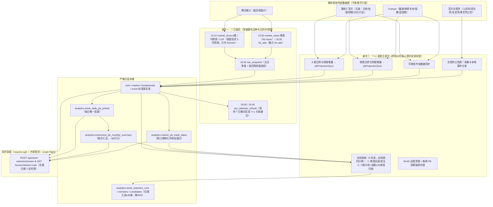

# 后台定时任务收敛与实时选股重构研发方案

> 文档职责：专项方案（三轮审计修订版·待评审）
> 截至日期及范围：2026-11-27；基于 `portfolio-server` 仓库现行代码（`server/db/jobs.js`、`server/db/migrations.js`、`server/db/migrations/era17SelectionAuditIndexes.js`、`server/services/jobDefinitions.js`、`server/services/jobScheduleSlots.js`、`server/services/jobRunners.js`、`server/jobs/stockAnalysisRefresh.js`、`server/services/stockSelectionService.js`、`server/repositories/stockSelectionRepository.js`、`server/routes/stockSelection.js`、`server/services/storageRetention.js`、`public/js/admin.js`）及 `docs/全站架构与工程治理深度重构研发方案_20261120.md` 域 A.A3 逐行核对修订
> 当前结论：**阶段 0 已完成生产只读计量与本地脚本；阶段 1（含 1A PB 投影、1B 实时选股/轻量归档、1C 前端与后台展示）代码与本地回归已就绪，待整合验收；阶段 2/3/4 已于 2026-11-28 完成本地实现与本地回归（凌晨波次 7 个收敛任务 + `JOB_CONVERGENCE_ENABLED` 回退开关、`LEGACY_JOB_ALIAS_MAP` 旧告警映射、`pruneSelectionCandidates` 清理脚本），尚未生产部署或授权生产清理**。本方案在 **PB 投影** 上承接 `2026-11-20` 方案域 A.A3（`analytics` 两步按月投影 + 6 类全量触发面 + 定期对账），在 **选股落库与交互** 上改为「`requireLogin` 实时筛选 + 仅落入选 ≤30 席的轻量归档（含个人轻量落库，零断链且存储降 99%）」，在 **任务收敛与凌晨波次** 上坚持「阶段 0 只读计量 + 01:00 探针实测上游就绪时刻 → 阶段 1/2 零改任务码降噪前移 → 阶段 3 受控收敛并映射历史告警」
> 权威与证据：[AGENTS.md](../AGENTS.md)、[docs/技术架构.md](技术架构.md)（第 7/8/9/10/11/12 节）、[docs/全站架构与工程治理深度重构研发方案_20261120.md](全站架构与工程治理深度重构研发方案_20261120.md)（域 A.A3，已归档作参考）、[docs/投资策略选股中心研发方案_20261102.md](投资策略选股中心研发方案_20261102.md)、[docs/自动任务重复执行与API调用保护整改方案_20260815.md](自动任务重复执行与API调用保护整改方案_20260815.md)、[docs/decisions/ADR-0003-告警与任务治理门禁补强.md](decisions/ADR-0003-告警与任务治理门禁补强.md)、[docs/知识索引.md](知识索引.md)
> 唯一实施边界声明（防多 Agent 冲突）：原《全站架构与工程治理深度重构研发方案（2026-11-20）》已在 `docs/知识索引.md` 标记归档；**凡涉及「PB 每日选源与周期预聚合投影、选股实时化与轻量化落库、后台定时任务收敛与凌晨排程」的后续开发与迁移，一律以本方案为唯一实施依据**，复用 11-20 已定义的 `analytics` 表命名与 `pbProjectionSync` 入口，严禁另建平行 PB 预聚合表或重复迁移。
> 未验证/未完成：阶段 0 的生产只读计量与本地脚本已完成，但**连续 3～5 个交易日 00:30/01:00/02:00/03:00 凌晨探针尚未执行**；阶段 1 代码与本地回归已就绪、待协调 Agent 独立审查与统一发布验收，**生产 1,285 万行 PB 首次回填未执行**（需用户单独书面授权）；阶段 2/3/4 已于 2026-11-28 完成本地实现与本地回归（`job-convergence-stage234`），**尚未在生产启用或授权生产清理**：凌晨真实调度连续绿灯、生产上游就绪时刻、历史告警在真实生产数据上的归档范围、生产存量清理与物理缩表均未验证。浏览器多尺寸/真机、生产并发与性能、统一发布前最终整合树全量仍待验。

---

## 1. 背景与核心问题

### 1.1 后台定时任务碎片化、同名裂变与时序错位
1. **单日槽位过多**：[jobDefinitions.js](file:///D:/Users/%E5%AD%98%E5%9C%A8%E5%B0%8F%E7%AB%99/portfolio-server/server/services/jobDefinitions.js#L42-L93) 当前启用定时任务 **23 个**（另有 3 个已暂停港股 IPO、5 个 `manualOnly`），叠加 `additionalSchedules` 与动态排队，每个交易日实际产生 **30～40+ 个任务槽位**。
2. **“个股分析刷新”一天裂出 10+ 个同名槽位**：
   - `stock_analysis_refresh` 固定有 3 个定时槽（`08:20 core`、`18:40 selection_periodic`、`18:55 stock_analysis_hk`）；
   - `enqueueDueSelectionPeriods()`（[stockAnalysisRefresh.js](file:///D:/Users/%E5%AD%98%E5%9C%A8%E5%B0%8F%E7%AB%99/portfolio-server/server/jobs/stockAnalysisRefresh.js#L498-L537)）按 **2 套策略（默认 V2 + 格雷厄姆）× 2 个市场（CN + HK）× 周期（日/周）** 每日自动追加 4～8 个槽位，`enqueueDueSelectionQuarters()` 在季度末补充排队，加上管理员手工触发的预览/回测/补数槽位，单日可达 10～15 个；
   - 管理后台 [admin.js](file:///D:/Users/%E5%AD%98%E5%9C%A8%E5%B0%8F%E7%AB%99/portfolio-server/public/js/admin.js#L847) 仅渲染 `jobLabel(slot.job_code)`，全部显示为“个股分析刷新”，无法分辨用途。
3. **数据采集按业务竖井拆分与早间堆积**：
   - 交易所公告按业务拆成可转债（一天 3 次）、套利（一天 3 次）、IPO（一天 4 次）；港股能力散落在 5 个任务/排程里；
   - 选股在 T 日 18:40 抢跑，但估值与财务缺口到 T+1 上午 08:00/08:40 才齐，导致晚间必然反复空等；大量采集与计算堆在早上 06:30～08:45，管理员起床后仍在边跑边报未就绪。

### 1.2 选股中心存储膨胀与慢查询全貌
1. **全市场候选每日重复落库，年增 7～10 GB**：
   - [stockSelectionService.js](file:///D:/Users/%E5%AD%98%E5%9C%A8%E5%B0%8F%E7%AB%99/portfolio-server/server/services/stockSelectionService.js#L1215-L1230) 每次运行将全市场评估对象（A 股 ~5,000+ 只、港股 ~688 只）全部写入 `analytics.stock_selection_candidates`（40 列 + 大 JSONB `detail` + 3 个索引，约 2～3 KB/行）；
   - 2 策略 × 双市场常规交易日写入 **~1.14 万行/天**，周五叠加 `weekly` 写入 **~2.28 万行/天**；个人测算 `copyCandidates`（[stockSelectionRepository.js](file:///D:/Users/%E5%AD%98%E5%9C%A8%E5%B0%8F%E7%AB%99/portfolio-server/server/repositories/stockSelectionRepository.js#L2644-L2667)）再整批拷贝 5,000+ 行；
   - 仅自动日/周任务一年即新增 **~335 万行（7～10 GB/年）**，而 [storageRetentionRepository.js](file:///D:/Users/%E5%AD%98%E5%9C%A8%E5%B0%8F%E7%AB%99/portfolio-server/server/repositories/storageRetentionRepository.js#L37-L65) 只清未发布 `partial` 试算，已发布批次永久累积。
2. **慢查询不止 `loadPbWindow` 一处**：
   - `loadPbWindow` 每次硬扫 `market.daily_valuations` 10 年 × 5,700 只 ≈ **1,220 万行**，生产实测单条 SQL **60.7 秒**（物化排序列 + 索引反而慢至 62.4 秒，见 [stockSelectionRepository.js:426-429](file:///D:/Users/%E5%AD%98%E5%9C%A8%E5%B0%8F%E7%AB%99/portfolio-server/server/repositories/stockSelectionRepository.js#L426-L429)），同函数末尾的 `marketDays`（L449-453）又是一次全窗口 `COUNT(DISTINCT)`；
   - 2026-11-27 实测暴露（见工作树未登记迁移文件 `server/db/migrations/era17SelectionAuditIndexes.js`）：`fundamental.financial_reports` 已达 118 万行 / 9.4 GB，`loadAnnualDividends` 缺部分索引时单条耗时 **500～880 秒**；
   - 格雷厄姆策略（`computeGrahamSelection`）不查 10 年 PB 窗口，核心查询仅 `loadUniverse` + `loadGrahamBalanceFacts` + `loadIndustries` + `loadFxRatesToCurrency`。

---

## 2. 架构对齐：已有能力、可复用能力与真正缺口

严格遵守 `AGENTS.md` 方案设计强制门禁（不新增平行数据源、不新增平行事实表、不新建第二调度器、不把已有能力当缺口重复改造）：

| 维度 | 已有 / 可复用能力（直接沿用，不重复建设） | 真正缺口 | 处理原则 |
|---|---|---|---|
| **CN 盘后收盘 Runner** | `market_close:A股/可转债/LOF` **已共用同一 Runner** `runMarketCloseByLabel`（`jobRunners.js:200-202`），且三品种各自 `coverageKind` 与检查点（17:15/17:30/18:15 等）已在 `jobDefinitions.js:58-61` 落地 | 无 Runner 统一缺口；仅需确认保持 15:10 现有时刻与品种作用域 | **保留现状，不做重复合并**，完整守住 `ADR-0003` 品种级告警与就绪唤醒作用域 |
| **港股收盘与汇率策略** | `market_close:港股`（`hk-close`）与 `hk_rate`（`hk-rate`：`closeQuoteTime + 5m`，且港股休市 A 股开市 16:15 独立触发，见 `jobScheduleSlots.js:90-102`） | 无须强合并；强合并会导致汇率提早 5 分钟或丢失港休 A 开触发 | **保持两个独立槽位与既有日历策略** |
| **PB 预聚合投影** | `2026-11-20` 方案域 A.A3 已确立 `analytics` 下两步投影设计及 `pbProjectionSync.reconcilePickedPbDates` 入口 | 尚未落地；且需按月粒度压缩头尾切片（≤2 个月）、补齐 `listed_days` / `market_pb_trade_dates` / 6 类全量触发面与定期对账 | **直接承接 11-20 架构放 `analytics` schema**，绝不在 `market` 下另建平行表 |
| **选股规则与现有读路径** | `stockSelectionRulesV2`、`stockSelectionGrahamRules`、`stockSelectionPortfolio`；5 处读 `candidates` 的现役接口（`listMembers`、`listCandidates`、`listIndustryIdentityCounts`、`findCandidate`、`copyCandidates` / `run_kind='personal'`） | 缺同步实时筛选 API、缺 5 处读路径的轻量化替代、缺分段 SQL 基线、缺并发保护；`era17SelectionAuditIndexes.js` 尚未登记进 `server/db/migrations.js` | 保留 **≤30 席轻量正式归档 + 轻量个人落库**，逐项承接 5 处读路径不断链；合规登记既有分红索引迁移 |
| **调度与告警治理** | `ops.job_schedule_slots`、`public.job_runs`、`jobOrchestrator`、`afterTradingDay`、`previous_trading_day`、`datasetDependencies` | 缺上游实际出数时刻实测证据；阶段 3 若合并任务码需补旧→新告警/槽位映射 | 阶段 0 先以入库时间差 + 01:00 只读探针取证；阶段 1/2 **零改任务码**；阶段 3 带映射表受控收敛 |

---

## 3. 总体目标架构



---

## 4. 核心子设计 A：PB 两步按月投影、实时选股与 5 处读路径轻量化承接

### 4.1 `analytics` 两步按月投影与物化市场估值日（承接 11-20 域 A.A3）
*(注：新迁移按实施合并时 `server/db/migrations.js` 最新顺序顺延编号，不预定编号；现有未跟踪文件 `era17SelectionAuditIndexes.js` 在阶段 1 实施前须先核验归属并正式登记至 `server/db/migrations.js`)*

#### ① 每日唯一选源表 `analytics.stock_daily_pb_picked`
```sql
CREATE TABLE IF NOT EXISTS analytics.stock_daily_pb_picked (
  instrument_id BIGINT NOT NULL REFERENCES core.instruments(instrument_id) ON DELETE CASCADE,
  trade_date DATE NOT NULL,
  market TEXT NOT NULL CHECK (market IN ('CN', 'HK')),
  source_id INTEGER NOT NULL,
  pb NUMERIC,
  picked_at TIMESTAMPTZ NOT NULL DEFAULT now(),
  PRIMARY KEY (instrument_id, trade_date)
);

CREATE INDEX IF NOT EXISTS ix_stock_daily_pb_picked_market_date
  ON analytics.stock_daily_pb_picked (market, trade_date);
```
- **唯一选源口径**：与现行 [stockSelectionRepository.js:430-431](file:///D:/Users/%E5%AD%98%E5%9C%A8%E5%B0%8F%E7%AB%99/portfolio-server/server/repositories/stockSelectionRepository.js#L430-L431) 逐字一致——仅取 `pb IS NOT NULL`，按 `ORDER BY CASE WHEN s.source_code LIKE 'lixinger%' THEN 0 ELSE 1 END, v.source_id ASC` 选每日唯一胜出行；头尾非完整月明细切片统一读本表，彻底杜绝多源重复行翻倍。

#### ② 按月汇总表 `analytics.instrument_pb_monthly_summary`
```sql
CREATE TABLE IF NOT EXISTS analytics.instrument_pb_monthly_summary (
  instrument_id BIGINT NOT NULL REFERENCES core.instruments(instrument_id) ON DELETE CASCADE,
  market TEXT NOT NULL CHECK (market IN ('CN', 'HK')),
  cal_year SMALLINT NOT NULL CHECK (cal_year BETWEEN 1990 AND 2100),
  cal_month SMALLINT NOT NULL CHECK (cal_month BETWEEN 1 AND 12),
  listed_days INTEGER NOT NULL DEFAULT 0,      -- 该完整月内 trade_date > COALESCE(list_date,'1900-01-01') 的开市日数
  exempt_days INTEGER NOT NULL DEFAULT 0,      -- 该完整月内 suspend_type='S' 且当日 pb_picked 无有效 PB 的开市日数
  covered_days INTEGER NOT NULL DEFAULT 0,     -- pb > 0 日数
  observed_days INTEGER NOT NULL DEFAULT 0,    -- pb IS NOT NULL 日数
  non_positive_days INTEGER NOT NULL DEFAULT 0,-- pb <= 0 日数
  invalid_days INTEGER NOT NULL DEFAULT 0,     -- observed - covered - non_positive（含 NaN）
  max_pb NUMERIC,                              -- 含负值最大 PB（V1 兼容）
  max_positive_pb NUMERIC,                     -- pb > 0 最大值（V2）
  min_positive_pb NUMERIC,                     -- pb > 0 最小值（V2）
  min_pb_date DATE,                            -- 最小正 PB 最早出现日（pb ASC, trade_date ASC）
  max_pb_date DATE,                            -- 最大正 PB 最早出现日（pb DESC, trade_date ASC）
  effective_start DATE,                        -- 该月首个 pb > 0 日期
  series_digest BIGINT NOT NULL DEFAULT 0,     -- SUM(('x'||substr(md5(trade_date::text||':'||pb::text),1,8))::bit(32)::bigint)
  series_rows INTEGER NOT NULL DEFAULT 0,      -- 参与 series_digest 的行数
  picked_version BIGINT NOT NULL DEFAULT 1,
  updated_at TIMESTAMPTZ NOT NULL DEFAULT now(),
  PRIMARY KEY (instrument_id, cal_year, cal_month)
);

CREATE INDEX IF NOT EXISTS ix_pb_monthly_summary_market_ym
  ON analytics.instrument_pb_monthly_summary (market, cal_year, cal_month);
```
- **体量**：~5,700 只 × 120 个月（10 年）≈ **68.4 万行**（15 年约 100 万行，表+索引 ~90～120 MB）。
- **整月重算原则**：`exempt_days` 依赖停牌日历与当日 `pb_picked` 的差集，`listed_days` 依赖交易日历与 `list_date`，二者均非静态常数，故**禁止逐股增量加减**，重算必须按受影响的 `(market, cal_year, cal_month)` 整月重算。

#### ③ 原口径物化市场估值日表 `analytics.market_pb_trade_dates`
```sql
CREATE TABLE IF NOT EXISTS analytics.market_pb_trade_dates (
  market TEXT NOT NULL CHECK (market IN ('CN', 'HK')),
  trade_date DATE NOT NULL,
  instrument_count INTEGER NOT NULL DEFAULT 0,
  updated_at TIMESTAMPTZ NOT NULL DEFAULT now(),
  PRIMARY KEY (market, trade_date)
);
```
- **严格对齐原 `marketDays` 口径**：原 [stockSelectionRepository.js:449-453](file:///D:/Users/%E5%AD%98%E5%9C%A8%E5%B0%8F%E7%AB%99/portfolio-server/server/repositories/stockSelectionRepository.js#L449-L453) 统计 `market.daily_valuations` 在窗口内出现过的 `COUNT(DISTINCT trade_date)`，**没有 `v.pb IS NOT NULL` 过滤**。因此本表必须直接基于 `market.daily_valuations`（不滤 `pb IS NOT NULL`）维护，而不是从 `stock_daily_pb_picked` 派生，否则会在全市场仅有 `pb IS NULL` 估值行的日期少算天数；同时本表 10 年仅约 2,500 行，彻底替代 PG 16 不支持的 Index Skip Scan 设想。

### 4.2 `loadPbWindow` 严格三段混合查询（零未来泄漏 + 头尾精确口径）
对任意窗口 `(windowStart, asOfDate]`：
1. **中段（严格完整落在区间内的中间自然月）**：读取 `analytics.instrument_pb_monthly_summary`（直接取 `listed_days`、`exempt_days`、`covered_days`、`observed_days`、`non_positive_days`、`invalid_days`、`max_pb`、`max_positive_pb`、`min_positive_pb`、`min_pb_date`、`max_pb_date`、`effective_start`、`series_digest`、`series_rows`）。
2. **头段（`windowStart` 所在不完整月）与尾段（`asOfDate` 所在不完整月）**：
   - **禁止**偷读当月/当年汇总行（彻底杜绝未来数据泄漏）；
   - `covered_days` / `observed_days` / 极值 / 极值日期 / `series_digest` / `series_rows`：按精确日期边界 `trade_date > windowStart AND trade_date <= asOfDate` 查 `analytics.stock_daily_pb_picked` 现算；
   - **`listed_days` 与 `exempt_days`（头尾精确现算）**：按同一精确边界关联 `market.trade_calendar`（过滤 `c.trade_date > COALESCE(i.list_date,'1900-01-01')`）、`market.stock_suspend_calendar`（`suspend_type='S'`）与 `analytics.stock_daily_pb_picked` 现算，**严禁在头尾非完整月直接加整月 `listed_days/exempt_days`**。
3. **三段合并规则（确保极值日期同值取最早）**：
   - 累加类：`SUM(listed_days)`、`SUM(exempt_days)`、`SUM(covered_days)`、`SUM(observed_days)`、`SUM(non_positive_days)`、`SUM(invalid_days)`、`SUM(series_digest)`、`SUM(series_rows)`；`expected_days = GREATEST(SUM(listed_days) - SUM(exempt_days), 0)`；
   - 极值类：`MAX(max_pb)`、`MAX(max_positive_pb)`、`MIN(min_positive_pb)`、`MIN(effective_start)`；
   - **极值日期合并**：对各段 `(min_positive_pb, min_pb_date)` 按 `ORDER BY min_positive_pb ASC, min_pb_date ASC` 取首条 `min_pb_date`；对 `(max_positive_pb, max_pb_date)` 按 `ORDER BY max_positive_pb DESC, max_pb_date ASC` 取首条 `max_pb_date`，与原 SQL（L408-411）完全一致。
4. **`marketDays` 与 `calendarDays`**：
   - `marketDays`：查 `analytics.market_pb_trade_dates`（`WHERE market=$1 AND trade_date > $2 AND trade_date <= $3`）；
   - `calendarDays`：保持查 `market.trade_calendar`（确认命中 `(exchange, trade_date)` 索引）。

### 4.3 全部 6 类依赖触发面闭环 + 定期对账水位
统一由 `pbProjectionSync` 维护，完整覆盖全部 6 类会导致投影变化的源表变动：

| 序号 | 触发源 | 典型入口 | 重算范围 |
|---|---|---|---|
| 1 | 日常估值入库（`market.daily_valuations`） | A 股 / 港股日终同步 | 受影响 `(instrument_id, trade_date)` 更新 `pb_picked` 与 `market_pb_trade_dates` → 整月重算受影响 `(market, cal_year, cal_month)` |
| 2 | 历史估值补录/修订/删除 | 补漏脚本、数据修复任务 | 同上（删除时同步清理失去源行的 `pb_picked` / `market_pb_trade_dates` 并整月重算） |
| 3 | 交易日历变更（`market.trade_calendar`） | `holiday_sync`、`hk_trade_calendar_sync`、港交所人工修正 | 整月重算受影响 `(market, cal_year, cal_month)`（更新 `listed_days` 与 `exempt_days`） |
| 4 | 停牌日历变更（`market.stock_suspend_calendar`） | 共享停牌采集、停牌补漏 | 整月重算受影响 `(market, cal_year, cal_month)`（更新 `exempt_days`） |
| 5 | 证券主档变更（`core.instruments`） | 上市日 `list_date` 纠错、`asset_class`/`identity_backfill` 修正、`auditInstrumentMerges` 合并 | 重算受影响证券及涉及月份的 `pb_picked` 与月表 |
| 6 | 数据源注册/选源规则变更（`ops.data_sources`） | 新增/变更 `source_code`（当前代码固定按 `source_code LIKE 'lixinger%'` 优先、`source_id ASC` 决胜；若未来升级为可配置权重亦走同一入口） | 标记 `fullRebuild: true`，按月分批全量重算受影响市场 |

- **定期对账防静默腐化**：每周在 `04:00` 运维清理任务末尾执行一次轻量对账——按 `(market)` 抽样 20 只跨 10 年股票 + 最新 1 个完整月全量，与原 `daily_valuations` 原始口径逐字段比对；任一字段 `diff > 0` 即记录告警（归属宿主任务 `storage_retention`）并逐月短事务标脏重算受影响月份；单次最多自动修复 6 个脏月，超过则只写 `pending_full_rebuild` 告警，绝不在凌晨任务里连修几十个月。投影未回填（无月汇总或无 `pb_projection` 水位）时对账直接返回 `projection_not_initialized`，不得自动触发全库 120 个月重建，也不推进对账水位。对账通过后才将水位持久化到 `ops.sync_cursors`。
- **写入触发面补齐**：除 `financialDataArchitecture` 外，可转债正股主同步/历史回补、`repairStockMarketDate`、官方估值回填脚本在事务提交后同样按实际估值日调用 `safeSyncValuations`；`getRecentOpenDays` 写 `market.trade_calendar` 后按涉及月份调用 `safeSyncCalendarChange`；可转债生命周期同步更新股票 `list_date` 后调用 `safeSyncInstrumentChange`。
- **同步边界**：稀疏/跨年估值只按实际传入日期去重后的月份逐月独立短事务重算，禁止 `min(dates)~max(dates)` 生成连续月份；月度游标用 `GREATEST` 单调前进；来源指纹按 `pb_projection:source_fingerprint:<market>` 隔离，CN 全量重建不得掩盖 HK 的数据源变更。
- **1,220 万行首次回填工程规范**：按 `(market, cal_year, cal_month)` 逐月小事务分批回填；每完成 1 个月将游标持久化至 `ops.sync_cursors` 支持断点续跑；批次间短暂让出 I/O（防 WAL 与磁盘突发）；**在生产库执行首次回填前必须经用户单独书面授权**。

### 4.4 「轻量归档（≤30 席）」与 5 处现役读路径逐项承接
为把每日落库从 1.14 万～2.28 万行压至 **≤120 行/天（降 99%）** 且**不砍掉任何现役功能**，逐项明确 5 处依赖 `stock_selection_candidates` 的读取与个人测算去向：

| 现役读取 / 写入路径 | 源码位置 | 改造后承接方案 | 兼容性保证 |
|---|---|---|---|
| **1. `listMembers`（组合 30 席详情）** | `stockSelectionRepository.js:2186` | 正式归档与个人归档仍写入 `portfolio_members`（≤30 行）+**对应的 ≤30 行 `candidates`**，原 `JOIN` 100% 命中 | 零断链，历史业绩对比、shadow 评估、旧 `/runs/:id/portfolio` 全兼容 |
| **2. `listCandidates`（全市场候选明细分页）** | `stockSelectionService.js:1752` | 实时视图直接由 `POST /api/stock-selection/screen` 缓存结果分页返回；访问旧轻量归档批次的“全部候选”页签时，按该批次冻结的 `(market, strategyCode, asOfDate)` 自动路由实时筛选引擎动态还原（或前端提供“查看全市场筛选明细”） | 候选页签不空白，无需在库里存 5,700 行被淘汰记录 |
| **3. `listIndustryIdentityCounts`（一级行业候选分布）** | `stockSelectionService.js:1774` | 实时视图直接内存产出；正式/个人轻量归档时，将该批次约 30 个一级行业的计数摘要写入 `runs.input_manifest.industryIdentityCounts`（< 1 KB JSON），`getPortfolio` 优先读该摘要，缺省才回退查表 | 不扫全市场 `candidates` 即可展示行业受影响数 |
| **4. `findCandidate`（单股未入选原因）** | `stockSelectionService.js:1946` | 新增 `GET /api/stock-selection/screen/stocks/:code?market=&strategyCode=&asOfDate=`（强制 `requireLogin`），优先命中实时缓存，未命中则实时计算单股规则详情返回 | 任意日期、任意未入选股票均可秒查排除原因 |
| **5. `copyCandidates` / 个人测算 `run_kind='personal'`** | `stockSelectionService.js:2433`、`stockSelectionRepository.js:1806` | **保留轻量 `run_kind='personal'` 落库**：仍写 `runs`（含 `settings_revision/settings_hash/selectionOutcomes`）+ `portfolio_members`（≤30 行）+ **仅这 ≤30 席对应的 `candidates`（≤30 行）**，彻底废除拷贝 5,700 行的 `copyCandidates`；`previousPersonalMembers`、`stock_selection_request_bindings` 幂等键 100% 保留 | 个人排除结果可持久化/可历史对比，同时个人测算体积下降 **99%** |

### 4.5 6 类选股模式的精确去留与阶段 1～3 无断档衔接

| 现行模式 | 现行触发方式 | 阶段 1（立即切换，不改旧 `job_code`） | 阶段 3（终态） |
|---|---|---|---|
| `selection_daily` / `selection_weekly` | `enqueueDueSelectionPeriods` 每日自动排 4～8 槽 | 由开关 `STOCK_SELECTION_LEGACY_SLOTS=0` 关闭旧分裂排队；在 `stock_analysis_refresh` 下新增**单一槽位模式 `selection_archive_light`**，串行跑完双市场×策略集合（`DEFAULT_STRATEGY_CODE` + V2 + 格雷厄姆，去重）轻量归档（≤30 席/项），按 `completedKeys` 跳过同目标日已成功子项，本周最后开市日顺带落周指针（**零断档**） | 自然并入 `stock_analytics_refresh` 串行子阶段 |
| `selection_quarterly` | `enqueueDueSelectionQuarters` + 管理员手工 | 停掉每日自动空检排队；保留管理员手工入口，并在季度最后开市日由 `selection_archive_light` 顺带落季指针 | 保留手工入口 + 季末顺带归档 |
| `selection_preview` | 管理员手工试算 | 被同步实时接口 `POST /api/stock-selection/screen` 替代；旧异步入口过渡期保留兼容 | 仅保留实时筛选接口 |
| `selection_backtest` | 管理员手工历史回测 | **保留不变**，直接复用 PB 按月投影提速 | 保留不变 |
| `shadow=true`（影子模式） | `STOCK_SELECTION_SHADOW=1` 控制 | 仍在 `selection_archive_light` 内按环境变量串行轻量归档（≤30 席），不单独裂变槽位 | 同阶段 1 |
| `selection_inputs`（缺口审计） | `stock_analysis_refresh` 审计 / `company_financial_incremental_sync` 补数 | 补数链路保留并前移凌晨；纯审计仍按需调用 | 收敛至 A/H 日终同步任务内 |

### 4.6 实时筛选接口权限、并发防击穿与分段性能门禁
1. **接口鉴权与保护**：
   - `POST /api/stock-selection/screen` 与 `GET /api/stock-selection/screen/stocks/:code` **强制挂载 `requireLogin`**（与现行 [routes/stockSelection.js:143/201/208/270/282](file:///D:/Users/%E5%AD%98%E5%9C%A8%E5%B0%8F%E7%AB%99/portfolio-server/server/routes/stockSelection.js#L143) 保持一致）；
   - **连接池与慢查询防线**：
     - 全局实时冷计算并发信号量（默认 `MAX_CONCURRENT_SCREEN_COMPUTE = 2`，超限短等待后返回 `503` 提示稍后重试），避免不同日期并发请求打满 PG 连接池；
     - 请求级 SQL 保护：`SET LOCAL statement_timeout = '15000'`（15 秒硬中止，杜绝慢查询拖垮 Web 进程）；
     - **Single-Flight + 分区水位 LRU 缓存（5 分钟 TTL，上限 20 键）**：同键并发合并只查 1 次库；缓存键采用 `${market}:${strategyCode}:${asOfDate}:${partitionWatermarkOf(market, asOfDate)}`（按目标市场与目标日所依赖数据分区的水位构造，绝不用“全站最新入库水位”，避免今天凌晨入库无谓失效上个月历史日期缓存）。
2. **分段耗时基线与相对比例验收门禁（不拍脑袋定死绝对秒数）**：
   - 阶段 0 先在**隔离同规模库**完成迁移 213 登记前后的完整分段 P50/P95 基线实测，再锁定阶段 1 绝对阈值；方案阶段采用与 11-20 序 4 一致的**相对基线比例门禁**：

| 分段 | 对应模块 | 阶段 0 基线 (P50/P95) | 阶段 1 相对验收门禁 |
|---|---|---|---|
| 股票池与当日行情 | `loadUniverse` | *阶段 0 隔离库实测填入* | `<= 基线`（如接入 `instrument_market_coverage` 则 `<= 1/3`） |
| 10 年 PB 窗口 | `loadPbWindow` | 现网已有记录 **60.7s**（阶段 0 复测） | **`<= 现网基线的 1/10`** |
| 市场覆盖日数 | `marketDays` / `calendarDays` | *阶段 0 隔离库实测填入* | 读 `market_pb_trade_dates`，**不扫 `daily_valuations`** |
| 年度分红 | `loadAnnualDividends` | 2026-11-27 实测缺索引 **500～880s** | 登记迁移 213 部分索引后实测锁定（降幅 ≥ 100×） |
| 权益 / 年利 / TTM / 行业 | `loadEquityFacts` / `AnnualProfits` / `TtmInputs` / `Industries` | *阶段 0 隔离库实测填入* | 无退化，必要时补索引 |
| **端到端冷查 / 热查** | `POST /api/stock-selection/screen` | *阶段 0 隔离库实测填入* | 冷查 **`<= 现网基线的 1/10`**；命中缓存/个人排除 **`<= 100 ms` (P95)** |

---

## 5. 核心子设计 B：后台定时任务收敛与凌晨波次排程

### 5.1 阶段 0 实测前置（严禁循环论证、严禁主库裸跑慢 SQL）
- **修正表名**：运行记录表为 **`public.job_runs`**（见 [server/db/jobs.js:33](file:///D:/Users/%E5%AD%98%E5%9C%A8%E5%B0%8F%E7%AB%99/portfolio-server/server/db/jobs.js#L33)），计划槽位表为 `ops.job_schedule_slots`。
- **拆清两类独立计量（不拿 08:00 跑完的 `job_runs` 反推 01:00 上游就绪）**：
  1. **任务耗时与重试分布（只读查生产 `public.job_runs` + `ops.job_schedule_slots` 近 30 天）**：只用于测量各任务真实单次耗时 P50/P95/Max 与超时余量，查询强制加 `SET LOCAL statement_timeout = '10s'`；
  2. **上游真实出数时刻测定**：① 统计已落库 `ops.raw_records` / `ops.dataset_partitions` 的入库时间与业务日差集；② 连续 3～5 个交易日由受控只读探针脚本（走 `externalCallGuard`、不写业务表）在 **00:30 / 01:00 / 02:00 / 03:00** 抽样探测理杏仁、Tushare、交易所接口对 T 日数据的实际就绪时刻；
  3. **选股分段 SQL 基准 & 迁移 213 前后对比**：**仅在本地/隔离同规模库执行**，确保阶段 0 对生产库 **100% 零写入、零长耗时查询风险**。

### 5.2 两波次目标时间表（保留品种作用域、拆开长耗时绑定、保住打新日报目标日）

| 波次 | 时间（凌晨项以阶段 0 探针校准） | 任务设计 | 关键边界与防回归设计 |
|---|---|---|---|
| **波次一：T 日盘后** | **15:10** | `market_close:A股` / `可转债` / `LOF/ETF`（**保持现状 3 槽**，已共用 `runMarketCloseByLabel`） | 保持各自 `coverageKind` 检查点（转债 17:15/17:45/18:15、基金 17:30/18:00/18:30）与告警作用域 |
| **波次一：T 日盘后** | **16:30** *(半日 12:30)* | `market_close:港股` | 保持 `hk-close` 策略与 `coverageKind: 'hk_stock'` 检查点 |
| **波次一：T 日盘后** | **16:35** *(港休 A 开 16:15)* | `hk_rate`（**保持独立槽位**） | 保持 `hk-rate` 独立日历策略与外币汇率增量 |
| **波次一：T 日盘后** | **18:30** | `nav_snapshot` | 保持 `nav-snapshot` 与 `repo_daily_rates` 就绪等待门禁 |
| **波次一：T 日盘后** | **18:05 / 19:45** | `ipo_calendar_refresh`（**默认保持 T 日晚间**） | `expectedDataDate` 按 T 日算出 **T+1（下一工作日）**（[jobScheduleSlots.js:116-120](file:///D:/Users/%E5%AD%98%E5%9C%A8%E5%B0%8F%E7%AB%99/portfolio-server/server/services/jobScheduleSlots.js#L116-L120)），留在晚间既满足用户当晚看明日打新，又彻底避免移到 T+1 凌晨导致目标日漂移到 T+2（若确需移至 T+1 凌晨，必须显式以 `afterTradingDay` 锚定 `business_date=T` 并专测周五/节假日） |
| **波次二：T+1 凌晨** | **T_eod**（候选 01:00） | 阶段 3 目标：`cn_stock_eod_sync` | `afterTradingDay(CN)`；A 股日线/复权/估值/停牌/财报/分红/行业/新股行情/指数/波动 → 触发 `pbProjectionSync` |
| **波次二：T+1 凌晨** | **T_eod + 15m**（候选 01:15） | 阶段 3 目标：`hk_stock_eod_sync` | `afterTradingDay(HK, hk-open)`；港股日线/估值/财报/分红/行业/每手股数/港交所日历 → 触发 `pbProjectionSync` |
| **波次二：T+1 凌晨** | **T_eod + 30m**（候选 01:30） | 阶段 3 目标：`convertible_bond_eod_sync` | `afterTradingDay(CN)`；转债主档/日线/参数/持有人与质押 |
| **波次二：T+1 凌晨** | **T_eod + 45m**（候选 01:45） | 阶段 3 目标：`exchange_announcements_sync` | `afterTradingDay(CN/HK)`；统一抓交易所公告入 `event.documents` → 显式顺序分发与失败隔离（见 5.3） |
| **波次二：T+1 凌晨** | **分区就绪后**（候选 02:30） | 阶段 3 目标：**拆为 2 个独立超时槽**：① `bond_analytics_refresh`（转债估值预警+安全评分，保留 360m deadline）；② `stock_analytics_refresh`（A/H 个股分析 + 选股 ≤30 席轻归档，60m deadline） | **不把 360m 长耗时转债估值与轻快个股/选股绑死在同一个槽位超时与依赖里**；二者均为 0 外采，各自声明独立 `datasetDependencies` |
| **运维 / 月度** | **04:00 / 每月 1 日 04:30** | `system_retention`（含每周 PB 投影抽样对账）、`holiday_sync` | 避开 01:00～03:00 数据库 I/O 高峰 |

### 5.3 逐模式契约声明与单任务失败隔离（对齐 `AGENTS.md` 第 53 行）
所有复合任务必须在 `JOB_DEFINITIONS` / `JOB_CONTRACTS` 的 `datasetPublicationByMode`、`modeDependencyCodes`、`modeDatasetDependencies` 中逐模式显式声明发布分区、依赖分区与完成条件，同时在 Runner 内落实顺序与失败隔离：

| 复合任务 | 子阶段 / 模式 | 依赖分区（框架级） | 发布分区 | 顺序与失败隔离规则 |
|---|---|---|---|---|
| `exchange_announcements_sync` | `core`（全量晚间公告） | `bond_master` | `bond_announcement_facts`、`bond_issuance_events`、`bond_redemption_events`、`bond_listing_liquidity`、`bond_analysis_inputs`、`arbitrage_cases`、`stock_cash_dividend_facts`、`stock_swap_settlements` | ① 先统一抓公告写 `event.documents`；② 再独立投影转债/IPO/套利/分红（任一失败记入 `failedDatasets`，不阻断其余）；③ `stock_swap_settle` 仅依赖 `arbitrage_cases` 成功，**`cash_dividends` 失败不得阻断 `stock_swap_settle`** |
| `bond_analytics_refresh` | `core` | `bond_master`、`bond_daily`、`stock_daily`、`stock_suspend_calendar`、`stock_financial_reports` | `bond_valuation`、`bond_analysis_snapshot`、`bond_safety_snapshot` | 先估值快照、再安全评分；安全评分失败不回滚已发布估值分区 |
| `stock_analytics_refresh` | `core`（A/H 个股分析 + 选股轻归档） | CN 依赖 `stock_daily`/`stock_financial_reports`；HK 独立按 `hk-open` | `stock_analysis_snapshot`、`stock_selection_daily/weekly_{cn,hk}`（≤30 席归档） | CN 与 HK 独立 `try/catch`；个股分析与选股轻归档互不回滚，单域失败记 `partial` 并仅续跑 `pendingStages` |

### 5.4 阶段 3 任务码迁移与历史告警作用域映射（对齐 `ADR-0003`）
- **阶段 1、阶段 2 保持全部现行 `job_code` 不变**，历史告警与恢复证据零受影响。
- **阶段 3 正式收敛任务码时**，按下表建立 `LEGACY_JOB_ALIAS_MAP` 并在 `jobRecoveryEvidence` 登记：

| 旧 `job_code`（含模式） | 新 `job_code`（含模式） | 历史未关闭告警与旧槽处置规则 |
|---|---|---|
| `convertible_bond_universe_refresh` (`core`) | `cn_stock_eod_sync` (`core`) + `convertible_bond_eod_sync` (`core`) | 切换前旧未完成槽在维护窗内结清或标 `superseded_by_migration`；历史未关闭告警保留原 `job_code` 作用域，**禁止批量清零**，按原业务日分区证据由管理员核验或通过 `LEGACY_JOB_ALIAS_MAP` 匹配新任务连续 3 次同数据集质量恢复证据归档 |
| `company_financial_incremental_sync` (`core` / `selection_inputs:CN`) | `cn_stock_eod_sync` (`core`) | 同上，按数据集 `stock_financial_reports` 恢复证据追溯 |
| `company_financial_incremental_sync` (`selection_inputs:HK`) + `hk_trade_rules_sync` + `hk_trade_calendar_sync` | `hk_stock_eod_sync` (`core`) | 同上，按 `hk_trade_rules` / `hk_trade_calendar` 分区证据追溯 |
| `index_recent` + `market_volatility_sync` | `cn_stock_eod_sync` (`core`) | 同上，按 `index_daily` / `market_volatility` 分区证据追溯 |
| `convertible_bond_revision_motive_inputs_sync` | `convertible_bond_eod_sync` (`core`) | 同上，按 `bond_motive_inputs` 分区证据追溯 |
| `convertible_bond_announcement_history_sync` + `arbitrage_sync` + `ipo_history_sync` (公告/资料部分) | `exchange_announcements_sync` (`core`) | 同上，各旧业务告警作用域通过 `LEGACY_JOB_ALIAS_MAP` 精确绑定到对应子数据集分区 |
| `convertible_bond_valuation_refresh` + `bond_safety_refresh` | `bond_analytics_refresh` (`core`) | 同上，按 `bond_valuation` / `bond_safety_snapshot` 分区证据追溯 |
| `stock_analysis_refresh` (`core`/`stock_analysis_hk`/`selection_archive_light`) | `stock_analytics_refresh` (`core`) | 同上，按 `stock_analysis_snapshot` 与选股渠道分区证据追溯 |
| `site_analytics_retention` + `storage_retention` | `system_retention` (`core`) | 系统清理类旧告警按连续成功 3 次归档 |
| `market_close:*`、`hk_rate`、`nav_snapshot`、`ipo_calendar_refresh`、`holiday_sync` | **任务码保持不变** | 零变更、零迁移成本 |

### 5.5 管理后台监控页清晰展示
改造 [public/js/admin.js](file:///D:/Users/%E5%AD%98%E5%9C%A8%E5%B0%8F%E7%AB%99/portfolio-server/public/js/admin.js#L441-L446) 与 L847：新增 `formatSlotDisplayName(slot)`，在槽位名称上显式拼接中文子模式与市场（如 `个股分析刷新（港股）`、`个股分析刷新（选股轻量归档）`），并同步更新 L534 已过时的任务说明文案。

---

## 6. 全链路影响清单

| 层级 | 涉及文件 / 对象 | 改动内容 |
|---|---|---|
| **数据源** | 无新增外部数据源 | 复用既有 `tencent`、`lixinger_official`、`tushare`、四大交易所与 `externalCallGuard` |
| **数据库迁移** | 1) 合规登记已有 `era17SelectionAuditIndexes.js` 至 `server/db/migrations.js`；2) 新增 `analytics` PB 投影迁移（按合并时最新号顺延） | 建 `analytics.stock_daily_pb_picked`、`analytics.instrument_pb_monthly_summary`、`analytics.market_pb_trade_dates`；不改 `market.*` 标准事实表结构 |
| **投影与仓储层** | `server/services/pbProjectionSync.js`、`server/repositories/pbProjectionRepository.js`、`server/repositories/stockSelectionRepository.js` | 闭环 6 类触发面 + 每周抽样对账；`loadPbWindow` 改为严格三段混合查询（头尾现算 `listed_days/exempt_days`）；`marketDays` 读 `market_pb_trade_dates` |
| **服务层** | `server/services/stockSelectionService.js`、`server/services/jobDefinitions.js`、`server/services/jobScheduleSlots.js`、`server/services/jobRecoveryEvidence.js` | 新增 `screenStocksRealtime()`（并发限流 + 15s 超时 + single-flight + 分区水位 LRU）；正式与个人归档仅落 ≤30 席 `candidates` 并存 `industryIdentityCounts` 至 `input_manifest`；新增 `selection_archive_light` 消除阶段 1～3 断档；阶段 3 增加 `LEGACY_JOB_ALIAS_MAP` |
| **API 路由** | `server/routes/stockSelection.js` | 新增 `POST /api/stock-selection/screen`、`GET /api/stock-selection/screen/stocks/:code`（均强制 `requireLogin`）；旧 `/runs` 保持只读兼容 |
| **前端页面** | `public/js/stock-selection.js`、`public/js/presenters/stock-selection-presenter.js`、`public/js/admin.js` | 选股中心切换实时筛选与日期选择器（桌面与移动端 760px/900px 适配）；旧归档视图显式提示；后台监控页按子模式命名 |
| **配置与治理** | `deploy/.env.example`、`governance/architecture-boundaries.json`、`governance/rule-traceability.json`、`docs/任务接口数据集矩阵.generated.md` | 登记 3 个开关变量、模块分层角色、规则追踪并运行脚本重生成矩阵 |

---

## 7. 分阶段实施路线（每阶段可独立上线与回滚）

### 阶段 0：只读计量与基线锁定（对生产库 100% 零写入）
1. **生产只读查 `public.job_runs` & `ops.job_schedule_slots`（带 `SET LOCAL statement_timeout = '10s'`）**：统计近 30 天各任务真实耗时（P50/P95/Max）与重试分布；
2. **上游出数时刻测定**：结合 `ops.raw_records` / `ops.dataset_partitions` 历史入库时间差 + 连续 3～5 个交易日凌晨 00:30/01:00/02:00/03:00 受控只读探针，锁定 T 日数据实际就绪时刻；
3. **隔离同规模库分段 SQL 基准**：在隔离库实测 `loadUniverse`、`loadPbWindow`、`marketDays`、`loadAnnualDividends`（对比登记 `era17SelectionAuditIndexes.js` 前后）、`loadEquityFacts`、`loadAnnualProfits`、`loadTtmInputs`、`loadIndustries` 的 P50/P95，填实第 4.6 节基线表；
4. **生产只读检查扩展能力**：执行只读查询核实生产 PG 16.14 是否已安装 `pg_repack`，确定阶段 4 物理回收路径。

### 阶段 1：PB 按月投影 + 实时选股 + 轻量归档（不改现行 `job_code`）
1. 核验并登记 `era17SelectionAuditIndexes.js` 至 `server/db/migrations.js`；新增 `analytics` 三张 PB 投影表迁移；
2. 分批按月回填历史 PB 投影（`ops.sync_cursors` 断点续跑，生产回填需用户单独授权）并接入 6 类触发面与每周抽样对账；
3. `loadPbWindow` 与 `marketDays` 切至三段混合查询并通过 **15 项全字段零差异门禁**；
4. 上线 `POST /api/stock-selection/screen`、`GET /api/stock-selection/screen/stocks/:code`（`requireLogin` + 并发限流 + single-flight + 分区水位 LRU）与前端实时日期筛选；
5. 启用 `selection_archive_light` 轻量归档（正式/个人均仅落 ≤30 席 `candidates`），以 `STOCK_SELECTION_LEGACY_SLOTS=0` 停掉原日/周/季分裂排队（**零断档、零改旧 `job_code`**）。

### 阶段 2：基于阶段 0 探针结果将早间任务前移凌晨 + 后台展示清晰化（仍不改 `job_code`）
1. 按阶段 0 实测就绪时刻调整早间采集与计算任务排程至凌晨波次，清理任务移至 04:00；`market_close:*`（15:10 / 16:30）、`hk_rate`、`nav_snapshot`、`ipo_calendar_refresh`（18:05/19:45）保持原盘后/晚间节奏；
2. 上线 `admin.js` 子模式清晰展示与任务说明修正；
3. 连续 3 个交易日生产观察，核实凌晨自动绿灯与早上 07:00 终态告警。

### 阶段 3：数据层与业务层任务收敛合并（带完整告警映射）
1. 在保持 `market_close` 三品种作用域、`hk_rate` 独立策略与 `bond_analytics_refresh` / `stock_analytics_refresh` 长短耗时分离的前提下，完成任务定义与逐模式契约收敛；
2. 接入 `LEGACY_JOB_ALIAS_MAP` 承接旧告警/旧槽位追溯与恢复证据校验；同步重生成任务矩阵。

### 阶段 4：存量冗余 `stock_selection_candidates` 清理与物理空间回收（独立授权）
- **前提**：阶段 1 稳定运行 ≥ 14 天 + 用户书面授权生产清理。
- **清理口径**：仅删除历史 `daily` / `weekly` 批次中**未入选 `portfolio_members` 的被淘汰行**（保留每期入选 ≤30 行 `candidates`，确保旧 `portfolio_members JOIN candidates` 100% 完整）。
- **物理磁盘回收（兼容生产 PG 16.14 无 `CREATE EXTENSION` 权限）**：
  - 严禁在应用迁移中执行 `CREATE EXTENSION`；操作前必须先用 `pg_dump` 对 `analytics.stock_selection_*` 做完整逻辑备份；
  - **路径 A（阶段 0 核实已装 `pg_repack` 或获 DBA 单独授权安装时）**：低峰期执行 `pg_repack -t analytics.stock_selection_candidates` 在线低锁缩表；
  - **路径 B（不装扩展的标准退路，默认可用）**：① 预约凌晨维护窗停 `portfolio-worker` 执行 `VACUUM FULL ANALYZE analytics.stock_selection_candidates`（持 `ACCESS EXCLUSIVE` 锁表数分钟）；或 ② **精简表原子交换**（`CREATE TABLE candidates_slim AS SELECT ...` 只拷保留行 → 建约束与索引 → 维护窗内毫秒级 `RENAME` 切换并观察后删旧表，彻底避开长时间锁表与扩展依赖）。

---

## 8. 完整回滚预案

| 开关（登记至 `.env.example` 与技术架构第 12 节） | 默认值（上线后） | 回滚动作 |
|---|---|---|
| `PB_PROJECTION_READ_ENABLED` | 生产未显式设置时 `0`；回填验收后 `1` | 置 `0` 一键回退 `loadPbWindow` / `marketDays` 至原 `daily_valuations` 查询；生产回填完成前保持 `0`，不得以部署动作代替回填验收 |
| `STOCK_SELECTION_REALTIME` | `1` | 置 `0` 一键切回原 `/runs` 异步快照读路径 |
| `STOCK_SELECTION_LEGACY_SLOTS` | `0` | 置 `1` 立即恢复原 `18:40 selection_periodic` 与 `enqueueDueSelectionPeriods/Quarters` 槽位生成（阶段 1 保留原定义受开关控制，不物理硬删，保证读路径与调度路径同步可回滚） |
| `JOB_CONVERGENCE_ENABLED`（阶段 2/3，2026-11-28 本地实现） | `1` | 置 `0` 跳过 7 个凌晨收敛任务并恢复旧任务自动排程（`job_code`、业务实现、数据集契约与历史告警作用域均不变）；同时禁用 `LEGACY_JOB_ALIAS_MAP` 别名归档，避免回退期用新任务证据替代旧任务恢复证据 |

- **旧 `/runs` 页签提示**：实时模式开启后，若用户切换查看旧批次归档，页面显式提示「历史归档快照（仅展示入选组合与轻量化摘要；查看全市场明细请切换至实时按日筛选）」，杜绝误将陈旧快照当最新数据。

---

## 9. 验收标准与测试清单

| 阶段 | 验收项 | 量化与必过反例门禁 |
|---|---|---|
| **阶段 0** | 生产只读计量与探针报告 | 产出 `public.job_runs` 近 30 天耗时分布 + 00:30～03:00 上游就绪实测表 + 隔离库分段 SQL P50/P95 基线表 + PG 16 扩展只读检查结论 |
| **阶段 1** | **PB 投影 15 项全字段零差异门禁** | 新增 `pb-projection-equivalence.test.js`，覆盖：① 跨年/闰年/年初/年末；② 新股年中/月中上市（`listed_days` 截断）；③ 头尾非完整月 `listed_days/exempt_days` 精确边界；④ **同日多来源重复**（理杏仁 vs Tushare）；⑤ **`ops.data_sources` 规则/顺序变更后全量重算**；⑥ **手工删除某日估值后重算**；⑦ **交易日历变更 / 停牌日历补录 / 上市日纠错 / 证券合并后重算**；⑧ 含仅有 `pb IS NULL` 行的 `marketDays` 对齐。**逐只股票比对全部 15 项：`expected_days`、`listed_days`、`exempt_days`、`covered_days`、`observed_days`、`non_positive_days`、`invalid_days`、`max_pb`、`max_positive_pb`、`min_positive_pb`、`min_pb_date`、`max_pb_date`、`effective_start`、`series_digest`、`series_rows` + `marketDays`，全部 `diff = 0`** |
| **阶段 1** | **禁止未来泄漏必红反例** | 构造 `asOfDate` 为当月某日且同月后续日期存在更极端 PB，断言尾月严格读 `pb_picked`、`asOfDate` 之后数据零泄漏 |
| **阶段 1** | **投影触发面与同步边界加固（2026-11-28）** | 反例覆盖：游标不回退、CN 重建不掩盖 HK 指纹、稀疏两日期不重算中间月份、未回填对账 `projection_not_initialized`、逐月短事务修脏且超过 6 个脏月只标记 `pending_full_rebuild`、理杏仁探针纯数字代码、实时组合 ≤30 席含 `debtToAssetRatio`/`latestProfitYoy` 且不受首屏 50 行候选限制、前端首次取最近可用估值日且手动日期锁定。 |
| **阶段 1** | **权限、性能与并发门禁** | 未登录调用 `/screen` 与 `/screen/stocks/:code` 稳定返回 **401**；同规模库分段耗时达到第 4.6 节相对比例门禁；并发实测：① **同一用户连点 10 次同参**（single-flight 生效，DB 仅查 1 次）；② **两名用户同时查不同日期**（互不串缓存、连接池受限流保护、P95 达标）；③ 历史日期缓存不因当日凌晨入库而误失效 |
| **阶段 1** | **5 处现役读路径与轻量归档回归** | `listMembers`、`listCandidates`、`listIndustryIdentityCounts`、`findCandidate`、`run_kind='personal'`（轻量落库 ≤30 席）全部回归通过；日归档写入 `candidates` `<= 30` 行/市场/策略；个人测算零触发全量 `copyCandidates`；桌面与移动端 320～1440px / 760px / 900px 回归通过 |
| **阶段 2** | 凌晨跨日契约与后台可读性 | 周五收盘 → 周六凌晨目标日严格为周五，周日/周一不空跑；港开 A 休次日凌晨港股链路正常；`ipo_calendar_refresh` 目标日严格为下一工作日；后台列表清晰展示各子模式 |
| **阶段 3** | 作用域、失败隔离与旧告警映射 | 验证三品种 `coverageKind` 独立唤醒/告警、`hk_rate` 独立触发、`cash_dividends` 失败不阻断 `stock_swap_settle`、旧 `job_code` 未关闭告警通过 `LEGACY_JOB_ALIAS_MAP` 正确追溯与按分区证据归档；通过 `npm.cmd run check:knowledge`、`npm.cmd run check:data-architecture -- --static`、`npm.cmd run check:date` 及发布前 `npm.cmd run test:all` |
| **阶段 4** | 物理空间回收验收 | 清理后旧期 `portfolio_members JOIN candidates` 0 断链；核对 `pg_total_relation_size('analytics.stock_selection_candidates')` 实际缩容与 OS 可用磁盘增长 |

---

## 10. 实施后需同步更新的权威文档清单

1. [docs/技术架构.md](file:///D:/Users/%E5%AD%98%E5%9C%A8%E5%B0%8F%E7%AB%99/portfolio-server/docs/%E6%8A%80%E6%9C%AF%E6%9E%B6%E6%9E%84.md)：同步第 7 / 7.1 节（新增实时选股接口与 `requireLogin` 权限）、第 8 节（`analytics` 三张 PB 投影表）、第 9 节（实时选股 + 5 处读路径 + ≤30 席轻量归档）、第 11 节（凌晨波次与收敛清单）、第 12 节（3 个新增开关环境变量）。
2. `deploy/.env.example`：补齐 `PB_PROJECTION_READ_ENABLED`、`STOCK_SELECTION_REALTIME`、`STOCK_SELECTION_LEGACY_SLOTS` 及并发信号量配置说明。
3. [docs/投资策略选股中心研发方案_20261102.md](file:///D:/Users/%E5%AD%98%E5%9C%A8%E5%B0%8F%E7%AB%99/portfolio-server/docs/%E6%8A%95%E8%B5%84%E7%AD%96%E7%95%A5%E9%80%89%E8%82%A1%E4%B8%AD%E5%BF%83%E7%A0%94%E5%8F%91%E6%96%B9%E6%A1%88_20261102.md)：登记实时筛选 + ≤30 席轻量归档演进边界，保留历史证据。
4. [docs/decisions/ADR-0003-告警与任务治理门禁补强.md](file:///D:/Users/%E5%AD%98%E5%9C%A8%E5%B0%8F%E7%AB%99/portfolio-server/docs/decisions/ADR-0003-%E5%91%8A%E8%AD%A6%E4%B8%8E%E4%BB%BB%E5%8A%A1%E6%B2%BB%E7%90%86%E9%97%A8%E7%A6%81%E8%A1%A5%E5%BC%BA.md)：登记阶段 3 任务收敛与 `LEGACY_JOB_ALIAS_MAP` 告警映射规则。
5. [docs/生产部署流程.md](file:///D:/Users/%E5%AD%98%E5%9C%A8%E5%B0%8F%E7%AB%99/portfolio-server/docs/%E7%94%9F%E4%BA%A7%E9%83%A8%E7%BD%B2%E6%B5%81%E7%A8%8B.md)：补充 1,220 万行分批回填与阶段 4 维护窗口（备份 + 缩表）授权执行流程。
6. [docs/知识索引.md](file:///D:/Users/%E5%AD%98%E5%9C%A8%E5%B0%8F%E7%AB%99/portfolio-server/docs/%E7%9F%A5%E8%AF%86%E7%B4%A2%E5%BC%95.md)、[governance/knowledge-map.json](file:///D:/Users/%E5%AD%98%E5%9C%A8%E5%B0%8F%E7%AB%99/portfolio-server/governance/knowledge-map.json)、`governance/architecture-boundaries.json`、`governance/rule-traceability.json`、`docs/任务接口数据集矩阵.generated.md`（脚本重生成）及 `CHANGELOG.md` / `public/changelog.json`。

---

## 11. 阶段 2/3/4 本地实施记录（2026-11-28，未部署）

1. **波次二排程与编排**：新增 7 个任务码，定义见 `server/services/jobDefinitions.js`，人工入口见 `server/services/jobRunners.js`，编排见 `server/services/jobConvergence.js`（登记为 `application`，0 SQL/0 联网/0 DOM）。全部 `afterTradingDay: true`、`dataDatePolicy: 'previous_trading_day'`、`requiresDataWatermark: false`；`hk_stock_eod_sync` 用 `marketCalendarPolicy: 'hk-open'`，`resolveScheduleForDate` 在 `afterTradingDay` 时按前一日港交所状态判定，`isSlotDayAllowed` 仅做前一工作日粗筛，因此“港开 A 休”的次日凌晨仍生成槽位。凌晨任务的目标交易日由计划槽 `request_payload.targetTradeDate`（`previousTradingDateOf`）固定，`jobOrchestrator` 把该字段带进运行上下文，避免用执行日（周六）冒充目标日（周五）。
2. **单一采集与失败隔离**：`cn_stock_eod_sync` 复用共享 A 股日终（含转债主档/日线/回购利率）+ 财务 core/selection_inputs:CN + 指数 + 波动 + PB 投影兜底；`convertible_bond_eod_sync` 先核对 `bond_master`/`bond_daily` 目标日分区是否已由共享采集发布，已发布则只补持有人/质押，不重复联网。`exchange_announcements_sync` 按“可转债公告 → IPO 历史 → 套利案件 → 现金分红 → 换股结算”顺序执行，只有换股结算显式依赖套利案件，现金分红失败不阻断；`bond_analytics_refresh` 先估值后安全评分；`stock_analytics_refresh` 三域独立 `try/catch`。所有子阶段失败只写 `failedDatasets`/`pendingStages`，成功子阶段分区保持已发布。
3. **旧任务码与开关**：15 个旧任务码保留 `JOB_DEFINITIONS`/`JOB_CONTRACTS`/`JOB_RUNNERS` 与手工定向触发，并标注 `supersededBy`；`syncScheduleSlots` 在 `JOB_CONVERGENCE_ENABLED !== '0'` 时跳过带 `supersededBy` 的定义，`=0` 时跳过 `CONVERGED_JOB_CODES` 并恢复旧排程。任务矩阵生成器对旧任务显示“已收敛：…（不再自动排程，保留手工补跑）”。
4. **历史告警映射**：`server/services/jobRecoveryEvidence.js` 导出 `LEGACY_JOB_ALIAS_MAP`/`legacyJobAlias`/`verifyLegacyAliasEvidence`（SQL 在 `jobRecoveryEvidenceRepository`），`jobAlertMailer.verifyAlertScope` 仅在原作用域证据不足且告警类型属于 `failure`/`failure_warning`/`late`/`degraded` 时追加映射证据，并在关闭时写 `job_alert_legacy_alias_resolved` 审计（旧码/模式/映射组/新任务/旧槽号/业务日/分区或连续 `data_as_of`）。
5. **存量清理**：`server/scripts/pruneSelectionCandidates.js` 以 `NOT EXISTS (portfolio_members m WHERE m.run_id=c.run_id AND m.instrument_id=c.instrument_id)` 为唯一删除口径，默认 dry-run、`--execute` 才写库、生产需 `--allow-production`；清理前发现既有断链直接中止，清理后断链必须为 0；不执行 `CREATE EXTENSION`，物理回收由运维窗口独立执行。
6. **配套**：`deploy/.env.example` 新增 `JOB_CONVERGENCE_ENABLED`；`governance/architecture-boundaries.json` 登记 `jobConvergence.js`；`governance/rule-traceability.json` 新增 `JOB-CONVERGENCE-NIGHTLY-001`、`JOB-CONVERGENCE-ALIAS-001`、`SELECTION-CANDIDATE-PRUNE-001`；`docs/任务接口数据集矩阵.generated.md` 由脚本重生成；`analytics.convertible_bond_valuation_daily` 登记为 `bond_valuation` 数据集分区（原有表，非新表），使估值分区可被依赖与恢复证据核对。
7. **验证**：`server/test/job-convergence-stage234.test.js` 覆盖跨日契约、开关收敛/回滚、三类失败隔离反例、别名归档正反例与清理脚本真实隔离库；同步复跑 `job-orchestration-regression`、`job-slot-after-trading-day`、`job-execution-protection`、`stock-selection-schedule-contracts`、`stock-selection-realtime-and-light-archive`、`pb-projection-equivalence`、`admin-layer-presenter`。生产凌晨调度、上游就绪时刻、真实历史告警归档与生产清理仍未验证。

## 12. 生产执行实录（2026-11-28，`0.9.5.15`～`0.9.5.17`）

1. **阶段 0 线上只读探针**：生产执行 `probeUpstreamReadiness.js --target-date=2026-11-27 --market=ALL --sample=3` 退出码 0、`ready=true`（6/6 数据源就绪：理杏仁 CN/HK 纯数字代码、Tushare CN 5,576 行 / HK 2,214 行、上交所 535 / 深交所 769 / 港交所 10）。
2. **阶段 1～3 生产部署与 PB 全量回填（`0.9.5.15` / `0.9.5.16`）**：
   - `0.9.5.15`（`10c8c001`，部署批次 `d73000fb-97df-4f8b-bc3f-8fc8847a07d1`）上线并执行迁移 `215_pb_projection_tables`。
   - 分市场完成生产历史 PB 投影回填：CN 428 个自然月（`1991-04`～`2026-11`）、HK 135 个自然月（`2015-09`～`2026-11`），落库 `stock_daily_pb_picked` 1,231.9 万行（1,380 MB）、`instrument_pb_monthly_summary` 287.7 万行（468 MB）、`market_pb_trade_dates` 12,424 行（968 kB），`ops.sync_cursors` 双市场指纹一致且 `pending_full_rebuild` 清零。
   - 首次生产 10 年对比即通过全字段零差异（`diffs = 0`），同时捕获 `pbProjectionRepository.js` 两处非 SARGable 谓词（`make_date`/`date_trunc` 及漏 `p.market`）导致耗时 14.5s/11.4s；随 `0.9.5.16`（`131a1b9b`，部署批次 `f254215a-d1e2-4a7f-a6e3-fc5cb06eec21`）改用可走联合索引的年月行值区间与首尾日期区间后，生产 10 年窗口复测：CN `65.36s → 2.77s`（**23.64x**，5,748 股 `diffs = 0`），HK `14.70s → 0.50s`（**29.47x**，2,820 股 `diffs = 0`），已开启 `/opt/portfolio/.env` 的 `PB_PROJECTION_READ_ENABLED=1`。
3. **阶段 4 逻辑备份、清理与路径 B 物理空间回收**：
   - 前置备份 `/var/backups/stock_selection_pre_stage4_20261128.dump`（166 MB，`pg_restore -l` 36 条 TOC 校验通过）。
   - 执行 `pruneSelectionCandidates.js --execute --allow-production`（先 `daily,weekly` 53 个 run 清理 154,629 行，随后按用户明确确认补清 `quarterly,personal` 剩余 100,993 行）：合计 82 个 run 删除被淘汰行 **255,622** 条，100% 保留全部 **2,460** 条入选行，`portfolio_members LEFT JOIN candidates` 断链 **0 条**。
   - 停 Worker 执行 `VACUUM FULL ANALYZE analytics.stock_selection_candidates` 并恢复服务：表总占用由 **1,162 MB 缩至 8.7 MB（主表 1.55 MB，累计释放 1,153 MB / -99.25%）**，根分区可用空间恢复至 12 GB（81%），全部 3 个 systemd 单元 `active`。
4. **生产巡检收口补丁（`0.9.5.17` / `0.9.5.18`）**：
   - `0.9.5.17`（`b4ba7f49`，部署批次 `c7810131-618c-4d9c-a0cf-0a63640a966f`）：修复 `stockSelectionRepository.loadEquityFacts` 单批 500 家耗时 29.17s 触发 15s 超时（改 `unnest CROSS JOIN LATERAL ... LIMIT 1` 命中 `idx_financial_reports_period`，上线复测 CN 降至 4.27s、HK 降至 0.29s）；修复 `server/jobs/indexBaseline.js` 的 `runIndexRecentJob`/`runIndexBaselineJob` 返回 `undefined` 导致 `cn_stock_eod_sync` 误判 `index_daily` 失败。
   - `0.9.5.18`：修复 `stockSelectionRepository.loadAnnualDividends` 的 `visible_actions` 未按当前批 `companyIds` 裁剪导致每批扫描全市场 `corporate_actions` 耗时 32～50s 的瓶颈，新增 `scoped_instruments` CTE 命中 `idx_corporate_actions_dividend_dedup` 索引。
   - `0.9.5.19`：修复实时选股 `loadScreenDataset` 因套单连接 `withTransaction` 导致 7 段只读查询退化为串行 70s、并叠加 `waitMs=1500` 触发 `503 实时筛选计算繁忙`：在 `server/db/transaction.js` 新增 `createReadOnlyTimeoutExecutor` 保留逐句 `READ ONLY` + `statement_timeout` 硬中止同时恢复受控 4 并发执行，并将等待上限改为可配 `SCREEN_WAIT_MS`（默认 25s）。
5. **未验边界**：浏览器桌面/移动端真实视觉与触控回归、以及下一个自然交易日 01:00～04:30 凌晨波次二无人值守全绿观察。


| 编号 | 评审意见摘要 | 落点章节 | 闭环状态 |
|---|---|---|---|
| **B1** | 与 11-20 方案重复造表（错放 `market`）且缺每日唯一选源去重 | 第 2 章、第 4.1 节 | 已闭环（承接 `analytics` 两步投影，头尾只查 `pb_picked`） |
| **B2** | 尾段读当年聚合行会产生未来数据泄漏 | 第 4.2 节、第 9 章 | 已闭环（严禁捷径，补未来泄漏必红反例） |
| **B3** | `< 0.5 秒` 缺依据且漏 `marketDays` / `calendarDays` / 分段基线 | 第 4.1/4.2/4.6 节 | 已闭环（改按月粒度 + 物化 `market_pb_trade_dates` + 相对比例分段基线） |
| **B4** | 0 落库切断业绩对比与影子评估，改为只落 ≤30 席 | 第 4.4 节 | 已闭环（日写入降 99% 至 ≤120 行，保留 30 席与影子对比） |
| **D1–D4** | `listed_days` 截断、`exempt_days` 整月重算、保留 `series_digest`、补全触发面 | 第 4.1/4.3 节 | 已闭环（并在三轮进一步扩至 6 类触发面 + 每周对账） |
| **T1–T4** | 保留 `market_close` 三作用域与 `hk_rate` 独立策略、用数据定时点、显式顺序与隔离 | 第 2 章、第 5.1–5.3 节 | 已闭环 |
| **S1–S4** | `VACUUM FULL`/`pg_repack`、11-20 文档归并边界、完整回滚开关、PB 与并发强验收 | 顶部边界、第 7/8/9 章 | 已闭环 |
| **R3-01** | `public.job_runs` 非 `ops.job_runs`；08:00 记录不能反推 01:00 上游就绪；阶段 0 零写入自洽 | 第 5.1 节、第 7 章阶段 0 | 已闭环（修正表名 + 00:30～03:00 只读探针 + 迁移 213 对比改放隔离库） |
| **R3-02** | 「只落 ≤30 席」影响 5 处现役读取与 `run_kind='personal'` 落库 | 第 4.4 节 | 已闭环（5 处逐项承接 + 保留轻量个人落库 ≤30 席） |
| **R3-03** | PB 零差异门禁缺 8 个输出字段；头尾月 `listed/exempt` 须现算；`marketDays` 原口径不滤 `pb IS NOT NULL` | 第 4.1/4.2 节、第 9 章 | 已闭环（扩至 15 项全字段 + 头尾现算 + 原口径物化 `market_pb_trade_dates`） |
| **R3-04** | PB 派生表依赖不止 4 类；写死 `LIKE 'lixinger%'` 与优先级变更矛盾；缺定期对账 | 第 4.3 节 | 已闭环（补全 6 类依赖面、澄清选源口径、增加每周抽样对账水位） |
| **R3-05** | 阶段 1～3 归档断档；日/周/季/预览/回测/影子 6 类模式去留未交代 | 第 4.5 节、第 7 章阶段 1 | 已闭环（阶段 1 即启 `selection_archive_light` 零断档，6 模式逐一明确） |
| **R3-06** | `market_close` 三槽已共用 `runMarketCloseByLabel`，不应列为缺口 | 第 2 章、第 5.2 节 | 已闭环（保留现状、修正时刻为 15:10） |
| **R3-07** | 阶段 3 改任务码缺旧→新映射与历史告警迁移方案 | 第 5.4 节、第 9 章 | 已闭环（补齐映射表 + `LEGACY_JOB_ALIAS_MAP` 追溯与归档规则） |
| **R3-08** | 逐模式契约未声明；360m 转债估值不宜绑死轻任务；`ipo_calendar_refresh` 目标日防漂移 | 第 5.2/5.3 节 | 已闭环（拆 `bond_analytics_refresh` / `stock_analytics_refresh`；打新默认留晚间） |
| **R3-09** | 新接口缺 `requireLogin` / 并发限流 / 超时 / 分区水位缓存键；第 10 节漏文档 | 第 4.6 节、第 10 章 | 已闭环 |
| **R3-10** | PG 16.14 无 `CREATE EXTENSION` 权限且无 Index Skip Scan；缺 1,220 万行分批回填规范 | 第 4.1/4.3 节、第 7 章阶段 4 | 已闭环（删 Index Skip Scan、补无扩展退路、补 `ops.sync_cursors` 断点续跑） |
| **R3-小修** | 15:10 修正、删硬拍秒数改相对比例、主库 `statement_timeout`、迁移 213 登记说明、附对照表 | 第 4.1/4.6/5.1/5.2 节、附录 A | 已闭环 |
