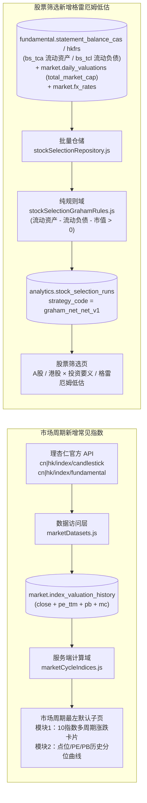

# 市场周期「常见指数」与股票筛选「格雷厄姆低估」研发方案（2026-11-22）

> 文档职责：专项方案（待实施）
> 截至日期及范围：2026-11-22；只读核对基线 `df61e967`（主线 `master`，`0.9.4.14`）。覆盖市场周期新增最左默认子页「常见指数（10大指数多周期涨跌与历史估值分位曲线）」及股票筛选页新增「格雷厄姆低估（流动资产−流动负债−总市值>0）」双方案设计。
> 当前结论：方案已按用户确认锁定（周/月/季度涨跌采用自然日历周期 WTD/MTD/QTD；格雷厄姆低估采用纯单条规则并按净流动资产盈余占市值比降序排列）；本次仅制定研发方案，未修改业务代码、未执行数据库迁移、未部署生产。
> 权威与证据：[AGENTS.md](../AGENTS.md)；[技术架构 5.1—5.3／9.4／9.8](技术架构.md)；[前端UI设计系统重构研发方案](前端UI设计系统重构研发方案_20261121.md)；[投资策略选股中心研发方案](投资策略选股中心研发方案_20261102.md)。
> 未验证/未完成：全部代码实施、10指数官方目录代码与覆盖探针实测、数据库历史回填、自动化测试、浏览器多尺寸与真机视觉验收、生产部署。

---

## 一、整体架构与设计原则

1. **页面请求零外采**：市场周期「常见指数」与股票筛选「格雷厄姆低估」在页面打开、切换周期或切换方案时**只读本地数据库**，绝不在请求链路内触发外部金融 API 调用。
2. **分层与职责隔离**：严格遵守 `routes → services → domain / repositories → dataAccess` 后端分层，以及 `View (只碰 DOM) ↔ Presenter (只管状态与请求，allowDom=false)` 前端分层门禁（`acceptanceDataArchitecture.js --static`）。
3. **全站统一 UI 规范**：所有颜色、圆角、阴影、字号、表格（`.biz-table`）、分段按钮与图表配色均复用 `public/shared/style.css` 顶部的 CSS Design Tokens 与 `window.SiteChartTheme`，不在模块 CSS 中硬编码新色系。

---

## 二、需求一：市场周期新增「常见指数」默认子页

### 2.1 二级导航位置与默认路由

1. **DOM 结构调整**（`public/index.html` `#main-market-volatility`）：
   在 `#main-market-volatility .mv-header > .mv-sub-nav` **最左侧**新增 `常见指数` 页签，并将默认 `.active` 移至该页签：
   - 顺序：**`常见指数`（`data-mv-metric="indices"`，默认激活） → `格雷厄姆指数`（`graham`） → `市盈率（PE）`（`pe`） → `市净率（PB）`（`pb`） → `M2与股市市值比`（`m2_market_cap`）**。
2. **进入行为与深链兼容**（`public/js/navigation.js`、`public/js/market-cycle-metrics.js`）：
   - 点击一级导航「市场周期」（`/?main=market-volatility` 无 `metric` 参数）默认激活 `indices` 并加载常见指数子页（`#mv-sub-indices`）。
   - 若 URL 显式携带 `?main=market-volatility&metric=graham|pe|pb|m2_market_cap`（例如从首页市场周期卡片点击详情或登录回跳），直接进入对应指标子页，不先请求默认子页。

### 2.2 10 大目标指数清单与数据源口径

| 序号 | 指数名称 | 市场 | 站内标准标识 (`indexCode`) | `index_valuation_history.index_code` 存储键 | 理杏仁官方端点与代码 | 备源（仅收盘点位兜底） |
|---|---|---|---|---|---|---|
| 1 | 上证指数 | `CN` | `000001.SH` | `000001.SH` | `cn/index/*` → `000001` | Tushare `000001.SH` / 新浪 `sh000001` |
| 2 | 中证全指 | `CN` | `000985.CSI` | `000985` *(兼容存量选股/周期)* | `cn/index/*` → `000985` | Tushare `000985.CSI` |
| 3 | 深证成指 | `CN` | `399001.SZ` | `399001.SZ` | `cn/index/*` → `399001` | Tushare `399001.SZ` / 新浪 `sz399001` |
| 4 | 沪深300 | `CN` | `000300.SH` | `CSI300` *(兼容存量选股/周期)* | `cn/index/*` → `000300` | Tushare `000300.SH` / 新浪 `sh000300` |
| 5 | 创业板指 | `CN` | `399006.SZ` | `399006.SZ` | `cn/index/*` → `399006` | Tushare `399006.SZ` / 新浪 `sz399006` |
| 6 | 科创50 | `CN` | `000688.SH` | `000688.SH` | `cn/index/*` → `000688` | Tushare `000688.SH` |
| 7 | 北证50 | `CN` | `899050.BJ` | `899050.BJ` | `cn/index/*` → `899050` | Tushare `899050.BJ` |
| 8 | 恒生指数 | `HK` | `HSI` | `HSI` *(兼容存量选股/周期)* | `hk/index/*` → `HSI` | 腾讯 `hkHSI` |
| 9 | 恒生中国指数 | `HK` | `HSCEI` | `HSCEI` | `hk/index/*` → 探针核验官方代码 | 腾讯 `hkHSCEI` |
| 10 | 恒生科技指数 | `HK` | `HSTECH` | `HSTECH` | `hk/index/*` → 探针核验官方代码 | 腾讯 `hkHSTECH` |

- **前置核验步骤**：开发第一步先用只读脚本调用一次 `cn/index` 与 `hk/index` 目录接口，精确核对上述 10 个指数（特别是北证50、恒生中国企业指数、恒生科技指数）在理杏仁官方的 `stockCode`、`launchDate` 及 `candlestick` / `fundamental` 覆盖区间，写入统一配置表 `server/domain/marketIndexCatalog.js`，严禁猜测代码。
- **估值口径统一**：PE/PB 统一使用理杏仁官方 `cn|hk/index/fundamental` 的**总市值加权**口径（`pe_ttm.mcw`、`pb.mcw`），`valuation_method = 'market_cap_weighted'`，`source_code = 'lixinger_official'`，不混用等权或整体法备源。

### 2.3 数据库存储与同步任务设计

1. **复用标准表 `market.index_valuation_history`（零新表）**：
   - 现有 `market.index_valuation_history` 已含 `index_code, valuation_method, trade_date, close, market_cap, pe_ttm, pb, source_code, raw_payload`（迁移 `026_index_valuation_history`）。
   - 此前 `saveIndexValuationHistoryRows`（`server/repositories/marketYieldRepository.js`）只写入了 `pe_ttm` 和 `pb`，未写入 `close`。
   - **升级写入逻辑**：将同指数、同交易日的 `candlestick`（`type='normal'` 收盘点位 `close`）与 `fundamental`（`pe_ttm.mcw`、`pb.mcw`、`mc`）按 `trade_date` 合并后写入 `market.index_valuation_history`：
     - `close = COALESCE(EXCLUDED.close, market.index_valuation_history.close)`
     - `pe_ttm = COALESCE(EXCLUDED.pe_ttm, market.index_valuation_history.pe_ttm)`
     - `pb = COALESCE(EXCLUDED.pb, market.index_valuation_history.pb)`
     - 允许早期交易日只有 `close`（尚无估值）或只有 `pe_ttm`/`pb` 的行独立入库，互不丢弃。
   - **存量兼容**：`CSI300`、`000985`、`HSI` 保持原 `index_code` 存储键不变，确保格雷厄姆指数、市场周期 PE/PB 子页及选股中心零改动无缝读取，同时补齐此前缺失的 `close` 点位。
2. **首次回填与日常增量调度**：
   - **全历史回填脚本**：扩展 `server/scripts/backfillIndexValuationOfficial.js` 覆盖全部 10 个指数（按 5 年分段请求 `readIndexCloseSeries` + `readIndexValuationSeries`，默认预演，`--apply` 落库）。
   - **日常增量任务**：在 `server/jobs/marketVolatilitySync.js`（每日 18:45 执行）中接入 10 指数增量同步（按每个指数各自的水位往前 45 天重叠窗口拉取点位与估值），并在 `SUBDATASET_QUERIES` 与任务质量诊断中按交易日历（A股 `SSE`、港股 `HKEX`）监控新鲜度。

### 2.4 模块一：10 大指数多周期涨跌概览卡片区

1. **周期切换控制栏**：
   - 使用统一的 `.mv-controls` 卡片工具栏，左侧为 10 个周期胶囊按钮（`data-mvi-period`），右侧为数据截止日期说明：
     `日涨跌`（`1d`，默认） · `周涨跌`（`1w`） · `月涨跌`（`1m`） · `季度涨跌`（`1q`） · `今年涨跌`（`ytd`） · `今年最大回撤`（`ytd_mdd`） · `近一年`（`1y`） · `三年`（`3y`） · `五年`（`5y`） · `十年`（`10y`）。
2. **各周期涨跌幅与最大回撤计算公式（服务端纯函数确定性计算，已确认锁定）**：
   设该指数最新有效收盘日为 $T$，收盘价为 $C_T$：
   - **日涨跌 (`1d`)**：取 $T$ 前一有效交易日 $T_{-1}$，$\text{Pct} = (C_T / C_{T_{-1}} - 1) \times 100\%$；迷你图取最近 20 个交易日收盘走势。
   - **周 / 月 / 季度 / 今年涨跌（`1w` / `1m` / `1q` / `ytd` —— 自然日历周期口径 WTD / MTD / QTD / YTD）**：
     - 设当前最新有效交易日 $T$ 所在自然周的周一为 $D_{\text{week\_start}}$、所在自然月首日为 $D_{\text{month\_start}}$（`YYYY-MM-01`）、所在自然季度首日为 $D_{\text{quarter\_start}}$（`YYYY-01-01 / 04-01 / 07-01 / 10-01`）、所在自然年首日为 $D_{\text{year\_start}}$（`YYYY-01-01`）。
     - 基准交易日 $T_{\text{base}}$ 统一取 **严格早于该自然周期首日（$t < D_{\text{start}}$）的最近一个有效交易日**（即上周五/上月末/上季末/上年末最后交易日收盘价 $C_{T_{\text{base}}}$），计算 $\text{Pct} = (C_T / C_{T_{\text{base}}} - 1) \times 100\%$；迷你图绘制自 $T_{\text{base}}$ 至 $T$ 的收盘序列（含起点基准虚线）。
   - **近一年 / 三年 / 五年 / 十年（`1y` / `3y` / `5y` / `10y` —— 滚动日历年口径）**：
     - 目标回看日 $D_{\text{target}} = \text{CoreDate.subtractYears}(T, N)$，基准交易日 $T_{\text{base}}$ 取 $t \le D_{\text{target}}$ 的最近一个有效交易日收盘价。
     - 若指数发布日（库内最早有效收盘日）晚于 $D_{\text{target}}$（如北证50无三年/五年/十年数据），该周期涨跌幅返回 `null`，卡片显示 `--` 并标注「成立不足N年」，**不拿成立首日冒充N年前**。
   - **今年最大回撤 (`ytd_mdd`)**：
     - 取当年首个交易日 $T_{\text{year\_start}}$（$t \ge D_{\text{year\_start}}$）至 $T$ 的全部收盘点位序列 $\{C_1, C_2, \dots, C_n\}$：
       $$\text{MDD}_{\text{YTD}} = -\max_{1 \le i \le j \le n} \left(\frac{C_i - C_j}{C_i}\right) \times 100\%$$
     - 返回最大回撤百分比（如 `-14.28%`）以及峰值日 `peakDate`、谷值日 `troughDate`，悬停提示可查看回撤区间。
3. **卡片 UI 与统一规范落地**：
   - **网格布局**：桌面端（`>1100px`）采用 5 列 × 2 行（`grid-template-columns: repeat(5, minmax(0, 1fr))`）或 3~4 列自适应网格；平板 2~3 列；手机端（`≤760px`）2 列紧凑排布（`gap: 10px`）。
   - **单卡视觉（对齐本站 Design Tokens）**：
     - 卡片容器：圆角 `var(--r-lg)`（`12px`），内边距 `14px 16px`，左右 `flex` 布局（左侧点位与名称涨跌、右侧 SVG 迷你走势图 `88×36px`）。
     - **红涨绿跌语义底色与文字**：
       - 涨跌幅 $> 0$：背景 `var(--up-soft)`（`#fef2f2`），边框 `1px solid rgba(220,38,38,.18)`，点位与涨幅文字 `var(--up)`（`#dc2626`），迷你折线同为 `var(--up)`。
       - 涨跌幅 $< 0$（或切换至「今年最大回撤」）：背景 `var(--down-soft)`（`#f0fdf4`），边框 `1px solid rgba(21,128,61,.18)`，点位与跌幅文字 `var(--down)`（`#15803d`），迷你折线同为 `var(--down)`。
       - 涨跌幅 $= 0$ 或无数据：背景 `var(--bg-subtle)`（`#f8fafc`），边框 `1px solid var(--border-default)`，文字 `var(--text-secondary)`。
     - **右侧 SVG 迷你图（Sparkline）**：绘制所选周期内的降采样收盘折线（最多 40 个采样点）+ 周期起点基准价的水平浅灰虚线（`stroke-dasharray="3 2"`，`stroke: var(--border-strong)`）。
     - **选中联动**：点击任一指数卡片，卡片外框高亮 `box-shadow: var(--focus-ring); border-color: var(--primary)`，并联动下方模块二切换至该指数的历史曲线。

### 2.5 模块二：指数历史波动与 PE/PB 分位点曲线

1. **算法与组件同源复用**：
   - 抽取或复用证券分析估值图 `public/js/stock-analysis-valuation-chart.js` 与 `server/domain/stockValuation.js` 的分位点算法：
     - **支持三种曲线模式切换（`data-mode`）**：
       1. **`指数点位`（`close`）**：展示所选时间区间内的指数收盘点位波动曲线（同时在浮框与摘要显示区间累计涨跌幅、区间最高/最低点及点位 20% / 50% / 80% 分位线）。
       2. **`PE-TTM`（`pe`）**：展示市值加权滚动市盈率历史曲线 + 20% / 50% / 80% 分位虚线。
       3. **`PB`（`pb`）**：展示市值加权市净率历史曲线 + 20% / 50% / 80% 分位虚线。
     - **支持时间区间切换**：复用 `DateRangeControl`（预设 `1年 / 3年 / 5年 / 10年 / 20年 / 全部` + 自定义起止日期选择器，默认 `10年`）。
2. **头部统计摘要与图表交互**：
   - 图表顶部展示选中指数的实时统计摘要条：
     `当前值` · `所选区间分位 (%)` · `20%分位（机会区）` · `50%分位（中位数）` · `80%分位（危险区）` · `区间涨跌幅` · `有效样本数`。
   - 遵循 `ChartInteraction` 规范：桌面鼠标移动、手机触屏点按展示 `.app-tooltip` 浮框，同屏显示该交易日的 **`日期`、`收盘点位`、`PE-TTM`、`PB`**；窗口缩放只用内存缓存重绘，不触发网络请求。

### 2.6 新增后端接口契约

在 `/api/market-volatility` 下新增两个公开只读接口（带 `applyPublicCache` 60 秒缓存 + 水位 ETag）：
1. `GET /api/market-volatility/indices/overview`
   - 一次性返回 10 个指数的最新点位、最新 PE/PB、全历史及近十年 PE/PB 分位，以及预计算好的 10 个周期维度（`1d / 1w / 1m / 1q / ytd / ytd_mdd / 1y / 3y / 5y / 10y`）的涨跌幅、最大回撤与迷你图采样序列（前端切换 10 个周期按钮时**零网络等待，纯内存即时切换**）。
2. `GET /api/market-volatility/indices/history?code=000300.SH`
   - 返回指定指数的全量历史序列 `[{ date, close, pe, pb }]`，供模块二前端按 `DateRangeControl` 任意切换 `1/3/5/10/20/30年` 或自定义日期区间并即时重算区间分位线（与证券分析估值图完全同构）。

---

## 三、需求二：股票筛选页新增「格雷厄姆低估」筛选方案

### 3.1 业务规则与财务/币种严谨性设计（已确认锁定）

1. **唯一核心筛选公式（`G01：净流动资产盈余`）**：
   $$\text{净流动资产盈余 (Net-Net Surplus)} = \text{流动资产合计} - \text{流动负债合计} - \text{总市值} > 0$$
   - 等价表达：$\text{净流动资产 (NCAV)} = \text{流动资产合计} - \text{流动负债合计} > \text{总市值}$。
   - **纯单条规则（已确认选项 A）**：不叠加「投资要义」的 100 亿净资产门槛、11 年利润分红异常和近 12 个月必须分红条件。
2. **数据来源与时点可见性（Point-in-Time）**：
   - **资产负债表**：取目标交易日 $T$ 可见截止时点（`announced_at < asOfDate` 且 `available_at < knowledgeCutoff`）前最新一期已公告的**合并资产负债表**（`report_kind = 'balance'`, `statement_scope = 'consolidated'`, `report_type = '1'`，含一季报、半年报、三季报、年报）。
   - **字段取数（A股与港股物理分表，严禁串表）**：
     - **A股（CAS）**：取同一 `report_id` 的 `fundamental.statement_balance_cas.bs_tca`（流动资产合计）与 `bs_tcl`（流动负债合计）；同时在 `FACT_MAP.balance` 和 `REPORT_METRICS.balance` 补充标准映射 `total_current_assets` / `total_current_liabilities`，并向后兼容 Tushare 存量 `raw_payload->>'total_cur_assets'` / `'total_cur_liab'`（与 #44 安全性读端回退同口径，校验同一 `report_id / source_id / source_version / currency_code / CAS`）。
     - **港股（HKFRS）**：取同一 `report_id` 的 `fundamental.statement_balance_hkfrs.bs_tca`（流动资产合计）与 `bs_tcl`（流动负债合计）（原币 `.t_o` 口径，复用 `UNVERIFIED_FINANCIAL_CURRENCY_SQL` 门禁屏蔽未核实币种）。
   - **总市值**：取目标交易日 $T$（或 60 天内最近有效交易日，与现有 `loadUniverse` 完全同源）的 `market.daily_valuations.total_market_cap`（元）及 `valuation_currency`（A股 `CNY`、港股 `HKD`）。
3. **两项关键边界治理**：
   - **金融类公司不区分流动资产/流动负债（判 `NOT_APPLICABLE` 而非 `PENDING`）**：
     银行、保险、证券、多元金融（`fs_table_type IN ('bank','insurance','security','other_financial')` 或无流动科目定义的金融企业）在会计准则上本就不设「流动资产合计 / 流动负债合计」。规则层识别后直接判 `NOT_APPLICABLE`（原因：`financial_statement_no_current_classification`），**不计入 `pendingCount` 数据缺口**，防止阻塞正式批次发布或导致 `selection_inputs` 无限循环补数。
   - **港股跨币种折算闭合**：
     港股总市值为 `HKD`，但财报原币常为 `CNY` 或 `USD`。当 `balance_currency !== valuation_currency` 时，必须按目标日 $T$ 已确认汇率（`market.fx_rates`）将 `流动资产` 与 `流动负债` 统一折算为市场交易币种（港股统一折为 `HKD`、A股为 `CNY`），再与 `总市值` 做十进制比较（BigInt 精确运算，不经二进制浮点）；同时在候选明细中保留原币金额、折算汇率与汇率日期证据。若汇率缺失则判 `PENDING / fx_rate_missing`。

### 3.2 后端多方案架构（复用 `stock_selection_*` 表体系）

现有数据库 `analytics.stock_selection_strategies` 与 `analytics.stock_selection_runs` 已原生支持按 `strategy_id` 隔离多套策略，**无需新增平行选股表**：

1. **策略注册**：
   - 方案一（既有）：**`投资要义`**（`investment_essentials_adapted_v2` / `v1`）
   - 方案二（新增）：**`格雷厄姆低估`**（`strategy_code = 'graham_net_net_v1'`，`formula_version = 'graham-net-net-formula-v1'`）
2. **领域规则模块 `server/domain/stockSelectionGrahamRules.js`**：
   - 规则 `G01`：
     - `PASS`：流动资产、流动负债、总市值均有效、币种闭合，且 $\text{流动资产} - \text{流动负债} - \text{总市值} > 0$。
     - `FAIL`：$\text{流动资产} - \text{流动负债} - \text{总市值} \le 0$。
     - `NOT_APPLICABLE`：新股上市后尚无任何已披露资产负债表，或金融类报表不区分流动资产/流动负债。
     - `PENDING`：非金融类已上市公司已有财报但缺 `bs_tca`/`bs_tcl`（触发 `selection_inputs` 补采理杏仁宽表财报）、缺总市值或跨币种缺汇率。
   - **排序指标**：入选股票按 **「净流动资产盈余占市值比」** $\frac{\text{流动资产} - \text{流动负债} - \text{总市值}}{\text{总市值}}$ **降序**排名（折价越深、安全边际越高的排在越前；等价于 $\frac{\text{总市值}}{\text{净流动资产}}$ 升序），选出目标组合（最多 30 席）及完整合格候选列表。
3. **调度与批次生成**：
   - 每日/每周/历史季度选股任务支持按策略列表遍历：对 `CN`（A股）和 `HK`（港股）分别生成并发布 `投资要义` 与 `格雷厄姆低估` 的独立批次。

### 3.3 前端股票筛选页 UI 设计（符合统一规范）

1. **市场 × 筛选方案两级切换交互**（`public/index.html`、`public/js/stock-selection.js`、`public/js/presenters/stock-selection-presenter.js`）：
   - **一级市场导航**（吸顶 `.bond-header > #ss-tabs`）：保持 **`A股`** | **`港股`**。
   - **二级方案切换栏**（置于市场导航下方 / 页头工具栏，采用统一分段胶囊控件 `.ss-scheme-tabs`）：
     - **`投资要义`**（`data-ss-scheme="essentials"`，默认）
     - **`格雷厄姆低估`**（`data-ss-scheme="graham_net_net"`）
   - 切换 A股/港股 时保留当前所选方案；切换方案时自动加载当前市场在该方案下的最新批次、目标组合与候选列表（请求序号守卫与身份切换守卫完全复用现有 `ssBeginLoad`）。
2. **动态说明与表格列（`.biz-table` 规范）**：
   - 当方案为 **`格雷厄姆低估`** 时：
     - **规则说明区（`.ss-rule-list`）**：切换展示格雷厄姆净流动资产法说明：
       - **G01 净流动资产盈余**：最新已披露合并报表的 `流动资产合计 − 流动负债合计 − 总市值 > 0`（港股异币种财报按目标日汇率折算为港币后比较；银行/保险/券商等不区分流动科目的金融企业标记为不适用）。
       - **排序与组合**：按 `（流动资产 − 流动负债 − 总市值）÷ 总市值` 降序排名（安全边际越高越靠前）。
     - **表格展示列（统一使用 `.biz-table-scroll > .biz-table`，12px 等宽数字 `tabular-nums`）**：
       `排名` · `代码/名称` · `行业` · `财报期` · `流动资产合计` · `流动负债合计` · `净流动资产(NCAV)` · `总市值` · `净流动资产盈余` · `市值/净流动资产` · `PB` · `PE(TTM)` · `股息率` · `状态/操作`。

---

## 四、测试、门禁与知识库同步计划

1. **自动化测试覆盖**：
   - **市场周期常见指数**：
     - 单元测试：10 个周期维度（日/周WTD/月MTD/季QTD/今年YTD/今年最大回撤/1年/3年/5年/10年）涨跌幅与最大回撤计算、成立不足 N 年边界、PE/PB 分位点与 20%/50%/80% 分位线计算。
     - 仓储与同步测试：`market.index_valuation_history` 的 `close + pe_ttm + pb` 合并幂等写入、存量 `CSI300/000985/HSI` 兼容性。
     - 前端 DOM 与导航回归：市场周期默认打开最左侧 `常见指数`、显式 `?metric=` 深链直达、10 个周期切换、卡片点击联动模块二曲线、多尺寸响应式不溢出。
   - **格雷厄姆低估选股**：
     - 规则域单元测试：BigInt 十进制 `流动资产 - 流动负债 - 市值 > 0` 边界（含恰好等于 0 不通过、净流动资产为负、跨币种汇率折算、金融企业无流动科目判 `NOT_APPLICABLE`、非金融企业缺宽表科目判 `PENDING`）。
     - 隔离 PG 管线测试：A股（`statement_balance_cas`）与港股（`statement_balance_hkfrs`）同 `report_id` 取数、A股/港股下「投资要义」与「格雷厄姆低估」双方案切换与个人排除隔离。
2. **门禁与文档同步**：
   - 运行静态分层门禁 `acceptanceDataArchitecture.js --static` 与知识门禁 `npm.cmd run check:knowledge`。
   - 按 `market-cycle`、`stock-selection`、`frontend` 路由同步更新 `docs/技术架构.md`（5.1/5.2/9.4/9.8 节）、`docs/投资策略选股中心研发方案_20261102.md` 与 `docs/知识索引.md`。

---

## 五、已确认的设计决策（2026-11-22 锁定）

1. **常见指数「周 / 月 / 季度涨跌」时间窗口口径（选项 B：自然日历周期）**：
   - 采用 **本周以来（WTD）/ 本月以来（MTD）/ 本季度以来（QTD）** 自然日历周期口径，与 **今年涨跌（YTD）** 保持一致：基准价统一取对应自然周期首日（本周一 / 本月1日 / 本季首月1日 / 当年1月1日）**之前最近一个有效交易日**的收盘价。
   - **近一年 / 三年 / 五年 / 十年** 采用滚动日历年回看（`CoreDate.subtractYears(T, N)` 当日或之前最近有效交易日收盘价）；成立不足 $N$ 年的指数返回 `null` 并显示 `--`（成立不足N年）。
2. **「格雷厄姆低估」方案的规则与排序口径（选项 A：纯单条规则）**：
   - 仅执行一条核心筛选规则 **`G01：流动资产合计 − 流动负债合计 − 总市值 > 0`**（BigInt 十进制精确比较，等于 0 不通过）。
   - **不叠加**「投资要义」的 100 亿净资产门槛、11 年利润分红异常和近 12 个月必须分红条件。
   - 银行、保险、证券、多元金融等会计准则上不区分流动资产/流动负债的金融企业判为 `NOT_APPLICABLE`（不计入 `pendingCount` 待补缺口，不阻塞批次发布）。
   - 港股财报原币与市值币种（`HKD`）不一致时，按目标交易日已确认汇率（`market.fx_rates`）统一折算为市场交易币种后比较。
   - 通过筛选的股票按 **净流动资产盈余占市值比** $\frac{\text{流动资产合计} - \text{流动负债合计} - \text{总市值}}{\text{总市值}}$ **降序**排列（安全边际越高越靠前），选出目标组合（最多 30 席）及完整合格候选列表。
