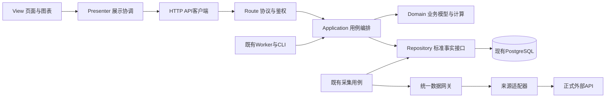

# 应用分层与 MVP 架构整改方案

文档职责：跨层依赖与 MVP 整改实施方案；截至2026-10-27。
当前结论：已有数据库标准层、请求保护、业务服务和页面API，但职责仍混用；已根据本轮代码复核意见局部修订原方案，业务重构尚未实施。逐项采纳结论见第8.2节。
代码基线：`449254fa`，工作目录 `.worktrees/lixinger-backup`；主目录其他任务的未提交修改不属于该基线。
权威与证据：[技术架构](技术架构.md)第5/6/8.4/9/11节；[原产品整改](产品功能架构分析整改报告_20260804.md)DATA-02/FRONT-01；[任务卡](tasks/active/20261027-理杏仁备用数据源.md)。
实施前置：本对话提供的AGENTS约束要求大范围代码重构须先明确请示、用户回复“同意”；本次先交付可审阅方案，不把设计登记当作实施完成。

## 1. 目标、范围与已有能力

目标是让三类变化各有唯一落点：替换数据API只调整数据适配；修改收益/评分规则只调整业务模型；修改页面布局只调整View。Presenter负责操作流程、页面状态和异步响应协调，不承载金融公式。

本次是“后端职责分层＋前端MVP”。MVP的Model是业务模型，不等于数据库；HTTP路由是协议适配，也不等于业务层或Presenter。

已有能力直接复用：

- PostgreSQL现有core/market/fundamental/event/analytics/ops及技术架构8.4的权威读写矩阵。
- `securityIdentity`、`externalCallGuard`、接口策略、原始记录、游标、分区质量、PDF缓存和现有Runner。
- `routes/services/jobs/db`、公开API和快照读取、统一鉴权/CSRF、交易账本及任务执行令牌。
- 原前端会话、导航、共享费用/日期/计算函数、表格/图表、移动端组件及公开分享的渲染复用。

真正缺口是稳定的数据访问接口、统一事务调用合同、业务与基础设施依赖隔离、前端Presenter/View职责、跨Node/Python的一致契约，以及现有门禁对新边界的覆盖。项目**已经有** `check:data-architecture`，不是从零建立第二套架构检查；创建目录或移动文件本身不算完成。

不新增产品功能，不替换技术栈，不另建数据库/事实表/调度器/权限系统；不修改金融公式、税务规则、交易记账口径或训练模型。已有业务逻辑按原样提取，发现独立Bug另列，不借分层改口径。

## 2. 代码核查与实施基线

### 2.1 已证实的职责混合

| 当前位置 | 已证实问题 | 整改方向 |
|---|---|---|
| `server/services/stockAnalysis.js` | 同时包含供应商请求、SQL、缓存编排、分析计算 | 分出数据适配/仓储和纯业务计算，保留原公共出口兼容 |
| `companyFinancialIncrementalSync.js` | 采集和标准层写入仍固定Tushare来源 | 数据网关选择供应商，标准层写入消费实际来源和证据 |
| `financialDataArchitecture.js` | 标准写入包含多处固定来源；现有读者对多来源优选/聚合没有统一合同 | 在数据层统一投影与读取优选，防重复汇总及来源错标 |
| `server/routes/stockAnalysis.js` | 同时存在服务调用和自选股SQL | HTTP层仅转交用例，SQL留仓储，账号隔离保持不变 |
| `public/js/stock-analysis.js` | `loadStockAnalysis/stockAnalysisSelect`同时处理请求、状态和DOM，另包含整页渲染 | 拆出API客户端、Presenter和View，保留入口/DOM ID |
| `server/jobs`及Python业务脚本 | 部分任务直接SQL/取数；数据准备和算法仍在同一模块 | 任务/CLI调用同一用例，数据准备归数据层，算法消费事实参数 |

股票分析当前常用Runner已按只读标准层重算，这是应保留的机制；同文件存在旧完整刷新路径，不能把“文件里有请求”误说成“所有页面都会外采”。

本轮补充核实：现有 `server/scripts/acceptanceDataArchitecture.js` 为224个逻辑行，已读stockAnalysis/tencentQuote等源码作边界断言，并检查数据库身份、分区和来源事实。当前股票分析路由有4处字面量pool.query，前端有5处fetch且无require/import；混用判断成立，次数以本分支代码为准。36个service文件含字面量pool.connect，未找到既有withTransaction封装；此外externalCallGuard使用getPool().connect取得会话锁连接，不能当作普通事务批量替换。

### 2.2 静态粗筛范围

2026-10-27原粗筛按文件split计行，将每个文件的末尾换行多计了一个空行。本轮按同一冻结代码提交 `449254fabddb078acd2ac27546305ba3617e6729` 的Git对象重算：CRLF/CR统一成LF，保留注释及内部空行，不计末尾换行产生的虚拟空行。public/js由11702修正为11670，services由37105修正为37003，原差值恰好等于各目录文件数；其他行数同口径修正如下。

阶段0交付 `scripts/audit-layer-coupling.js`，后续只用该脚本生成可比报告。输入为指定Git提交及跟踪文件清单，排除node_modules/venv/__pycache__/test/tests/backups、运行数据/模型目录和test前缀/`.test.js`测试文件，仅扫描JS/Python；新增dataAccess源码不得误按运行数据排除。报告同时输出提交、扫描器/规则版本、纳入及排除路径、文件数、逻辑行数和候选位置。规则版本变更时对前后提交同规则重算，不把规则变化当成整改收益。脚本目前为待实施，不能把本轮复算说成已入库工具。

SQL/请求候选仍由明确规则粗筛，**不是已逐项确认的违规数量**；后续同时看“未豁免越界清单净减”和新增越界，不能仅凭文件或候选数下降判完成。

| 目录 | JS/Python文件 | 行数 | SQL候选模块 | 请求候选模块 |
|---|---:|---:|---:|---:|
| server/routes | 25 | 7128 | 9 | 1 |
| server/services | 102 | 37003 | 70 | 20 |
| server/jobs | 21 | 4866 | 16 | 6 |
| server/db | 25 | 11571 | 22 | 0 |
| server/scripts | 61 | 10659 | 32 | 9 |
| public/js | 32 | 11670 | 0 | 25 |
| public/shared | 22 | 6920 | 0 | 9 |
| ipo-report | 50 | 16779 | 35 | 3 |

另有public根目录6个HTML，其中4个命中非空内联script粗筛；需逐一分辨业务脚本、初始化和结构化元信息，不盲目全部搬走。启动入口、中间件、部署/迁移、原生模块和动态加载关系在阶段0补入正式依赖清单。

SQL在仓储里、请求在客户端里本来就是正确职责；不能把上述候选全部当作缺陷。也不能将全部混合文件标成“基础设施”来躲过检查。

### 2.3 并行工作与资源

主目录存在其他任务的换股结算、套利跟进、任务契约与文档增量；不得吸收、覆盖或暂存这些未提交修改。本分支保留已有理杏仁提交和方案证据，但分层实施只承担批次0，**不再以一个长分支承载批次1—5**。

批次1—5各自建立唯一任务卡、独立分支/worktree和固定交接提交；批次3/4/5继续按业务域拆成可独立合并的小批。开始和交接前核对当时master/前置批次实际代码及提交映射，先解决接口或同段正文重叠，再固定交接范围；不得只凭任务卡状态认定依赖已齐。前批已有兼容出口时下一批可独立接续，接口不兼容的上下游必须同批交接。

每批通过专项和门禁后即为可整合/可发布候选，不等待全站完成；发布仍由另一发布对话统一整合定版。每批一组可识别提交、一个回滚单位，禁止跨批squash丢失映射；本批合并后后续批次以最新已整合代码开工，不累积整站长分支。本文只登记开发流程，不自动创建对话、分支或向其他对话发消息。

沿用本任务独立开发库、PGTESTDATABASE与DATA_DIR；不对共用portfolio库做迁移或重置。重测试按本机资源顺序执行；Web/Worker、浏览器和视觉测试继续服从低性能限制。

## 3. 目标结构与依赖规则

图中箭头表示调用依赖；采集/计算/发布仍按既有任务契约编排，不因拆层自动形成新任务。

| 职责 | 允许做什么 | 禁止依赖 |
|---|---|---|
| Domain/Model | 基于传入事实执行金融规则、校验、收益/评分计算 | SQL/连接池、供应商SDK/HTTP、req/res、DOM、调度器 |
| Application | 用例、事务协调、权限上下文、质量门槛、调用Domain与仓储接口 | 具体供应商路径/Token/字段；直接操作页面 |
| 数据网关/适配器 | 本地事实不能满足请求时，唯一负责外部采集选源、回退和归一化 | 用户页面状态、收益或评分决策；重新给库内版本排序 |
| Repository | SQL、事务实现、标准事实/快照读写；唯一负责已落库来源/版本的优选、合并与追溯 | 页面、金融评分公式；外部取数或再次决定外部回退顺序 |
| Route/Job/CLI | 协议适配、原鉴权/任务上下文、调用同一用例 | 复制SQL、金融公式或供应商回退流程 |
| Presenter | 请求协调、加载/错误/选择状态、响应序号与账号归属、调用View/Model端口 | DOM细节、数据库、供应商；自写或复制金融公式 |
| View | DOM/图表、格式化、交互事件转交、可访问性；下文明确许可的共享纯函数调用 | 直接取数、来源切换、自写/复制金融规则或独立业务状态机 |
| API客户端 | 站内HTTP、响应解析与错误归一 | DOM与金融计算；供应商凭据 |

建议新增职责目录为 `server/domain`、`server/application`、`server/dataAccess`、`server/repositories` 和 `public/js/presenters`、`public/js/views`、`public/js/api`；均是**待实施目录**，不是已有能力。原拟server/data已被现有.gitignore的server/data/规则整体忽略，且承载模型产物，故数据访问源码改用dataAccess，不改模型路径、不取消产物忽略。原路径保留必要兼容出口，后续按职责移动，不为了目录整齐重复包壳。

依赖在启动/模块组合入口装配，保持现有CommonJS和浏览器加载方式，不引入DI框架或前端框架。现有provider、Guard、连接池和表结构继续只有一份；运行时处理器绑定表不是第二套来源事实库，优先级/权限/额度沿用ops现有事实和任务合同。

公共会话、导航、遥测和任务租约属于基础设施，单独分类；不强行为每个工具建立MVP三件套。public/shared按现有Git清单为22个JS加1个CSS资产，不将23个文件统称为23个JS模块。阶段0逐文件/必要时逐导出符号登记三档，保留原共享位置，不另造一套同名工具：

| 共享职责 | 现有候选示例 | 使用边界 |
|---|---|---|
| 基础设施 | ui-actions、lazy-sections、mobile-ui、telemetry等 | P/V可使用登记接口；涉及DOM的能力只由View/组合入口调用，遥测等网络例外限定到实际基础设施用途，不成为业务取数后门 |
| 复用渲染 | business-table、chart-interaction、dialog、pager等 | 由View复用，Presenter通过View端口协调，不直接操纵这些实现的DOM |
| 业务纯计算/日期 | core-fees、core-returns、core-date及其他core-* | 保持Node/浏览器同一份实现；优先由Presenter/业务模型调用，View仅按5.3的窄许可使用 |

上表是分类方向，最终导出和全局符号以阶段0代码清单核对，不按文件名一概放行。

## 4. 数据层合同与主备选择

### 4.1 上层只提出数据需求

业务请求证券、报告期/交易日、所需字段及质量要求，不传供应商URL、原生接口名、Token或主备角色。唯一判定入口分为两种场景：仓储的标准事实读取先判断已落库候选的版本、口径和质量；仅在不能满足需求且原采集用例允许外采时，数据网关才按既有合同选择外部来源及回退。供应商返回先留原文，再转换为统一事实、由仓储投影；网关不重排库内候选，仓储不触发外采，业务不再做第三次优选。具体方法名在批次1冻结合同后确定，不把上述描述冒充已有函数。

例如内部估值合同描述证券身份、tradeDate、currency、PE/PB、市值、质量、逐字段来源与原文引用；字段名称实施时与现有内部合同对齐，不借重构改变公开API字段。市值统一为元、比例统一口径，转换只在适配边界发生一次。

理杏仁已验证的公司/估值/行业/银行与证券财务作为准入证据复用，GDP为空则没有有效业务覆盖。ROA净利润口径与既有指标未证明相同时不得合并；公司来源的退市状态不得越过官方生命周期门禁。配置密钥不等于所有字段都能互为备用。

### 4.2 统一读写

- 原始响应仍入ops.raw_records；标准事实、计算指标和快照仍按技术架构8.4分工，不新增平行事实表。
- 写入使用实际来源/版本/原文关系，不把理杏仁数据标成Tushare；数据层统一处理来源并存和更正。
- 同一证券、同一交易日/报告期先核验范围、币种、日期、字段口径和质量，再做主备优选；规则在数据层，不分散到各业务服务。
- 日估值聚合不得把两个来源当成两只证券相加；财报备源不得因为更新入库就顶替一份完整有效主源。审计仍能读取所有原始来源及版本。
- 同口径缺项可以按合同补齐并保存字段来源；口径不兼容、备源缺字段或部分范围未覆盖，必须返回missing/partial，不假报完整。
- 先有效本地事实/原文缓存，再必要增量和允许备源；失败/空值不覆盖旧有效事实。成功空结果保留证据，不自动变成业务成功。

### 4.3 采集、额度和页面边界

继续使用同一Runner、Guard、游标和数据集分区；页面读取、换页、旋转和重复计算不外采。人工刷新仍排队，源失败只续补未完成阶段。

同请求并发去重；首次范围、增量窗口、去重键、缓存期与补漏沿既有合同。理杏仁共享日10000次为用户声明的总约束，不复制成每接口10000，不臆测重置时区或分钟限额。400/401/403/429/503保留实际状态、原始错误码和request_id；权限拒绝不重试绕过，其他恢复按正式文档和统一Guard执行。

该10000次声明只记录在本方案/任务的使用约束，**不写入策略表，也不据此生成额度迁移SQL**：internal_per_minute_limit/internal_daily_limit继续NULL；official_*只有官方文档或真实上游依据核验后才可填写，用户声明不能当官方限制。现有lixingerSource迁移只登记来源/接口，不填写额度；实施不得自行补写、更不能按接口复制。

## 5. 业务层、协议与 MVP

### 5.1 业务层

将收益、分红/税、交易、估值、评分、强赎/下修、IPO预测、市场周期等规则按现有业务域保留，输入改为标准事实与明确业务日期，输出结果及质量诊断。业务只判断数据是否满足规则，不判断数据来自哪个API。

事务边界由用例统一控制，不能拆出层次后各自提交。批次0确定并交付 `server/db/transaction.js` 的 `withTransaction(fn)` 基础合同，批次1先迁移数据边界及样板依赖：拥有事务时统一checkout/BEGIN/COMMIT，失败ROLLBACK并保留原错误，finally只释放自己取得的连接。复用外层事务的标准形式为 `withTransaction(fn, { tx })`，不另开连接、不提交/回滚/释放外层事务；这不是隐式嵌套事务，局部容错继续保留原SAVEPOINT语义。

Repository统一签名 `method(params, tx)`，params为命名参数对象；单次读取或已证实单语句原子操作可令tx缺省使用pool，多语句写入必须由用例传入同一个事务client，不得无tx时分别自动提交。跨仓储失败要整体回滚，并测试传入tx后不偷走全局pool。已有方法先用兼容出口接续，不能一批强改所有调用签名。

新增/修改的业务和普通仓储代码禁止自行pool.connect；存量按触碰范围逐步迁移。transaction helper、连接初始化、迁移/测试以及确有生命周期要求的会话锁基础设施为精确登记例外，必须写明连接归属和释放者；例如externalCallGuard的会话级advisory lock跨网络请求保留连接，不能机械改成普通事务封装或事务级锁。36个字面量pool.connect文件是迁移清单输入，不是必须全部套同一事务模型的结论。

账号/账户归属、版本冲突、幂等键、任务执行令牌、精确告警恢复和来源保护保持原样。Python算法不重写成JS，模型产物/随机种子/公式版本不变；Python数据准备与算法同样隔离。

### 5.2 Route与任务

保留API路径、状态码、鉴权矩阵、响应字段和异步202语义。Route将合法身份/参数交给用例并序列化结果；Job/CLI将目标日、模式、范围与令牌交给同一用例，不能各做一份计算/采集。

原公共入口采用薄兼容转发，调用方实际切到新职责后再评估退役；不删除仍有消费者的导出、脚本或核心文件。生产删除、迁移和数据回填另按原授权规则执行。

### 5.3 前端MVP

以股票分析为首个贯通样板：

1. API客户端提供读取快照、列表、刷新排队等站内接口，统一HTTP错误。
2. Presenter持有加载/错误/选择状态及请求序号，控制旧响应、切账号和重复操作，向View传展示模型。
3. View保留已有DOM ID、共享表格/图表、格式化和触控行为，只渲染并上报用户操作；不直接fetch。
4. 原 `loadStockAnalysis/stockAnalysisSelect` 等全局入口转交Presenter；证券公开分享继续复用同一View，不复制渲染器或额外采集。

然后逐域覆盖持仓/收益/交易、可转债、IPO、市场周期、套利、知识、反馈/通知及后台。共享表格、日期、导航和会话按原权威规范复用；不增加动画、断点或样式体系。浏览器端必要的费用预览仍调用现有共享业务函数，服务端入账继续用同一规则校验。

**共享纯函数窄许可**：禁止的是View自写/复制金融公式，不是禁止它调用全部core-*。日期/数字格式化以及既有只读费用/收益预览，可调用角色清单逐文件、逐导出符号批准的core-date/core-fees/core-returns函数；不得带I/O、修改业务状态、决定正式入账/交易/评分，且必须与服务端同源。新代码优先由Presenter生成预览展示模型；确有既有View兼容调用时单列原因、范围及验证，不给整个public/shared目录或整个core-*通配豁免。7.1按同一许可检查，不能误杀合法共享实现，也不能以预览为名复制业务规则。

## 6. 分批实施与退出条件

下表为批准后的实施顺序，各批依2.3建立独立交接点。每批完成真实调用切换、冻结的等价/性能比对、正文更新和既有门禁；不得只加文件后继续运行旧链路。表内“退出”指本批可整合，不等于全站完成。

| 批次 | 修改落点/交付物 | 本批退出条件及专属反例 | 回滚单位 |
|---|---|---|---|
| 0 基线、共用合同与门禁 | 扩展现有acceptanceDataArchitecture；architecture-boundaries角色/全局契约；transaction.js；audit-layer-coupling.js；record-arch-golden.js；check:knowledge标题校验 | 规则/扫描版本和冻结基准可复算；注入一个新增越界必须失败；缺失全局提供者或readSections标题必须失败；事务异常回滚且只释放自己连接 | 本批工具、清单、事务helper及其接入的一组提交；不改业务数据 |
| 1 数据边界 | market/tushare/lixinger、financialDataArchitecture、stock/bondDataService及仓储；接入统一tx签名 | 中立合同与唯一选源入口可验证；主源有效时备源零调用；双来源同日市值不重复；一个子仓储失败时整笔回滚、会话锁不提前释放 | 本批数据访问/投影/兼容出口及测试的一组提交 |
| 2 股票贯通 | stockAnalysis、companyFinancialIncrementalSync、routes/stockAnalysis、前端股票分析入口 | 本链路四层分离且保持基线；普通读取零外采；切换证券/账号后迟到响应不覆盖；刷新仍返回原202并复用Runner、公开分享仍复用View | 本批股票链路前后端及加载引用的一组提交 |
| 3 后端各域小批 | 持仓/现金收益、转债、IPO、市场周期、套利、内容/运营等分别建卡 | 本小批Node调用同一用例且无新越界；跨用户读写拒绝；跨仓储失败整体回滚；旧令牌/失败分区不得伪造成功或恢复。Python留批次5 | 每个业务域小批一组提交，不打包成整个后端长分支 |
| 4 前端各域小批 | 各页面脚本/必要加载引用、Presenter/View/API客户端；复用shared | P脱离DOM、V脱离网络测试；View直接fetch应被拒绝而许可的core预览不得误杀；快速切账号不串数据；旋转/重绘不取数 | 每个页面族及其匹配加载引用一组提交，公共依赖需绑定已整合版本 |
| 5 Python/脚本各域小批 | ipo-report、server/scripts、Node子进程适配 | 相同事实/模型结果一致；算法内部SQL/联网应被拒绝；目标日不被当前日替换；原文缓存命中零外采 | 每个脚本/模型调用链及适配的一组提交，不回滚模型文件或业务数据 |
| 6 总体验收 | 汇总已整合小批、剩余清单、最终门禁和未验项 | 各已迁域无新增越界，存量未豁免清单仅减不增；任意提高阈值/重置基线不得变绿；全站完成另须全部必需范围清零并通过行为/性能/运行验收 | 每批保留可识别提交映射，回滚有问题的已交接批次，不跨批squash |

### 6.1 单一门禁入口与依赖安装

**扩展现有 `npm.cmd run check:data-architecture` → `server/scripts/acceptanceDataArchitecture.js`，取消另建独立check-architecture-boundaries命令/脚本。** 角色清单是该入口消费的元数据；必要内部解析函数由它调用，不形成第二套规则或验收结论。

阶段0拟新增该入口的 `--static` 模式：只做Node/Python依赖、前端文件角色/全局契约检查，不连接数据库；既有默认模式继续做现有身份/来源/分区等只读数据库验收。开发/CI必须分别运行静态模式与具备隔离库的原验收，不能用一个模式的成功冒充另一个。重构移动实现后，将原“旧文件正文含某字符串”断言改为原出口到实际新目标的调用/行为断言，保留其检查意义，不删除它来消除失败。

JavaScript解析器明确使用 `acorn`＋`acorn-walk`，Python使用标准库ast；两项JS包仅通过官方 `npm.cmd install --save-dev` 安装到devDependencies并锁定package-lock，不引入eslint套件。开发/CI用全量 `npm ci` 后运行静态门禁；生产沿用 `npm ci --omit=dev`，运行代码及默认数据库验收不得顶层加载开发解析器。静态模式缺依赖必须报未执行/失败，不能假通过。当前尚未安装两包，`--static`及扩展检查均未实现；已有默认验收入口真实存在。

### 6.2 批次回滚与总目标分档

回滚原则引用[原产品整改第十节](产品功能架构分析整改报告_20260804.md#十研发任务依赖与发布批次)：只回滚本批代码，不通过回退迁移文件或删除生产数据回滚。若某批未来确需schema变化，发布前必须确认旧代码仍兼容扩展结构，并在本方案补充前滚修复/回滚边界；不兼容时不得将本批标为可独立发布。

采用逐批收紧方式：新增代码零未批准越界是硬门禁；存量清单只减不增，触碰到的业务迁移单元须一并整改，无法安全迁移时明确拆批或等待依赖，不能用扫全文件重构扩散范围。已批准的会话锁、共享纯函数等例外按明确用途登记，不是遗留耦合豁免。

批次0—5各自可整合、可成为发布候选；批次6分为“本轮增量验收”和“全站终态验收”。前者允许仍有明确存量，但不得宣布全站完成；后者仍要求全部必需范围内的未豁免越界清零、调用方切换及所需验收完成。不采纳任意设一个非零净减阈值就宣告全站迁完。样板、目录变小、数量下降或静态绿灯都不能单独证明最终完成。

## 7. 验收与防回退

### 7.1 分层门禁

全部架构规则并入6.1既有入口，分工如下：

- Node模块用AST核对CommonJS/ESM/可静态识别的动态导入；Python用ast核对导入及登记调用。Domain不依赖SQL/供应商/DOM/调度；Presenter允许调用注入的API和View端口，但不能直接依赖HTTP/DOM/SQL实现。
- 前端现状为全局脚本，**不宣称import图能捕捉全部依赖**。先实施文件→角色白名单和AST中直接/字面量fetch、window.fetch、XMLHttpRequest等网络调用位置检查，限定在API客户端或登记的基础设施中；同时维护HTML入口→顺序/懒加载脚本→提供/消费全局符号契约，核对`stockAnalysisState`、`window.securityAnalysisLoadList`等的唯一归属和加载先后。
- 无法静态解析的动态全局名、加载器和别名需明确列出人工/行为测试覆盖，不能默认已覆盖或标成整个window可用。View消费未许可API全局同样不能借壳绕过角色检查。
- 按第3节三档和5.3窄许可检查shared；允许的core纯函数调用不按“View自写金融公式”误杀。未登记的纯函数、带I/O的包装器或正式交易/评分决定仍不在许可范围。
- 新增和改动模块必须有角色、允许依赖和已迁单元约束；旧耦合清单用于逐批收紧，不作为永久大白名单。不接受把pool.query改名repository.query却继续在业务拼SQL、把全部业务标为数据层、复制实现双跑、删测试或只建目录。

自动检查只能证明可识别依赖/调用及已登记契约；内联复制公式、隐藏别名和金融语义仍须逐模块核查及等价回归。原入口已有的源码断言须随真实调用链迁移，不能继续只匹配已变成薄转发的旧文件，也不能被另一套新门禁绕过。

知识路由标题检查归已有 `check:knowledge`：阶段0扩展scripts/check-knowledge.js，逐个验证readSections文件中的完整Markdown标题，忽略代码围栏内示例，按统一空白/尾部井号规则规范化；缺失时报告route ID、文件和标题，不靠文件存在就通过。当前仅做过手工存在性检查，本轮不把文档约定说成自动校验已实现。

### 7.2 行为与数据等价

固定证券集合、目标日/报告期、账号身份、原始事实、模型和公式版本，比较迁移前后的返回字段、关键金额/比例、日期、排序、质量及发布/告警状态；仅剔除明确登记的请求ID、运行时间等非业务变化。

关键反例包括：主源有效时备源零请求；主源失败后仅同口径字段回退；两来源同日不重复计市值；部分财报不顶替完整主源；空GDP不发布；分页未完不前进游标；失败不覆盖旧快照；同一请求/写入幂等；旧令牌/旧账号响应不写新状态；游客/跨用户越权仍被拒绝。

仓储用隔离PG验证事务/回滚/约束；Domain用固定事实验证真实规则；Presenter用替代API/View验证异步状态；View用jsdom验证DOM及交互。替代依赖只用于测试，不能冒充真实来源、生产或浏览器验收。

阶段0交付一个 `scripts/record-arch-golden.js` 的采集/比对入口，使用固定case-set（证券、日期、合成账号、模型/公式版本、质量状态）记录和比较，不再逐批手工拼快照。输出目录为 `server/test/fixtures/architecture-golden/`，保存完整响应结构及重点数值、数据来源/质量、基准提交/schema/工具版本；动态字段的排除名单逐项固定，不得忽略整个diagnostics或空字段来隐藏差异。CI不能自动重录预期值让测试变绿。

采集在独立库的只读事务和受控只读服务入口执行，禁止触发刷新、外采、补写快照或自动迁移。需要账号的case由既有测试准备步骤预先创建合成身份，采集脚本本身不写业务表；真实账户、持仓、密钥、Cookie/Token和连接串不得进入fixture。公开金融样本可复用已有落库原文，避免再耗API额度。

交易、写入回滚和刷新202排队等写用例，继续由独立测试库的事务/接口回归验证，不强行塞进只读golden采集脚本。

性能基准同时冻结关键接口/服务耗时、关键仓储查询的 `EXPLAIN (FORMAT JSON)` 摘要（不默认ANALYZE）、查询次数、环境/数据规模、预热及采样规则。测试HTTP栈或本任务已获授权的验收实例可用于接口测量，直接调用服务的耗时不得标成接口耗时；无法测量时记待测而非通过，不额外启动被禁止的开发服务。阶段0根据可复现实测冻结p50/p95和预先审阅的绝对/相对退化预算，预算未冻结不得宣告该case基线齐备；不能用增加重试、缩小证券集合、删慢case或临时提高阈值通过性能验收。

### 7.3 运行、移动端与发布

阶段0实现后，每批运行相应专项、`npm.cmd run test:all`、`npm.cmd run check:knowledge`、`npm.cmd run check:data-architecture -- --static`及具备独立验收库的原默认数据验收；静态模式目前是计划参数，不能在尚未实现时宣称已执行。每批还运行同版耦合扫描及golden/性能比对。当前已有228/0/0是理杏仁接入阶段回归，不是本分层方案实施验收。

手机与桌面继续检查320/360/390/430/768/1024/1440px及760/900px分界、触控/键盘、重绘不取数、旧响应隔离和原权限。用户未允许时不启动开发服务/浏览器、截图或视觉测试；保留待验，不以DOM/静态通过冒充真机和运行验收。

发布由独立发布对话整合固定交接提交后统一定版。批准本方案不自动批准生产代码部署、数据库迁移/历史补算或生产Worker补跑；如实施确需schema变化，先在本方案补充具体必要性和回滚，再依原规则单独确认生产写入。

## 8. 知识归属、风险与当前状态

本方案只维护层间职责、依赖、迁移阶段和验收；金融口径、事实表、数据源优先级及任务合同仍回原权威架构/专项。它承接原产品整改的DATA-02/FRONT-01，不替代历史数据层报告，也不创建第二份事实表设计。

实施时同步技术架构第5/6/8.4及实际涉及的9/10/11/12节、知识索引、相关原专项和路由；任务规则变化才更新规则追踪与生成矩阵。复用现有事故、反馈及发布回执，不复制一套历史。

### 8.1 每批正文更新落点

技术架构第6节继续只描述**当时已经运行的结构**。各批实施后原位改写本批已改变的职责行：domain/application承接原services内业务/编排，dataAccess/repositories承接取数/SQL；同步删除被替代的旧职责描述或保留明确兼容出口，不在旧表下再堆一张“目标架构已完成”表。当前尚未实施，所以本轮不把该表提前改成未来结构。

| 批次 | 本批交接前必须核对/更新的位置 |
|---|---|
| 0 | 技术架构6/13中的现有门禁与新增工具实际状态；方案2.2/5.1/6.1/7；AGENTS、角色/全局契约清单与知识路由；check:knowledge实际覆盖能力 |
| 1 | 技术架构6、8.4、10、12；实际仓储/来源优选与事务接口；原DATA-02数据读写边界 |
| 2 | 技术架构5/6/9.2/9.2.1；股票API、手动刷新/分享的实际调用链和原专项 |
| 3 | 技术架构6和相应9.x/11；该业务域原方案、任务合同与必要的规则追踪/生成矩阵 |
| 4 | 技术架构5/5.3及对应业务页；共享模块分类、HTML/懒加载/全局符号契约与实际移动端未验范围 |
| 5 | 技术架构6/11/12及对应9.x；Python/CLI/Node子进程、日期/身份/缓存的原权威合同 |
| 6 | 技术架构6当前表、全站进度与剩余清单、知识索引、各批任务卡及实际发布回执；不得一次性补写前五批遗漏事实 |

### 8.2 本轮评审建议的采纳结论

本轮用户明确要求评估并修改文档；以下均是原方案的局部修订，**没有实施新工具、依赖、事务封装或业务重构**。

| 建议编号 | 结论 | 具体落点/限定 |
|---|---|---|
| 1 复用门禁 | 采纳 | 6.1/7.1扩展既有acceptanceDataArchitecture；取消独立check-architecture-boundaries计划，分清静态模式与原只读数据库验收 |
| 2 事务封装 | 采纳并限定 | 5.1、批次0/1交付withTransaction和(params,tx)；会话锁、连接初始化等按明确生命周期例外，不能机械套事务 |
| 3 全局脚本与纯函数 | 采纳并限定 | 3/5.3/7.1改为角色、直接网络调用和HTML/全局符号契约；合法pure helper只读预览按逐符号窄许可，不给整个shared通配豁免 |
| 4 两处选源 | 采纳 | 3/4.1区分外部采集选源与库内版本优选，分别唯一入口；仓储不外采，网关不重排库内候选 |
| 5 长分支 | 采纳 | 2.3/6按批次建卡、独立分支、固定提交和可合并点，各批可成为发布候选，不等全站迁完 |
| 6 基线与性能工具 | 采纳 | 7.2、批次0交付record-arch-golden采集/比对、只读/脱敏fixture、耗时/查询次数/EXPLAIN和冻结的性能预算 |
| 7 粗筛复算 | 采纳 | 2.2修正末尾空行口径；批次0入库同源扫描工具，记录提交和规则版本，不把统计口径变化当成净减 |
| 8 架构正文替换 | 采纳 | 8.1逐批原位更新第6节及其他实际变更章节，不并列两套“当前结构” |
| 9 反例与回滚 | 采纳 | 第6节每批绑定反例和提交组，6.2引用原产品报告第十节；只回滚本批代码，不回退迁移或删生产数据 |
| 10 解析依赖 | 采纳 | 6.1仅acorn/acorn-walk进devDependencies，开发/CI全量安装，生产omit=dev不加载AST解析器 |
| 11 10000次落点 | 采纳 | 4.3明确仅记使用约束，不填internal_*或未核验official_*；不改变现有来源迁移 |
| 12 目标分档 | 部分采纳 | 6.2采用新增零越界、存量只减不增、按触碰单元迁移；允许逐批验收发布，但不以任意非零阈值宣告全站完成 |
| 13 标题自动校验 | 采纳为批次0交付 | 7.1扩展已有check:knowledge；当前仍须手工核对，未假称自动检查已实现 |
| 14 shared三档 | 采纳 | 第3节区分基础设施、复用渲染和业务纯计算；保留原模块及明确P/V依赖，避免新目录复制共享工具 |

另核实并修正一处实施路径冲突：原拟server/data源码会被现有.gitignore忽略，并与模型产物混用；本方案改为待建server/dataAccess，产物及忽略规则保持原样。该项只调整方案和路由目标，不新增产品功能。

主要风险为多来源错标/重复汇总、口径混合、拆事务后部分提交、权限或账号身份丢失、旧脚本/分享入口遗漏、Node/Python日期不一致及未交接并行增量覆盖。各风险已分别绑定上述合同和反例验收，不能用单次全量测试替代专项证据。

当前完成静态核查、原方案设计及本轮14项评审修订，未改变业务实现、公开接口、数据库、前端或生产服务。本轮不把文档评审视为代码实施指令。后续明确开工时，本分支先交付批次0的可合并基础；其余批次按独立任务卡/分支持续推进，每批完成即可交接，终态不降低为任意净减阈值。
