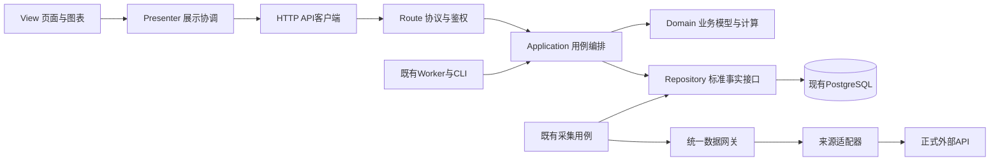

# 应用分层与 MVP 架构整改方案

文档职责：跨层依赖与 MVP 整改实施方案；截至2026-10-27。
当前结论：已有数据库标准层、请求保护、业务服务和页面API，但职责仍混用；本方案已设计，业务重构尚未实施。
代码基线：`449254fa`，工作目录 `.worktrees/lixinger-backup`；主目录其他任务的未提交修改不属于该基线。
权威与证据：[技术架构](技术架构.md)第5/6/8.4/9/11节；[原产品整改](产品功能架构分析整改报告_20260804.md)DATA-02/FRONT-01；[任务卡](tasks/active/20261027-理杏仁备用数据源.md)。
实施前置：本对话提供的AGENTS约束要求大范围代码重构须先明确请示、用户回复“同意”；本次先交付可审阅方案，不把设计登记当作实施完成。

## 1. 目标、范围与已有能力

目标是让三类变化各有唯一落点：替换数据API只调整数据适配；修改收益/评分规则只调整业务模型；修改页面布局只调整View。Presenter负责操作流程、页面状态和异步响应协调，不承载金融公式。

本次是“后端职责分层＋前端MVP”。MVP的Model是业务模型，不等于数据库；HTTP路由是协议适配，也不等于业务层或Presenter。

已有能力直接复用：

- PostgreSQL现有core/market/fundamental/event/analytics/ops及技术架构8.4的权威读写矩阵。
- `securityIdentity`、`externalCallGuard`、接口策略、原始记录、游标、分区质量、PDF缓存和现有Runner。
- `routes/services/jobs/db`、公开API和快照读取、统一鉴权/CSRF、交易账本及任务执行令牌。
- 原前端会话、导航、共享费用/日期/计算函数、表格/图表、移动端组件及公开分享的渲染复用。

真正缺口是稳定的数据访问接口、业务与基础设施依赖隔离、前端Presenter/View职责、跨Node/Python的一致契约和自动防回退门禁。创建目录或移动文件本身不算完成。

不新增产品功能，不替换技术栈，不另建数据库/事实表/调度器/权限系统；不修改金融公式、税务规则、交易记账口径或训练模型。已有业务逻辑按原样提取，发现独立Bug另列，不借分层改口径。

## 2. 代码核查与实施基线

### 2.1 已证实的职责混合

| 当前位置 | 已证实问题 | 整改方向 |
|---|---|---|
| `server/services/stockAnalysis.js` | 同时包含供应商请求、SQL、缓存编排、分析计算 | 分出数据适配/仓储和纯业务计算，保留原公共出口兼容 |
| `companyFinancialIncrementalSync.js` | 采集和标准层写入仍固定Tushare来源 | 数据网关选择供应商，标准层写入消费实际来源和证据 |
| `financialDataArchitecture.js` | 标准写入包含多处固定来源；现有读者对多来源优选/聚合没有统一合同 | 在数据层统一投影与读取优选，防重复汇总及来源错标 |
| `server/routes/stockAnalysis.js` | 同时存在服务调用和自选股SQL | HTTP层仅转交用例，SQL留仓储，账号隔离保持不变 |
| `public/js/stock-analysis.js` | `loadStockAnalysis/stockAnalysisSelect`同时处理请求、状态和DOM，另包含整页渲染 | 拆出API客户端、Presenter和View，保留入口/DOM ID |
| `server/jobs`及Python业务脚本 | 部分任务直接SQL/取数；数据准备和算法仍在同一模块 | 任务/CLI调用同一用例，数据准备归数据层，算法消费事实参数 |

股票分析当前常用Runner已按只读标准层重算，这是应保留的机制；同文件存在旧完整刷新路径，不能把“文件里有请求”误说成“所有页面都会外采”。

### 2.2 静态粗筛范围

2026-10-27在上述基线执行目录递归扫描，排除测试、venv、node_modules、数据和缓存目录；行数含注释/空行。SQL/请求候选由关键词和调用模式识别，**不是已逐项确认的违规数量**，不能作为整改完成比例。

| 目录 | JS/Python文件 | 行数 | SQL候选模块 | 请求候选模块 |
|---|---:|---:|---:|---:|
| server/routes | 25 | 7153 | 9 | 1 |
| server/services | 102 | 37105 | 70 | 20 |
| server/jobs | 21 | 4887 | 16 | 6 |
| server/db | 25 | 11596 | 22 | 0 |
| server/scripts | 61 | 10720 | 32 | 9 |
| public/js | 32 | 11702 | 0 | 25 |
| public/shared | 22 | 6942 | 0 | 9 |
| ipo-report | 50 | 16829 | 35 | 3 |

另有public根目录6个HTML，其中4个命中非空内联script粗筛；需逐一分辨业务脚本、初始化和结构化元信息，不盲目全部搬走。启动入口、中间件、部署/迁移、原生模块和动态加载关系在阶段0补入正式依赖清单。

SQL在仓储里、请求在客户端里本来就是正确职责；不能把上述候选全部当作缺陷。也不能将全部混合文件标成“基础设施”来躲过检查。

### 2.3 并行工作与资源

主目录存在其他任务的换股结算、套利跟进、任务契约与文档增量；不得吸收、覆盖或暂存这些未提交修改。分层先在本任务隔离分支推进；涉及同一接口/算法/正文段落的部分，先核对固定交接提交，缺依赖则记录等待，继续无重叠部分。

沿用本任务独立开发库、PGTESTDATABASE与DATA_DIR；不对共用portfolio库做迁移或重置。重测试按本机资源顺序执行；Web/Worker、浏览器和视觉测试继续服从低性能限制。

## 3. 目标结构与依赖规则

图中箭头表示调用依赖；采集/计算/发布仍按既有任务契约编排，不因拆层自动形成新任务。

| 职责 | 允许做什么 | 禁止依赖 |
|---|---|---|
| Domain/Model | 基于传入事实执行金融规则、校验、收益/评分计算 | SQL/连接池、供应商SDK/HTTP、req/res、DOM、调度器 |
| Application | 用例、事务协调、权限上下文、质量门槛、调用Domain与仓储接口 | 具体供应商路径/Token/字段；直接操作页面 |
| 数据网关/适配器 | 能力匹配、主备选择、字段/单位/身份/日期转换、统一Guard | 用户页面状态、收益或评分决策 |
| Repository | SQL、事务实现、标准事实/快照读取写入、来源优选与追溯 | 页面、金融评分公式、外部直接采集 |
| Route/Job/CLI | 协议适配、原鉴权/任务上下文、调用同一用例 | 复制SQL、金融公式或供应商回退流程 |
| Presenter | 请求协调、加载/错误/选择状态、响应序号与账号归属、调用View端口 | DOM细节、数据库、供应商、金融公式 |
| View | DOM/图表、格式化、交互事件转交、可访问性 | 直接取数、来源切换、金融规则或独立业务状态机 |
| API客户端 | 站内HTTP、响应解析与错误归一 | DOM与金融计算；供应商凭据 |

建议新增职责目录为 `server/domain`、`server/application`、`server/data`、`server/repositories` 和 `public/js/presenters`、`public/js/views`、`public/js/api`；均是**待实施目录**，不是已有能力。原路径保留必要兼容出口，后续按职责移动，不为了目录整齐重复包壳。

依赖在启动/模块组合入口装配，保持现有CommonJS和浏览器加载方式，不引入DI框架或前端框架。现有provider、Guard、连接池和表结构继续只有一份；运行时处理器绑定表不是第二套来源事实库，优先级/权限/额度沿用ops现有事实和任务合同。

公共会话、导航、遥测和任务租约属于基础设施，单独分类；不强行为每个工具建立MVP三件套。现有跨端共享纯计算可以留在原shared位置，由角色清单确认职责，并保证Node/浏览器仍用同一份函数。

## 4. 数据层合同与主备选择

### 4.1 上层只提出数据需求

业务请求证券、报告期/交易日、所需字段及质量要求，不传供应商URL、原生接口名、Token或主备角色。数据网关根据已准入的来源能力及现有策略选择来源；供应商返回先留原文，再转换为统一事实，仓储负责标准投影。

例如内部估值合同描述证券身份、tradeDate、currency、PE/PB、市值、质量、逐字段来源与原文引用；字段名称实施时与现有内部合同对齐，不借重构改变公开API字段。市值统一为元、比例统一口径，转换只在适配边界发生一次。

理杏仁已验证的公司/估值/行业/银行与证券财务作为准入证据复用，GDP为空则没有有效业务覆盖。ROA净利润口径与既有指标未证明相同时不得合并；公司来源的退市状态不得越过官方生命周期门禁。配置密钥不等于所有字段都能互为备用。

### 4.2 统一读写

- 原始响应仍入ops.raw_records；标准事实、计算指标和快照仍按技术架构8.4分工，不新增平行事实表。
- 写入使用实际来源/版本/原文关系，不把理杏仁数据标成Tushare；数据层统一处理来源并存和更正。
- 同一证券、同一交易日/报告期先核验范围、币种、日期、字段口径和质量，再做主备优选；规则在数据层，不分散到各业务服务。
- 日估值聚合不得把两个来源当成两只证券相加；财报备源不得因为更新入库就顶替一份完整有效主源。审计仍能读取所有原始来源及版本。
- 同口径缺项可以按合同补齐并保存字段来源；口径不兼容、备源缺字段或部分范围未覆盖，必须返回missing/partial，不假报完整。
- 先有效本地事实/原文缓存，再必要增量和允许备源；失败/空值不覆盖旧有效事实。成功空结果保留证据，不自动变成业务成功。

### 4.3 采集、额度和页面边界

继续使用同一Runner、Guard、游标和数据集分区；页面读取、换页、旋转和重复计算不外采。人工刷新仍排队，源失败只续补未完成阶段。

同请求并发去重；首次范围、增量窗口、去重键、缓存期与补漏沿既有合同。理杏仁共享日10000次为用户声明的总约束，不复制成每接口10000，不臆测重置时区或分钟限额。400/401/403/429/503保留实际状态、原始错误码和request_id；权限拒绝不重试绕过，其他恢复按正式文档和统一Guard执行。

## 5. 业务层、协议与 MVP

### 5.1 业务层

将收益、分红/税、交易、估值、评分、强赎/下修、IPO预测、市场周期等规则按现有业务域保留，输入改为标准事实与明确业务日期，输出结果及质量诊断。业务只判断数据是否满足规则，不判断数据来自哪个API。

事务边界由用例统一控制，仓储接受同一事务上下文，不能拆出层次后各自提交。账号/账户归属、版本冲突、幂等键、任务执行令牌、精确告警恢复和来源保护保持原样。Python算法不重写成JS，模型产物/随机种子/公式版本不变；Python数据准备与算法同样隔离。

### 5.2 Route与任务

保留API路径、状态码、鉴权矩阵、响应字段和异步202语义。Route将合法身份/参数交给用例并序列化结果；Job/CLI将目标日、模式、范围与令牌交给同一用例，不能各做一份计算/采集。

原公共入口采用薄兼容转发，调用方实际切到新职责后再评估退役；不删除仍有消费者的导出、脚本或核心文件。生产删除、迁移和数据回填另按原授权规则执行。

### 5.3 前端MVP

以股票分析为首个贯通样板：

1. API客户端提供读取快照、列表、刷新排队等站内接口，统一HTTP错误。
2. Presenter持有加载/错误/选择状态及请求序号，控制旧响应、切账号和重复操作，向View传展示模型。
3. View保留已有DOM ID、共享表格/图表、格式化和触控行为，只渲染并上报用户操作；不直接fetch。
4. 原 `loadStockAnalysis/stockAnalysisSelect` 等全局入口转交Presenter；证券公开分享继续复用同一View，不复制渲染器或额外采集。

然后逐域覆盖持仓/收益/交易、可转债、IPO、市场周期、套利、知识、反馈/通知及后台。共享表格、日期、导航和会话按原权威规范复用；不增加动画、断点或样式体系。浏览器端必要的费用预览仍调用现有共享业务函数，服务端入账继续用同一规则校验。

## 6. 分批实施与退出条件

下表为批准后的实施顺序。每批都要完成真实调用切换、测试和正文更新，不能只增加新文件后保留旧调用链运行。

| 批次 | 具体修改落点 | 退出条件 |
|---|---|---|
| 0 基线与门禁 | 正式依赖清单；拟新增governance/architecture-boundaries.json和scripts/check-architecture-boundaries.js | 所有业务模块有可核查角色、现存耦合逐项列账；无“未知模块默认放行”；快照/接口/模型和权限基线固定 |
| 1 数据边界 | 现有market/tushare/lixinger、financialDataArchitecture、stock/bondDataService及相关仓储 | 中立数据合同、主备能力和单位/日期映射可独立测试；实际来源正确，重复来源不重复聚合，失败保留 |
| 2 股票贯通 | stockAnalysis、companyFinancialIncrementalSync、routes/stockAnalysis、public/js/stock-analysis及原脚本入口 | 同一链路数据/业务/Presenter/View均分离；普通读取零外采、主动刷新复用原Runner、分享复用、账面结果不变 |
| 3 后端逐域迁移 | 持仓账本/现金收益；转债安全/估值/周期/强赎下修/资料；IPO；市场周期；套利；内容与运营等 | 本批Node的Route/Job只调同一用例、业务无SQL/供应商依赖；原事务、质量和权限证据通过；Python部分继续阶段5，与未交接并行任务不重叠覆盖 |
| 4 前端逐域MVP | 各业务页面脚本与必要HTML加载引用、共享入口 | Presenter可脱离DOM测试，View可脱离网络渲染；接口/DOM/样式/移动行为和共享渲染兼容 |
| 5 Python及脚本边界 | ipo-report、server/scripts及Node子进程调用处 | 数据准备、CLI编排与算法分开；同数据/模型得到相同结果，Node/Python共用既有身份/Guard/日期/缓存合同 |
| 6 全站验收与整合 | 依赖清单、专项/全量、知识入口与任务卡 | 所有域清单完成，架构门禁无未批准的越界依赖；未验项与发布范围明确，才进入待整合 |

JavaScript依赖门禁拟使用AST解析，Python使用标准库ast；当前未安装JS解析依赖、未创建或启用架构门禁。实施时通过官方npm命令安装并锁定开发依赖，不手写简陋解析器冒充AST检查。

批次2完成只表示样板完成，批次1完成也不等于“所有业务备源已接入”。全站完成须同时清空批次3—5的所有必需条目。目录和文件数将随提取变化，不能以“文件变小”代替验收。

## 7. 验收与防回退

### 7.1 分层门禁

- Domain/Presenter导入SQL、网络、供应商、DOM或调度实现时测试必须失败；View直接取数或计算金融规则必须失败。
- 识别CommonJS/ESM、动态导入、Python导入和浏览器script加载；数据/CLI/迁移等合法基础设施按角色核验，不能全项目简单grep判零。
- 新增和改动模块必须有角色与允许依赖；未迁移旧耦合清单只用于进度跟踪，不能通过永久大白名单宣称全站通过。
- 不接受把pool.query改名repository.query却继续在业务层拼SQL、把所有业务模块标为数据层、复制实现双跑、删除/放宽测试、仅建立空目录等结果。

AST门禁负责可识别的依赖、调用和已登记边界；没有导入依赖却内联重复的金融公式，还须逐模块职责核查和等价回归。不能宣称静态依赖图自动证明全部金融语义已经分离。

### 7.2 行为与数据等价

固定证券集合、目标日/报告期、账号身份、原始事实、模型和公式版本，比较迁移前后的返回字段、关键金额/比例、日期、排序、质量及发布/告警状态；仅剔除明确登记的请求ID、运行时间等非业务变化。

关键反例包括：主源有效时备源零请求；主源失败后仅同口径字段回退；两来源同日不重复计市值；部分财报不顶替完整主源；空GDP不发布；分页未完不前进游标；失败不覆盖旧快照；同一请求/写入幂等；旧令牌/旧账号响应不写新状态；游客/跨用户越权仍被拒绝。

仓储用隔离PG验证事务/回滚/约束；Domain用固定事实验证真实规则；Presenter用替代API/View验证异步状态；View用jsdom验证DOM及交互。替代依赖只用于测试，不能冒充真实来源、生产或浏览器验收。

### 7.3 运行、移动端与发布

每批运行相应专项、最终运行 `npm.cmd run test:all` 和 `npm.cmd run check:knowledge`，并运行实际启用的架构门禁。当前已有228/0/0是理杏仁接入阶段回归，不是本分层方案实施验收。

手机与桌面继续检查320/360/390/430/768/1024/1440px及760/900px分界、触控/键盘、重绘不取数、旧响应隔离和原权限。用户未允许时不启动开发服务/浏览器、截图或视觉测试；保留待验，不以DOM/静态通过冒充真机和运行验收。

发布由独立发布对话整合固定交接提交后统一定版。批准本方案不自动批准生产代码部署、数据库迁移/历史补算或生产Worker补跑；如实施确需schema变化，先在本方案补充具体必要性和回滚，再依原规则单独确认生产写入。

## 8. 知识归属、风险与当前状态

本方案只维护层间职责、依赖、迁移阶段和验收；金融口径、事实表、数据源优先级及任务合同仍回原权威架构/专项。它承接原产品整改的DATA-02/FRONT-01，不替代历史数据层报告，也不创建第二份事实表设计。

实施时同步技术架构第5/6/8.4及实际涉及的9/10/11/12节、知识索引、相关原专项和路由；任务规则变化才更新规则追踪与生成矩阵。复用现有事故、反馈及发布回执，不复制一套历史。

主要风险为多来源错标/重复汇总、口径混合、拆事务后部分提交、权限或账号身份丢失、旧脚本/分享入口遗漏、Node/Python日期不一致及未交接并行增量覆盖。各风险已分别绑定上述合同和反例验收，不能用单次全量测试替代专项证据。

当前只完成静态核查和整改设计，未改变业务实现、公开接口、数据库、前端或生产服务。下一步：用户回复“同意”后，先固定阶段0清单和等价基线，再从数据边界与股票分析贯通样板开始；后续持续执行到全部范围验收完成，不把第一批交付当作全站结束。
