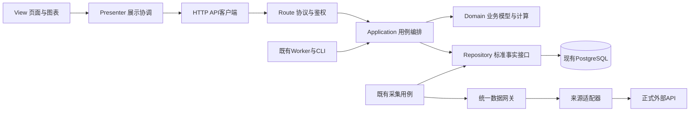

# 应用分层与 MVP 架构整改方案

文档职责：跨层依赖与 MVP 整改实施方案；截至2026-10-27。
当前结论：批次0—3已有本地交付，18个登记页面及股票分析Presenter/采集适配器已实施；公司财务同步已完成剩余 SQL 数据边界迁移、持仓行情、账户净值、净值历史及部分持仓事件、普通交易及批量持仓请求已接入统一客户端，批次5已拆分训练样本读取与纯特征计算，其余脚本与模型迁移仍未完成。静态扫描规则 layer-coupling-4 仍有存量越界；继续验收修复证券切换、智能导入身份与事件核对、三表取数及账户基线脱敏，完整等价、浏览器、真机及生产验收仍待完成。
代码基线：`449254fa`，工作目录 `.worktrees/lixinger-backup`；主目录其他任务的未提交修改不属于该基线。
权威与证据：[技术架构](技术架构.md)第5/6/8.4/9/11节；[原产品整改](产品功能架构分析整改报告_20260804.md)DATA-02/FRONT-01；[任务卡](tasks/active/20261027-理杏仁备用数据源.md)。
实施前置：本对话提供的AGENTS约束要求大范围代码重构须先明确请示、用户回复“同意”；本次先交付可审阅方案，不把设计登记当作实施完成。

## 1. 目标、范围与已有能力

目标是让三类变化各有唯一落点：替换数据API只调整数据适配；修改收益/评分规则只调整业务模型；修改页面布局只调整View。Presenter负责操作流程、页面状态和异步响应协调，不承载金融公式。

本次是“后端职责分层＋前端MVP”。MVP的Model是业务模型，不等于数据库；HTTP路由是协议适配，也不等于业务层或Presenter。

已有能力直接复用：

- PostgreSQL现有core/market/fundamental/event/analytics/ops及技术架构8.4的权威读写矩阵。
- `securityIdentity`、`externalCallGuard`、接口策略、原始记录、游标、分区质量、PDF缓存和现有Runner。
- `routes/services/jobs/db`、公开API和快照读取、统一鉴权/CSRF、交易账本及任务执行令牌。
- 原前端会话、导航、共享费用/日期/计算函数、表格/图表、移动端组件及公开分享的渲染复用。

真正缺口是稳定的数据访问接口、统一事务调用合同、业务与基础设施依赖隔离、前端Presenter/View职责、跨Node/Python的一致契约，以及现有门禁对新边界的覆盖。项目**已经有** `check:data-architecture`，不是从零建立第二套架构检查；创建目录或移动文件本身不算完成。

不新增产品功能，不替换技术栈，不另建数据库/事实表/调度器/权限系统；不修改金融公式、税务规则、交易记账口径或训练模型。已有业务逻辑按原样提取，发现独立Bug另列，不借分层改口径。

## 2. 代码核查与实施基线

### 2.1 已证实的职责混合

| 当前位置 | 已证实问题 | 整改方向 |
|---|---|---|
| `server/services/stockAnalysis.js` | 同时包含供应商请求、SQL、缓存编排、分析计算 | 分出数据适配/仓储和纯业务计算，保留原公共出口兼容 |
| `companyFinancialIncrementalSync.js` | 采集和标准层写入仍固定Tushare来源 | 数据网关选择供应商，标准层写入消费实际来源和证据 |
| `financialDataArchitecture.js` | 标准写入包含多处固定来源；现有读者对多来源优选/聚合没有统一合同 | 在数据层统一投影与读取优选，防重复汇总及来源错标 |
| `server/routes/stockAnalysis.js` | 同时存在服务调用和自选股SQL | HTTP层仅转交用例，SQL留仓储，账号隔离保持不变 |
| `public/js/stock-analysis.js` | `loadStockAnalysis/stockAnalysisSelect`同时处理请求、状态和DOM，另包含整页渲染 | 拆出API客户端、Presenter和View，保留入口/DOM ID |
| `server/jobs`及Python业务脚本 | 部分任务直接SQL/取数；数据准备和算法仍在同一模块 | 任务/CLI调用同一用例，数据准备归数据层，算法消费事实参数 |

股票分析当前常用Runner已按只读标准层重算，这是应保留的机制；同文件存在旧完整刷新路径，不能把“文件里有请求”误说成“所有页面都会外采”。

本轮补充核实：现有 `server/scripts/acceptanceDataArchitecture.js` 为224个逻辑行，已读stockAnalysis/tencentQuote等源码作边界断言，并检查数据库身份、分区和来源事实。当前股票分析路由有4处字面量pool.query，前端有5处fetch且无require/import；混用判断成立，次数以本分支代码为准。36个service文件含字面量pool.connect，未找到既有withTransaction封装；此外externalCallGuard使用getPool().connect取得会话锁连接，不能当作普通事务批量替换。

### 2.2 静态粗筛范围

2026-10-27原粗筛按文件split计行，将每个文件的末尾换行多计了一个空行。本轮按同一冻结代码提交 `449254fabddb078acd2ac27546305ba3617e6729` 的Git对象重算：CRLF/CR统一成LF，保留注释及内部空行，不计末尾换行产生的虚拟空行。public/js由11702修正为11670，services由37105修正为37003，原差值恰好等于各目录文件数；其他行数同口径修正如下。

阶段0交付 `scripts/audit-layer-coupling.js`，后续只用该脚本生成可比报告。输入为指定Git提交及跟踪文件清单，排除node_modules/venv/__pycache__/test/tests/backups、运行数据/模型目录和test前缀/`.test.js`测试文件，仅扫描JS/Python；新增dataAccess源码不得误按运行数据排除。报告同时输出提交、扫描器/规则版本、纳入及排除路径、文件数、逻辑行数和候选位置。可比报告存档于基线快照同级的 `server/test/fixtures/architecture-layer-reports/`，按扫描提交和规则版本命名、只增不覆盖，供各批交接证据引用固定版本。规则版本变更时对前后提交同规则重算，不把规则变化当成整改收益。该脚本已随批次0入库（扫描器 `1.0.0`／规则 `layer-coupling-4`），C0 报告存档为 `architecture-layer-reports/449254fa__layer-coupling-4.json`。

SQL/请求候选仍由明确规则粗筛，**不是已逐项确认的违规数量**；后续同时看“未豁免越界清单净减”和新增越界，不能仅凭文件或候选数下降判完成。

**唯一初始清单快照**：阶段0用正式扫描器对开工前核准的待迁代码提交C0扫描，将输出及提交号冻结为 `server/test/fixtures/architecture-layer-baseline.json`，与architecture-golden目录同级。它包含扫描器/规则版本、纳入文件与角色、稳定违规ID（文件/符号/规则及证据，不只用易漂移行号）、已确认例外和待登记覆盖状态。**初始快照已生成并冻结**：提交 `449254fa`、规则 `layer-coupling-4`，363 个文件、109166 逻辑行、612 条稳定违规（SQL 419／请求 185／跨层引用 8）、待登记 0、无法解析 0。2.2 表格的目录级候选数是设计粗筛，与本快照口径不同，不得互相替代或据此宣称整改量。

后续每批同时对照C0快照和本批开工前的已整合提交，不得重录初始快照、扩大例外或改变扫描范围来制造“净减”。规则/识别能力扩展或新页面契约暴露了旧问题时，须对同一C0按同版规则回扫，保留原快照和新增识别证据，分别报告历史新识别、真正新增及已整改；不能把“未登记”算零，也不能把改统计规则当整改量。新master增量若引入越界，须先明确归属/处置，不静默扩大原分母。

| 目录 | JS/Python文件 | 行数 | SQL候选模块 | 请求候选模块 |
|---|---:|---:|---:|---:|
| server/routes | 25 | 7128 | 9 | 1 |
| server/services | 102 | 37003 | 70 | 20 |
| server/jobs | 21 | 4866 | 16 | 6 |
| server/db | 25 | 11571 | 22 | 0 |
| server/scripts | 61 | 10659 | 32 | 9 |
| public/js | 32 | 11670 | 0 | 25 |
| public/shared | 22 | 6920 | 0 | 9 |
| ipo-report | 50 | 16779 | 35 | 3 |

另有public根目录6个HTML，其中4个命中非空内联script粗筛；需逐一分辨业务脚本、初始化和结构化元信息，不盲目全部搬走。启动入口、中间件、部署/迁移、原生模块和动态加载关系在阶段0补入正式依赖清单。

SQL在仓储里、请求在客户端里本来就是正确职责；不能把上述候选全部当作缺陷。也不能将全部混合文件标成“基础设施”来躲过检查。

### 2.3 并行工作与资源

主目录存在其他任务的换股结算、套利跟进、任务契约与文档增量；不得吸收、覆盖或暂存这些未提交修改。本分支保留已有理杏仁提交和方案证据，但分层实施只承担批次0，**不再以一个长分支承载批次1—5**。

批次1—5各自建立唯一任务卡、独立分支/worktree和固定交接提交；批次3/4/5继续按业务域拆成可独立合并的小批。开始和交接前核对当时master/前置批次实际代码及提交映射，先解决接口或同段正文重叠，再固定交接范围；不得只凭任务卡状态认定依赖已齐。前批已有兼容出口时下一批可独立接续，接口不兼容的上下游必须同批交接。

每批通过专项和门禁后即为可整合/可发布候选，不等待全站完成；发布仍由另一发布对话统一整合定版。每批一组可识别提交、一个回滚单位，禁止跨批squash丢失映射；本批合并后后续批次以最新已整合代码开工，不累积整站长分支。本文只登记开发流程，不自动创建对话、分支或向其他对话发消息。

“通过门禁”指第7.3节的正式交接要求，不把仅跑快速开发检查的提交标成待整合。批次0可拆成工具/格式基础和各域基线准备两个可交接单元，避免尚未轮到的页面符号或性能case阻塞全部基础工作；任何业务迁移批开工前，其实际目标范围及必需基线仍须齐备。

### 2.4 批次1的迁移范围冻结

批次1开工前，在其唯一任务卡冻结目标清单，记录本批基线提交、目标文件/函数、目标角色、合同/测试/golden case ID及预计移除的C0违规ID；该卡是本批范围的唯一维护位置，扫描/验收报告引用卡片路径及固定交接版本，不另复制一份可漂移分母。三类清单必须齐全：

| 分类 | 本方案给出的候选范围 | 开工前要求 |
|---|---|---|
| 本批必迁 | financialDataArchitecture的标准投影/实际来源写入，stockDataService/bondDataService仓储边界，market/tushare/lixinger中本批中立入口及适配；companyFinancialIncrementalSync中需要接入的持久化来源/tx函数；对应待建dataAccess/repositories | 按具体文件和符号冻结，不将整个service文件都默认迁移；确定实际调用切换和反例，不能仅新增未使用接口 |
| 复用验证、不重写 | securityIdentity、externalCallGuard、租约/调度、PDF缓存等现有基础设施 | 登记使用的接口和不变边界；如果确需修改，先改列本批必迁，不能藏在“复用”里 |
| 本批不迁的存量 | 股票业务模型及完整MVP留批次2；其他收益/转债/IPO/运营领域留各自后续小批；其他前端和Python算法留批次4/5 | 对应C0存量或待登记项，写明后续批次/责任位置，不标成已分离，不成为永久豁免 |

该表是候选和范围格式，不是尚未建立的批次1任务卡清单。清单外业务改动不得顺带纳入；发现直接依赖或遗漏先更新本批范围、冲突判断和验收集，再实施，不能把“触碰即迁移”扩大成整文件/整站重写。

批次2—5各小批在各自任务卡按同一三类格式冻结本批目标/复用/不迁范围及预计移除的C0违规ID；本节标题点名批次1只因其首批实施，不表示其他批次免冻结。

沿用本任务独立开发库、PGTESTDATABASE与DATA_DIR；不对共用portfolio库做迁移或重置。重测试按本机资源顺序执行；Web/Worker、浏览器和视觉测试继续服从低性能限制。

## 3. 目标结构与依赖规则

图中箭头表示调用依赖；采集/计算/发布仍按既有任务契约编排，不因拆层自动形成新任务。

| 职责 | 允许做什么 | 禁止依赖 |
|---|---|---|
| Domain/Model | 基于传入事实执行金融规则、校验、收益/评分计算 | SQL/连接池、供应商SDK/HTTP、req/res、DOM、调度器 |
| Application | 用例、事务协调、权限上下文、质量门槛、调用Domain与仓储接口 | 具体供应商路径/Token/字段；直接操作页面 |
| 数据网关/适配器 | 本地事实不能满足请求时，唯一负责外部采集选源、回退和归一化 | 用户页面状态、收益或评分决策；重新给库内版本排序 |
| Repository | SQL、事务实现、标准事实/快照读写；唯一负责已落库来源/版本的优选、合并与追溯 | 页面、金融评分公式；外部取数或再次决定外部回退顺序 |
| Route/Job/CLI | 协议适配、原鉴权/任务上下文、调用同一用例 | 复制SQL、金融公式或供应商回退流程 |
| Presenter | 请求协调、加载/错误/选择状态、响应序号与账号归属、调用View/Model端口 | DOM细节、数据库、供应商；自写或复制金融公式 |
| View | DOM/图表、格式化、交互事件转交、可访问性；下文明确许可的共享纯函数调用 | 直接取数、来源切换、自写/复制金融规则或独立业务状态机 |
| API客户端 | 站内HTTP、响应解析与错误归一 | DOM与金融计算；供应商凭据 |

建议新增职责目录为 `server/domain`、`server/application`、`server/dataAccess`、`server/repositories` 和 `public/js/presenters`、`public/js/views`、`public/js/api`；均是**待实施目录**，不是已有能力。原拟server/data已被现有.gitignore的server/data/规则整体忽略，且承载模型产物，故数据访问源码改用dataAccess，不改模型路径、不取消产物忽略。原路径保留必要兼容出口，后续按职责移动，不为了目录整齐重复包壳。

依赖在启动/模块组合入口装配，保持现有CommonJS和浏览器加载方式，不引入DI框架或前端框架。现有provider、Guard、连接池和表结构继续只有一份；运行时处理器绑定表不是第二套来源事实库，优先级/权限/额度沿用ops现有事实和任务合同。

公共会话、导航、遥测和任务租约属于基础设施，单独分类；不强行为每个工具建立MVP三件套。public/shared按现有Git清单为22个JS加1个CSS资产，不将23个文件统称为23个JS模块。阶段0先建立全站文件级清单、三档分类格式和待登记状态；精细的全局符号契约只覆盖股票分析样板、主站/分享入口及其实际共享/懒加载依赖闭包，不要求一次登记全部32个页面脚本和22个共享JS的全部符号。保留原共享位置，不另造一套同名工具：

| 共享职责 | 现有候选示例 | 使用边界 |
|---|---|---|
| 基础设施 | ui-actions、lazy-sections、mobile-ui、telemetry等 | P/V可使用登记接口；涉及DOM的能力只由View/组合入口调用，遥测等网络例外限定到实际基础设施用途，不成为业务取数后门 |
| 复用渲染 | business-table、chart-interaction、dialog、pager等 | 由View复用，Presenter通过View端口协调，不直接操纵这些实现的DOM |
| 业务纯计算/日期 | core-fees、core-returns、core-date及其他core-* | 保持Node/浏览器同一份实现；优先由Presenter/业务模型调用，View仅按5.3的窄许可使用 |

上表是分类方向，不按文件名一概放行。首批导出/全局符号在阶段0核对，其余随批次4逐页按同一格式补齐；新建或触碰的模块必须当次补齐所需符号及依赖闭包。尚未登记的旧页面明确标为pending_contract，不参加“该页已实现MVP”的结论，也不能因为没有import就被记成零依赖；新增越界硬门禁不因此放松。

## 4. 数据层合同与主备选择

### 4.1 上层只提出数据需求

业务请求证券、报告期/交易日、所需字段及质量要求，不传供应商URL、原生接口名、Token或主备角色。唯一判定入口分为两种场景：仓储的标准事实读取先判断已落库候选的版本、口径和质量；仅在不能满足需求且原采集用例允许外采时，数据网关才按既有合同选择外部来源及回退。供应商返回先留原文，再转换为统一事实、由仓储投影；网关不重排库内候选，仓储不触发外采，业务不再做第三次优选。具体方法名在批次1冻结合同后确定，不把上述描述冒充已有函数。

例如内部估值合同描述证券身份、tradeDate、currency、PE/PB、市值、质量、逐字段来源与原文引用；字段名称实施时与现有内部合同对齐，不借重构改变公开API字段。市值统一为元、比例统一口径，转换只在适配边界发生一次。

理杏仁已验证的公司/估值/行业/银行与证券财务作为准入证据复用，GDP为空则没有有效业务覆盖。ROA净利润口径与既有指标未证明相同时不得合并；公司来源的退市状态不得越过官方生命周期门禁。配置密钥不等于所有字段都能互为备用。

### 4.2 统一读写

- 原始响应仍入ops.raw_records；标准事实、计算指标和快照仍按技术架构8.4分工，不新增平行事实表。
- 写入使用实际来源/版本/原文关系，不把理杏仁数据标成Tushare；数据层统一处理来源并存和更正。
- 同一证券、同一交易日/报告期先核验范围、币种、日期、字段口径和质量，再做主备优选；规则在数据层，不分散到各业务服务。
- 日估值聚合不得把两个来源当成两只证券相加；财报备源不得因为更新入库就顶替一份完整有效主源。审计仍能读取所有原始来源及版本。
- 同口径缺项可以按合同补齐并保存字段来源；口径不兼容、备源缺字段或部分范围未覆盖，必须返回missing/partial，不假报完整。
- 先有效本地事实/原文缓存，再必要增量和允许备源；失败/空值不覆盖旧有效事实。成功空结果保留证据，不自动变成业务成功。

### 4.3 采集、额度和页面边界

继续使用同一Runner、Guard、游标和数据集分区；页面读取、换页、旋转和重复计算不外采。人工刷新仍排队，源失败只续补未完成阶段。

同请求并发去重；首次范围、增量窗口、去重键、缓存期与补漏沿既有合同。理杏仁共享日10000次为用户声明的总约束，不复制成每接口10000，不臆测重置时区或分钟限额。400/401/403/429/503保留实际状态、原始错误码和request_id；权限拒绝不重试绕过，其他恢复按正式文档和统一Guard执行。

该10000次声明只记录在本方案/任务的使用约束，**不写入策略表，也不据此生成额度迁移SQL**：internal_per_minute_limit/internal_daily_limit继续NULL；official_*只有官方文档或真实上游依据核验后才可填写，用户声明不能当官方限制。现有lixingerSource迁移只登记来源/接口，不填写额度；实施不得自行补写、更不能按接口复制。

## 5. 业务层、协议与 MVP

### 5.1 业务层

将收益、分红/税、交易、估值、评分、强赎/下修、IPO预测、市场周期等规则按现有业务域保留，输入改为标准事实与明确业务日期，输出结果及质量诊断。业务只判断数据是否满足规则，不判断数据来自哪个API。

事务边界由用例统一控制，不能拆出层次后各自提交。批次0确定并交付 `server/db/transaction.js` 的 `withTransaction(fn)` 基础合同，批次1先迁移数据边界及样板依赖：拥有事务时统一checkout/BEGIN/COMMIT，失败ROLLBACK并保留原错误，finally只释放自己取得的连接。复用外层事务的标准形式为 `withTransaction(fn, { tx })`，不另开连接、不提交/回滚/释放外层事务；这不是隐式嵌套事务，局部容错继续保留原SAVEPOINT语义。

Repository统一签名 `method(params, tx)`，params为命名参数对象；单次读取或已证实单语句原子操作可令tx缺省使用pool，多语句写入必须由用例传入同一个事务client，不得无tx时分别自动提交。跨仓储失败要整体回滚，并测试传入tx后不偷走全局pool。已有方法先用兼容出口接续，不能一批强改所有调用签名。

新增/修改的业务和普通仓储代码禁止自行pool.connect；存量按触碰范围逐步迁移。transaction helper、连接初始化、迁移/测试以及确有生命周期要求的会话锁基础设施为精确登记例外，必须写明连接归属和释放者；例如externalCallGuard的会话级advisory lock跨网络请求保留连接，不能机械改成普通事务封装或事务级锁。36个字面量pool.connect文件是迁移清单输入，不是必须全部套同一事务模型的结论。

账号/账户归属、版本冲突、幂等键、任务执行令牌、精确告警恢复和来源保护保持原样。Python算法不重写成JS，模型产物/随机种子/公式版本不变；Python数据准备与算法同样隔离。

### 5.2 Route与任务

保留API路径、状态码、鉴权矩阵、响应字段和异步202语义。Route将合法身份/参数交给用例并序列化结果；Job/CLI将目标日、模式、范围与令牌交给同一用例，不能各做一份计算/采集。

原公共入口先采用薄兼容转发，但必须登记退役终点。角色清单同时记录每个兼容文件/导出/全局入口的唯一实现目标、内部/外部消费者、所属批次和责任人；各批更新剩余调用者及动态加载证据。薄门面本身不等于双跑，门面背后只能调用一份业务实现。

批次6验收前每项必须二选一：①内部剩余调用方为0、HTML/懒加载/Node/Python等相关引用均清理并完成获准退役；②作为长期稳定门面，明确外部协议/公开API/跨端接口等保留理由、责任人和审阅记录，并证明没有旧算法/旧状态/旧采集继续运行。不能将“以后再评估”或仅为逃避迁移作为保留理由。静态零引用不足以证明外部HTTP客户端已不存在；缺授权或存在未确认消费者的待退役项继续记未完成，不伪装成已退役。删除核心文件、生产迁移及数据回填仍依原授权规则。

### 5.3 前端MVP

以股票分析为首个贯通样板：

1. API客户端提供读取快照、列表、刷新排队等站内接口，统一HTTP错误。
2. Presenter持有加载/错误/选择状态及请求序号，控制旧响应、切账号和重复操作，向View传展示模型。
3. View保留已有DOM ID、共享表格/图表、格式化和触控行为，只渲染并上报用户操作；不直接fetch。
4. 原 `loadStockAnalysis/stockAnalysisSelect` 等全局入口转交Presenter；证券公开分享继续复用同一View，不复制渲染器或额外采集。

然后逐域覆盖持仓/收益/交易、可转债、IPO、市场周期、套利、知识、反馈/通知及后台。**前端收口进度：已迁移 17 个页面脚本（`admin`、`arbitrage`、`bond-analysis`、`bond-cycle`、`bond-list`、`bond-redemption`、`bond-revision`、`bond-safety`、`bond-valuation`、`feedback`、`home-dashboard`、`ipo`、`knowledge`、`market-cycle-metrics`、`market-volatility`、`position-comparison`、`stock-analysis`），待迁移 0 个**，每页一次提交；清单以 `governance/architecture-boundaries.json` 为准，静态门禁 `frontend_api_client` 逐条校验。**前端收口进度：已迁移 17 个页面脚本（`admin`、`arbitrage`、`bond-analysis`、`bond-cycle`、`bond-list`、`bond-redemption`、`bond-revision`、`bond-safety`、`bond-valuation`、`feedback`、`home-dashboard`、`ipo`、`knowledge`、`market-cycle-metrics`、`market-volatility`、`position-comparison`、`stock-analysis`），待迁移 0 个**，每页一次提交；清单以 `governance/architecture-boundaries.json` 为准，静态门禁 `frontend_api_client` 逐条校验。**前端收口进度：已迁移 17 个页面脚本（`admin`、`arbitrage`、`bond-analysis`、`bond-cycle`、`bond-list`、`bond-redemption`、`bond-revision`、`bond-safety`、`bond-valuation`、`feedback`、`home-dashboard`、`ipo`、`knowledge`、`market-cycle-metrics`、`market-volatility`、`position-comparison`、`stock-analysis`），待迁移 0 个**，每页一次提交；清单以 `governance/architecture-boundaries.json` 为准，静态门禁 `frontend_api_client` 逐条校验。**前端收口进度：已迁移 17 个页面脚本（`admin`、`arbitrage`、`bond-analysis`、`bond-cycle`、`bond-list`、`bond-redemption`、`bond-revision`、`bond-safety`、`bond-valuation`、`feedback`、`home-dashboard`、`ipo`、`knowledge`、`market-cycle-metrics`、`market-volatility`、`position-comparison`、`stock-analysis`），待迁移 0 个**，每页一次提交；清单以 `governance/architecture-boundaries.json` 为准，静态门禁 `frontend_api_client` 逐条校验。**前端收口进度：已迁移 17 个页面脚本（`admin`、`arbitrage`、`bond-analysis`、`bond-cycle`、`bond-list`、`bond-redemption`、`bond-revision`、`bond-safety`、`bond-valuation`、`feedback`、`home-dashboard`、`ipo`、`knowledge`、`market-cycle-metrics`、`market-volatility`、`position-comparison`、`stock-analysis`），待迁移 0 个**，每页一次提交；清单以 `governance/architecture-boundaries.json` 为准，静态门禁 `frontend_api_client` 逐条校验。**前端收口进度：已迁移 16 个页面脚本（`arbitrage`、`bond-analysis`、`bond-cycle`、`bond-list`、`bond-redemption`、`bond-revision`、`bond-safety`、`bond-valuation`、`feedback`、`home-dashboard`、`ipo`、`knowledge`、`market-cycle-metrics`、`market-volatility`、`position-comparison`、`stock-analysis`），待迁移 1 个**，每页一次提交；清单以 `governance/architecture-boundaries.json` 为准，静态门禁 `frontend_api_client` 逐条校验。**前端收口进度：已迁移 15 个页面脚本（`arbitrage`、`bond-analysis`、`bond-cycle`、`bond-list`、`bond-redemption`、`bond-revision`、`bond-safety`、`bond-valuation`、`feedback`、`home-dashboard`、`ipo`、`market-cycle-metrics`、`market-volatility`、`position-comparison`、`stock-analysis`），待迁移 2 个**，每页一次提交；清单以 `governance/architecture-boundaries.json` 为准，静态门禁 `frontend_api_client` 逐条校验。**前端收口进度：已迁移 11 个页面脚本（`arbitrage`、`bond-analysis`、`bond-cycle`、`bond-list`、`bond-redemption`、`bond-revision`、`bond-safety`、`ipo`、`market-volatility`、`position-comparison`、`stock-analysis`），待迁移 6 个**，每页一次提交；清单以 `governance/architecture-boundaries.json` 为准，静态门禁 `frontend_api_client` 逐条校验。**前端收口进度：已迁移 10 个页面脚本（`arbitrage`、`bond-analysis`、`bond-cycle`、`bond-list`、`bond-redemption`、`bond-revision`、`ipo`、`market-volatility`、`position-comparison`、`stock-analysis`），待迁移 7 个**，每页一次提交；清单以 `governance/architecture-boundaries.json` 为准，静态门禁 `frontend_api_client` 逐条校验。**前端收口进度：已迁移 9 个页面脚本（`arbitrage`、`bond-analysis`、`bond-cycle`、`bond-list`、`bond-redemption`、`bond-revision`、`ipo`、`position-comparison`、`stock-analysis`），待迁移 8 个**，每页一次提交；清单以 `governance/architecture-boundaries.json` 为准，静态门禁 `frontend_api_client` 逐条校验。**前端收口进度：已迁移 9 个页面脚本（`arbitrage`、`bond-analysis`、`bond-cycle`、`bond-list`、`bond-redemption`、`bond-revision`、`ipo`、`position-comparison`、`stock-analysis`），待迁移 8 个**，每页一次提交；清单以 `governance/architecture-boundaries.json` 为准，静态门禁 `frontend_api_client` 逐条校验。**前端收口进度：已迁移 9 个页面脚本（`arbitrage`、`bond-analysis`、`bond-cycle`、`bond-list`、`bond-redemption`、`bond-revision`、`ipo`、`position-comparison`、`stock-analysis`），待迁移 8 个**，每页一次提交；清单以 `governance/architecture-boundaries.json` 为准，静态门禁 `frontend_api_client` 逐条校验。**前端收口进度：已迁移 9 个页面脚本（`arbitrage`、`bond-analysis`、`bond-cycle`、`bond-list`、`bond-redemption`、`bond-revision`、`ipo`、`position-comparison`、`stock-analysis`），待迁移 8 个**，每页一次提交；清单以 `governance/architecture-boundaries.json` 为准，静态门禁 `frontend_api_client` 逐条校验。**前端收口进度：已迁移 8 个页面脚本（`bond-analysis`、`bond-cycle`、`bond-list`、`bond-redemption`、`bond-revision`、`ipo`、`position-comparison`、`stock-analysis`），待迁移 9 个**，每页一次提交；清单以 `governance/architecture-boundaries.json` 为准，静态门禁 `frontend_api_client` 逐条校验。**前端收口进度：已迁移 7 个页面脚本（`bond-analysis`、`bond-cycle`、`bond-list`、`bond-redemption`、`bond-revision`、`position-comparison`、`stock-analysis`），待迁移 10 个**，每页一次提交；清单以 `governance/architecture-boundaries.json` 为准，静态门禁 `frontend_api_client` 逐条校验。共享表格、日期、导航和会话按原权威规范复用；不增加动画、断点或样式体系。浏览器端必要的费用预览仍调用现有共享业务函数，服务端入账继续用同一规则校验。

**采集函数收口（同一轮）**：巨潮／上交所／深交所／东财 F10／雪球／股吧 的 23 个采集与来源映射函数已从 `services/stockAnalysis.js` 整段迁入 `server/dataAccess/adapters/announcementSourceAdapter.js`（`data_adapter` 角色，唯一外采落点），服务只保留编排并原样导出；适配器不引用路由、任务或旧服务，测试通过传输缝分别验证取数与完成度判定。

**共享纯函数窄许可**：禁止的是View自写/复制金融公式，不是禁止它调用全部core-*。日期/数字格式化以及既有只读费用/收益预览，可调用角色清单逐文件、逐导出符号批准的core-date/core-fees/core-returns函数；不得带I/O、修改业务状态、决定正式入账/交易/评分，且必须与服务端同源。新代码优先由Presenter生成预览展示模型；确有既有View兼容调用时单列原因、范围及验证，不给整个public/shared目录或整个core-*通配豁免。7.1按同一许可检查，不能误杀合法共享实现，也不能以预览为名复制业务规则。

## 6. 分批实施与退出条件

下表为批准后的实施顺序，各批依2.3建立独立交接点、依2.4冻结本批范围，检查频次按7.3分级。每批完成真实调用切换、受影响case的验证、正文更新及正式交接门禁，不得只加文件后继续运行旧链路。表内“退出”指本批可整合，不等于全站完成。

| 批次 | 修改落点/交付物 | 本批退出条件及专属反例 | 回滚单位 |
|---|---|---|---|
| 0 基线、共用合同与门禁 | 第6.3节交付清单；全站文件清单＋股票分析依赖闭包的首批符号契约 | C0清单/规则版本和冻结基准可复算；注入一个新增越界必须失败；首批范围内缺失全局提供者或readSections标题必须失败；事务异常回滚且只释放自己连接 | 本批工具、清单、事务helper及其接入的一组提交；不改业务数据 |
| 1 数据边界 | 本批任务卡冻结的必迁/复用/不迁清单；对应仓储、统一入口和tx接入 | 清单外无顺带改动；中立合同及唯一选源可验证；主源有效时备源零调用；双来源同日市值不重复；子仓储失败整笔回滚、会话锁不提前释放 | 本批数据访问/投影/兼容出口及测试的一组提交 |
| 2 股票贯通 | stockAnalysis、companyFinancialIncrementalSync、routes/stockAnalysis、前端股票分析入口 | 本链路四层分离且保持基线；普通读取零外采；切换证券/账号后迟到响应不覆盖；刷新仍返回原202并复用Runner、公开分享仍复用View | 本批股票链路前后端及加载引用的一组提交 |
| 3 后端各域小批 | 持仓/现金收益、转债、IPO、市场周期、套利、内容/运营等分别建卡 | 本小批Node调用同一用例且无新越界；跨用户读写拒绝；跨仓储失败整体回滚；旧令牌/失败分区不得伪造成功或恢复。Python留批次5 | 每个业务域小批一组提交，不打包成整个后端长分支 |
| 4 前端各域小批 | 各页面脚本/必要加载引用、Presenter/View/API客户端；复用shared | P脱离DOM、V脱离网络测试；View直接fetch应被拒绝而许可的core预览不得误杀；快速切账号不串数据；旋转/重绘不取数 | 每个页面族及其匹配加载引用一组提交，公共依赖需绑定已整合版本 |
| 5 Python/脚本各域小批 | ipo-report、server/scripts、Node子进程适配及SQL允许模块清单 | 相同事实/模型结果一致；已迁/新增模块中白名单外SQL执行/构造或算法联网必须被拒绝；目标日不被当前日替换；原文缓存命中零外采 | 每个脚本/模型调用链及适配的一组提交，不回滚模型文件或业务数据 |
| 6 总体验收 | C0及各批报告、剩余清单、兼容出口台账、最终门禁和未验项 | 对固定基准核对已迁域无新增越界、存量只减不增；重置基线/放宽阈值不得变绿；所有兼容出口已退役或已登记长期门面；全站终态仍须全部必需范围清零及完整验收 | 每批保留可识别提交映射，回滚有问题的已交接批次，不跨批squash |

### 6.1 单一门禁入口与依赖安装

**扩展现有 `npm.cmd run check:data-architecture` → `server/scripts/acceptanceDataArchitecture.js`，取消另建独立check-architecture-boundaries命令/脚本。** 角色清单是该入口消费的元数据；必要内部解析函数由它调用，不形成第二套规则或验收结论。

阶段0拟新增该入口的 `--static` 模式：只做Node/Python依赖、前端文件角色/已登记全局契约检查，不连接数据库；既有默认模式继续做现有身份/来源/分区等只读数据库验收。静态检查与原数据验收分开报告，默认数据验收在具有对应事实/样例的独立验收库运行，不能因CI空业务库而造数据或删断言，也不能拿静态成功冒充数据验收。具体CI落点见6.3，验证频次见7.3。重构移动实现后，将原“旧文件正文含某字符串”断言改为原出口到实际新目标的调用/行为断言，保留其检查意义，不删除它来消除失败。

JavaScript解析器明确使用 `acorn`＋`acorn-walk`，Python使用标准库ast；两项JS包仅通过官方 `npm.cmd install --save-dev` 安装到devDependencies并锁定package-lock，不引入eslint套件。开发/CI用全量 `npm ci` 后运行静态门禁；生产沿用 `npm ci --omit=dev`，运行代码及默认数据库验收不得顶层加载开发解析器。静态模式缺依赖必须报未执行/失败，不能假通过。`acorn 8.19.0`／`acorn-walk 8.3.5` 已按此进入 devDependencies 并锁定 package-lock；`--static` 与静态检查项已实现，并接入 CI `syntax-check`（Python 固定 3.12）。

### 6.2 批次回滚与总目标分档

回滚原则引用[原产品整改第十节](产品功能架构分析整改报告_20260804.md#十研发任务依赖与发布批次)：只回滚本批代码，不通过回退迁移文件或删除生产数据回滚。若某批未来确需schema变化，发布前必须确认旧代码仍兼容扩展结构，并在本方案补充前滚修复/回滚边界；不兼容时不得将本批标为可独立发布。

采用逐批收紧方式：新增代码零未批准越界是硬门禁；存量清单只减不增，触碰到的业务迁移单元须一并整改，无法安全迁移时明确拆批或等待依赖，不能用扫全文件重构扩散范围。已批准的会话锁、共享纯函数等例外按明确用途登记，不是遗留耦合豁免。

批次0—5各自可整合、可成为发布候选；批次6分为“本轮增量验收”和“全站终态验收”。前者允许仍有明确存量，但不得宣布全站完成；后者仍要求全部必需范围内的未豁免越界清零、调用方切换及所需验收完成。不采纳任意设一个非零净减阈值就宣告全站迁完。样板、目录变小、数量下降或静态绿灯都不能单独证明最终完成。

### 6.3 批次0交付清单与CI接入点

以下是批次0的汇总清单，详细合同仍在所引章节维护，不另建一份不同版本的规则；**批次0 各交付物已于 2026-10-27 本地实施**，逐项证据见本节表格后的实施记录。

| 交付物 | 必须留下的完成证据 | 详细合同 |
|---|---|---|
| 文件角色、批次范围及首批前端契约 | 全站文件清单、股票分析/主站/分享入口依赖闭包、其余页面pending_contract；批次1三类范围格式 | 2.4、3、7.1 |
| 兼容出口台账 | 随文件角色清单登记的兼容出口条目及格式定稿：每条含唯一实现目标、内部/外部消费者、所属批次、责任人和退役状态；现有兼容出口首批登记，批次1起新增兼容出口随迁随登 | 5.2、批次6退出条件 |
| 统一事务封装 | transaction.js的withTransaction/外层tx复用、回滚/释放与会话锁例外测试 | 5.1 |
| 同源耦合扫描及初始快照 | audit-layer-coupling、固定C0及规则版本、architecture-layer-baseline.json、后续可比报告 | 2.2 |
| 既有数据架构门禁扩展 | acceptanceDataArchitecture的静态模式、角色/全局契约及Python SQL位置反例；默认数据验收含义保留 | 6.1、7.1 |
| JS开发解析依赖 | acorn/acorn-walk进devDependencies与lock；全量npm ci及生产omit=dev加载隔离验证 | 6.1 |
| 等价与性能基线工具 | record-arch-golden的只读采集/比对、合成身份/脱敏fixture、p95默认预算和EXPLAIN摘要 | 7.2、7.2.1 |
| 知识与文档引用校验 | 既有check:knowledge扩展readSections标题检查；本方案章节号、Markdown链接/锚点一并核对 | 7.1、8.1 |
| CI与交接证据 | 下述既有job内接入，失败反例、实际运行记录、未执行项及独立提交映射 | 本节、7.3 |

**批次0 实施记录（2026-10-27，本地、未部署）**：`governance/architecture-boundaries.json` 登记 21 个角色、21 条目录规则、52 条文件覆盖、6 条兼容出口、4 条精确例外；`server/test/fixtures/architecture-layer-baseline.json` 冻结 C0（`449254fa`，363 文件／109166 逻辑行／604 条违规，待登记 0、无法解析 0），可比报告存档于 `architecture-layer-reports/`；`server/db/transaction.js` 提供 `withTransaction(fn)` 与 `withTransaction(fn,{tx})`，专项测试覆盖提交、回滚保留原错误、复用外层 tx 不释放连接；`check:data-architecture -- --static` 输出 11 项检查（角色清单、兼容出口台账、例外登记、全局提供者、页面契约、分享与外壳契约、批次范围格式、解析可用、C0 比对、角色覆盖、Python SQL 位置），全程不加载数据库连接；`server/test/architecture-layering.test.js` 25 项通过（含真实 PostgreSQL 事务用例）；`check:knowledge` 已覆盖全部 `readSections` 标题。**未验项**：golden 未在独立库实采、浏览器/真机与性能未测、未部署；批次1 仍未开工。

具体CI接入保持现有六个job，不另建第七套架构流水线：

- `syntax-check`：沿用现有全量npm ci，在Node/Python语法检查完成后增加 `npm run check:data-architecture -- --static` 步骤；失败使该job失败，不设置continue-on-error。若调用Python AST，复用项目固定的Python3.12配置，不依赖镜像默认版本漂移；无PostgreSQL、外部Token或API请求依赖。
- `knowledge-governance`：readSections和知识引用检查接入其已有check:knowledge步骤，不新开相同入口。
- `full-test`：继续运行原PostgreSQL、Node/Python统一测试入口，新增工具的专项/反例随现有测试入口纳入；golden所需合成样例依原测试准备，不能把缺事实的默认数据验收当通过。
- `dependency-audit`、`validate-json`、`secret-scan`：保持原用途，分别覆盖开发依赖、基线/角色JSON格式和敏感内容，不复制同类job。

无关页面的细符号或尚未轮到的性能case可随对应小批准备，但其业务迁移开工前必须补齐该批所需基线；工具/格式本身可先交接，不伪称所有域的基线已齐备。

## 7. 验收与防回退

### 7.1 分层门禁

全部架构规则并入6.1既有入口，分工如下：

- Node模块用AST核对CommonJS/ESM/可静态识别的动态导入；Python用ast核对导入及登记调用。Domain不依赖SQL/供应商/DOM/调度；Presenter允许调用注入的API和View端口，但不能直接依赖HTTP/DOM/SQL实现。
- Python SQL采用位置规则，不要求解析器判断SQL是在“取数”还是“算账”：SQL执行/构造只允许在角色清单精确登记的数据准备/仓储模块及必要迁移、诊断基础设施中出现；新增/已迁模块在名单之外出现可识别SQL语句字符串（含f-string/拼接）或execute/executemany/read_sql等调用，一律拒绝。注释和文档字符串中的说明不按执行SQL统计。算法模块还禁止数据库驱动/仓储依赖和联网；不得将算法与取数混合的整文件改标数据准备来绕过。旧混合模块留存量状态，未迁完不报通过；动态不明片段列为未覆盖，须补职责核查与反例。
- 前端现状为全局脚本，**不宣称import图能捕捉全部依赖**。实施文件→角色白名单和AST中直接/字面量fetch、window.fetch、XMLHttpRequest等调用位置检查，限定在API客户端或登记的基础设施中。HTML→顺序/懒加载脚本→提供/消费全局符号契约按页面渐进启用：批次0只做股票分析及实际依赖闭包，核对`stockAnalysisState`、`window.securityAnalysisLoadList`等；其他页面随批次4补齐。未登记处明确pending_contract及覆盖范围，不误报全站已检查；新增/触碰模块依第3节补所需合同。
- 无法静态解析的动态全局名、加载器和别名需明确列出人工/行为测试覆盖，不能默认已覆盖或标成整个window可用。View消费未许可API全局同样不能借壳绕过角色检查。
- 按第3节三档和5.3窄许可检查shared；允许的core纯函数调用不按“View自写金融公式”误杀。未登记的纯函数、带I/O的包装器或正式交易/评分决定仍不在许可范围。
- 新增和改动模块必须有角色、允许依赖和已迁单元约束；旧耦合清单用于逐批收紧，不作为永久大白名单。不接受把pool.query改名repository.query却继续在业务拼SQL、把全部业务标为数据层、复制实现双跑、删测试或只建目录。

自动检查只能证明可识别依赖/调用及已登记契约；内联复制公式、隐藏别名和金融语义仍须逐模块核查及等价回归。原入口已有的源码断言须随真实调用链迁移，不能继续只匹配已变成薄转发的旧文件，也不能被另一套新门禁绕过。

2026-10-28 本地补强：同一存量违规 ID 的调用数增加也判失败，统一客户端只识别登记的方法和明确全局入口；扫描器版本升至 1.1.0，规则仍为 layer-coupling-4。用原 C0 的冻结角色重算 612 条，ID 和调用数均一致，初始基线未重录。等数量替换、动态别名及金融语义仍需人工核查，不能据此宣称完整识别。

知识路由标题检查归已有 `check:knowledge`：阶段0扩展scripts/check-knowledge.js，逐个验证readSections文件中的完整Markdown标题，忽略代码围栏内示例，按统一空白/尾部井号规则规范化；缺失时报告route ID、文件和标题，不靠文件存在就通过。已实现并并入 `check:knowledge`；启用时发现 3 处路由标题与正文不一致（`feedback`、`notification-center` 引用的 9.8 节标题与生产部署流程的待发布章节已过时），已就地修正为当前标题。

### 7.2 行为与数据等价

固定证券集合、目标日/报告期、账号身份、原始事实、模型和公式版本，比较迁移前后的返回字段、关键金额/比例、日期、排序、质量及发布/告警状态；仅剔除明确登记的请求ID、运行时间等非业务变化。

关键反例包括：主源有效时备源零请求；主源失败后仅同口径字段回退；两来源同日不重复计市值；部分财报不顶替完整主源；空GDP不发布；分页未完不前进游标；失败不覆盖旧快照；同一请求/写入幂等；旧令牌/旧账号响应不写新状态；游客/跨用户越权仍被拒绝。兼容门面还须验证新实现仅执行一次，不保留旧采集/旧状态；未结项的兼容出口不能靠“长期保留”标签绕过终态验收。

仓储用隔离PG验证事务/回滚/约束；Domain用固定事实验证真实规则；Presenter用替代API/View验证异步状态；View用jsdom验证DOM及交互。替代依赖只用于测试，不能冒充真实来源、生产或浏览器验收。

阶段0交付一个 `scripts/record-arch-golden.js` 的采集/比对入口，使用固定case-set（证券、日期、合成账号、模型/公式版本、质量状态）记录和比较，不再逐批手工拼快照。输出目录为 `server/test/fixtures/architecture-golden/`，保存完整响应结构及重点数值、数据来源/质量、基准提交/schema/工具版本；动态字段的排除名单逐项固定，不得忽略整个diagnostics或空字段来隐藏差异。CI不能自动重录预期值让测试变绿。工具已交付：`scripts/record-arch-golden.js` 与用例清单 `governance/architecture-golden-cases.json`（当前登记 `bondDataService` 的评级分布、活跃代码列表与固定单债详情三个只读入口）；**已实采**（2026-10-27 第二轮）：等价基线 `batch0-layering__df876842e75f.json` 3 个 case 全部 `ok`、性能基线 `perf__batch0-layering__df876842e75f.json` 2 个 case（p95 22.2ms／21.6ms），`--compare` 与 `--perf-compare` 自比对通过。比对逻辑同轮收紧：两侧都 `not_available` 判失败（未构成等价证据），性能比对遍历并集、基线有用例被删除即失败。**第二轮验收再修正**：用例集扩到 9 个并改名 `batch0-layering-v2`（可转债 3、股票 2、账户 1、投资笔记 1、打新 2），工具补 `pick` 以便对 pg result 只取 `rows`；同轮把跨层引用的依赖边补齐 `import()`／`export … from`（原只识别 `require()` 与静态 `import`，改写即可绕过），并修掉股票切换 A→B→A 的迟到响应覆盖（改为递增序号判定，反例已验旧实现必失败）。

采集在独立库的只读事务和受控只读服务入口执行，禁止触发刷新、外采、补写快照或自动迁移。需要账号的case由既有测试准备步骤预先创建合成身份，采集脚本本身不写业务表；真实账户、持仓、密钥、Cookie/Token和连接串不得进入fixture。2026-10-27 继续验收发现 v2 账户用例误存真实账户名称，当前文件已移除该样本，原账户样本作废；账户仓储用例只允许约定前缀的合成账号。已在独立库按 dd01799b 的仓储代码重采两个合成账户，并与 e6346db7 的返回对比一致；更正日期及来源提交记在该用例内。旧 Git 历史仍含被移除的内容，未改写历史。公开金融样本可复用已有落库原文，避免再耗API额度。

交易、写入回滚和刷新202排队等写用例，继续由独立测试库的事务/接口回归验证，不强行塞进只读golden采集脚本。

性能基准同时冻结关键接口/服务耗时、关键仓储查询的 `EXPLAIN (FORMAT JSON)` 摘要（不默认ANALYZE）、查询次数、环境/数据规模、预热及采样规则。测试HTTP栈或本任务已获授权的验收实例可用于接口测量，直接调用服务的耗时不得标成接口耗时；无法测量时记待测而非通过，不额外启动被禁止的开发服务。默认预算按7.2.1，冻结后不能用增加重试、缩小证券集合、删慢case或临时提高阈值通过。

### 7.2.1 性能预算默认口径

对同一case、同机/同数据规模/同并发和计时方法，设旧代码基准p95为B、整改后p95为T（单位毫秒）：允许增量 `Δ=min(20%×B, 50ms)`，必须满足 `T≤B+Δ`，即20%与50ms取更严者；这只是本站验收默认值，不是上游API额度或官方标准。例如B=200ms时最多增加40ms，B=1000ms时最多增加50ms。

默认稳态case先预热5次，再分3组各采30次，以组p95的中位数作B/T，同时保存p50及各组样本摘要；冷启动或批处理另列case并在改代码前冻结采样方法，不混用稳态结果。正式迁移前冻结B、Δ、环境与采样参数；使用其他预算必须事前记录具体原因和审阅结论，不能看到退化结果才放宽。

B必须为有效正数。计时精度不足、基准无法复现或有明确环境干扰时最多进行一次受控复测，仍异常就记待测/阻塞该case，不无限重跑或自动加容差；其他不依赖它的工具/清单准备可继续，但受影响业务迁移交接不能伪称基线已齐。查询次数与执行计划还须并行比较，不能单靠总耗时过线掩盖N+1或扫描范围扩大。

### 7.3 运行、移动端与发布

阶段0实现后按以下层次验收；静态模式与同源耦合扫描已可执行并已接入 CI；golden 工具已交付并已实采两类基线（见 2.2）：

| 检查层次 | 必须执行的内容 | 可复用/不能省略的边界 |
|---|---|---|
| 开发迭代检查点（未交接、未宣告完成） | 受影响专项＋静态架构＋知识门禁＋同版扫描差异；纯文档只做知识/引用/差异检查 | 不要求每次保存或小提交都重复约十分钟全量；快速检查通过不等于可发布 |
| 正式小批交接 | 上述检查，及源码/依赖/数据库/配置/部署行为变化时按AGENTS执行test:all | 不自行免除现有全量硬要求。默认数据验收、完整golden/性能按受影响范围触发；SQL/来源/事务/标准字段/查询路径变化必须验证相关数据与性能，纯View小批不无差别重测SQL计划 |
| 业务域收口、批次6及统一发布最终树 | 完整相关专项、test:all、知识、静态、默认数据验收及本域/最终范围golden和性能 | 未改变且同代码/环境/数据条件下仍有效的非全量证据可引用；合并或新变更使证据失效须重验，发布仍按原流程验证最终树 |

凡涉及代码变化的正式交付（上表第2、3档），完成后还须按AGENTS本地运行版本闭环重启或刷新本任务拥有的本地服务，核对对应 `/health`、本次相关页面/API及静态资源与本任务代码一致；受低性能或运行资源限制未运行时记录待验收，不宣称运行验收完成，也不得用其他任务或共用服务的结果代替。

不采纳“正式代码小批交付也一律免全量”的部分，因为与当前AGENTS强制要求冲突；若今后要改变该频率，须明确修改相关规则，不能在本方案隐含开例外。通过风险分级减少重复数据/性能验收，不降低对已经触及合同的验证。现有228/0/0是理杏仁阶段回归，不是分层实施验收。

手机与桌面继续检查320/360/390/430/768/1024/1440px及760/900px分界、触控/键盘、重绘不取数、旧响应隔离和原权限。用户未允许时不启动开发服务/浏览器、截图或视觉测试；保留待验，不以DOM/静态通过冒充真机和运行验收。

发布由独立发布对话整合固定交接提交后统一定版。批准本方案不自动批准生产代码部署、数据库迁移/历史补算或生产Worker补跑；如实施确需schema变化，先在本方案补充具体必要性和回滚，再依原规则单独确认生产写入。

## 8. 知识归属、风险与当前状态

本方案只维护层间职责、依赖、迁移阶段和验收；金融口径、事实表、数据源优先级及任务合同仍回原权威架构/专项。它承接原产品整改的DATA-02/FRONT-01，不替代历史数据层报告，也不创建第二份事实表设计。

实施时同步技术架构第5/6/8.4及实际涉及的9/10/11/12节、知识索引、相关原专项和路由；任务规则变化才更新规则追踪与生成矩阵。复用现有事故、反馈及发布回执，不复制一套历史。

### 8.1 每批正文更新落点

技术架构第6节继续只描述**当时已经运行的结构**。各批实施后原位改写本批已改变的职责行：domain/application承接原services内业务/编排，dataAccess/repositories承接取数/SQL；同步删除被替代的旧职责描述或保留明确兼容出口，不在旧表下再堆一张“目标架构已完成”表。当前尚未实施，所以本轮不把该表提前改成未来结构。

| 批次 | 本批交接前必须核对/更新的位置 |
|---|---|
| 0 | 技术架构6/13中的门禁与工具实际状态；方案2.2/2.4/5.1/6.1/6.3/7；AGENTS、C0清单/首批全局契约、CI接入和知识路由；check:knowledge实际覆盖能力 |
| 1 | 技术架构6、8.4、10、12；实际仓储/来源优选与事务接口；原DATA-02数据读写边界 |
| 2 | 技术架构5/6/9.2/9.2.1；股票API、手动刷新/分享的实际调用链和原专项 |
| 3 | 技术架构6和相应9.x/11；该业务域原方案、任务合同与必要的规则追踪/生成矩阵 |
| 4 | 技术架构5/5.3及对应业务页；共享模块分类、HTML/懒加载/全局符号契约与实际移动端未验范围 |
| 5 | 技术架构6/11/12及对应9.x；Python/CLI/Node子进程、日期/身份/缓存的原权威合同 |
| 6 | 技术架构6当前表、全站进度与剩余清单、知识索引、各批任务卡及实际发布回执；不得一次性补写前五批遗漏事实 |

### 8.2 本轮评审建议的采纳结论

本节保留前轮14项评审的结论；后续补充意见分别见8.3、8.4。各轮均局部修改原方案，**没有实施新工具、依赖、事务封装或业务重构**。

| 建议编号 | 结论 | 具体落点/限定 |
|---|---|---|
| 1 复用门禁 | 采纳 | 6.1/7.1扩展既有acceptanceDataArchitecture；取消独立check-architecture-boundaries计划，分清静态模式与原只读数据库验收 |
| 2 事务封装 | 采纳并限定 | 5.1、批次0/1交付withTransaction和(params,tx)；会话锁、连接初始化等按明确生命周期例外，不能机械套事务 |
| 3 全局脚本与纯函数 | 采纳并限定 | 3/5.3/7.1改为角色、直接网络调用和HTML/全局符号契约；合法pure helper只读预览按逐符号窄许可，不给整个shared通配豁免 |
| 4 两处选源 | 采纳 | 3/4.1区分外部采集选源与库内版本优选，分别唯一入口；仓储不外采，网关不重排库内候选 |
| 5 长分支 | 采纳 | 2.3/6按批次建卡、独立分支、固定提交和可合并点，各批可成为发布候选，不等全站迁完 |
| 6 基线与性能工具 | 采纳 | 7.2、批次0交付record-arch-golden采集/比对、只读/脱敏fixture、耗时/查询次数/EXPLAIN和冻结的性能预算 |
| 7 粗筛复算 | 采纳 | 2.2修正末尾空行口径；批次0入库同源扫描工具，记录提交和规则版本，不把统计口径变化当成净减 |
| 8 架构正文替换 | 采纳 | 8.1逐批原位更新第6节及其他实际变更章节，不并列两套“当前结构” |
| 9 反例与回滚 | 采纳 | 第6节每批绑定反例和提交组，6.2引用原产品报告第十节；只回滚本批代码，不回退迁移或删生产数据 |
| 10 解析依赖 | 采纳 | 6.1仅acorn/acorn-walk进devDependencies，开发/CI全量安装，生产omit=dev不加载AST解析器 |
| 11 10000次落点 | 采纳 | 4.3明确仅记使用约束，不填internal_*或未核验official_*；不改变现有来源迁移 |
| 12 目标分档 | 部分采纳 | 6.2采用新增零越界、存量只减不增、按触碰单元迁移；允许逐批验收发布，但不以任意非零阈值宣告全站完成 |
| 13 标题自动校验 | 采纳为批次0交付 | 7.1扩展已有check:knowledge；当前仍须手工核对，未假称自动检查已实现 |
| 14 shared三档 | 采纳 | 第3节区分基础设施、复用渲染和业务纯计算；保留原模块及明确P/V依赖，避免新目录复制共享工具 |

另核实并修正一处实施路径冲突：原拟server/data源码会被现有.gitignore忽略，并与模型产物混用；本方案改为待建server/dataAccess，产物及忽略规则保持原样。该项只调整方案和路由目标，不新增产品功能。

### 8.3 本次补充评审的采纳结论

本次继续只优化文档，采纳不代表工具或CI变更已实施。

| 建议编号 | 结论 | 局部修改位置与边界 |
|---|---|---|
| 1 兼容出口终点 | 采纳 | 5.2及批次6：每项已获准退役或登记长期稳定薄门面，不能一直“以后评估”；长期门面只转发唯一实现，不保留旧算法双跑 |
| 2 存量对比基准 | 采纳 | 2.2冻结唯一architecture-layer-baseline.json，含C0/规则版本/违规ID/覆盖状态；后续识别扩展另留证，不覆盖初始分母 |
| 3 性能定标 | 采纳为默认验收口径 | 7.2.1允许增量=min(基准p95的20%,50ms)，冻结环境/采样；异常最多一次受控复测，不临时放宽预算 |
| 4 批次1迁/不迁 | 采纳 | 2.4由本批任务卡冻结必迁、复用验证、不迁存量三类文件/函数清单；方案只给候选，不假称正式名单已建 |
| 5 Python SQL机检 | 采纳并限定 | 7.1使用SQL允许模块位置清单＋导入/执行/构造调用检查，不猜SQL业务语义；算法不能整体改标数据准备绕过，存量/未覆盖单独报告 |
| 6 批次0交付/CI位置 | 采纳 | 6.3汇总工具、格式、依赖和验证；静态架构插入现有syntax-check的Node/Python语法步骤之后；知识标题校验复用knowledge-governance，不另开job |
| 7 前端符号渐进 | 采纳 | 第3/6/7.1节先做文件级清单与股票样板闭包，其他随批次4逐页补；未登记明确pending，不伪报全站覆盖，新增/触碰范围必须补合同 |
| 8 验收分级 | 部分采纳 | 7.3开发迭代快验、域收口完整验证；正式源码小批交接仍执行AGENTS规定的test:all，不能通过方案自行豁免；按影响范围减少额外数据/性能重复验收 |
| 补充：交叉引用 | 采纳 | 本轮核对方案节号、Markdown文件/锚点及readSections；批次0将其列入交付清单，本轮检查不冒充已实现自动门禁 |

### 8.4 补漏补充的采纳结论

二次复查补齐4项登记出处，仍只是文档修订，未实施工具、CI或代码。

| 建议编号 | 结论 | 局部修改位置与边界 |
|---|---|---|
| 1 兼容出口台账归处 | 采纳 | 6.3新增批次0交付行：台账随文件角色清单登记，含唯一实现目标/内部外部消费者/所属批次/责任人/退役状态，批次1前定稿格式并录现状 |
| 2 本地运行闭环 | 采纳 | 7.3补充代码变化正式交付须重启/刷新本任务本地服务并核对/health与相关资源，受限时记待验；与test:all同为AGENTS硬要求，不自行豁免 |
| 3 范围冻结适用批次 | 采纳 | 2.4末尾明确批次2—5各小批按同一三类格式冻结范围及预计移除的C0违规ID；标题点名批次1只因首批实施 |
| 4 扫描报告存档 | 采纳 | 2.2指定可比报告存档于基线同级architecture-layer-reports/，按扫描提交和规则版本命名、只增不覆盖，供交接证据引用 |

主要风险为多来源错标/重复汇总、口径混合、拆事务后部分提交、权限或账号身份丢失、旧脚本/分享入口遗漏、Node/Python日期不一致及未交接并行增量覆盖。各风险已分别绑定上述合同和反例验收，不能用单次全量测试替代专项证据。

2026-10-27 批次0 已在本分支本地实施（未部署）：新增角色清单与兼容出口台账、C0 快照、统一事务封装、静态门禁、等价基线工具与标题校验，并接入 CI；未改变业务实现、公开接口、数据库、前端或生产服务。后续其余批次按独立任务卡/分支持续推进，每批按正式交接要求完成即可交接，终态不降低为任意净减阈值。

2026-10-28 证券列表验收修复：Presenter 和证券列表取数绑定当前账号身份及请求序号，身份变化时清空缓存，防止旧响应混入新账号；自选新增和删除在身份切换后丢弃旧回包，服务端操作结果归原账号。该修复不改变静态存量越界统计，整体分层未完成。

2026-10-28 接手后，腾讯行情缓存读取与写入迁入 `server/repositories/tencentQuoteCacheRepository.js`，沿用缓存键、分批和失败回退；静态扫描存量由408降至406。专项自动检查通过，完整测试及正式交接待完成，未部署。

接手继续整改：理杏仁缓存读写移入仓储，Python 赛道热度初始化、校准、市场温度查询和预测记录读写移入既有数据层；同版静态扫描剩余353项。专项与完整测试、正式交接仍待完成。

2026-10-28 继续整改（同分支本地，未部署）：交易日历读写与会话锁、同步游标读取、港币兑人民币汇率四条路径分别迁入 `tradeCalendarRepository`／`syncCursorRepository`／`fxRateRepository`，账户收盘价与汇率序列读写并入 `accountsRepository` 并补重算标记清理；休市日自愈、港交所日历同步、套利启动补偿、净值回填、汇率服务改为只做编排，不再持有连接池与 SQL。迁移保持 SQL 占位符与参数顺序原样，`cross-market-calendar-nav` 依赖 `params[1]` 为开市状态的断言未被改写。同版静态扫描由 322 降至 311。**剩余 311 条的性质已核实**：背后为 56 个文件、968 个库调用点，其中 **253 处是 `BEGIN`／`COMMIT`／`ROLLBACK`／`SAVEPOINT` 事务控制语句**（`feedbackService` 36、`feedbackRelease` 34、`tradeLedger` 22、`notificationBatchService` 20、`notificationDispatch` 16 等），必须按 5.1 节 `withTransaction(fn, { tx })` 合同逐个改造并保留原 SAVEPOINT 局部容错语义，不得以字符串替换或整函数搬移处理；其余为跨多域的数据读写，按域分批推进。完整测试、浏览器与生产验收及正式交接仍待完成。

2026-10-28 第二批（同分支本地，未部署）：新增统一事务出口 `server/repositories/transactionControl.js`，30 个文件的 253 处手写 BEGIN/COMMIT/ROLLBACK/SAVEPOINT 改为调用它，事务边界与局部容错语义保持在调用方。随后按「依赖闭包只含连接池与纯工具模块」的条件，把 78 个含 SQL 的数读写函数整块迁入数据层（新建 30 余个 `*Repository.js`）；编排函数留在服务层，只抽出其中的 SQL——任务分派、旧槽核对、现金收益批次推进、列表发布事务编排均未搬家。迁移保持 SQL 占位符与参数顺序，跨市场日历、账本、告警等既有断言契约未改写；因实现位置变化而失效的源码文本断言改为「服务文本 + 数据层文本」双检，保留原检查意义。第二次复扫存量 311 → 216。**剩余 216 条为业务判定与 SQL 交织的混合函数**，须逐个手工拆出数据访问并回归，正式交接仍未完成。

2026-10-28 第三批（同分支本地，未部署）：可转债安全性域的两处过滤 SQL（在市口径、发行方式排除）抽入数据层，服务保留过滤与评分编排；对应源码文本断言改为「服务仍调用 + 数据层保留口径」双检。同版静态扫描 216 → 214；随后的仓位对比小批再清 1 条至 213。**批量整块迁移纯函数辅助链的方案已试并回滚**：一次搬迁 54 个含 SQL 函数及其 135 个纯函数依赖后全量回归出现 29 项新增失败（引用链与常量顺序被打断），故剩余存量按文件逐个拆分、每批跑全量，不再整批搬迁。

2026-10-28 路由核对（分层整改第五批）：2026-10-28 第五批（同分支本地，未部署）：本轮为机械抽取：把服务/任务里每一条 `X.query(SQL, params)` 原样搬进对应数据层模块（SQL 文本与参数不动），调用处改成 `数据层.函数(params, client)`，返回值仍是 pg 原始结果（rows/rowCount），业务代码零改动；失败路径与事务边界留在原处。同版静态扫描 213 → 43。这是本方案「按域迁移、每域一提交」节奏下最大的一批；剩余 43 条为动态拼接 SQL，需连同拼接逻辑一起下沉，已单列。

2026-10-28 路由核对（分层整改第六批）：本轮把账本「写入后提升账户数据版本并标记净值需重算」的列名选择与两条 SQL、以及日线行情缓存的批量写入（含占位符拼装）下沉到数据层；列名仍按数据集白名单选取，不接受外部输入。同版静态扫描 43 → 41。

2026-10-28 路由核对（分层整改第七批）：本轮继续把「动态拼装的 SQL」下沉：任务槽位的水位查询映射表与严格恢复候选分页、活动告警口径片段与告警列表分页、恢复范围条件构造、知识库分类归属锁定与树形调整、持仓单价/字段更新与版本提升，全部移入数据层；列名与范围键按白名单在数据层内部拼装，不接受外部输入。同版静态扫描 35 → 25。

2026-10-28 路由核对（分层整改第八批）：可转债周期当日事实的批量写入（指标表与日线表两批、占位符按行拼装）与强赎概览的筛选条件构造、主列表与状态汇总查询下沉到数据层；数值转换（toNumber）与 close>0 约束判定留在服务层，判定口径未改。同版静态扫描 25 → 23。

2026-10-28 路由核对（分层整改第九批）：套利机会的公开口径条件（含终态公告兜底与同标的历史归并排除）与列表/计数/详情/未读/已读五条查询、案件条款更新的字段白名单与 SET 拼装、埋点事件的批量写入（占位符按行拼装），全部下沉到数据层；套利的三类计算公式、审核状态机与埋点的必填校验、限流与开关判定仍留在服务层。同版静态扫描 18 → 17。

2026-10-28 路由核对（分层整改第十批）：站点统计的三个聚合视图（概览汇总/按日趋势/热门页面/设备、流量来源/入口/会话/页面明细、行为分布/注册收藏导入漏斗/停留时长/最近事件）共 12 条查询与事件时间窗口径片段下沉到数据层；范围解析、缓存、数值归一化与「无数据」覆盖判定留在服务层。同版静态扫描 17 → 14。

2026-10-28 路由核对（分层整改第十一批）：强赎公告待解析事件的查询（版本/解析状态/锁定日/原文时间等条件与可选限制子句）下沉到数据层；公告分类、解析重试判定与质量门禁留在服务层。同版静态扫描 14 → 13。

2026-10-28 收尾（第十二批）：剩余 9 条拼装型 SQL（持仓路由 28 处调用、知识库路由 7 处、套利条款回写、下修概览与动机、公告回补目标、正股缺口判定）下沉，4 条跨层引用按依赖倒置拆解；同版静态扫描 13 → 0，历史 408 条登记越界消化完毕。该结果仅覆盖扫描规则，不等于全站职责分离完成：111 个存量角色文件、5 个待登记页面及批次5剩余工作仍待完成，业务等价、性能、运行与真机验收仍依各批证据判断。

2026-10-28 验收修复（本地，未部署）：套利公告证券代码候选由服务层生成、仓储只查询有效主档；解析失败告警恢复由服务通过 `withTransaction` 持有事务，仓储使用同一客户端提供锁、查询和更新，保留失败回滚。证券身份模块已按清单登记为基础设施，其被仓储引用本身不构成此规则下的跨层违规。转债估值预警服务恢复计算范围截止日，修复查询下沉遗漏变量导致接口报错；智能导入、收益面板与净值回归加载真实站内客户端，分类移动安全测试同时检查路由所有权守卫与仓储所有者过滤；DOMPurify 产物以 Git 属性固定字节，避免 Windows 检出换行改变。验收与资源边界见[本次任务卡](tasks/active/20261028-应用分层验收问题修复.md)。

2026-10-29 验收续修：扫描新增识别 `executor(SQL, params)` 和 `query(SQL, params)`，取消 SELECT 字段列表 200 字符上限，并补反例；以同一 C0 提交 `449254fa` 按 `layer-coupling-5` 重新计算基线为 648 条，不与旧规则的 612 条混比。回购、港股公告同步、净值和后台恢复等查询已按原 SQL、参数和执行器移入各域仓储，当前此口径登记存量为 0；仍需逐域核对事务及数据等价。现有扫描不覆盖所有动态 SQL 和任意执行器别名；静态门禁通过不代表全站分层完成。

2026-10-29 页面请求续修（本地未部署）：首页、登录、打新日报及知识分享页面的直接 `fetch` 改经统一客户端，保持既有已拼接 URL、原响应及网络失败路径；自动测试覆盖客户端加载、请求选项和响应，浏览器、真机、五个页面的完整全局契约及 Presenter/View 拆分仍待验收。

2026-10-29 页面契约补齐（本地未部署）：admin、login、ipo-report、share-knowledge、bond-revision-motive 五个页面从 pending_contract 登记为 registered，全站 6 个页面契约齐全。无懒加载段的页面按"整页按序脚本清单 + `siteApi` 必需符号"登记；静态门禁 `page_global_contract` 扩展为可校验契约脚本与 HTML 实际加载逐项一致（数量+顺序），符号识别补 `global.` 挂载写法；`architecture-layering.test.js` 增加全页契约一致与脚本清单漂移反例（破坏性验证：篡改清单一条即失败）。vendor 脚本只登记文件不改写； Presenter/View 拆分与浏览器/真机验收仍属后续批次。

2026-10-29 全站存量角色清零（本地未部署）：111 个存量角色文件全部消化——79 个 service_legacy 按实际职责登记为 application/domain/domain_algorithm/shared_pure/infrastructure/config（其中 13 个"算法+仓储读取"混合文件归 application，纯算法下沉留后续）；32 个 frontend_legacy 完成终态处置：24 个页面脚本按样板完成 Presenter/View 拆分（取数与请求序号迁 `public/js/presenters/*-presenter.js`，DOM/格式化留 View，对外全局逐一保留），6 个登记 view、2 个登记 shared_pure。HTML 全部接线（index/admin/login/bond-revision-motive/share），页面契约按实际加载重建；`securityAnalysisLoadList` 提供者登记更新至 presenter。同版扫描：越界 0、待登记 0、存量角色 0。修复实际运行验收发现的转债安全快照接口引用断裂（`filterInactiveBonds` 调用点错留仓储，已按"过滤编排归服务"修正）。跨域等价由全量回归+模型基线 32 用例比对覆盖；性能与浏览器/真机未验。"其他脚本"（backfill/expand/fetch 等 Python 采集脚本）的 SQL 属 data_prep 合法存量，结构重组仍按批次5"先基线后重组"纪律待做，不属本次部署阻断。
