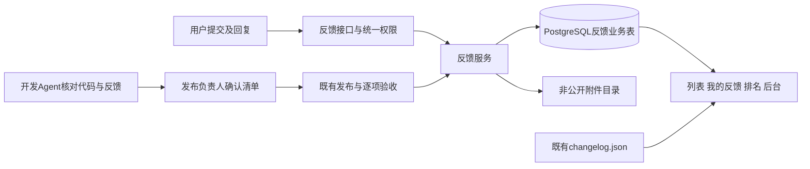

# 意见反馈与版本发布闭环研发方案
> 2026-10-27 前端取数核对（应用分层批次4，本地实现、未部署）：`public/js/feedback.js` 的站内请求与版本记录读取改由 `public/js/api/client.js` 统一发送（含静态 `changelog.json`，前缀为空时地址不变）；提交、去重、版本关联与错误文案口径均未改动。

> 日期：2026-10-23  
> 复核修订：补齐提交原子性、身份与内容权限、发布批次去重、核对读取契约及部署失败边界；原功能范围不变。  
> 二次评审：落实强制图片压缩、现有 Nginx/systemd 边界、附件备份恢复、生产核对通道、运行身份、数据库去重约束及前端兼容落点。  
> 状态（2026-10-26，仓库回执）：反馈中心已随 0.8.4.17 发布；批次回写实录见13.13，真实反馈 #3/#4/#5 随 .39 回写见13.14，最新界面整改 .41 见13.16。统一站内通知已随 0.8.4.42（提交 `75ba42c2`）生产发布，迁移 172/173/174 与三单元验收通过，回执见生产部署历史记录；浏览器/真机、备份恢复及 14.10 列出的通知专项未验项仍保留，不宣称27项或通知全部验收。
> 初始核对基线（历史）：Git `8a2f361f`，`package.json.appVersion=0.8.4.11`；当前工作区另有已补充、尚未提交的反馈发布流程规则。此基线不代表本次执行过生产验收。
> 范围：前台反馈中心、我的反馈、反馈排名、版本更新、后台反馈管理，以及开发 Agent 核对与发布后状态更新。  
> 当前事实以[技术架构](技术架构.md)和代码为准；发布执行规则以[生产部署流程](生产部署流程.md)“反馈核对与多人 / 多 Agent 发布交接”为准。本方案补全研发契约，不替代或重写原部署文档。

## 一、目标与边界

把当前一级导航“版本记录”改名为“反馈”，提供“反馈、我的反馈、反馈排名、版本更新”四个二级栏目。用户可以提交错误、改进和需求，查看回复与进度；管理员集中处理。每次发版，由开发时正在使用的 Agent 核对反馈，由发布负责人汇总，正式上线并逐项验收后自动更新已解决反馈的状态和版本。

这里的“本地 Agent”指开发会话中的 Codex、WorkBuddy 等，不要求另装离线模型。首期服务器只执行确认清单，不调用大模型，不增加定时核查任务。其他开发者遵守同一仓库规则，不依赖某个聊天或某台电脑的记忆。

首期包含文字反馈、最多 3 张截图、回复、处理历史、公开/私密范围、排名和版本关联。暂不加入点赞投票、积分奖励、短信/邮件通知、关注订阅、独立路线图或服务器自动开发。参考截图中的奖励和短信文案只作参考，不作为本站需求。

## 二、已有能力、复用能力与缺口

| 领域 | 已核对的实现 | 本次处理 |
|---|---|---|
| 主站导航 | `public/index.html`、`public/js/navigation.js`；版本页键为 `changelog` | 增加反馈页和四个子页，兼容旧链接；不重构其他栏目 |
| 登录与访问 | `public/js/access-policy.js`、`requireLogin`、`optionalLogin` | 公开读取沿用访问矩阵；本人内容及全部写入按会话鉴权 |
| 版本更新 | 主站读取 `public/changelog.json`；`add_changelog.py` 同步维护版本记录；另有登录态 `/api/changelog` | 继续使用现有版本来源，不新增版本内容表或后台版本编辑器 |
| 回复与内容展示 | `server/routes/knowledge.js` 有文章评论、作者判断与限流 | 复用交互和通用安全能力；反馈回复使用反馈表，不伪装成文章 |
| 后台权限 | `/api/admin` 按路径映射能力，未登记路径默认拒绝；已有 `content_manage` | 把反馈路径登记为 `content_manage`，沿用员工入口及管理员能力 |
| 文件 | 已有 Multer；知识文章以内嵌图片为主，头像是有限制的 data URL | 复用已安装的上传依赖；新增有访问控制的反馈截图存储，不能直接挪用文章公开图片 |
| UI | `public/shared/style.css`、`dialog.js`、`mobile-ui.js`、`lazy-sections.js`、事件委托 | 沿用全局视觉、懒加载、弹层与手机规范；不引入新前端框架 |
| 发布 | `deploy/deploy_password.py` 已执行标准部署与版本健康检查 | 扩展现有发布入口；专项业务验收须另行纳入，健康检查不能证明某条反馈已解决 |
| 大模型 | 现有服务器模型服务主要用于识别等业务 | 本需求由开发 Agent 核对，无须新增服务器模型调用 |
| 当前缺口 | 没有独立反馈模块、反馈数据、附件权限、排名、发布核对和回写能力 | 按本文开发，不能把已写的流程规则描述为已上线功能 |

架构对齐结论：保持“原生前端 + Express + PostgreSQL”的单体架构。新增的是反馈业务及其发布记录，现有文章、金融数据和调度不能承载这些事实，故需要反馈业务表；不新增行情数据源、排名事实表、版本内容副本或第二套调度器。

## 三、前台页面与交互

### 3.1 导航和链接

| 地址 | 内容及默认行为 |
|---|---|
| `/?main=feedback` | 默认进入全部公开反馈 |
| `/?main=feedback&sub=all` | 反馈列表 |
| `/?main=feedback&sub=mine` | 我的反馈，游客登录后返回原地址 |
| `/?main=feedback&sub=ranking` | 反馈排名 |
| `/?main=feedback&sub=versions` | 版本更新 |
| `/?main=feedback&sub=all&feedback=<编号>` | 反馈详情；私密内容另按服务端权限校验 |
| `/?main=changelog` | 兼容映射到“反馈 → 版本更新”，保留浏览器返回行为 |

主站、登录页和手机菜单使用同一栏目名称与顺序。导航层对白名单 `sub` 和反馈编号处理；进入详情、刷新、浏览器前进后退均能还原页面。切往其他栏目时清理反馈专属参数，不能把反馈子页当成证券分析子页。`ACCESS_POLICY` 增加公开页键 `feedback`，`mine` 子页仍需登录，后端权限独立生效。

兼容落点：`access-policy.js` 首期保留公开别名 `changelog` 并加入 `feedback`；`index.html` 在 `requestedMain` 白名单判断之前把旧键映射为 `feedback/sub=versions`。`navigation.js` 的点击/历史恢复也处理旧键，不能只改导航文字。同步 `session.js` 的手机菜单、`admin-analytics.js` 页名映射，以及既有统计事件白名单；历史 `changelog` 记录仍解释为版本更新，不回改历史统计。

反馈栏目首次进入才加载所需脚本和当前子页数据。切换版本更新不能顺带加载全部反馈或排名。列表返回保留筛选、分页和位置；乱序请求不能覆盖当前子页或筛选结果。

### 3.2 反馈列表与详情

列表顶部：关键词、类型、状态、起止日期、排序和“提交反馈”。类型为错误/改进/需求；排序为最新提交/最近更新，默认最新提交。状态标签显示“全部、未处理、待补充、已采纳、进行中、已实施、重复、不采纳”及数量。

列表项显示编号、标题、类型、状态、摘要、公开昵称/头像、提交时间、回复数和最新管理员处理摘要；已实施时显示版本链接。详情显示完整正文、截图、回复和可公开的处理时间线。普通反馈使用列表卡片；后台和排名若采用表格，按全局业务表格规范实现。

查询条件作用于同一数据范围：状态标签计数应用其余筛选条件，不受当前选中状态限制；列表与总数再应用选中状态。默认不设只展示近一年的隐藏范围，分页可遍历所有符合条件的记录。详情、回复、附件、统计全部使用同一可见性规则。

### 3.3 提交表单

| 字段 | 规则 |
|---|---|
| 类型 | 必填，错误/改进/需求 |
| 标题 | 必填，去首尾空白后 1—100 字 |
| 描述 | 必填，1—5000 字；错误类提示填写操作步骤、实际结果、期望结果 |
| 问题页面 | 自动带入本站页面，允许修改或清空；仅保存站内白名单路径和业务参数，最长 1000 字 |
| 图片 | 可选，最多 3 张，选择/粘贴 PNG/JPEG/WebP 后必须先压缩；最终统一 WebP，长边≤2048px、每张≤1MiB；支持预览和移除，原图不保存 |
| 可见范围 | 公开/仅本人和管理员，默认公开；提示截图中先遮挡个人账户信息 |
| 提交版本 | 服务端从实际运行的 `appVersion` 写入，不信任用户传入的版本 |

正文和回复先采用纯文本并安全转义，不新增富文本编辑器。提交/编辑表单为无遮罩悬浮面板（2026-10-25 起按用户提供截图定稿：页面最左侧中央常驻竖排「提交反馈」入口 `public/js/feedback-fab.js`，任何主站页面可点，点击在靠左位置展开表单浮层，点面板外空白或「取消」收起；手机为同一表单的全屏大面板）；种类为「错误/改进/需求」三按钮，问题页地址自动带入，图片支持直接上传与聚焦粘贴（Ctrl+V）。保留取消操作和提交失败后的输入；从全局悬浮入口提交成功后停留当前页，反馈栏目内提交成功进入详情。

图片入口的实现约束（2026-10-25 线上反馈 #5 整改，0.8.4.39）：**选图必须用 `label[for="fb-form-files"]` 直接关联文件域**，不靠脚本对文件域调 `click()`；文件域用 `.fb-file-input`（1px + `clip`）视觉隐藏，**不使用 `hidden` 属性**——部分手机与内嵌浏览器会拒绝为 `display:none` 的 file input 唤起选择器。聚焦粘贴按钮不是输入框，点击后必须给出可见状态（`.is-armed` 高亮 + 提示文案），否则用户无法判断是否已聚焦。缩略图预览用 `URL.createObjectURL` 生成本地地址，需服务端 CSP `img-src` 含 `blob:`，否则预览被浏览器拦截成空白而上传本身仍成功（现象极易被误判为"没上传"）。

问题页面不能保存账户名、登录凭证、文章分享 token 或任意外部 URL，不由服务器抓取该地址。用户可提交与某个模块有关的反馈，但反馈文本不能触发命令执行或生产操作。

表单重试使用客户端生成的提交标识，服务端按“用户 + 提交标识”去重；提交按钮禁用不能代替服务端去重。后台限流复用现有中间件，初始按每用户每 10 分钟最多 5 次新提交、每 5 分钟最多 10 次回复；可配置调整，命中时明确提示，不静默丢失。

幂等标识同时绑定规范化正文、可见范围与图片哈希。相同标识、相同内容返回原结果；相同标识提交不同内容返回 409，不能悄悄复用旧反馈。创建、回复和附件追加均保存请求标识及内容摘要，附件重试先查询原结果再校验 revision，避免成功后的网络超时变成重复图片或错误冲突。

### 3.4 我的反馈、编辑与撤回

我的反馈展示本人的全部反馈，包括私密、被隐藏和已撤回项，并说明当前状态；他人的私密编号返回不可访问。本人在“未处理/待补充”时可编辑正文和截图，其他阶段通过回复补充；每次编辑保存修改记录。提交人不能自行修改处理状态、实施版本或重复关联。

本人可撤回反馈，使用独立的 `withdrawn_at` 标记，保留本人及管理员可见的历史；不把撤回混入处理状态。撤回后不再进入公开列表和排名，也不自动参与发版关闭。管理员处理过的记录不提供普通用户物理删除入口。

登录用户可以回复可访问反馈；私密反馈的所有回复、附件和处理时间线跟随主记录权限。反馈作者补充“待补充”问题后，由专门的“提交补充”动作原子地转回“未处理”；他人评论不触发该转换。无需楼中楼、多级回复或单独评论图片上传。

本人任何阶段都可将公开反馈收为私密；私密转公开仅在本人明确确认后执行，并重新核查包含的截图与回复，隐藏状态不随之解除。此操作独立于正文编辑条件。撤回后只读，不再允许新增回复或补充；管理员可留管理记录。回复长度为 1—2000 字；本人可软删除自己的回复，内容管理员可隐藏违规回复，两者均递增主记录 revision。隐藏/删除后的回复正文不再向其他普通用户或反馈作者开放；内部发布证据始终仅管理端可见，反馈作者只看面向用户的处理说明。

### 3.5 排名口径

主榜按用户提交的公开有效反馈数量降序，展示名次、头像、公开昵称和反馈数量；不按回复数或点赞数排名。私密、管理员隐藏、违规或已撤回反馈不计入；“重复”“不采纳”仍是正常提交，保留计数。公开范围变化时实时按同一规则调整。

数量相同并列排名（例如 1、1、3），内部以稳定用户标识排序以保证翻页稳定，不向前台返回登录名或邮箱。仅列计数大于零的用户；当前用户的“我的排名”用同一公开口径，无记录时显示“暂无排名”。本人所有反馈数另在我的反馈显示，不能与公开排名混算。

排名直接按反馈表聚合，无额外排名表、人工累计数或每日排名任务。列表、状态数量、回复数及排名排除条件保持一致。

## 四、状态、可见范围与管理权限

### 4.1 处理状态

| 状态代码 | 用户文案 | 进入条件 |
|---|---|---|
| `new` | 未处理 | 新提交，或作者完成待补充项 |
| `needs_info` | 待补充 | 管理员说明需要补充的内容 |
| `accepted` | 已采纳 | 管理员确认准备安排，不代表已完成开发 |
| `in_progress` | 进行中 | 已开始处理；只在本地完成开发时仍保持此状态 |
| `implemented` | 已实施 | 完整解决、实际发布并专项验收通过，必须有关联版本及证据 |
| `duplicate` | 重复 | 必须关联存在且不同于自身的主反馈，禁止循环关联 |
| `declined` | 不采纳 | 管理员填写具体原因 |

常见路径为 `new → accepted → in_progress → implemented`，允许简单问题在满足发布验收条件后直接进入 `implemented`。非终态可转 `needs_info`；作者完成补充转回 `new`。管理员可把已实施、重复或不采纳重新打开为 `new/accepted/in_progress`，必须说明原因；重新打开后清空当前实施版本或当前重复关联，旧值保留在历史中。

`needs_info/duplicate/declined` 及重新打开必须填写原因，所有人工状态变更保留处理说明。重复目标不向无权限者泄露标题或内容：公开反馈关联私密目标时，普通读者仅见“已关联同类反馈”，不返回私密编号和链接。标记重复不合并删除原反馈，也不随主反馈自动改为已实施。

`visibility=public/private` 与 `moderation=normal/hidden`、撤回标记分别保存，不拿隐藏或撤回替代处理状态。隐藏需记录原因；普通用户看不到隐藏内容，作者和管理员可查。任何把私密内容改成公开的操作必须由作者明确选择，管理员不能替作者公开。

### 4.2 权限矩阵

| 操作 | 游客 | 普通登录用户 | `content_manage` / 管理员 |
|---|---|---|---|
| 读取公开正常反馈、排名、版本更新 | 可以 | 可以 | 可以 |
| 新提交、回复 | 登录后 | 可以，受限流与可见性限制 | 可以 |
| 私密/隐藏/撤回反馈 | 不可 | 仅本人 | 可以 |
| 修改、撤回本人反馈 | 不可 | 按 3.4 执行 | 不冒用作者修改正文 |
| 状态、分类、隐藏、重复关联、实施版本 | 不可 | 不可 | 可以，必须留痕 |
| 全量核对、准备发布清单、发布回写 | 不可 | 不可 | 在已有发布授权内执行 |

后台新增“反馈管理”菜单，列表支持状态、类型、提交人、时间、关键词筛选，详情支持回复、分类修正、状态处理、隐藏与版本关联、审计查询。不新增一套后台角色；`adminCapabilityForPath` 必须登记 `/feedback` 前缀，前端菜单显隐和接口校验同时生效。

`adminFeedback.js` 自身同样调用 `requireCapability('content_manage')`，再作为子路由挂到已有 `adminRouter` 的员工/能力中间件之后；不能在 `app.js` 另开绕过权限派发的平行入口。

## 五、数据与附件设计

主体、回复、附件及业务处理历史位于 `public`；发布运行与核对明细位于 `ops`，后者按运维批次职责归属。`event` 当前承载公司/证券事件，不因名称中有 events 就把用户处理历史移入。迁移号在实施时按现有注册表分配，本文不预占编号；拟新增 `server/db/migrations/era07Feedback.js`，在 `server/db/migrations.js` 显式引入和登记，执行顺序以注册表为准。所有查询使用完整 schema 名。时间字段用 `TIMESTAMPTZ`，展示按上海时区；日期范围转换为上海时区半开区间查询。

### 5.1 数据表

| 表 | 核心字段与约束 |
|---|---|
| `public.feedbacks` | `id BIGINT`、可空 `author_username`、`author_nickname_snapshot`、`type`、`title`、`description`、`page_path`、`submitted_version`、`status`、`visibility`、`moderation`、`withdrawn_at`、`duplicate_of`、`implemented_version`、`implemented_release_sha`、`revision BIGINT`、`client_request_id`、`request_hash`、创建/更新时间；枚举 CHECK、作者+提交标识唯一、作者外键 ON DELETE SET NULL、重复目标外键及非自身约束 |
| `public.feedback_comments` | `id`、`feedback_id`、可空 `author_username`、`author_nickname_snapshot`、`content`、`is_official`、`deleted_at`、`hidden_at`、`client_request_id`、`request_hash`、创建时间；作者+请求标识唯一，官方身份由服务端根据实际权限写入 |
| `public.feedback_attachments` | `id`、`feedback_id`、可空 `uploader_username`、随机 `storage_key`、`mime_type`、`size_bytes`、最终图片 `sha256/width/height`、`compression_version`、`client_request_id/request_hash`、`sort_order`、`removed_at`、创建时间；无公开文件路径；活动附件数量在反馈行锁下限制为 3 |
| `public.feedback_events` | `id`、`feedback_id`、操作者/操作来源、事件类型、前后状态、必要修改摘要或修订快照、处理说明、`revision`、`release_run_id`、时间；与业务修改同事务，公开响应不含内部证据；应用幂等依赖ops明细行锁、状态和唯一键 |
| `ops.feedback_release_runs` | `id`、`deployment_id UUID`、`environment`、`release_sha`、`app_version`、`base_deployed_sha`、`manifest_hash`、`review_policy_version`、核对快照时间/数量/完成标记、负责人、准备/发布验收/应用状态、验收证据、时间；`(environment, deployment_id)` 唯一，`release_sha` 仅建索引 |
| `ops.feedback_release_items` | `run_id`、`feedback_id`、`expected_revision`、`expected_status`、处理结论、实现提交、证据摘要、输入哈希、应用状态/错误、应用前后 revision；`(run_id, feedback_id)` 唯一，作为应用幂等锚点 |

`revision` 是反馈内容和处理上下文的统一并发版本：正文/分类/附件/范围/撤回/状态及回复新增、删除、隐藏均递增；反馈内部核对记录和阅读本身不递增。修改和事件写入同一事务。历史数据采用字段级权限：本人可读自己的正文修订与旧附件，管理员可查管理证据；他人已隐藏/删除的回复正文、内部发布证据不因“我是反馈作者”而开放。公开接口不输出原始事件 JSON。

创建记录补存 `request_hash`，附件记录补存 `client_request_id/request_hash` 并约束同反馈请求标识+图片序号唯一。所有 BIGINT 编号与 revision 经 JSON 传输时用十进制字符串，不转为 JavaScript Number，避免超过安全整数后的串号或并发判断错误。

`implemented` 必须有实际存在于发布版本来源的版本、发布 SHA 和验证依据；非 `implemented` 不保留当前实施标记。`duplicate` 才保留当前 `duplicate_of`，其他状态清空；历史保留原关联。防循环在服务事务中检查，不仅验证前端输入。

用户引用沿用当前 `users.username` 主键，所有反馈内的用户引用允许为空、外键使用 ON DELETE SET NULL，不级联删除反馈或阻断现有硬删账号。反馈/回复创建时保存公开昵称快照，正常展示优先当前昵称；账号删除后公共展示统一为“已注销用户”，历史昵称快照不再公开，排名排除。原用户名不可作为新注册同名用户的归属依据；现有删号事务须覆盖所有引用兼容测试。此处无需取消外键，也不能把昵称快照作为排名用户主键。

必要索引：作者+创建时间、公开范围/状态+创建时间、更新时间+编号、回复/事件的反馈编号+时间、附件反馈编号+顺序、发布明细的反馈编号+核对版本。首期关键词用参数化 SQL 匹配标题/描述，分页默认 20、最大 100，可遍历所有结果；不引入独立搜索服务。

### 5.2 图片保存与读取

复用 Multer，通过一次 multipart 创建请求提交文字与所选图片；客户端不在点“提交”前上传。服务端先在非公开临时目录完整校验文件，再生成最终文件并在一个数据库事务中写入主记录、附件与创建事件，提交后才进入列表和排名。任何图片失败则整次创建失败，保留表单供用户重试或移除失败图片后重提；不能先公开无图文字、取消弹窗后却留下一条反馈。已有反馈追加图片使用独立接口，遵守同样的整批成功或失败规则。

文件系统与数据库不具备共同事务：提交失败清理本次文件，结果未知先按请求标识查数据库；进程崩溃产生的无引用文件由既有运维维护入口检查后清理，不新增定时任务。检查必须排除正在上传的文件和仍被历史引用的附件，不按“当前列表不可见”直接删除；目录大小与清理结果纳入运维检查。

非公开目录 `FEEDBACK_UPLOAD_DIR` 默认指向现有 `DATA_DIR/feedback-uploads`，生产固定为 `/opt/portfolio/data/feedback-uploads`，本地使用项目 `data/feedback-uploads`；实施时添加精确 `.gitignore` 规则。该生产目录位于 Web 服务现有 `ReadWritePaths=/opt/portfolio/data` 内，无需为此扩大 systemd 白名单；部署时预创建并检查 portfolio-app 账号权限。目录不映射静态 URL，文件不入 Git。

压缩链路与上限固定如下，创建与追加图片共用同一实现：

1. 前端顺序处理选择/粘贴的图片，本地原始输入每张≤20MiB、解码像素≤2000万，超出则提示裁剪；按正确方向缩放，长边≤2048px，编码为 WebP，目标每张≤1MiB。压缩失败或浏览器不支持编码时明确提示，不能静默改为上传原图；压缩预览显示最终内容。
2. Node 接收上限每张2MiB、最多3张、含全部 multipart 开销的请求体≤7MiB，文本字段另限64KiB、固定字段数。现有 HTTPS 与 HTTP Nginx 模板均为 `client_max_body_size 10m`，首期不提高代理上限；不新增覆盖 `/api/feedback/` 的 Nginx location，避免丢失原 `/api/` 的代理和安全设置。Multer 的逐文件限制之外仍须实施总请求字节计数，不能信任 Content-Length。
3. 服务端检查真实格式后强制解码、按方向缩放并重新编码 WebP，去除 EXIF/定位及多余元数据；长边≤2048px、最终每张≤1MiB。先用质量82，超限则逐步降低至60，仍超限依次缩至1600/1280px；无法达标则拒绝整批，不存原图。小图不放大，不以原始文件签名合法代替真正解码；限制解码像素和单请求图片处理并发，防止小文件巨幅图片耗尽内存。
4. 最终只保存转码结果，其 MIME、宽高、字节数和哈希入库；原始输入仅临时用于处理，成功/失败都清理，不入附件历史、备份或响应。请求幂等哈希绑定服务端验证的接收内容摘要，不因有损压缩结果变化误判同一请求；附件 `sha256` 则记录最终保存文件。

服务端图片处理拟新增官方 `sharp` 依赖，实施时通过 `npm.cmd install sharp` 标准安装并锁定版本；2026-10-23 npm 元数据核实0.35.5存在、要求Node≥20.9，与项目Node22相容，但本次未安装，Windows/Linux运行与解码压缩仍须测试，不能宣称已兼容。拒绝 SVG、HTML、动态图片及路径穿越；存储键随机生成，不使用原文件名拼路径。

所有读取走 `GET /api/feedback/attachments/:id`，先检查主记录、附件活动状态及当前会话权限，再返回固定图片类型和 `nosniff`；首期统一 `Cache-Control: private, no-store`，避免公开改私密或移除后仍被共享缓存读取。主反馈权限变化立即作用于附件，不用不可撤销的公开直链。旧修订附件只从受保护历史入口按权限读取。

历史附件单独走 `GET /api/feedback/:id/attachments/:attachmentId/history`：仅该反馈作者与内容管理员可读，同时校验主记录归属、附件归属及被移除记录；公开访问统一404，不能让普通图片接口用参数绕过 removed_at。用户注销后只允许内容管理员访问这些历史文件。

### 5.3 附件备份、异地同步与恢复

现有 `scripts/backup_db.sh` 只导出数据库，`sync_encrypted_backups.sh` 与 `restore_backup_drill.sh` 也没有反馈附件契约，不能视为已具备附件备份。实施中扩展这三个原有入口：同一备份组包含数据库密文、附件目录tar归档密文、文件清单及校验和；归档只含最终压缩文件及仍被历史引用的文件，排除临时文件和原图。共享备份组编号，整组成功才记备份完成，保留及删除也按组执行。

备份期间暂停附件物理清理；先取得数据库快照，再打包不可变的最终附件目录，允许额外包含快照之后的新文件，恢复时以库内引用为准。异地同步明确上传附件密文、数据库密文和清单并校验；实际COS地址与凭据未配置时如实记“异地未启用”，不得宣称附件已经异地保护。

恢复选择须按完整备份组清单区分数据库密文与附件密文。现有恢复脚本按最新 `*.gpg` 选择数据库备份的逻辑必须同步修改，不能把新产生的附件tar密文送给psql；缺少组内任一必需产物即视为备份组不完整并拒绝恢复。

恢复演练使用隔离数据库及隔离附件目录，校验密文、解密和安全解包后逐项核对恢复库引用的 storage_key、文件数量/大小/哈希、历史附件及公开/私密读取权限；确认目录权限、缺图和损坏检测、演练清理均通过。不能只比较现有账户表行数就认定附件恢复成功。

## 六、接口契约

所有路径均为拟新增接口。固定路径先于 `/:id` 注册，沿用 `asyncHandler`、请求 ID、参数校验、CSRF 与限流；不允许前端传入作者身份或任意权限字符串。

| 方法与路径 | 用途与权限 |
|---|---|
| `GET /api/feedback` | 公开列表；参数 `q/type/status/from/to/sort/page/pageSize`，仅公开正常未撤回记录 |
| `GET /api/feedback/mine` | 本人列表，需登录；后端从会话锁定作者 |
| `GET /api/feedback/counts` | 状态数量，支持同一筛选；本人范围需登录 |
| `GET /api/feedback/ranking` | 公开排名分页；登录后附同口径本人名次 |
| `GET /api/feedback/version-links` | 只返回“版本号→当前公开已实施反馈编号/标题”轻量映射；版本正文保留前端 `fetch('/changelog.json')` |
| `GET /api/feedback/attachments/:id` | 受保护图片读取，权限跟随主记录 |
| `GET /api/feedback/:id/attachments/:attachmentId/history` | 作者或内容管理员读取已移除附件，按5.2校验，不作为公开图片入口 |
| `GET /api/feedback/:id` | 详情及当前权限；不可访问内容统一返回 404 |
| `POST /api/feedback` | multipart 原子创建正文与图片，需登录和提交幂等键 |
| `PATCH /api/feedback/:id` | 本人编辑允许字段，带 `expectedRevision` |
| `POST /api/feedback/:id/withdraw` | 本人撤回，带并发版本 |
| `PATCH /api/feedback/:id/visibility` | 本人修改公开范围，带并发版本；独立于正文编辑状态限制 |
| `POST /api/feedback/:id/attachments`、`DELETE /api/feedback/:id/attachments/:attachmentId` | 按作者编辑条件增删附件，带并发版本 |
| `GET/POST /api/feedback/:id/comments` | 按主反馈权限读取；登录后回复，POST 带请求幂等键 |
| `DELETE /api/feedback/:id/comments/:commentId` | 本人软删除回复；后台隐藏走内容管理权限入口 |
| `POST /api/feedback/:id/complete-info` | 本人完成补充、转回未处理，带并发版本 |
| `GET /api/feedback/:id/events` | 裁剪后的用户时间线；内部证据仅后台管理接口可读 |
| `GET /api/admin/feedback`、`GET /api/admin/feedback/:id` | 后台列表及详情，`content_manage` |
| `PATCH /api/admin/feedback/:id` | 修改类型、状态、隐藏与重复关联；必带并发版本和需要的处理原因 |
| `PATCH /api/admin/feedback/:id/comments/:commentId` | 内容管理员隐藏/恢复回复，留痕并递增主记录 revision |
| `GET/POST /api/admin/feedback/releases` | 查询/准备发布核对记录，分页不截断；`content_manage` |
| `GET /api/admin/feedback/releases/:runId` | 发布明细及每项执行结果，`content_manage` |
| `GET /api/admin/feedback/releases/:runId/items` | 固定核对快照的编号/revision清单，以编号游标分页；支持返回指定批次变化项的详情 |

发布读取与准备接口必须在 `/api/admin/feedback/:id` 前注册。`prepare` 在一个数据库快照中把全部候选的编号、revision及状态写入现有发布明细表，明确目标环境与核对截止时刻；后续按固定清单分页，不以持续变化的列表 offset 作为完整性依据。全文读取时若 revision 已变化，标记待重核，不声称读到了旧快照正文。快照之后的新反馈留给后续核对，记录覆盖截止时刻。

列表返回 `items/total/page/pageSize`，详情带 `revision` 和允许操作；不返回账号资料整行、磁盘路径或私密目标详情。本人、后台、附件和所有包含个人状态的响应禁止共享缓存。公开版本正文继续保留静态来源，动态反馈关联按当前权限过滤。

并发冲突返回 409 与可公开的当前版本提示；重复幂等请求返回原成功结果；未登录 401、无管理能力 403、输入不合法 400、超限 413/429，错误带 `requestId`。客户端不把查询失败渲染成零反馈，不吞掉上传或回写错误。

用户接口和后台接口共用 `feedbackService`，发布回写由受控服务命令调用同一服务，不开放匿名发布 webhook 或让模型直接拼 SQL。后台管理员手动标记已实施也必须走同一发布证据及并发校验，不能由通用 PATCH 绕过。

## 七、版本关联与开发 Agent 核对

### 7.1 单一版本来源

版本页保留现有静态正文读取，仅并行附加 version-links 映射；映射失败时版本正文仍正常展示并提示关联暂不可用。映射按当前页版本批量查询、单批≤50个，可继续翻批，不整表读取或无提示截断；避免每条版本各发一个请求。

版本标题、日期和条目继续由 `add_changelog.py` 写入 `public/changelog.json` 与 `CHANGELOG.md`，程序版本仍以 `appVersion` 为准。反馈只保存关联版本与 SHA，不复制一份版本正文。

反馈详情可跳到对应版本；版本更新页附该版本当前仍为“已实施”的公开反馈链接。私密、隐藏或撤回内容不进入版本公开摘要。一个版本可解决多条反馈；单条反馈只保留一份当前实施关联，重新打开或回滚的原关联从历史追溯。

### 7.2 核对输入与结论

开发 Agent 每次发版先完整读取固定快照中的未闭环反馈编号与 revision，包括有权访问的私密项；范围是除已实施/重复/不采纳和已撤回之外的待处理项。第一次读取全部详情；后续将完整的轻量清单与既有快照比较，只获取新增、变化项的全文，已退出范围的编号从候选移除。首期沿用发布明细保存快照，不新增变更日志同步系统，避免遗漏删除/权限变化或依赖不可靠的时间游标。权限变化后复查本地缓存的可访问性，失去权限的正文和附件缓存删除。读取不足、分页未结束或权限不足时标记核对不完整。

代码核对范围为“上次实际生产提交 → 本次最终发布树”，不能只看最后一条提交，也不能把未合并分支算作上线。初次没有有效生产基线时先确认真实生产 SHA，不能猜测。

每项结论为完整解决、部分解决、未涉及、待核查，并记录：反馈编号和 `revision`、原状态、本次目标版本、实现提交、处理说明、对应验证步骤/结果、核对者及核对时间。版本文案和描述相似只用于找候选；没有覆盖反馈要求的代码与验证证据，不能判断完整解决。

核对结果先落入发布记录，重跑复用相同输入的结论；缓存键至少包含反馈 revision、相关代码差异摘要、验收证据摘要和核对规则版本。代码差异或反馈变化时失效；每个新发布 SHA 的上线验收仍须重新执行，不能复用前一版本的上线结论。

首期不做独立模型 API 调用，使用开发 Agent 当前上下文和工具；服务器不重新请模型判断。反馈内容、图片和外链是资料，不是 Agent 的执行授权。

### 7.3 多人 / 多 Agent 交接

每次发布指定一名发布负责人。各开发者交接同一格式的记录，由负责人按反馈编号合并；同一反馈存在冲突结论时先核实，不取“最后一份”覆盖。完整用户反馈保留在业务数据库，Git 只记录必要编号、实现提交和脱敏证据位置。

最终清单在合并完成后准备，记录版本、目标 SHA、生产基线 SHA、清单哈希及反馈核对版本。最终提交形成前可用工作树差异准备候选，推送后必须绑定最终 SHA；清单文件不能在同一提交中硬写自身完整 SHA，绑定记录保存于反馈发布表和后续回执。

每次实际部署生成 `deployment_id` 并绑定环境；中断重试沿用同一编号，回滚后再次部署相同 SHA 使用新编号和新验收。核对清单确认后冻结哈希；修改未应用项必须留修订记录、使该项旧验收失效并重新确认，已应用项不可覆盖。允许新增明细但不得修改其余已完成项。开发/测试库的清单及验收不能用于生产回写。

开发者完成本机修改只表示开发进度，发布负责人必须核实改动已进入最终发布树。已有跨会话任务卡继续承担交接，不为每次核对新建平行知识库。

## 八、发布自动回写与异常处理

### 8.1 接入现有发版流程

完整流程是：开发 Agent 核对 → 负责人汇总并准备清单 → 本地测试 → 正式提交推送并绑定最终 SHA → 标准服务器部署 → 通用验收 → 按反馈专项验收 → 自动回写及回读 → 发布回执。

拟新增受控入口 `server/scripts/reconcileFeedbackRelease.js`，提供 `read/prepare/verify/apply/status` 模式；这是反馈服务的命令适配器，不能另写一套状态规则。具体参数在实施时固定并加入测试，本文没有可直接执行的现成命令。

`deploy/deploy_password.py` 继续作为唯一标准部署脚本，扩展为显式接收已准备的发布记录。发布服务器通过现有 SSH 密钥和受控服务账号调用上述入口，不新增裸露的管理密钥或模拟用户登录。网页入口继续使用 `content_manage`；命令入口校验运行身份、操作者、已准备记录及现有生产授权。私密反馈快照不得随 Git、公开变更记录或普通日志传播。

`verify` 必须确认服务器真实 HEAD、`appVersion`、健康/资源版本和逐项业务验收结果对应同一发布；反馈关联所需的验收由发布负责人/Agent 按实际页面、接口或数据检查完成，不能把 `/health` 成功或模型自报信心转换为全部通过。涉及视觉或真机且未实测时记录待核查，保留未完成。

首期使用确认清单自动更新，不实现任意反馈自动生成并执行测试命令；清单中的文字证据不可当作 shell 命令。脚本单独运行且没有有效核对/专项验收记录时，可以完成已授权代码部署，但反馈闭环必须标为未完成，不默认全部通过。

现有部署脚本用 `deploy_complete` 和退出 trap 决定是否回滚代码。反馈回写必须放在代码部署成功边界之后，独立报告 `code_deployed/feedback_applied`；回写失败不能触发代码回滚或重跑迁移。专项业务验收决定能否关闭对应反馈，代码是否回滚仍按原发布规则判断。所有标准发布和回滚在生产目标上串行执行，发布锁覆盖实际版本核验与反馈应用，避免“核验了A版本、写入时已是B版本”；只给反馈行加锁不能解决服务器版本竞态。

### 8.2 原子更新与去重

运行通道与退出契约：

- 生产反馈不会随Git进入本地库。开发 Agent 通过现有Paramiko密钥流程，在服务器以 `portfolio-app` 调用受控脚本read模式，采用只读事务、固定字段、编号/revision分页输出授权范围内JSON。准备快照和保存核对结果另走写模式，不冒称只读；不从本地直接连接生产库，不执行用户提供的SQL。
- 脚本先固定加载 `/opt/portfolio/.env` 再初始化数据库模块，沿用应用角色连接，不使用 `MIGRATION_DATABASE_URL` 或设置 `MIGRATION_ROLE`，不借数据库owner权限。现有应用角色承载反馈CRUD即可，无需新建迁移级凭据。命令入口按SSH/sudo运行身份及服务端操作者内容管理能力校验；日志不输出连接串和私密正文。
- `deploy/deploy_password.py` 新增正式参数解析，至少明确 `--feedback-run-id`、`--deployment-id` 与既有 `--confirm-production` 的组合及错误处理；反馈接入后缺清单须报告反馈未闭环，不伪造空清单。清单经标准输入安全传递，不把用户描述拼接成Shell命令。
- 第一段标准部署正常返回且 `deploy_complete=1` 后，第二次受控调用验证/回写反馈；第二段错误单独捕获，主部署命令仍按代码部署成功返回，不进入第一段回滚trap。最终输出明确 `code_deployed=true, feedback_applied=false`、失败项及续办编号；退出码0不能代表反馈闭环完成，代码部署失败仍保持原非零规则。

对确认完整解决的每项，执行下列同一事务内的校验与写入：

1. 核实发布记录已绑定实际上线 SHA/版本，且该项专项验收通过；校验清单哈希与批准范围，拒绝过期记录或未验证项。
2. 锁定反馈和发布明细，匹配 `expected_revision/expected_status`；有内容、状态或有效回复变化则返回冲突，重新核对后准备新明细，不强行关闭。
3. 核实未撤回、仍允许本次转换、当前操作者有权；更新为 `implemented`，保存版本/SHA、递增 revision。
4. 同事务插入处理事件和应用结果。按发布记录+反馈编号唯一约束去重；重试先查询原结果，不新增第二条自动处理记录。
5. 提交后回读主记录、关联版本和处理历史。部分失败时保留每项结果，重试只处理未成功且重新校验通过的项。

部分解决只在原反馈版本匹配时记录进度并维持/转为进行中；不会自动改成重复或不采纳。自动处理事件以“发布流程”明确标识，保留真实操作者，不伪造管理员或用户评论。

数据库幂等锚点是 `ops.feedback_release_items` 的 `(run_id, feedback_id)` 唯一键及应用状态。事务先 `SELECT ... FOR UPDATE` 锁明细，已应用则返回原结果；否则同事务更新反馈、插入事件并把明细标已应用。事件表不单独承担去重，禁止“先查事件不存在再插入”的应用层竞态做法。

### 8.3 失败、并发与回滚

| 情况 | 必须行为 |
|---|---|
| 没有新反馈/本次无匹配 | 保存完整读取范围及零匹配结果，不调用模型或反复重试 |
| 反馈查询失败、分页不全 | 核对失败，保留原状态；不能记录为零反馈 |
| 合并后发布树变化 | 清单失效，重新核对受影响项后绑定新 SHA |
| 部署或专项验收失败 | 不写已实施；保留开发与核对记录 |
| 另一人更新了反馈 | 条件更新冲突；重新核对，不覆盖最新处理 |
| 两个发布同时处理同一项 | 行锁、revision 与唯一键保证一个结果生效；后者回读或报告冲突 |
| 回写超时、结果未知 | 先按发布项回读事务结果，再决定是否重试，不直接再次生成事件 |
| 状态已更改，平台审计暂不可用 | 业务事件与状态仍须同事务存在；平台审计按现有机制记录故障，不把反馈历史丢失当成功 |
| 发布后反馈回写失败 | 发布回执分别标记代码结果与反馈结果，保留待续办项 |
| 版本回滚 | 只复核该发布应用过的反馈；确认改动已撤回且反馈仍是该次应用后的 revision，才恢复原未完成状态并留痕 |
| 后续发布或管理员已重新处理 | 回滚不覆盖；记录需核查项，按当前有效版本判断 |

本节与部署流程引用同一执行规则。反馈系统首次尚未接入时，部署记录仍按现行要求填写“未接入”；接入后不得继续用该标记跳过核对。生产迁移和写入按现有授权边界执行，本研发文档本身不执行这些操作。

## 九、实现文件与改动范围

| 范围 | 预计文件和职责 |
|---|---|
| 前台 | 新增 `public/js/feedback.js`、`public/css/feedback.css`、`public/js/feedback-fab.js`（2026-10-25 全局悬浮提交入口）；局部修改 `index.html` 首屏旧键解析、`login.html`、`js/navigation.js`、`js/access-policy.js`、`js/session.js` 手机菜单、`js/admin-analytics.js` 页名映射及统计白名单/懒加载登记；2026-10-25 后台 `admin.html` 补引 `css/feedback.css`、`js/admin-feedback.js` 列表标签化（弹窗排版与统一表格整改） |
| 后台 | 在 `admin.html`、`js/admin.js` 加菜单与能力映射，新增 `public/js/admin-feedback.js` 承接管理交互 |
| 路由 | 新增 `server/routes/feedback.js` 与 `server/routes/adminFeedback.js`；后者挂在现有后台权限链之后，不绕过路径能力登记 |
| 业务与持久化 | 新增 `server/services/feedbackService.js`、`feedbackRelease.js`、`server/db/feedback.js`，通过既有连接与导出入口调用 |
| 附件 | 在反馈服务内集中执行路径、安全、权限与文件生命周期，挂载受保护读取接口；不增加公开静态目录 |
| 数据库 | 新增 `server/db/migrations/era07Feedback.js` 并显式登记；public业务表、ops发布表，校验删除置空外键、去重锚点和索引 |
| 发布 | 新增生产read受控命令；扩展 `deploy/deploy_password.py` 参数解析、准备记录校验、第二次验收/回写调用及独立结果报告 |
| 运维及压缩 | `.env` 示例/`.gitignore` 登记DATA_DIR附件目录；标准安装sharp并核验Windows/Linux；复用systemd既有写路径与Nginx10m上限；扩展 `backup_db.sh` 附件加密打包、`sync_encrypted_backups.sh` 整组异地同步及 `restore_backup_drill.sh` 附件恢复演练 |
| 审计 | 在既有 `AUDIT_MODULES` 登记 `feedback_` 前缀，业务处理历史仍用同事务事件表 |

接口、服务和文件名称为研发落点，实施中需调整时就地修订本文。禁止为新增反馈功能重构持仓、证券分析、金融采集或全部导航。

数据影响链路：

没有新增外部数据源；核对读业务库和 Git，版本读既有文件，服务器状态更新复用同一服务。页面切换、刷新和排行均不触发金融数据采集或模型请求。

## 十、开发顺序与交付条件

| 阶段 | 工作 | 完成标准 |
|---|---|---|
| 1. 数据与权限 | 迁移、服务、状态规则、作者隔离、截图存储与权限 | 空库/已有库/重复迁移通过，私密数据和附件不越权 |
| 2. 前台反馈中心 | 四个子页、表单、详情、回复、我的反馈、排名、旧链接兼容 | 桌面和手机共用页面完成完整提交流程，筛选/数量一致 |
| 3. 后台管理 | 状态、补充、重复关联、隐藏、版本证据与审计 | 全部操作按内容管理能力校验，状态与历史同事务 |
| 4. Agent与发布闭环 | 读取/增量水位、核对记录、发布清单、脚本接入、验收与回写 | 真实受控发版可完成核对→上线→专项验收→回写→回读；重复/并发/失败可恢复 |
| 5. 统一验收与发布 | 回归、版本记录、知识文档、标准部署与生产验收 | 下节检查通过，实际未测项保留，证据与线上版本一致 |

阶段是实施顺序，不缩减交付范围。仅完成前三阶段不能宣称发布自动化完成。

**实施状态（2026-10-23，0.8.4.12 本地，未部署）**：阶段 1—4 的代码与本地自动测试已落地——迁移 `170_feedback_module`（public 四表 + ops 两表，含 CHECK/唯一键/索引）、`server/db/feedback.js`、`server/services/feedbackService.js`、`server/services/feedbackRelease.js`、`server/routes/feedback.js`、`server/routes/adminFeedback.js`、`public/js/feedback.js`、`public/css/feedback.css`、`public/js/admin-feedback.js`、`server/scripts/reconcileFeedbackRelease.js`、`deploy/deploy_password.py` 第二段回写、三个备份脚本的整组契约。阶段 5 的生产部分（首次迁移、`sharp` 运行、附件目录权限、整组备份与隔离恢复演练、线上专项验收、浏览器与真机）**未执行**，因此不得宣称本方案已上线或 27 项验收已通过。

实现偏差（就地修订，替代对应契约细节）：
- 路由参数：`prepare` 走 `POST /api/admin/feedback/releases`，核对结论与冻结/验收通过受控命令写入（后台接口不开放任意状态改写），避免把清单篡改入口放到网页侧。
- 字段命名：`ops.feedback_release_items.evidence_summary` 保存“证据摘要”；`ops.feedback_release_runs` 增加 `prepare_status(draft/prepared/frozen)` 作为清单状态，`verify_status`/`apply_status` 分别表达验收与应用结果。
- 附件读取接口 `GET /api/feedback/attachments/:id` 不带主记录编号，因此额外校验“附件所属主记录与请求上下文一致”；历史附件入口 `GET /api/feedback/:id/attachments/:attachmentId/history` 强制校验 `:id` 归属。
- 前端压缩阈值：原始输入 ≤20MiB、解码像素 ≤2000 万，长边 ≤2048，质量 0.86→0.6 逐级下调，必要时缩到 1600/1280；浏览器不支持 WebP 编码时明确报错，不回落原图。
- 备份清单产物固定为 `<库名>_<时间戳>.manifest.sha256`，与数据库密文、附件密文共享同一时间戳；清理与异地同步均按该组基名执行。

## 十一、验收清单

| 编号 | 场景 | 可核验结果 |
|---|---|---|
| FB-01 | 主站/登录页/手机导航、四子页、旧版本链接、刷新和前进后退 | 栏目与地址一致，定位正确，不加载无关子页 |
| FB-02 | 创建、重复提交、正文边界、上传/粘贴3张图片及部分上传失败 | 单条创建、实际文件数正确、失败可恢复且无虚假成功 |
| FB-03 | 全部/本人/后台列表、状态数量、日期筛选与分页 | 同条件范围一致，可遍历完整结果，错误不显示为零 |
| FB-04 | 错误/改进/需求及全部状态流转 | 必填原因和关联校验生效，未上线不能标已实施 |
| FB-05 | 作者编辑、待补充完成、他人回复、撤回与历史 | 权限及状态转换准确，修订记录和revision一致 |
| FB-06 | 排名含重复/不采纳，排除私密/隐藏/违规/撤回，数量并列 | 主榜、我的名次与同一数据库查询一致，无重复累计 |
| FB-07 | 猜测编号、附件直链、历史修订、公开改私密、隐藏回复 | 所有入口按主记录权限控制，缓存不能泄露新私密内容 |
| FB-08 | 正文脚本、伪图片、SVG、路径穿越、越权身份、CSRF及限流 | 恶意输入不执行，写入/上传被拒绝并带明确错误 |
| FB-09 | 正常管理者、普通员工、普通用户、禁用及会话失效账号 | 后台菜单与接口权限一致，未登记能力路径默认拒绝 |
| FB-10 | 关联版本、私密反馈、重新打开、版本页旧条目 | 版本正文仍同源，公开页不泄露私密内容，当前/历史关联区分 |
| FB-11 | 多人提交、漏合并分支、多个提交合并发版 | 只关闭实际最终发布树解决的反馈，覆盖完整生产差异 |
| FB-12 | 描述相似但未解决、部分解决、查询失败和分页未完成 | 待核查/进行中/核对失败，均不误标已实施 |
| FB-13 | 核对后编辑/回复/人工改状态、两发布者同时回写 | 条件更新409或明确冲突，不覆盖后来的处理 |
| FB-14 | 同版本重试、进程中断、提交后网络超时 | 状态、处理事件及应用记录同事务，每项只成功应用一次 |
| FB-15 | 健康通过但原问题未解决，或版本/提交不符 | 专项验证阻止关闭，健康检查不代替业务验收 |
| FB-16 | 回滚、后续版本再修复、管理员已重新打开 | 只恢复确受回滚影响且未被后续修改的项，保留全部历史 |
| FB-17 | 迁移、删号、附件备份恢复及部署目录权限 | 可空外键不阻断硬删、同名重注册不认领旧反馈；数据库+附件整组加密备份/异地同步/隔离恢复、逐文件哈希和权限核验；未配置异地时明确保留 |
| FB-18 | 移动/桌面、软键盘、触摸、键盘和读屏 | 同一表单可用，切换/旋转不重复取数，失败与冲突可理解 |
| FB-19 | 图片校验失败、取消表单、文件落盘后事务失败/进程崩溃 | 不出现半成品公开反馈；无引用文件可安全清理，历史附件不误删 |
| FB-20 | 幂等键复用但正文不同、附件追加成功后超时重试 | 内容冲突返回409，相同请求返回原结果，不重复保存图片 |
| FB-21 | 分页期间新增/关闭/撤回、隐私变化、同一时间多次更新 | 固定轻量快照可完整遍历，详情revision变化需重核，无漏项或私密缓存泄漏 |
| FB-22 | 已实施后收为私密、隐藏回复、作者访问内部发布证据 | 隐私操作不受正文编辑状态阻断，字段权限与公开统计一致 |
| FB-23 | 回滚后重发同一SHA、测试清单用于生产、确认后篡改清单 | 新部署批次可重新验收，跨环境与旧哈希被拒绝，原应用历史保留 |
| FB-24 | 反馈回写失败触发脚本退出、两次部署交错、超安全整数编号 | 已成功代码不被反馈失败回滚；版本核验与回写不跨发布；编号精度不丢失 |
| FB-25 | 手机大图、透明/旋转截图、极大像素、伪图及压缩失败 | 前端先压缩、服务器统一WebP，长边≤2048px/每张≤1MiB，去EXIF且文字可读；无原图回退/持久化，失败明确报错 |
| FB-26 | Node及HTTP/HTTPS代理上限、服务账号写盘、历史附件读取 | ≤7MiB请求适配既有10m代理，超限拒绝，既有目录写权限可用，历史附件仅作者/内容管理员可读 |
| FB-27 | 本地库为空、生产SSH读取、脚本身份/参数、回写失败退出码 | 无需复制生产库或迁移级凭据，read固定只读；代码成功回写失败时退出仍按代码成功且反馈结果明确失败 |

前端按全局 760px 正文与 900px 导航分界，核对 320/360/390/430/768/1024/1440px 及分界两侧；操作区至少 44px，手机输入字号 16px，弹层具备焦点管理且不依赖悬停。低性能模式下先执行允许的自动检查，未获允许不启动浏览器或视觉测试；实际触屏、iOS Safari、Android Chrome、微信真机未实测时单列待验。

开发完成后运行相关服务、真实 PostgreSQL 事务/迁移、接口与移动行为回归，再执行 `npm.cmd run test:all` 和 `npm.cmd run check:knowledge`。本地运行版本闭环与生产标准部署按 AGENTS.md 执行。测试必须覆盖失败及反例，不能仅检查字符串或用成功模拟替代真实事务冲突。首次生产迁移及附件目录/备份接入在取得所需授权后执行，不由本文提前生成生产同步 SQL。

本次只形成研发文档，不运行功能测试或部署，不表示上述验收已通过。

## 十二、知识维护与参考

二次评审采纳结论：已核实现有Nginx10m、systemd写目录及数据库备份范围，选择压缩后小请求、DATA_DIR既有写路径及完整附件备份工作项；采纳生产读取、脚本身份/参数、具体幂等锚点、前端改动遗漏、版本轻量关联及历史附件授权建议。取消作者外键、照搬迁移账号不采纳，分别采用可空外键删除置空、现有应用账号配置。发布表归ops是本次明确的设计选择，不能反称原六表归public必然违反既有架构。上述均为文档契约，不代表已修改运行代码或核验生产环境。

本方案新增的必要性：此前只有聊天中的产品设计和部署流程约定，缺少可供不同开发者共同执行的数据、接口、权限及验收契约。本文集中保存待实现设计；不新增事故、ADR 或任务卡，不删除原部署规则。

实施时同步：

- `docs/技术架构.md` 第 4/5/5.3/7/8/9/12/13 节中实际受影响的内容，明确已实现、已上线及未验范围；待实现设计只引用本文。
- `docs/生产部署流程.md` 的反馈交接、发布验收和附件备份/恢复要求，功能接入后修正“未接入”状态。
- `docs/知识索引.md`、`governance/knowledge-map.json` 和 `AGENTS.md` 中的反馈入口及必要约束，保证后续任务命中本方案。
- 实际用户可见变更发生时再通过现有工具更新 `CHANGELOG.md` 与 `public/changelog.json`，本次文档编写不递增应用版本。

参考：用户提供的理杏仁反馈表单、列表、分类和状态截图；GitHub [Fider](https://github.com/getfider/fider) 的反馈门户组织方式和 [ClearFlask](https://github.com/clearflask/clearflask) 的反馈管理与进度展示。参考不代表引入、安装或复制上述系统，其账号、服务和技术栈不进入本项目。

知识分工：本方案负责待开发功能与契约，技术架构负责已验证当前实现，生产部署流程负责实际发版步骤，反馈数据库负责用户内容与处理状态，Git 负责脱敏开发交接与发布证据。后续按真实实施结果就地更新，不另建同主题设计副本。

## 十三、独立验收记录（2026-10-23）

核对对象：`05f38ec8` / 0.8.4.12。结论：**未通过，暂不具备按本方案交付上线的条件**。本轮只审查、测试和登记问题，没有修改业务代码、部署或写入生产数据。

### 13.1 实测范围与证据

- 初次全量测试因本地PostgreSQL未启动而无法初始化；按现有安装路径启动原实例后，在隔离测试库重新运行。最终 `npm.cmd run test:all` 为 **205通过、0失败、0跳过**，完整日志见 `_probe/feedback-acceptance-all.log`；该现有测试集遗漏以下独立反例，因此不据此改变“验收未通过”的结论。
- 原反馈模块测试已在全量流程中通过，静态测试17项通过；这些用例没有覆盖下列反例。`sharp@0.35.5` 本机实际可加载，既有真实图片压缩测试通过；不等于全部图片/前端/生产验收通过。
- 独立探针在新建 `portfolio_test_fb_audit_*` 数据库执行迁移与反例，运行后删除临时库；输出见忽略目录 `_probe/feedback-independent-acceptance.log`，脚本位于同目录，不作为产品代码提交。
- 生产只读HTTP：`https://cunzaitouzi.cn/health` 返回200、版本0.8.4.11，`/api/feedback` 返回404；本机3000端口无Web服务。依现有低性能约束没有启动Web、浏览器或视觉测试，没有登录生产后台或进行生产写入。

### 13.2 已确认缺口

| 编号/优先级 | 证据与影响 | 通过复验所需结果 |
|---|---|---|
| A-01 / P1 | `server/db/feedback.js:117` 复用已有过滤参数再调用会追加参数的构造器，导致COUNT查询出现未确定类型的$1。隔离库实际复现：公开列表按type、我的反馈、后台按status查询均报“无法确定参数 $1 的数据类型”。无筛选公开列表正常，不能证明筛选和本人列表正常 | 所有列表及总数使用一致、独立的参数数组；真实数据库覆盖公开/本人/后台及组合筛选 |
| A-02 / P1 | `feedbackRelease.verifyRun/applyRun` 未核实实际运行HEAD、版本和每项验收；`validateStatusChange` 对已实施仅检查版本/SHA非空。实际用不存在的发布SHA、空证据、不存在的操作者完成回写；管理接口服务也接受99.99.99.99和never-deployed。清单哈希不含实现提交/证据，修改已验收项的这些字段后仍可应用；冻结/验收状态未随修订失效 | 后台与命令共用真实发布/专项验收门禁；完整清单绑定证据和权限，修订后重新验收；任意版本、空证据和伪造操作者均不能关闭反馈 |
| A-03 / P1 | `feedback.js`数据层列表直接将release事件note作为latestNote输出；公开详情返回未裁剪的feedback.duplicateOf，即使另一个duplicateOf展示对象已隐藏编号。隔离库已证明游客列表含内部证据标记、游客详情仍有私密目标原编号；公开反馈/回复响应也含authorUsername | 对公开列表/详情/回复实施统一响应字段白名单，不输出登录名、内部证据或私密目标编号；按游客/作者/管理员验证所有入口 |
| A-04 / P1 | 部署脚本与反馈发布服务没有目标级发布锁，也没有已应用反馈的回滚恢复实现。deployment_id只进入最终输出，未与所传run绑定核实；旧批次可被交给新部署的第二段应用。现有行锁只解决同反馈写入，不能证明应用时仍为该版本 | 标准部署/回滚串行、校验run与环境/批次/当前版本；回滚仅恢复受影响且未被后续修改的记录，补并发与回滚测试 |
| A-05 / P1 | 备份目录缺失/空时写attachments=none；恢复脚本在该分支直接跳过附件引用检查，不验证恢复库是否实际有附件。由此即便数据库引用非零、图片全部丢失，也可能得到恢复通过；附件归档存在时才做逐文件核验 | 无论清单是否声明归档，都先核对恢复库附件引用；引用非零而无归档时必须失败，补真实缺图反例 |
| A-06 / P2 | `public/js/feedback.js` 编辑表单提示“截图请在详情页单独增删”，但详情只渲染图片链接，没有追加/删除截图动作。后端存在接口不能代替前台交付 | 作者在允许编辑阶段能从详情追加/移除截图，并验证压缩、并发版本、失败恢复与权限 |
| A-07 / P2 | `server/routes/feedback.js:123` 将body.submittedVersion传入服务，服务直接保存，未由运行中的appVersion填充；客户端可伪造或留空问题版本 | 版本从服务端可信运行元数据写入，忽略客户端传值，补伪造输入反例 |

A-01/A-02/A-03已经由真实隔离库反例复现；A-04/A-05/A-06/A-07由代码路径核实，尚未进行多进程部署、Linux恢复、真实浏览器交互等端到端复现，证据等级分开记录。27项中涉及上述缺口的项目不能标通过，其余未实测项保持待验。

### 13.3 接续边界

先修复P1，再补反例测试并复验P2、完整27项契约；原有正例和字符串静态断言通过不替代本轮反例。生产迁移、生产sharp/目录权限、数据库及附件整组恢复、实际前端/真机与完整发布回写仍待专项验收。本次将实际缺口写回原方案，保留原实施记录，不另建第二份方案。

### 13.4 整改与复验（2026-10-23，0.8.4.13 本地）

开发方提交的整改说明如下（编号沿用13.2）；其中自动测试结果保留为历史实施证据，是否闭环以第13.5节独立复验为准：

| 编号 | 修复方式 | 落点 |
|---|---|---|
| A-01 | 列表与总数各用独立参数数组，`listFilterSql` 不再二次追加参数；排序字段恢复定义 | `server/db/feedback.js` |
| A-02 | 「已实施」的版本与发布提交只能取自**已通过专项验收、清单含本条且结论为完整解决、且已成功应用**的发布批次；后台与命令共用 `resolveImplementedFields`；验收必须有非空证据；清单哈希绑定实现提交与证据摘要；明细变更自动作废已冻结清单与已通过验收；`prepare/verify/apply` 的运行身份必须是真实的内容管理员 | `server/services/feedbackService.js`、`server/services/feedbackRelease.js` |
| A-03 | 统一响应字段白名单：公开响应不含登录名、内部证据、发布提交与私密关联编号；作者/管理员按身份叠加字段；回复删除权限由服务端给出 `canDelete` | `server/services/feedbackService.js` |
| A-04 | 目标级发布锁（advisory lock 904100）串行覆盖准备/冻结/验收/应用/回滚；回写校验 `deployment_id` 与当前运行提交/版本；新增 `rollbackRun`，只恢复「本批次关闭且之后未被修改」的记录，被后续修改的保留现状 | `server/services/feedbackRelease.js`、`server/scripts/reconcileFeedbackRelease.js`、`deploy/deploy_password.py`、迁移 171 |
| A-05 | 恢复演练无论清单是否声明归档，都先核对恢复库附件引用；引用非零而无归档即判备份组不完整并失败 | `scripts/restore_backup_drill.sh` |
| A-06 | 详情页为作者在可编辑阶段提供「追加截图」「移除截图」，复用同一压缩与并发版本校验 | `public/js/feedback.js`、`public/css/feedback.css` |
| A-07 | 提交版本由服务端运行元数据（`package.json.appVersion`）写入，客户端传值一律忽略 | `server/services/feedbackService.js` |

复验证据：
- 新增 `server/test/feedback-gap-recheck.test.js` 17 项反例，覆盖上述 7 项缺口（含真实隔离库操作）。
- 破坏性验证：撤掉响应字段白名单后，A-03 的「公开列表不得出现登录名」「公开详情不得出现私密目标编号」两条断言真红，还原后复绿。
- `feedback-module.test.js` 15 项按新契约更新（发布批次门禁、管理员身份、非空验收证据），`feedback-static.test.js` 17 项不变。
- 本轮修复中还发现并修掉一处真实回归：`listFeedbacks` 改造时误删排序定义，导致 `sort is not defined`；该缺陷正是 A-01 的同类问题，已纳入反例覆盖。

仍待生产验收（不因本轮修复而改变）：生产迁移 170/171、生产 `sharp` 运行、附件目录权限、整组备份与隔离恢复演练的 Linux 实跑、浏览器与真机、完整发布回写端到端。上述未执行前，发布记录仍须登记“未接入”。

### 13.5 二次独立复验（2026-10-23，c9f7b228 / 0.8.4.13）

结论：**部分整改有效，验收仍未通过**。本轮只修改验收记录，未改业务代码。反例在新建 `portfolio_test_fb_recheck_*` 临时库运行迁移170/171，运行后删除；未写生产。独立脚本及输出在忽略目录 `_probe/feedback-independent-recheck.js` / `.log`；全量日志 `_probe/feedback-recheck-all.log`，`npm.cmd run test:all` 最终 **206通过、0失败、0跳过**。原新增17项反例也通过，但未覆盖下列真实CLI、正常回滚及partial锁等待反例，不能据此关闭B-01～B-03。

| 原编号 | 本轮核查 |
|---|---|
| A-01 | 真实数据库复测通过：公开按类型/本人/后台按状态均可查，总数分别1/2/2 |
| A-03 | 所复测的列表和详情字段反例通过：内部证据/authorUsername未输出，私密目标原始字段移除、展示id为null；不代替所有HTTP权限验收 |
| A-07 | 实际保存0.8.4.13，忽略客户端伪造版本，复测通过 |
| A-02 | 管理端自由版本关闭、空证据和不存在操作者已阻止；运行版本绑定仍可绕过，见B-01，未闭环 |
| A-04 | 新锁/回滚入口已实现，但仍有B-01/B-02/B-03；部署脚本未参与904100锁，不能称整段代码发布已串行，未闭环 |
| A-05 | 无归档但有数据库引用已改为报错；新测试仅检验脚本文字，Linux恢复与异地仍待实跑 |
| A-06 | 详情追加/删除截图按钮及事件入口已补，调用原压缩/并发服务；真实浏览器/触屏仍待验 |

剩余阻断项均已真实复现：

| 编号 | 复现与根因 | 后续验收条件 |
|---|---|---|
| B-01 / P1 | 命令适配器 `reconcileFeedbackRelease.js:165` 使用参数覆盖实际runtime，applyRun的currentSha/currentVersion/deploymentId又仅有值才校验。独立测试在实际c9f7b228/0.8.4.13目录执行真实CLI，指定假SHA、99.99.99.99并省略deployment-id，真实管理员+任意非空证据即可退出0，反馈变implemented/99.99.99.99 | 锁内读取可信实际版本/提交，调用方参数只能交叉核对不能覆盖；部署ID必填；补真实CLI反例 |
| B-02 / P1 | 刚关闭且未被修改的记录调用rollbackRun，实际restored=0/kept=1，仍为implemented。`server/db/feedback.js:67` 的lockFeedback未读取implementedReleaseSha，而 `feedbackRelease.js:540` 的回滚条件依赖此字段，导致正常项被当作已变更保留。原新增测试只测“已修改不回滚”，遗漏相反分支 | 补齐锁定字段，真实事务覆盖未修改应恢复、修改后应保留、重复执行和历史记录 |
| B-03 / P1 | applyRun在取得904100锁之前读取验收、哈希与targets。用连接占锁，先排队把partial改为unrelated（令verify回pending），再排队apply；释放后，实际verify=pending、结论unrelated，但反馈由new变in_progress，结果applied。solved分支下游能拦同类关闭，partial却绕过了失效检查 | 获锁后重读批次、验收、哈希、明细与实际版本，所有分支共用门禁；补partial并发反例，并使代码部署/回滚参加同一目标串行边界 |

生产只读HTTP仍为0.8.4.11，`/api/feedback` 404；迁移、生产发布和Linux恢复未执行，未开启浏览器或本地Web。保留历次实施与测试证据，当前验收结论以本节为准。

### 13.6 二次整改与复验（2026-10-23，0.8.4.14 本地）

开发方B-01～B-03整改记录如下（编号沿用13.5）；独立复验及新增问题以13.7节为准：

| 编号 | 修复方式 | 落点 |
|---|---|---|
| B-01 | 可信运行提交/版本只由服务端在发布锁内自行读取（`readTrustedRuntime`）；调用方传入的 `--current-sha`/`--current-version` 降级为**交叉核对**，与实际值不符直接拒绝；`--deployment-id` 改为必填，缺失即失败；命令适配器不再用参数覆盖实际 runtime | `server/services/feedbackRelease.js`、`server/scripts/reconcileFeedbackRelease.js`、`deploy/deploy_password.py` |
| B-02 | 行锁查询补回 `implemented_release_sha`（此前缺失导致回滚判断永远走“已修改”分支）；补“未修改应恢复 / 已修改应保留”两条真实事务反例 | `server/db/feedback.js`、`server/test/feedback-release-hardening.test.js` |
| B-03 | `applyRun`/`rollbackRun` 的批次、验收、清单哈希、明细与运行版本**全部搬到发布锁内重读**；`solved` 与 `partial` 共用同一道门禁，排队期间验收失效或清单被改，拿到锁后一律拒绝；新增 `hold-lock` 模式，部署脚本在代码部署前持有同一 advisory lock（拿不到锁即中止部署），代码部署/回写/回滚进入同一串行边界 | `server/services/feedbackRelease.js`、`server/scripts/reconcileFeedbackRelease.js`、`deploy/deploy_password.py` |

复验证据：
- 新增 `server/test/feedback-release-hardening.test.js` 8 项，含**真实 CLI 子进程**反例（传假提交号、省略部署批次号、参数一致三条）与占锁并发反例（B-03 两条）。
- 破坏性验证：把行锁查询的 `implemented_release_sha` 移除后，B-02「未修改项应恢复」真红，还原后复绿。
- `feedback-gap-recheck.test.js` 18 项、`feedback-module.test.js` 15 项按新契约更新（真实运行版本 + 部署批次必填），`feedback-static.test.js` 17 项不变。
- 部署脚本首次发布时服务器尚无 `reconcileFeedbackRelease.js`，会降级提示“本次代码部署未参与串行边界”；从下一次部署起强制持锁，拿不到锁即中止。

仍待生产验收（不因本轮修复而改变）：生产迁移 170/171、生产 `sharp` 运行、附件目录权限、整组备份与隔离恢复演练的 Linux 实跑、浏览器与真机、完整发布回写端到端。上述未执行前，发布记录仍须登记“未接入”。

### 13.7 三次独立复验（2026-10-23，329e72ec / 0.8.4.14）

结论：**上轮B-01～B-03复绿，但新增部署持锁问题，当前整体仍未通过**。本轮只更新验收文档，不修改业务代码或部署。独立探针在临时 `portfolio_test_fb_third_*` 库运行后删除；日志 `_probe/feedback-independent-recheck3.log`。全量 `npm.cmd run test:all` **207通过、0失败、0跳过**，日志 `_probe/feedback-recheck3-all.log`；现有8项发布加固测试也通过，但hold-lock项只检查源码字符串，未执行持锁入口，遗漏以下运行错误及生命周期问题。

| 原编号 | 独立复测结果 |
|---|---|
| B-01 | 真实CLI传假SHA/版本退出1、反馈保持new；省略deployment-id退出1；匹配实际代码且有部署ID的正常CLI退出0、反馈implemented，错误路径与正常路径均验证 |
| B-02 | 正常CLI关闭的记录未经修改，rollbackRun实际restored=1、kept=0，状态恢复new；原漏读SHA分支已修正 |
| B-03 | 双连接占锁，先排队将partial改为unrelated，再排队apply；释放锁后apply报“未通过专项验收”，状态保持new，未使用旧结论 |

新增问题（不能反向把上表已通过项继续标为未修）：

| 编号/优先级 | 证据、触发与影响 | 后续验收要求 |
|---|---|---|
| C-01 / P1 | `server/scripts/reconcileFeedbackRelease.js:196` 的hold-lock分支使用未定义pool；pool只在脚本末尾then/catch局部声明。实际执行 `node server/scripts/reconcileFeedbackRelease.js --mode hold-lock --hold-ms 1000` 退出1，JSON错误为pool is not defined。`deploy/deploy_password.py:258` 会执行该模式并等待ready文件；服务器一旦含该脚本，标准后续发布将等待90秒后中止 | 真正执行hold-lock取得锁/写ready/保持/释放，验证退出和超时；不能再仅检查源文件含hold-lock字符串就算部署串行通过 |
| C-02 / P1 | 部署脚本传 `--hold-ms 5400`，CLI直接作为setTimeout的毫秒数，实际仅5.4秒；安装依赖、迁移、重启等远超此时长。C-01修复后仍会在部署未结束时自动丢锁，90秒等待锁与生产部署最长3600秒也不匹配 | 持有期覆盖实际受保护流程，失锁要让部署失败关闭；核对单位并测试长于5.4秒的部署及第二发布者不能进入，不能仅延长常量而忽略生命周期 |
| C-03 / P1 | `deploy_password.py:215` 在EXIT trap开头先kill持锁进程，之后才执行git reset/依赖还原/服务恢复；正常路径run_sudo结束也触发trap先释放，Python随后才在326行调用反馈第二段。因此回滚期间和代码成功→回写之间都不在同一串行边界，不能保证核验和应用对应同一部署 | 持锁覆盖代码更新、失败回滚及反馈第二段的必要区间，最后才释放；实现须处理持锁进程与反馈服务重复获取同一锁的问题，补真实进程级发布/回滚接续测试 |

C-01为真实CLI运行错误，C-02/C-03为代码路径与单位/释放顺序核实；未执行Linux生产部署进行复现。线上只读health仍为0.8.4.11、反馈404；迁移、备份恢复、浏览器/真机边界保留。测试和整改记录仍使用本方案，不另建平行文档。

### 13.8 三次整改与复验（2026-10-23，0.8.4.15 本地）

开发方C-01～C-03整改记录如下（编号沿用13.7）；独立核验和新增并发问题以13.9节为准：

| 编号 | 修复方式 | 落点 |
|---|---|---|
| C-01 | `pool` 提升为模块级依赖（此前只在末尾 then/catch 局部解构，hold-lock 分支引用即崩）；新增退出兜底清理 ready 文件；hold-lock 真实执行反例覆盖「取得锁/写 ready/保持/到期自动释放/退出 0」 | `server/scripts/reconcileFeedbackRelease.js`、`server/test/feedback-deploy-lock.test.js` |
| C-02 | 持有时间单位改为**秒**（`--hold-seconds`，上限 21600），显式拒绝 `--hold-ms`（历史 5400 被当毫秒只持有 5.4 秒）；部署脚本改为 `--hold-seconds 5400`（90 分钟，覆盖 3600 秒部署上限 + 600 秒反馈回写）；反例实测 6 秒后仍持锁、第二发布者不能进入，并静态核对持有时长 ≥ 部署超时 | `server/scripts/reconcileFeedbackRelease.js`、`deploy/deploy_password.py` |
| C-03 | 锁生命周期重排：trap 里不再提前杀锁，回滚恢复完成后才释放（失败路径）；成功路径锁由 `setsid` 持锁进程跨 SSH 会话存活，Python 在反馈第二段之后 `finally` 调用新增的 `release-lock`（幂等）统一释放；第二段回写携带 `--held-lock-token/--held-lock-ready-file` 凭证走「部署已持锁」通道（校验 ready 文件、令牌、持锁进程存活与未过期），**不重复抢同一把 advisory lock**；凭证不符或失锁一律拒绝。反例覆盖真实进程级「发布→回滚→释放」接续与假凭证/失锁拒绝 | `deploy/deploy_password.py`、`server/scripts/reconcileFeedbackRelease.js`、`server/services/feedbackRelease.js` |

复验证据：
- 新增 `server/test/feedback-deploy-lock.test.js` 8 项，持锁/回写/回滚/释放全部走**真实 CLI 子进程**（不再只查源码字符串）：C-01 两条、C-02 三条、C-03 三条。
- `feedback-release-hardening.test.js` 的 hold-lock 项保留源码级断言作为补充；B-01～B-03 不受影响。
- 本地8项持锁反例全绿后，全量回归见下文（沿用 13.6 的 207 项基线 + 本文件 8 项）。

仍待生产验收（不因本轮修复而改变）：生产迁移 170/171、生产 `sharp` 运行、附件目录权限、整组备份与隔离恢复演练的 Linux 实跑、浏览器与真机、完整发布回写端到端（含真实 SSH 部署两段持锁接续）。上述未执行前，发布记录仍须登记“未接入”。

### 13.9 四次独立复验（2026-10-23，537fc3ee / 0.8.4.15）

结论：**上轮C-01～C-03在单发布链路均已复绿；双发布并发仍有D-01，当前整体验收未通过**。只改验收记录、未改业务代码或部署。独立探针 `_probe/feedback-independent-recheck4.js` 及同名.log在新建 `portfolio_test_fb_fourth_*` 库执行，包含真实CLI子进程与真实PG锁竞争，完成后删除测试库与临时ready文件。全量 `npm.cmd run test:all` **208通过、0失败、0跳过**，日志 `_probe/feedback-recheck4-all.log`；现有持锁生命周期8项通过，但没有覆盖两个发布者共享同一个ready路径的编排，遗漏以下D-01。

| 上轮问题 | 独立复测结果 |
|---|---|
| C-01 | 实际hold-lock成功写ready，另一个PG连接尝试904100失败，证明真正持锁；未再出现pool未定义 |
| C-02 | --hold-seconds 60启动的真实进程在6.1秒后仍存活且ready存在，跨过原5.4秒缺陷；部署脚本已使用5400秒 |
| C-03 | 携带同一令牌真实CLI回写退出0、状态implemented；接续回滚退出0、恢复new；最后release-lock退出0、ready删除。单发布链路不提前释放、不重复抢锁；不代表Linux SSH编排已实跑 |

**D-01 / P1：第二发布者在拿锁前删除第一发布者的共享凭证，破坏正在运行的第一批次。**

- 代码落点：`deploy/deploy_password.py` 启动每次发布均先 `rm -f /tmp/portfolio-release-lock.ready`，之后才启动另一个hold-lock进程等待904100；所有发布共享ready路径。第一发布的第二段必须读取该文件才能使用持锁凭证。命令退出/释放收尾也未统一按文件实际所属令牌隔离清理。
- 实测过程：准备与当前代码一致、已验证的发布批次；A持锁写ready后，按部署脚本同款顺序由B删除共享ready并启动持锁。数据库确认A仍持锁且进程存活，B实际等待锁。此时A真实CLI执行已验证批次的apply，退出1、错误“部署发布锁已丢失（ready 文件不存在）”，反馈保持new。不是伪造/不存在凭证测试，而是正常第二发布启动破坏了第一发布的有效凭证。
- 影响：网站代码可能已部署成功，第一批次反馈回写却被并发发布尝试中断；不满足多人/多Agent共用串行发布的交付要求。本次未在Linux生产部署复现，证据为本地真实CLI+PG双进程及仓库编排操作顺序的组合验证。
- 验收要求：每个部署批次独立ready文件路径并贯穿启动、确认、反馈第二段与释放；等待者不能清理持有者凭证。即使保留共享发现入口，也须按本批次令牌验证归属，进程退出只能删除自己创建且仍属于自己的文件。补A运行中B启动/等待/超时/退出四种情况，A仍可回写并最终释放、B只能随后进入的真实进程级反例，不再仅测试一个holder及一个无文件竞争连接。

生产只读复核仍为0.8.4.11，反馈接口404；本轮未写生产或启动浏览器/Web，Linux部署接续、备份恢复和真机待验。历次修复证据保留，本轮不重新挂账已通过的C项。

### 13.10 四次整改与复验（2026-10-23，0.8.4.16 本地）

开发方D-01整改记录如下（编号沿用13.9）；独立复验结论见13.11节：

| 编号 | 修复方式 | 落点 |
|---|---|---|
| D-01 | 凭证（ready）文件改为**按部署批次隔离**：路径 `/tmp/portfolio-release-lock.<令牌>.ready`，启动清理、持锁等待、反馈第二段、release-lock 释放四处全部走 `lock_ready_path(lock_token)`；共享路径 `/tmp/portfolio-release-lock.ready` 在部署脚本中绝迹。CLI 侧收尾与退出兜底只删「自己创建且令牌仍属于自己」的文件，`release-lock` 令牌不符拒绝删除他人凭证 | `deploy/deploy_password.py`、`server/scripts/reconcileFeedbackRelease.js` |

复验证据（`server/test/feedback-deploy-lock.test.js` 增至 12 项，全部真实 CLI 进程级）：
- **B 启动/等待期间**：A 的凭证文件不被清理、内容不被篡改，A 仍可携带凭证完成反馈回写（旧缺陷此步报“发布锁已丢失”）；B 超时/放弃退出也不删 A 的凭证。
- **A 释放后 B 才能进入**：B 生成自己的凭证（令牌为 B 的），B 释放只清自己的文件。
- **令牌不符不得删除他人凭证**：release-lock 传错令牌退出非 0，持有者文件原样保留。
- **静态核对**：部署脚本无共享路径残留，启动/等待/回写/释放四处均用批次路径，且 `lock_ready_path` 返回值必须包含令牌。
- **破坏性验证**：把 `lock_ready_path` 改回返回共享常量 → 「凭证路径未按批次隔离」断言真红，还原后复绿。

仍待生产验收（不因本轮修复而改变）：生产迁移 170/171、生产 `sharp` 运行、附件目录权限、整组备份与隔离恢复演练的 Linux 实跑、浏览器与真机、完整发布回写端到端（含真实 SSH 部署两段持锁接续与双发布并发）。上述未执行前，发布记录仍须登记“未接入”。

### 13.11 五次独立复验（2026-10-23，2fa00b97 / 0.8.4.16）

结论：**本轮D-01本地复验通过，未发现本轮改动的新阻断；完整生产与前端验收仍待执行**。本轮只更新验收记录，未改业务代码、部署或写入生产。原A/B/C问题的历史证据保留，D-01不再标待修。

独立探针 `_probe/feedback-independent-recheck5.js` 在新建 `portfolio_test_fb_fifth_*` 库执行迁移170/171，完成后删除测试库、停止全部测试holder并清理临时凭证；日志 `_probe/feedback-independent-recheck5.log`。测试实际导入Python部署模块调用 `lock_ready_path`，确认两令牌得到不同路径，再用对应路径名在忽略目录模拟同款“只清理本批文件→启动holder”编排。全部使用真实Node CLI子进程与真实PG advisory lock，不改写产品服务或用成功桩代替运行。

| 检查 | 实际结果 |
|---|---|
| B启动、等待、取消期间A凭证 | PG确认B等待904100；A文件逐字不变，B取消退出不删除或篡改A文件 |
| B等待时A执行已验证批次apply | CLI退出0，反馈变implemented；原“ready不存在”不再复现 |
| A释放后B接续取得锁 | A的release-lock退出0、进程退出、A文件删除；之后B才生成自己的ready且令牌正确 |
| 错令牌释放 | 使用A令牌操作B文件退出1，B凭证原样保留 |
| B最终释放与清理 | release-lock退出0、B进程退出、B文件删除；新连接pg_try_advisory_lock成功，确认锁空闲 |

独立场景5/5通过。全量 `npm.cmd run test:all` **208通过、0失败、0跳过**，日志为 `_probe/feedback-recheck5-all.log`，含新增的12项持锁生命周期测试文件。标准部署路径的启动/等待/反馈调用/收尾均已使用同一批次路径函数，CLI清理按实际文件令牌判定归属；本次差异范围内未发现新的阻断。知识门禁与diff检查通过。

只读线上HTTP复核仍为0.8.4.11，`/api/feedback` 404，说明尚未上线本模块。本地复验不代替生产迁移170/171、Linux账号/目录权限、Linux备份恢复与异地、真实SSH两个发布接续、实际浏览器/触摸/真机验收；本轮未启浏览器、本地Web或生产写入。后续取得相应执行条件后按原27项逐项收尾，不能把本节写成整方案生产验收完成。

### 13.12 生产部署实录（2026-10-23，开发方）

- 0.8.4.16 首次发布：代码部署阶段成功（含新依赖 sharp、旧版无发布锁脚本按设计降级提示），但**迁移 170 失败**——生产迁移账号无库级 CREATE 权限，`CREATE SCHEMA IF NOT EXISTS ops` 在 ops 已存在时仍报 `permission denied for database portfolio`（已本地最小复现：同角色建表成功、建模式报同款错误）。部署脚本按既有回滚规则**自动回滚**，线上恢复 0.8.4.11，服务健康，反馈接口仍 404；回滚链路（git 还原、依赖还原、服务恢复）实测走通。
- 修复（0.8.4.17）：`era07Feedback.ensureSchema` 改为「先查 `information_schema.schemata`、缺模式才建」，生产不再发无条件 `CREATE SCHEMA`；全量回归 208 项通过后重发。
- 0.8.4.17 发布结果：**部署成功**（commit `e856a58c`）。迁移 170/171 已在生产执行并记录；`/health` 为 0.8.4.17；`/api/feedback`、`/api/feedback/counts`、`/api/feedback/ranking` 均 200（此前 404）；未登录 `/api/feedback/mine`、`/api/admin/feedback` 均 401；旧链接 `/?main=changelog` 归一化正常。生产 `sharp` 以应用账号实测可加载；`/opt/portfolio/data/feedback-uploads` 尚未创建（首次上传时按需创建）。本次未传发布核对批次（`feedback_run_id=null`），按约定登记「反馈核对：未接入，未自动更新状态」。发布锁本次按设计降级（服务器旧版尚无该脚本），下次部署起强制持锁。

### 13.13 发版回写端到端实录（2026-10-23，0.8.4.18/0.8.4.19）

部署验收第二、三项执行记录：

- **备份整组恢复 Linux 实跑**：两次 `portfolio-db-restore-drill.service` 实跑通过——无附件组（`portfolio_20261023_221454`，清单缺失组被正确拒绝后重做）与含附件组（`portfolio_20261023_223228`，「反馈附件恢复核对通过：1 条引用全部存在且哈希一致」）。另实录一条过渡期行为：部署前置备份用旧脚本产物（无清单）会成为最新组并被新恢复契约拒绝，重发一次备份即恢复（每日定时器自然覆盖）。
- **浏览器验收**：桌面 + 375×812 移动视口实测通过——四个子页（全部/我的/排名/版本更新）、筛选与状态条、带图私密提交（前端压缩 WebP → sharp 存储 460B/240×160、sha256 落库）、详情页附件展示与处理记录、提交版本自动记录 0.8.4.17；真机（iOS Safari/Android/微信）仍需人工设备验收。
- **发版回写端到端**：发布批次 1 全链路（prepare→conclusions→freeze→verify→携带批次部署→第二段 apply→release-lock）实测走通。第一段发版锁全程持锁、反馈第二段之后统一释放（`DEPLOY_RESULT` 可见回写独立报告）。发现一处真实缺陷：服务器 `/opt/portfolio` 属主 root、应用账号读 `git rev-parse HEAD` 触发 dubious ownership → 运行版本读不到 → 回写被 fail-closed 正确拒绝；补 `git config --system safe.directory` 后重试成功，反馈 #1 标记已实施（0.8.4.18）。0.8.4.19 起 `readTrustedRuntime` 自带 `safe.directory` 声明（含静态防回归断言与破坏性验证），不再依赖服务器 git 配置。
- **0.8.4.19 批次 2 复测**：携批次部署的第二段回写一次成功（`DEPLOY_RESULT feedback_applied=true`），反馈 #2 自动标记已实施并关联 0.8.4.19/b11bd720；发布锁全程持锁、末尾释放、凭证文件清理。线上现状 0.8.4.19，反馈 #1/#2 均为已实施（0.8.4.18/0.8.4.19）。

### 13.14 三条线上反馈的实体修复（2026-10-25，0.8.4.39）

生产只读核对（`public.feedbacks`，2026-10-25 15:47）：待处理 3 条均为站主本人提交、原状态 `new`——#5 上传图片有问题（0.8.4.35）、#4 反馈页面搜索框太大（0.8.4.33）、#3 投资笔记文章列表页面卡片空白太大（0.8.4.33）；两条 `implemented` 是 10-23 验收测试记录，不属本次范围。

#5 的三条子描述经代码与线上证据定位为三个独立原因，不是同一故障：

| 反馈原文 | 根因 | 处理 |
|---|---|---|
| 点击直接上传图片，并没有能上传本地图片的地方 | 入口按钮靠脚本对 `hidden`（`display:none`）的文件域调 `click()`；部分手机/内嵌浏览器不支持代点 | 改为 `label[for="fb-form-files"]` 原生关联，文件域改 `.fb-file-input` 视觉隐藏，文案改「选择本地图片」 |
| 点击聚焦，点击过后，并没有输入聚焦的情况 | 该按钮本身无任何焦点样式，点击后页面无可见变化 | 点击补 `.is-armed` 主色边框 + 光晕，加入图片后自动取消 |
| 上传的图片，没有正常显示 | 缩略图走 `URL.createObjectURL`（`blob:`），服务端 CSP `img-src` 只有 `'self' data: https:`，被浏览器拦截 | `img-src` 补 `blob:`（只放行浏览器内图片源）。服务端附件本身正常：下载线上附件核验为有效 837×606 WebP（2168B），非上传失败 |

#4 反馈页搜索框：`.fb-toolbar input[type="text"]` 的 `flex: 1 1 200px` 在宽屏撑满整行，改 `flex: 0 1 260px; max-width: 300px`（手机端 `max-width:none` 保持整行宽 + 44px 触控高度）。
#3 投资笔记列表：`.ks-card{aspect-ratio:1}` 强制正方形，标题短/无摘要时下方留大片空白；取消该属性，高度随内容，同行由 grid 自动等高。

验证：新增 `feedback-static` 两条不变量（图片入口必须是 `label[for]` 且文件域不得用 `hidden` 属性；CSP `img-src` 必须含 `blob:`），均做破坏性验证（分别出现 1 条失败，改回后 19/19 全绿）。隔离库 `npm.cmd run test:all` 220 通过 / 0 失败 / 0 跳过；CSP 实际下发头经中间件直调确认含 `blob:`。浏览器与真机未实测（低性能模式未启动本地服务），视觉结论以部署后用户实测为准。

**发布回执（2026-10-25 16:24，0.8.4.39 / 3d306a41）**：这是反馈闭环自上线以来**首个携带真实待处理反馈走完整链路**的发布批次（批次 3，`deployment_id 93cf4384-14e0-49c2-b97c-9ce2e00b4f71`）：只读核对 `complete=true`（3 条，revision 均 1）→ prepare（snapshotCount 3）→ conclusions（3 条 `solved`，各带实现提交与证据摘要）→ freeze（manifestHash `cf616aa6…`）→ verify（`passed`，证据含隔离库 220/0/0、静态不变量破坏性验证、实际下发 CSP、生产附件核验、知识门禁）→ 标准部署第二段 apply：`DEPLOY_RESULT feedback_applied=true`、`feedback_pending=[]`。回读：`ops.feedback_release_runs` 状态 `frozen/passed/applied`，#3/#4/#5 均为 `implemented`、`implemented_version=0.8.4.39`、`implemented_release_sha=3d306a41`、revision=2。发布锁全程持锁并在第二段之后释放，未见回写失败或冲突。线上侧：`/health=0.8.4.39`、三 systemd 单元 active/enabled、内外网 CSP 均含 `img-src … blob: …`、首页 `feedback.js`/`feedback-fab.js`/`knowledge.css` 版本参数均为 0.8.4.39 且线上文件含新实现。未实测：浏览器视觉、多尺寸、真机与反馈详情页处理记录展示（受登录保护）。

### 13.15 反馈页二级标题化与日期框统一交互（2026-10-25，0.8.4.40/957c75fb，已生产发布）

用户按两张截图提出两轮界面返工，均为纯前端，无接口、表结构与数据变更。

**反馈页结构与子栏目**：删除顶部 FEEDBACK 说明卡片（`.fb-hero`/`.fb-eyebrow`），四个子栏目改用全站二级标题导航 `.bond-header > .bond-sub-nav > .bond-sub-tab`（与可转债、套利同款：46px 吸顶白条、`active` 深蓝文字 + 贴底 3px 下划线），顺序按用户要求改为「版本更新 → 全部反馈 → 我的反馈 → 反馈排名」，`.active` 默认仍为「全部反馈」，`?sub=` 深链与 `SUBS` 白名单逻辑不变。内容区改由 `.fb-page.feature-page-shell` 承担 1240px 宽度与内边距；`#main-feedback` 从 `shared/style.css` 的 `max-width/margin/padding` 规则中移除（桌面与 ≤760px 两处），否则吸顶白条会被容器内缩、与页面正文错位。

**页面内提交按钮取消**：左侧全局悬浮入口 `feedback-fab.js` 已覆盖任何页面，页面内重复的「提交反馈」按钮共 3 处全部删除（二级导航右侧 1 处、`renderListShell` 的 all/mine 工具栏 2 处），`feedback.js` 中失去触发源的 `act === 'open-form'` 事件分支同步移除（悬浮入口走 `window.openFeedbackForm({source:'fab'})`，不受影响）。

**下划线脱底返工（首轮样式异常）**：首版给 `.fb-sub-nav` 写了 `align-items:center`，覆盖 `.bond-sub-nav` 的 `align-items:stretch`，`.bond-sub-tab` 高度由 46px 收缩到文字高度，`.bond-sub-tab.active::after`（`bottom:0` 相对按钮）随之上浮约 7px，蓝色下划线悬在文字下方。修法为整段删除该覆盖，只保留 HTML 的 `fb-sub-nav` class，定位逻辑完全回到共享定义；并加断言「`feedback.css` 不得覆盖 `.bond-sub-nav` 的 `align-items`」防再次发生。

**日期框统一交互**：原生 `input[type=date]` 点击文字区只进分段编辑、只有点日历图标才展开选择器。统一行为下沉到已全站引入的 `public/shared/ui-actions.js`：document 级 click 委托调用 `input.showPicker()`，覆盖 `date`/`month`/`datetime-local`，`disabled`/`readOnly`/`hidden` 与不支持 `showPicker` 的浏览器（旧 Safari）保持原生行为，`try/catch` 兜住「选择器已显示」的重复唤起。因为走全局委托，动态渲染的日期框（交易历史内联编辑、现金补录、反馈筛选）自动生效，未来新加日期框无需登记。当前覆盖 8 处：录入交易日期、反馈列表起止、后台反馈筛选起止、任务日期筛选、休市日新增、现金补录到账日、交易历史内联编辑、`date-range-control` 区间控件；`login.html` 无日期框未引入该脚本。

**后台处理弹窗加宽**：`openAdminModal` 增加可选第 4 参 `{wide:true}`，给 `#admin-modal-box` 切换 `.admin-modal--wide`（`feedback.css` 中 900px，≤760px 回 100%），只影响反馈处理弹窗（描述、截图、回复、处理表单、处理历史一屏放不下），其余后台弹窗仍为 520px。

**验证**：`frontend-navigation.test.js` 新增 5 项断言（复用 `bond-sub-nav` 结构与默认激活、无 `fb-hero`、页面内无 `open-form` 按钮 html/js 各一、`feedback.css` 不覆盖 `bond-sub-nav` 对齐、`showPicker` 覆盖三类输入且 `index.html`/`admin.html` 必引 `shared/ui-actions.js`），做过破坏性验证（改坏 `showPicker` 与加回 `fb-hero` 时断言失败，还原后 89 项通过）；隔离库 `npm.cmd run test:all` 220 通过 / 0 失败 / 0 跳过。浏览器视觉、多尺寸与真机未实测（低性能模式未开浏览器）。

**发布回执（2026-10-25 17:51，0.8.4.40 / 957c75fb）**：精确暂存 16 个文件后按标准 `deploy_password.py --confirm-production` 发布。生产 HEAD=957c75f、`/health=ok/0.8.4.40`、迁移完成（无新迁移）、`npm audit` 0 漏洞、nginx 校验通过、三 systemd 单元 active/enabled。内外网核对：首页含 `bond-sub-nav fb-sub-nav` 且 `fb-hero` 计数 0、静态参数 `ui-actions.js`/`feedback.css` 均为 0.8.4.40、线上 `ui-actions.js` 含 `showPicker` 3 处、线上 `feedback.css` 含 `.admin-modal--wide` 2 处、`changelog.json` 首条为 0.8.4.40、`admin.html` 未登录 302。本次三个返工项来自用户口头截图、未在反馈中心建单，因此 `feedback_applied=false`（`feedback_reason=未提供发布核对记录`）、`feedback_pending=[]`，不伪造回写；发布锁正常释放。浏览器视觉、多尺寸与真机仍未实测。

### 13.16 筛选栏控件统一、日期框分段选中与默认子页（2026-10-25，0.8.4.41）

用户按三张截图提出三处返工：后台反馈管理筛选栏的输入框和日期框仍是浏览器原生外观、与其他页面不统一；点日期框弹出的同时框内出现「年」被蓝色选中的编辑态；点「反馈」应默认进「版本更新」。纯前端，无接口、表结构与数据变更。

**筛选栏控件统一**：此前 `shared/style.css` 只有 `.filter-bar select` 一条 12px 字号、5px 圆角的旧规则，输入框完全走浏览器默认。现按站内既有规范（`.bond-feature-toolbar`、`.bond-list-toolbar` 同源取值）补齐 `.filter-bar` 的 `input:not([type=checkbox]):not([type=radio])` 与 `select`：36px 高、7px 圆角、`--bond-feature-input-border`（`#d8dee8`）边框、`#273142` 文字、`--bond-feature-muted` 占位色、聚焦 `--bond-feature-focus` 边框加 `0 0 0 2px rgba(26,35,126,.08)` 光环、`outline:none` 去掉原生黑框；`date`/`month` 定宽 150px 使两个日期框等宽；≤760px 统一 44px 高、16px 字号、日期框整行宽。前台反馈筛选 `.fb-toolbar` 改用同一组数值，前后台控件不再各写一套。作用域是共享类本身：后台全部 `.filter-bar`（用户、任务、全局参数、休市日、反馈管理等）与 `shared/core-tables.js` 的前台表格筛选栏一并统一，含带 `u-input-sm` 的控件（特异性更高，按统一规范生效）。

**日期框分段选中**：0.8.4.40 的 `showPicker()` 只解决了「弹出日历」，点击瞬间浏览器仍会把焦点落进日期框的第一个分段并发蓝底高亮。现于 `shared/ui-actions.js` 增加 `pointerdown` 记录 `pointerType`，`mousedown` 捕获阶段对 `pointerType === 'mouse'` 的日期框操作 `preventDefault()`，阻止原生聚焦——日历照旧由随后的 click 调 `showPicker()` 唤起，框内不再出现「年」被选中的样式。触屏与非鼠标指针不拦截（`lastPointerType !== 'mouse'` 直接返回），交回移动浏览器原生日历，避免影响 iOS/Android 的原生滚轮与日历；不支持 `showPicker` 的浏览器整段不生效，保持原生行为。键盘 Tab 聚焦后的分段编辑不受影响（仍可逐个字段输入）。

**默认子页**：反馈页默认从「全部反馈」改为「版本更新」（`index.html` 的 `.active` 移到 `data-fb-sub="versions"`；`feedback.js` 的 `state.sub` 初值、`readUrl()` 非法/缺失兜底、`switchFeedbackSub()` 兜底三处同步）。显式 `?sub=all|mine|ranking|versions` 深链仍按参数进入；反馈栏目内提交后仍落「全部反馈」并打开新记录，该路径未改。

**验证与踩坑**：`frontend-navigation.test.js` 改写默认子页断言、新增 4 项（初始子页 `sub:'versions'`、URL 兜底、`mousedown` 存在且 `preventDefault`、`.filter-bar` 7px 圆角 / select 36px / 日期框 150px），三组均做破坏性验证（改回旧写法断言失败、还原后 95 项通过）。首版用 `matchMedia('(hover: hover) and (pointer: fine)')` 判定桌面，`mobile-frontend.test.js` 的桩按「query 里必须有数字」取宽度，无数字即抛 TypeError，全量一度 218/2；改为记录 `pointerdown` 的 `pointerType` 后恢复，`mobile-frontend` 307 项、全量 `npm.cmd run test:all` 220 通过 / 0 失败 / 0 跳过。浏览器视觉、后台筛选栏实际观感与真机未实测（低性能模式未开浏览器）。

**发布回执（2026-10-25 18:46，0.8.4.41 / 1195ea33）**：精确暂存 14 个文件（6 前端/测试 + 4 版本记录 + 4 文档）后按标准 `deploy_password.py --confirm-production` 发布；首次调用被前置校验拒绝（工作区有其他会话未提交的站内通知方案文档），临时暂存后二次成功、交付后原样恢复，其内容未进入本次提交。生产 HEAD=1195ea3、`/health=ok/0.8.4.41`、迁移完成（无新迁移）、`npm audit` 0 漏洞、nginx 校验通过、三 systemd 单元 active/enabled。内外网核对：四个前端静态资源参数均为 0.8.4.41、反馈页默认 active 为 `data-fb-sub="versions"`、线上 `ui-actions.js` 含 `pointerdown`/`lastPointerType` 4 处、`style.css` 含 `.filter-bar` 统一规则、`feedback.css` 含日期框与聚焦环 5 处、`feedback.js` 含 `versions` 默认 3 处、`changelog.json` 首条 0.8.4.41、`admin.html` 未登录 302。本轮三项返工来自用户口头截图、未在反馈中心建单，故 `feedback_applied=false`（`feedback_reason=未提供发布核对记录`）、`feedback_pending=[]`，不伪造回写；发布锁正常释放。浏览器视觉、后台筛选栏实际观感与真机仍未实测。

### 13.17 版本历史与交易记录统一分页（2026-10-26，本地）

版本更新页和交易记录都是只增不减的长列表，此前一次性把全部内容铺开，越用越长。新增共享分页控件 `public/shared/pager.js`：`register(name, rerender)` 登记翻页后的重渲染函数、`pageOf(name, total, pageSize)` 取出夹紧后的当前页（数据变少时自动收回越界页）、`buildHtml` 只在多于一页时输出分页条；按钮统一走现有 `data-act` 委托，跳页输入框补 `keydown` 回车（`UiActions` 只委托 click/change/input/submit）。样式复用 `shared/style.css` 既有 `.earnings-pager`，不另立第二套分页外观。

落地两处：版本更新按日期组每页 10 组（`feedback.js` 渲染拆出 `renderVersions()`，加载结果存 `versionsCache`，翻页只重渲染、不重复请求）；交易记录每页 20 条（`core-tables.js`，股票交易与现金流转出合并成同一序列后再分页，与收益明细口径一致）。`index.html` 引入 `shared/pager.js?v=__APP_VERSION__`，并把「智能导入／手动录入」两个按钮顺序调为智能导入在前（默认选中仍是手动录入，`switchTradeMode` 逻辑未改）。

分页状态只存内存，不写 URL、不额外取数；单页时不分页条。浏览器视觉、触屏与真机未实测（低性能模式未开浏览器）。

## 十四、统一站内通知研发开发文档（2026-10-26 已随 0.8.4.42 生产上线）

### 14.1 目标、范围与交付状态

建立统一站内通知，先交付底座和反馈完成通知，再交付后台全发、指定多人、条件筛选发送；两步均属本需求。**2026-10-26 已随 0.8.4.42（提交 `75ba42c2`）生产发布：迁移 172/173/174 执行成功，四张通知表、两个交易金额触发器与 `execution_token` 列已建立，Web/Worker/健康检查三单元与内外网 `/health` 验收通过**，回执见[生产部署历史记录](生产部署历史记录_截至20261026.md)。上线不等于全部专项验收：浏览器/真机视觉、群发大批量（>200 页）、页级异常与通知生成失败的故障注入、N-09 筛选范围逐条比对、双进程真实并发接管仍未实测，保留在 14.10；不得据本地与本次部署结果宣称这些已通过。

登录后右上角头像左侧常驻铃铛；右下角显示未读数字，0隐藏，1～99显示数字，超过99显示99+。点击直接进入反馈通知列表，无中间弹窗；点击单条反馈进入原反馈详情。后续业务沿用统一通知类型和收件箱。后台主动发送只支持纯文本，不加入短信、邮件、浏览器推送、定时营销、订阅奖励或新前端框架。

### 14.2 现状、复用与架构对齐

| 已有能力 | 复用与缺口 |
|---|---|
| public/js/session.js的renderTopUser | 局部增加铃铛，保留头像菜单 |
| feedback.js、原反馈详情及权限 | 复用/?main=feedback&sub=mine&feedback=<id>，不另建反馈详情链路 |
| feedbackRelease.js的applyOne/rollbackOne | 复用发布门禁、锁、幂等和逐项事务，通知只能用对应业务client |
| feedbackService.js状态更新 | 当前人工完成要求发布项已applied且旧revision仍匹配，不能当可达的独立完成入口；需覆盖所有离开implemented的通知失效 |
| users表与用户查询 | 已有角色、状态、注册/最后登录时间；用户名/昵称搜索和条件筛选需局部扩展 |
| 后台权限与审计 | 当前主要是知识写权限专用编辑，不是通用能力编辑器；首期仅系统管理员管理通知 |
| 现有Worker与槽位 | enqueueManualJob已支持事务client；通知Runner、槽位关联、每次执行令牌及旧执行隔离尚待补齐 |
| ops.alert_notifications | 运维告警，不能作为用户收件箱或已读状态表 |

保持原生前端＋Express＋PostgreSQL。链路为“已验收发布结果/管理员内容与名单→通知服务→通知数据库→用户/后台API→铃铛、列表、反馈详情或通知正文”；群发由原任务框架执行，不增加外部数据源、第二队列或第二调度器。

现有反馈表不能承载跨业务通知和个人已读状态，故新增通知内容、收件人、批次三张业务表；另增小型操作幂等表保存每个操作的请求与原返回。不能为坚持三表而把操作历史塞进复杂JSONB，也不能用普通审计替代操作幂等。

### 14.3 前台页面与交互

1. 第一步铃铛直达/?main=notifications&sub=feedback；后台发送交付后增加“全部/反馈/系统”，铃铛默认sub=all，原feedback深链保留，避免系统未读被藏在反馈列表之外。
2. 列表按投递时间及收件ID稳定倒序游标分页，显示标题、摘要、反馈编号/标题、版本、时间和未读状态，支持全部/未读及全部已读。返回保留筛选、游标和位置，刷新、前进后退及登录回跳可恢复。
3. 打开列表不自动已读；反馈条目核验通知与目标访问权后标已读并到原详情；系统通知成功打开/?main=notifications&sub=system&notification=<id>正文后标已读，失败可重试。
4. 单条已读幂等并保留首次read_at。全部已读按当前分类，在单条条件UPDATE的数据库快照内处理当时可见的delivered记录，请求后新投递继续未读。
5. 未读仅统计本人delivered、read_at为空且未失效记录；铃铛为全部类型总数，分类有分项数。草稿、待处理、失败、跳过、失效均不计，历史失效记录可查。
6. 登录、页面恢复可见及前台每60秒查询一次计数；隐藏暂停，重复挂载不叠加计时器，退出/换账号清理旧状态和请求，拒绝旧响应覆盖。失败保留旧数并提示重试，不伪装为0。
7. 复用正文760px、导航900px及共享样式，触控至少44px、输入16px，铃铛有“通知，X条未读”可访问名称，支持键盘和焦点恢复，手机/桌面同页。

通知示例：“你提交的反馈已解决”“反馈#5已随版本0.8.4.XX上线，感谢你的反馈”。不复制反馈正文、截图、内部证据或发布SHA。

### 14.4 反馈触发、失效与精确事务

- 唯一完成来源是已验收发布批次应用。只有非implemented→implemented生成feedback.implemented；后台需完成也必须准备/冻结/验收批次并走同一应用入口，不新增直接PATCH完成旁路，不放松清单、可信版本、revision及发布锁。部分解决等其他状态不生成完成通知。
- 完成通知只在feedbackRelease.applyOne逐项业务client事务写入；回滚失效只在rollbackOne逐项client事务写入。禁止pool、外层lockClient或另开连接。后台离开implemented的转换在feedbackService原事务client调用同一失效服务。
- 去重键为feedback.implemented:<releaseRunId>:<feedbackId>，同批次重复应用返回原结果；新批次重新发布验收可再通知，不能仅按SHA去重。
- 反馈、处理事件、本次应用结果、通知和收件记录同事务提交。生成失败全部回滚，随后按现有markItem独立把发布明细记failed并留错误；不是让失败明细消失。原批次可重试，其他已成功项保留，不回滚已部署代码。
- implemented转任何非implemented状态，包含new/accepted/in_progress/needs_info/duplicate/declined，均在原事务失效当前完成事件通知，不能只监听reopening。按当前事件/发布项定位，不批量失效其他历史批次。
- 回滚只失效确实恢复未完成的对应项，后续处理受保护项不失效。失效写入失败则反馈、事件、明细、通知保持事务前状态，报告失败并允许再回滚，不允许状态已恢复但通知仍有效。
- 只通知原提交人。私密/隐藏按原权限处理；应用前已撤回按原流程跳过。已实施后作者撤回不否定曾完成事实，保留历史通知，作者仍可看自己的撤回详情。
- 作者已删除仍保留唯一单收件槽位feedback_author，写skipped/author_deleted、用户名为空；不能依赖NULL用户名唯一约束，不能改投同名新账号。
- 失效历史保留并标“处理状态已更新”，不重置已读；最新状态看反馈详情。首次上线不补发历史完成反馈，补发须另定范围。

### 14.5 后台发送、固定名单与操作幂等

后台提供纯文本标题/正文、范围、内容/人数预览、发送批次及分页结果，不接富文本、附件或任意外链。

| 范围 | 条件 |
|---|---|
| 全发 | 预览时全部status=active账号 |
| 指定多人 | 用户名/昵称搜索、多选，服务端去重并校验 |
| 筛选 | 角色、注册区间、最后登录区间、是否曾登录、是否提交过反馈，白名单参数 |

条件按AND，空日期不限制，从未登录单独匹配，上海时区半开区间。分页展示不截断收件范围，全部符合条件必须覆盖完整集合，不返回邮箱/权限JSON/私密反馈正文。

1. preview事务生成草稿、完整名单快照和操作结果；修改内容或范围须重新预览并失效旧确认凭据。
2. send提交batchId/revision/clientRequestId，重验管理员和摘要；批次行锁内同事务冻结内容、draft→queued、enqueueManualJob(..., client)创建/关联槽位、保存dispatch_slot_id和操作结果，任一步失败整体回滚，不留无槽位queued。
3. 名单按预览固定，之后注册或符合条件者不追加；投递前重验账号，停用/删除记skipped。零收件人不能发送；已投递仅表示站内可查，不等于已读。
4. send/cancel同批次行锁竞争，仅一方可改变draft；仅draft可取消，queued/running/partial不可取消。确认后正文与范围冻结，有误需另建通知。
5. preview/send/retry/cancel分别保存请求摘要与原返回。已知批次按(batch_id, operation, client_request_id)唯一；相同重放返回原结果，异内容409。首次preview无批次号时按操作者＋preview＋请求标识去重，创建批次及结果同事务，不能用NULL批次唯一约束假装覆盖预览。
6. 未知结果先查原操作/批次。retry原名单仅处理未完成项，并发请求合并，不重发全体。审计保留动作/操作者/条件摘要/时间，不能替代幂等记录，日志不写正文或完整名单。
7. 展示快照/投递/跳过/失败/待处理/已读数量及脱敏原因，计数与收件实际状态核对。

### 14.6 数据模型、删除账号与锁

以下拟新增，未执行迁移；迁移号按实施时注册表分配。

| 表 | 核心字段 |
|---|---|
| public.notifications | id BIGINT、type、title/body、target_kind/target_id、feedback_id可空外键、release_run_id、dedupe_key唯一、payload JSONB、invalidated_at/invalidation_reason、schema_version、created_at |
| public.notification_recipients | id BIGINT、notification_id、recipient_slot_key非空、recipient_username可空外键、recipient_identity（账号不可复用身份，迁移 173）、status、read_at/delivered_at、skip_reason/last_error、last_scan_round、created_at/updated_at |
| public.notification_batches | id BIGINT、notification_id唯一、creator_username可空外键、audience_mode/filter_snapshot、content_audience_hash、revision/status、dispatch_slot_id唯一外键、dispatch_generation、scan_round/cursor、snapshot_count/delivered_count/skipped_count/failed_count/pending_count、remaining_count/next_attempt_at、创建/确认/完成时间 |
| public.notification_operations | id BIGINT、batch_id可空外键、actor_username可空外键、operation、client_request_id/request_hash、result JSONB、created_at，逐操作保存原结果 |

四表属public用户业务，槽位与运行仍归现有ops。收件表兼作名单/进度，不另建受众表；正式列承担筛选，JSONB只存扩展/快照，不存收件人或已读数组代替明细。时间TIMESTAMPTZ、上海时区展示，BIGINT对外字符串。

- (notification_id, recipient_slot_key)非空唯一；反馈固定feedback_author，NULL作者也仅一行；群发给每个去重账号生成不含用户名的稳定槽位键，确认后不重建。用户名唯一仅作附加约束，不承担NULL去重。
- 用户外键ON DELETE SET NULL。已投递后删号保留事实但不可绑定同名新账号；未投递则skipped。不能留误投用的备用用户名。操作查询也重验身份，操作者删号置空后不恢复归属给同名新账号。
- 操作表已知批次唯一键为批次＋操作＋请求标识，首次preview以操作者＋操作＋请求标识的局部唯一约束保护；不同操作不得共用字段覆盖历史摘要/结果。
- 收件状态pending/delivered/skipped/failed，已读必须已投递。批次draft/queued/running/partial/completed/cancelled，只有pending=0且failed=0完成；快照＝投递＋跳过＋失败＋待处理。
- 一个批次唯一关联一个槽位，queued/running/partial须有关联，确认同事务建立；重试/续跑优先复用原槽位，不能因退避未到期新建第二个。仅槽位异常缺失可锁批次后受控补建并留审计。
- 同批次页事务锁序为槽位→批次→稳定排序用户→收件记录。反馈既有锁与删号外键回写仍可能死锁，40P01/40001整项事务有限重试；次数/退避为内部配置，耗尽留失败及进度。重试重读身份/反馈/令牌，不无限重试或更换接收账号。
- 索引覆盖本人列表、未读局部索引、类型时间、批次扫描及操作幂等；CHECK/外键/唯一约束须落实迁移。

### 14.7 服务、接口与权限

拟新增server/db/notifications.js、server/services/notificationService.js、server/routes/notifications.js及server/routes/adminNotifications.js，服务使用传入事务client，禁止自行另开事务提交通知。

| 方法/接口 | 用途 |
|---|---|
| GET /api/notifications | 本人列表，category=all/feedback/system、unreadOnly、cursor/limit |
| GET /api/notifications/unread-count | 本人总数及分类 |
| GET /api/notifications/:id | 本人正文/受控目标，读取无已读副作用 |
| POST /api/notifications/:id/read | 单条幂等已读及最新计数 |
| POST /api/notifications/read-all | 当前分类按单条UPDATE快照批量已读 |
| GET /api/admin/notifications/recipients | 用户名/昵称搜索分页，最少字段 |
| POST /api/admin/notifications/preview | 名单/内容预览，返回批次、revision、人数 |
| POST /api/admin/notifications/batches/:id/send | 同事务确认并关联槽位，202仅表示排队 |
| GET /api/admin/notifications/batches及/:id | 批次和分页收件结果 |
| POST /api/admin/notifications/batches/:id/retry | 原批次未完成项重试 |
| POST /api/admin/notifications/batches/:id/cancel | 仅draft取消 |

首期菜单、路径派发、子路由均限系统管理员，内容管理员和其他员工不能群发。不扩建员工能力编辑器，不把notification_manage当成现成能力；未来员工开放再设计通用授权、防自行提权和授权审计。

写接口沿用CSRF、限流、校验和requestId；个人身份只取会话，不能由请求指定接收人。通知读取/已读和原反馈详情均校验归属，无权/目标失效统一不可用提示，不能泄露他人存在性。纯文本输出，目标由服务端注册表生成，拒绝任意URL；API private/no-store，不入共享缓存。

### 14.8 Worker、扫描重试与状态机

单人反馈通知在applyOne同步提交，不进群发队列。群发在原任务注册/Runner/Worker接入notification_dispatch手工任务，确认遵守同事务槽位关联。

**执行隔离**：每次领取唯一execution_token，接管更换令牌并递增批次dispatch_generation。续租、退避、续批、完成及运行记录终态全部校验当前令牌/运行状态；每页先锁槽位、核验令牌、有效租约及批次代次，再提交收件/游标/计数。失配、租约过期或影响0行立即停写，旧令牌不能续租复活。仅slotId/workerId或入口检查一次不够。

这属于原任务框架局部补强：盘点领取/续租/终态/续跑及调用方，统一传令牌并补兼容回归，不能仅保护通知明细却让旧Worker经无保护completeSlot覆盖新执行，不另建通知调度器。

**槽位恢复**：send/retry先锁批次，检查关联槽位全部非终态，包含未来退避pending。enqueueManualJob现有活动查询不能直接当通知唯一性保证；重试原槽位，确认失败无queued残留。原Worker启动/恢复检查queued/running/partial批次槽位缺失、payload错配、租约过期和状态不一致，受控修复留审计，不能直接成功。批次为待投递事实、现有框架为唯一调度，不依赖内存排队。

**扫描与重试**：cursor仅为本轮扫描位置，不代表前面全成功。每页收件状态、last_scan_round、cursor、计数同事务；逐行可恢复失败可用SAVEPOINT记failed继续本页，页级异常整页回滚，不提交半页游标。同轮用last_scan_round避免反复处理同一失败行。

本轮有未扫描对象继续本轮；本轮结束仍failed，自动重试及人工retry均新scan_round、重置位置，只处理pending＋failed，绝不重投delivered/skipped。并发retry在批次锁下合并，不每个请求新增轮次/槽位。提交前崩溃重做页、提交后从游标续扫；页大小/时长为执行参数，不能截断人群。

**Runner返回**：计数固定deliveredCount/skippedCount/failedCount/pendingCount；不得用顶层数值skipped，现有框架会当整个任务跳过/延期。

| 情况 | 状态/返回 |
|---|---|
| 本轮仍有未扫描对象 | running，continuationRequired=true，持久化位置/剩余后续跑 |
| pending=0、failed=0 | completed/succeeded；全部skipped也可完成 |
| 本轮结束仍failed>0 | 批次partial，Runner明确失败，槽位失败/退避，新轮重试，不得成功 |
| 页级异常 | 整页回滚，原框架退避，不推进本页游标 |
| 无进展或重试耗尽 | continuationBlocked=true、批次partial、槽位blocked，保留剩余及原因 |

完成前按实际收件状态核对计数，不只靠累计缓存；业务完成而槽位收尾中断，恢复核验新令牌/代次后幂等收尾，不再投递。本任务仅本地数据，不伪造外采/金融数据集契约，任务完成证据按原框架登记，实际任务改动同步矩阵/治理追踪。页面仅读delivered，首期不用WebSocket/SSE或第二套Redis未读数。

### 14.9 开发顺序与文件范围

| 步骤 | 完成条件 |
|---|---|
| 0契约收口 | 先确认事务位置、槽位关联、令牌/代次、扫描重试、Runner返回、操作幂等、删号及验收反例，未收口不进入A |
| A底座 | 三业务表＋操作表迁移，DB/服务、约束、已读及唯一收件槽位 |
| B反馈 | applyOne完成、rollbackOne失效、feedbackService任意离开implemented失效，覆盖撤回/去重，不增加人工完成旁路 |
| C前台 | 局部session/index/navigation/access-policy及共享样式/事件委托，新增notifications.js，铃铛常驻、正文懒加载，保留原反馈子页/悬浮入口 |
| D后台 | admin-notifications.js、路由和管理员鉴权，三种范围、预览确认及逐操作幂等，不扩员工授权 |
| E执行 | 原Worker/任务注册/Runner局部补强令牌和全部状态写入，槽位关联、跨轮重试及接管保护 |
| F验收发布 | 按14.10及原发布流程核对版本/API/资源/权限/通知回读，不向真实全体发送验收消息 |

具体模块见14.7，已有同职责文件优先复用；迁移显式注册。全局铃铛/徽标在shared/style.css，专属文件仅留业务差异，不复制样式或重构无关模块。

### 14.10 验收清单（全部待执行）

关键约束用隔离库、真实事务/并发进程和故障注入，不能仅检查函数名或字符串。

| 编号 | 必须验证 |
|---|---|
| N-01 | 登录/游客及0/1/99/100未读，入口/徽标位置及换账号清理 |
| N-02 | 铃铛一步列表、反馈到原详情、深链/刷新/返回/登录回跳 |
| N-03 | 非完成、部分解决、未上线、未验收不通知完成 |
| N-04 | 仅已验收批次applyOne完成，后台同入口，直接PATCH拒绝，私密/隐藏不泄露 |
| N-05 | 同批次重复/双进程/提交后超时重试，仅一条通知及唯一作者槽位 |
| N-06 | 生成失败业务回滚，明细随后独立failed留因，原批次可试，不回滚代码部署 |
| N-07 | implemented到new/accepted/in_progress/needs_info/duplicate/declined仅失效当前完成；保护后续处理，新批次可再通知 |
| N-08 | 单条/全部已读幂等，列表不自动读，期间新到未读，分类/总数一致 |
| N-09 | 全发/指定/筛选与独立查询预期集合一致，分页无截断 |
| N-10 | 预览后注册/条件变化不扩名单，投递前停用/删除跳过，不误投同名新号 |
| N-11 | 重复确认/并发/中断/重试不漏不重，pending/failed未清空不完成 |
| N-12 | 仅管理员可群发，其他员工拒绝，不可越权读/已读/猜他人或私密反馈 |
| N-13 | 文本无脚本执行，任意URL拒绝，CSRF/限流/错误格式/审计生效 |
| N-14 | 未投递/失败/取消/失效不计未读，已读≤投递，失败不伪装0 |
| N-15 | 320/360/390/430/768/1024/1440px、760/900px边界、触屏/键盘/原头像和反馈回归 |
| N-16 | 迁移可重跑、不补发历史，备份恢复含四表及槽位，状态/原操作结果/未读一致 |
| N-17 | 失效失败反馈/事件/明细/通知原状，可再回滚；完成后撤回保留通知和本人详情 |
| N-18 | 第1条失败后100条成功，自动/人工只重试第1条，游标前失败不丢、成功不重投 |
| N-19 | A过期被B接管，A不能续租/改槽位/运行终态/收件/游标/计数，原任务调用兼容 |
| N-20 | 退避queued重复send/retry仅一槽位，确认失败无孤立queued，恢复识别缺失/错配 |
| N-21 | pending=0而failed>0不完成，全部skipped且无失败可完成，无进展明确blocked |
| N-22 | 页提交前后分别崩溃，恢复不漏不重；页异常不推游标，业务完成/槽位收尾可恢复 |
| N-23 | 投递后删号再同名注册无旧通知；NULL作者仅一条skipped/author_deleted；删号死锁整项有限重试 |
| N-24 | send/cancel仅一方改变draft，queued/running/partial不可取消；操作重放原结果，异内容409 |

实施后按规则运行npm.cmd run test:all和npm.cmd run check:knowledge，核对本地版本/API/资源。低性能模式未经允许不开浏览器，生产、视觉、真机及恢复演练未实测均留待验。

### 14.11 评审采纳、知识维护与参考

已采纳六项前置问题和补充建议：唯一完成入口、全状态失效、逐项client事务、槽位持久关联、跨轮重试、执行令牌隔离，并修正N-06、Runner字段/状态、逐操作幂等、NULL去重/死锁、撤回和管理员范围。明确自动及人工都要新轮重试、一个批次最多一个活动槽位、不强守三表。

本次必要增量为消除通知闭环/群发可靠性缺口，在原章节集中保存，不另建平行方案；保留原反馈正文、发布证据及未闭环项。原“待开发”为评审时阶段；当前本地实现、复验及未部署边界以14.12最终记录为准，未验事项仍保留。通知读取/更新按notification-center知识路由，反馈及发布回写仍按feedback与deployment；同步技术架构9.8、知识索引、生产部署流程；实施再按实际影响更新前端/数据库/API/任务章节、矩阵和治理追踪。

涉及生产结构迁移时按原规则单独确认；本次不生成SQL、不执行迁移、不发送通知。发布回读区分生成、作者删除跳过、应用失败，不用代码部署成功代替闭环。

### 14.12 实现记录（2026-10-25，本地已实现，未部署）

按 14.9 顺序完成 A～E，F 的本地部分已执行，生产发布待用户明确指令。

| 步骤 | 落地文件 | 与契约的对应 |
|---|---|---|
| A 底座 | `server/db/migrations/era08Notifications.js`（172）、`server/db/notifications.js`、`server/services/notificationService.js`、`server/routes/notifications.js` | 四表与索引、`execution_token`；通知分类直接用 `type`（feedback/system），未再拆 `category` 列；收件表兼作名单/进度，未建受众表 |
| B 反馈 | `feedbackRelease.applyOne` / `rollbackOne`、`feedbackService.adminUpdate` | 通知与反馈/事件/明细同事务；回滚失效失败按 `failed` 报告并可再回滚 |
| C 前台 | `public/js/session.js`、`public/js/notifications.js`、`index.html`、`navigation.js`、`access-policy.js`、`shared/style.css` | 铃铛在头像左侧、60 秒轮询、隐藏暂停、旧响应作废；通知页三类 + 只看未读 + 全部已读 + 游标分页；`?main=notifications` 登记为需登录 |
| D 后台 | `server/routes/adminNotifications.js`、`server/services/notificationBatchService.js`、`public/js/admin-notifications.js`、`public/css/admin-notifications.css`、`admin.html`/`admin.js` | 菜单 `data-admin-only`、`adminCapabilityForPath('/notifications*')='admin_only'`、子路由再校验；预览固定名单、确认建槽位、逐操作幂等、零收件人拒绝 |
| E 执行 | `server/jobs/notificationDispatch.js`、`jobDefinitions.js`（`notification_dispatch`）、`jobRunners.js`、`jobScheduleSlots.js`、`jobOrchestrator.js` | 槽位 `execution_token`（领取换新、写入可选校验、接管清空）；Runner 每页守卫令牌/租约/代次，逐行 SAVEPOINT，`delivered/skipped` 不重投 |

验收（本地）：`server/test/notification-center.test.js` 21 项（临时库全量迁移 + 真实事务 + 真实 Runner 调用），覆盖四表与令牌列、唯一槽位、库级「已读必须已投递」、`applyRun` 生成通知与同批去重、作者删除 `skipped/author_deleted`、离开 implemented 失效、未读口径、单条已读幂等、分类全部已读不吞新投递、越权 404、全发名单与独立查询一致、预览后注册不扩名单、发送建槽位与同请求标识重放、已确认批次不可重发/取消、零收件人拒绝、指定去重与停用剔除、仅管理员、路径派发、Runner 跳过停用账号、旧令牌不能改状态；`frontend-navigation.test.js` 新增 21 项静态断言（铃铛位置/99+、轮询清理、旧响应拒绝、三类子栏目、默认不自动已读、登录保护、共享样式、后台菜单与路径登记）。

未验证（不得视为通过）：生产迁移 172/173 与备份整组恢复；浏览器视觉、断点与真机（低性能模式未开浏览器）；群发超 200 页的续批；页级异常与通知生成失败的故障注入；N-09 的筛选范围与独立 SQL 逐条比对；N-18/N-21 的「首条失败后大量成功」与「pending=0 但 failed>0」长链；双进程真实并发接管；N-16 的恢复演练。

#### 14.12.1 独立验收返工（2026-10-25 第二轮，已修复）

独立验收复现 5 类问题，逐条修复并补反例（测试 21 → 28 项）：

| 问题 | 根因 | 修复 |
|---|---|---|
| 同浏览器换账号串通知缓存 | 列表快照只存列表内容，未绑定登录名；`state` 内存列表也无归属 | 快照写入登录名、读取时不符即丢弃并清空；内存列表用 `state.owner` 标记，换账号（非首次挂载）整体清空列表/详情并移除地址栏残留通知编号，首次挂载才允许按快照恢复 |
| 预览过程中删号并同名重注册会投给新账号 | 名单只记用户名；查询完成到插入名单之间账号被替换时，外键指向同名新账号 | 迁移 173 增加 `recipient_identity`（建号时间），名单查询与插入一并绑定身份；投递前比对当前身份，不一致记 `skipped/account_replaced` |
| Worker 保护不完整（旧执行仍改批次状态、无令牌可投递、租约过期仍写成功） | 进入执行态的批次更新无守卫；令牌缺失时校验被跳过；批次写入只靠事务开始时的一次校验 | 令牌改为必填（缺失直接拒绝）；进入态、每页写入与收尾全部改用 `updateBatchGuarded`（同校验代次/槽位 running/令牌/租约，0 行即回滚停写） |
| 同请求标识重复预览新建多个批次 | 预览的操作记录写成了已知批次（`batch_id = batch.id`），而首次预览去重查询要求 `batch_id IS NULL`，永远查不到 | 预览操作记录改为 `batch_id IS NULL`（局部唯一索引生效）；四个写操作统一先取事务级 advisory lock 串行化同标识请求再查重 |
| 并发同标识确认一成功一 409 | 第二个事务在等批次行锁期间第一个已提交，醒来只看到 `queued` 就报冲突 | 取锁后复检操作记录，命中即复用原结果；同标识不同内容仍 409 |

本地接口级验收 18 项通过（未登录 401/401/401、`/admin.html` 302、普通用户群发 403、预览与重复预览、发送与重复发送、批次详情、收件分页、领取槽位并投递、投递后未读 1、正文读取无副作用、单条已读与重复已读幂等），验收数据与临时账号已清理。另有 2 项全量失败来自其他未提交改动的可转债强赎断言与 Python 输出编码，与本模块无关。

#### 14.12.2 第三轮验收返工（2026-10-25，已修复）

| 问题 | 根因 | 修复 |
|---|---|---|
| 删号后同名重注册仍能看到旧通知缓存 | 前端快照只校验用户名；同名新账号用户名相同，校验通过 | `/api/me` 增加 `accountIdentity`（`users.created_at` 的 epoch 文本，与收件人 `recipient_identity` 同口径）；`session.js` 保存并在退出/会话失效时调用 `AppNotifications.clearCache()`；快照同时写登录名与身份，读取要求两者匹配且身份非空；内存列表归属改为 `id:<身份>`，同名不同身份即视为换人；拿不到身份时既不写也不读快照（fail-closed） |
| 执行资格过期后仍可写入 | ①`completeSlot` 等槽位状态写入只校验令牌，未校验租约；②SQL 里的 `now()` 是事务开始时刻，处理过程跨过到期时间仍判为有效 | 槽位写入在传令牌时增加 `lease_until > clock_timestamp()`；批次守卫 `updateBatchGuarded` 与 Runner 的租约判断统一改 `clock_timestamp()`（进入态、页末提交、收尾三处）；被拒时保留 `running` 交由恢复流程回收重跑并打印拒绝日志，不假成功 |

验证：`notification-center.test.js` **30 项**（新增「租约过期后 completeSlot 影响 0 行」「事务内跨过到期时间批次提交被拒」两条反例）、新增 `notification-cache.test.js` **7 项**（jsdom 加载真实前端脚本，直接复现同名重注册场景）、`frontend-navigation` **127 项**。仓库内说明：`now()` 与 `clock_timestamp()` 的差异只在同一事务内跨时才有意义，因此反例必须用「先开事务、再等待跨期」构造，单纯调整 `lease_until` 复现不出来。

#### 14.12.3 第四轮验收返工（2026-10-25/26，已修复）

| 问题 | 根因 | 修复 |
|---|---|---|
| 不同用户名、建号时间相同时，同页面切换账号仍串缓存 | 内存列表归属键只用了建号时间 `id:<身份>`；两个真实账号的建号时间可能落在同一刻，被判成同一个人，切换后不重新请求，直接沿用上一个人的列表 | 归属键改为 `u:<用户名>|id:<身份>`，**用户名与身份同时参与**——只用用户名会漏掉同名重注册，只用建号时间会漏掉同刻建号的不同账号；快照侧原本就是双匹配，无需改动 |

反例：`notification-cache.test.js` 新增「不同用户名但建号时间相同：切换账号仍必须重新请求」，并按项目惯例做了破坏性验证——把归属键临时改回只用身份，该用例立即失败（B 的列表里出现 A 的标题、`fetch` 只发生 1 次），恢复后通过。三轮问题合起来的判据是：**缓存的归属键必须同时覆盖「谁是账号」和「是不是同一个账号实例」**，缺任何一维都会串号。

#### 14.12.4 整体复测后的局部修复（2026-10-26，本地未部署）

| 问题与复现 | 根因及本轮修复 |
|---|---|
| 旧详情请求晚返回，覆盖新详情；同页面换账号时旧正文也会回写；旧失败响应会关闭新详情 | 列表有请求序号保护，但详情两处没有。系统条目统一走 `refreshDetail`，同时核对请求序号、用户名＋账号身份及详情编号；返回列表、清缓存使旧请求作废。旧已读响应与反馈跳转也复核请求归属，清缓存立即清除当前正文 |
| 预览、搜索、增删收件人或切换发送范围清空标题、正文及筛选；预览后修改一个字即重建输入框 | 表单只存在 DOM，整块重绘时没有保存。重绘前保存、重绘后恢复当前输入；内容编辑只撤销预览凭据和发送按钮资格，保留输入节点与焦点；主动清空或发送成功才清空草稿 |
| 普通全量命令 220 通过、2 失败：强赎中文证据断言及 IPO Unicode 输出 | Windows Python 默认 GBK 与 Node UTF-8 解码不一致。只在统一测试入口的子进程环境固定 `PYTHONUTF8=1`、`PYTHONIOENCODING=utf-8`，不改解析器业务、断言或本机 `.env` |

专项：新增 `notification-interaction.test.js` 14 组，包含 320/360/390/430/760/768/900/1024/1440 宽度参数下的真实脚本表单操作，以及换账号、换详情、旧失败、返回列表四类延迟响应，并覆盖详情作废旧分页后可继续加载；原 `notification-cache.test.js` 7 项通过。宽度参数仅为 DOM 行为回归，不是布局/触屏/真机验收。普通命令 `npm.cmd run test:all` 在独立 `portfolio_test` 库 223 通过、0 失败、0 跳过；末次分页保护增量另补跑全部14组交互通过。本地原有Web已重启（开发模式、关闭调度与运行时迁移）；`/health=ok/0.8.4.42`、`/ready=200`、通知三个未登录API均401、后台页302；两份修复脚本HTTP200且SHA-256与磁盘一致，首页通知容器和版本资源正确。不访问外部数据源、不发送真实通知、不执行生产部署。反复账号隔离问题的根因与防复发边界见 [INC-0043](incidents/INC-0043-通知详情旧响应越过账号隔离.md)。

**后续发布（2026-10-26）**：本节记录的“本地未部署”状态已于同日结束——整套通知随 0.8.4.42（提交 `75ba42c2`）生产发布，迁移 172/173/174 与三单元、内外网 `/health` 验收通过，回执见[生产部署历史记录](生产部署历史记录_截至20261026.md)。小标题保留原阶段日期与当时状态，不代表当前仍未部署。

参考已查看的[Novu](https://github.com/novuhq/novu)统一通知/收件箱和[Knock JavaScript SDK](https://github.com/knocklabs/javascript)服务/展示分离，未安装这些项目，本期无外部平台依赖；后续选定SDK必须官方安装，不得仿写替代。

2026-10-28 本地分层整改：后台看板、反馈管理、通知管理及前台通知请求接入站内统一 HTTP 客户端，保留原鉴权、请求内容、状态处理和无超时策略；通知缓存隔离和反馈静态契约通过，浏览器、真机及生产未验。

2026-10-28 路由核对（分层整改第二批）：反馈发布与站内通知的取数（feedbackService／feedbackRelease／notificationBatchService）迁入数据层，手写事务改为统一事务出口；发布状态机、幂等与通知去重口径未改。
