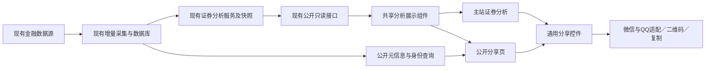

# 证券分析与通用分享开发方案

> 港股扩展：2026-11-10 一次性交付研发设计 + 本地实现完成、达到部署条件（未合并主线、未定版、未部署），实施与验收边界见第十四节及 14.7 实施记录。
> 日期：2026-10-22  
> 状态：**0.8.4.9 / 247c898 已生产发布并验收（2026-10-23）**，iOS/Android 微信真机与自定义卡片未验。实际落点、与设计的偏差和验收边界见第十二节。  
> 当前分层核对（2026-10-30，`6e7a5cfd`）：公开页复用股票/转债View、Presenter、业务API及siteApi加载链；服务端share路由与元信息注册继续沿原合同。分层接线不扩大公开字段或分享目标，微信卡片及真机未验边界保留。
> 修订（历史）：2026-10-22 按现役代码逐项复核后补强（CSP 内联哈希白名单、带参路由与 `PAGE_FILES` 的冲突、公开字段裁剪、微信签名与 canonical 分离、iOS 卡片缓存限制、`SHARE_PUBLIC_ORIGIN` 唯一性、`knowledge-map.json` 路由缺失）；架构方向与交付范围未变。
> 核对基线：`a1eb3b8`，`package.json.appVersion=0.8.4.3`；只代表本次设计所查代码。  
> 范围：证券分析公开H5、通用分享控件、微信好友、朋友圈、QQ好友及复制链接。本文固化已讨论方案，当前行为仍以[技术架构](技术架构.md)与现役代码为准。

## 一、目标与交付范围

用户查看闻泰转债等证券的分析页面时，可以点击“分享”，通过微信好友、朋友圈、QQ好友或复制链接发送。接收者无论是否登录，都能直接打开对应证券的完整公共分析内容，并可继续转发。

原分享首期接入证券分析中的股票和可转债，覆盖手机浏览器、电脑浏览器和微信内置浏览器；分享首期实现的股票范围为普通A股。港股扩展已在第十四节完成本地实现（达到部署条件、未定版未部署），上线后普通A股范围随之扩展到港股普通股票。

通用能力分开处理“分享什么内容、用什么形式、发到哪个渠道”：本期实现H5形式；其他页面、图片、海报、PDF等后续按需求接入。本期不增加分享管理后台、短链服务、访问密码、访问次数限制、分享统计或历史时点快照功能。

## 二、已有能力、复用范围与真正缺口

| 类别 | 已核对的当前实现 | 本次处理 |
|---|---|---|
| 游客访问 | `public/js/access-policy.js` 的公开页键是 `stock-analysis` 与 `bond-safety`；可转债详细分析是 `bond-safety` 下的 `sub=analysis`，`bond-analysis.js` 同时服务这两个栏目，**没有独立的 `bond-analysis` 页面键** | 沿用原权限矩阵；私有账户与写接口继续鉴权 |
| 股票分析 | `server/routes/stockAnalysis.js` 的 `GET /api/stock-analysis/:ts_code` 和 `/:ts_code/statements` 公开读取 | 复用原服务、接口、图表、财务三表与展示口径；响应中的运维字段不得进分享页（见 4.2） |
| 可转债分析 | `server/routes/bondAnalysis.js` 的搜索、列表、详情公开读取；无快照时可按现有服务仅读本地组装 | 复用 `GET /api/bond-analysis/:code` 及既有本地数据兜底 |
| 定位证券 | 主站已有两套深链：旧转债分析 `?main=stock-analysis&code=<代码>` 自动映射为 `main=bond-safety&sub=analysis`（`public/index.html` 初始化段）；估值页用 `?main=bond-safety&sub=valuation&bond=<代码>`（`public/js/bond-valuation.js`） | 原链接保留；新增便于外部分享的统一公开地址 |
| 分析展示 | `public/js/stock-analysis*.js`、`bond-analysis.js` 已有分析渲染能力 | 局部整理共享渲染入口，主站和分享页共用；不复制两份业务模板或计算 |
| 知识文章分享 | `public/share-knowledge.html`、`GET /api/knowledge/share/:token` 已有文章公开分享 | 保留旧地址、发布状态与token权限；后续可接入同一控件 |
| 公共UI和二维码 | 已有 `shared/style.css`、`dialog.js`、`mobile-ui.js`、表格/图表交互及 `qrcode` 依赖；`qrcode` 现役用法见 `server/routes/import.js` 的 `QRCode.toDataURL()`，返回 dataURL（CSP `img-src` 已放行 `data:`） | 样式与交互复用；二维码沿用同一生成方式；手机底部面板属新增能力（见 3.1），`qrcode` 不另行引入依赖 |
| 当前缺口 | 尚无统一分享面板、通用内容登记、独立证券分享页及微信卡片签名适配 | 本方案集中补齐这些能力 |

现有知识分享专项方案处理文章权限、净化与导入等问题，不覆盖本次跨页面分享需求，因此新增本方案；不替代或重写[原知识分享方案](知识分享模块_审查与优化执行方案.md)。

## 三、用户操作与渠道行为

### 3.1 公共交互

证券分析内容加载成功后，在标题区域增加“分享”按钮。点击后显示“微信好友、朋友圈、QQ好友、复制链接”四项。

- 手机使用底部分享面板，电脑使用站内弹窗；复用现有弹层能力和样式。需注意**底部面板本身属新增能力**：`window.MobileUI` 只导出 `syncNavigation`/`closeMenus`（`public/shared/mobile-ui.js` 末尾），`createMenu` 是模块内私有函数；`dialog.js` 只提供 confirm/alert/prompt 三种。面板在 `share.js` 内新建，但要接入 `mobile-ui.js` 已有的滚动锁定与 `.modal-overlay` 焦点陷阱，不另写一套。
- 分享面板绑定已经成功展示的证券，不能使用尚未提交的输入框文字；切换证券时，链接、标题和二维码一起更新（微信卡片受下方缓存限制约束）。
- 公开分享页也提供同一按钮，游客可以再次转发。
- 加载失败且没有可用证券资料时，先显示具体原因，不生成指向其他证券的链接。

微信内置浏览器存在**页面级卡片缓存**：iOS 上微信在页面首次加载时即缓存分享信息，同一页面地址内切换证券后，`updateAppMessageShareData` 改写的内容仍可能被首次进入的卡片覆盖。因此主站内切券只保证链接、标题、二维码和描述同步，**不承诺卡片同步**；需要可靠卡片时，引导用户改用公开分享页地址另行打开。该限制须在真机核验后按实际表现回写本节，不得在未实测时宣称卡片已随切券更新。

### 3.2 手机普通浏览器

| 用户选择 | 执行流程 | 不可用时的处理 |
|---|---|---|
| 微信好友 | 浏览器支持系统分享时，打开系统面板，由用户选择微信 | 面板没有微信、浏览器不支持或调用失败时，提供“复制标题和链接”，提示切换微信粘贴发送 |
| 朋友圈 | 提示“先把链接发给自己，在微信中打开，再点右上角分享到朋友圈”，提供复制按钮 | 始终保留可手动复制的标题和地址 |
| QQ好友 | 默认直接提供“复制标题和链接”，由用户在 QQ 内粘贴发送。`connect.qq.com/widget/shareqq/index.html` 是电脑版扫码页，手机上打开体验差、微信内还会被拦，手机端不作为主路径 | 复制始终可用，不依赖外部应用唤起 |
| 复制链接 | 在用户点击时复制“标题＋换行＋绝对地址” | 剪贴板被拒绝时，显示可选中、可长按复制的完整文本 |

系统分享不会保证出现微信，也不能预先指定微信好友或朋友圈。用户主动取消系统分享时返回原页面，不自动复制、不连续拉起其他应用。需要重试或切换复制时由用户再次点击。

### 3.3 电脑浏览器

| 用户选择 | 执行流程 |
|---|---|
| 微信好友 | 弹出当前公开链接的二维码；提示“用微信扫码打开，再点右上角发送给朋友” |
| 朋友圈 | 弹出同一个公开链接的二维码；提示“用微信扫码打开，再点右上角分享到朋友圈” |
| QQ好友 | 打开QQ官方分享入口，按实际页面提示操作；不可用时提供复制发送 |
| 复制链接 | 直接复制标题和地址；失败时显示手动复制文本 |

二维码编码本站的公开页面地址，不包含登录凭据，不调用微信生成二维码接口。切换分享选项只改变说明文字，不重新请求证券数据。

### 3.4 微信内置浏览器

配置可用时，通过微信官方JS-SDK设置当前证券的分享标题、简介、链接和封面。点击“微信好友”或“朋友圈”后，给出对应的右上角菜单操作提示，最终发送由用户在微信中完成。

公众号接口权限、JS接口安全域名、签名和卡片效果均是开发接入前及真机验收的核验项。本次微信官方文档读取受限，不将账号权限或最新客户端表现写成已确认能力。配置缺失或签名失败时，页面仍能阅读，保留复制与微信菜单操作提示；自定义卡片未核验前不得宣称通过。

提示语必须对应真实动作：“已复制”仅表示复制成功；“分享信息已设置”不能当作已经发送；打开系统面板或QQ入口也不能提示“分享成功”。

## 四、公开页面与内容边界

### 4.1 地址与复制格式

统一地址约定：`/s/security/:kind/:code`，其中 `kind` 首期只接受 `bond` 或 `stock`，`code` 是通过现有证券身份服务校验的标准代码。

闻泰转债示例：

```text
闻泰转债（110081）｜证券分析｜存在小站
{网站地址}/s/security/bond/110081.SH
```

`{网站地址}` 是文档占位符，开发时由服务端公开站点地址配置生成真实HTTPS绝对地址。页面参数、Host请求头或浏览器当前地址不得直接成为任意外部分享地址，也不把不同环境的数据库数字ID放进公开链接。

首期链接打开库内最新可用数据，不冻结分享当时的数据。页面显示实际行情日、报告期、计算日期和待更新状态；不把打开时间当作数据更新时间。

证券身份分两层处理，两层职责不同、不可互相替代：

- **入口层（分享路由、元信息、二维码）**：必须通过 `server/services/securityIdentity.js` 解析标准身份，确认对象存在且 `kind` 与解析结果一致；不自行按数字前缀猜市场。
- **业务层（复用原公开接口）**：转债继续走 `convertibleBondAnalysisCore.normalizeBondCode`，股票继续走 `stockAnalysis.normalizeStockCode`。这两个函数本身就按代码前缀判交易所（`normalizeBondCode` 用 `/^(123|127|128)/` 判深市），属可转债/股票的既定编码规则，本期不改，避免为了分享改动原分析链路。

即“不按前缀猜市场”约束的是对外开放的分享入口；原分析接口的既有规范化不在本期改动范围内。

### 4.2 页面内容

保留名称、代码、数据日期和完整公共分析主体，具体区块随原分析组件同步演进：

- 可转债：概览、基本信息、触发状态、募集用途与条款、转股价调整和不下修历史、持有人资料、利息明细、安全性、纯债和期权分析、正股相关、评级历史、来源链接及数据状态。
- 股票：现有分析指标、图表、事件资料及财务三表等公开内容。

图表切换、表格滚动、原文链接和字段说明继续可用。主站和分享页消费相同公共数据、格式器和渲染规则，不在分享页重复计算收益率、评级或估值。

分享页只加载当前证券所需资源，不初始化账户列表、持仓、自选列表、个人设置或后台配置。首期公开页面为只读展示，不承载刷新数据、加入自选等写操作；这类操作在原站继续按现有权限执行。

**复用原接口不等于原样透传。** 现有 `GET /api/stock-analysis/:ts_code` 的响应带 `diagnostics`、`needs_refresh`、`freshness`、`stale_reason`、`source_updated_at` 等运维字段（`server/routes/stockAnalysis.js`）。分享页元信息与页面内容按以下优先级处理：

1. 服务端只取名称、代码、数据日期等白名单字段写入 HTML 元信息，不把原接口响应整包塞进页面；
2. 前端渲染层显式排除运维字段。

第 1 种是唯一能满足 10.2“不泄露内部诊断”的做法；第 2 种只是不显示，不构成安全边界。分区块缺项照 4.3 处理，不允许为“看起来完整”补造字段。

### 4.3 异常与生命周期

- 未登录、已登录、Cookie过期时，公共内容均可读取，不先跳登录页或要求微信授权登录。
- 退市证券仍按标准身份查询，展示库内已有资料、退市状态和数据日期；不能因搜索列表只显示上市证券而使旧分享链接失效。
- 证券不存在返回404；参数不合法返回400；数据暂不可用显示说明，不能静默换成别的证券。`/s/security/*` 是开放参数空间，任何代码都能拼出地址，404 响应需带 `X-Robots-Tag: noindex`，避免爬虫按无效代码反复抓取。
- 原接口支持的旧快照和本地资料兜底继续使用；缺项保留缺项，禁止为分享访问自动补采、补写或排队刷新。
- 一个区块缺资料不清空其他可用区块。股票和转债切换时，迟到响应不能覆盖当前对象。

## 五、通用控件与扩展约定

### 5.1 三个独立维度

| 维度 | 首期 | 后续扩展方式 |
|---|---|---|
| 内容类型 | `security-analysis`，区分 `bond/stock` | 新页面登记对象解析、公开权限、元信息及展示入口 |
| 分享形式 | `h5` | 新增图片、海报等形式处理器，继续消费同一公开内容描述 |
| 分享渠道 | `wechat-friend`、`wechat-timeline`、`qq`、`copy` | 新增渠道适配，不修改证券业务服务 |

使用普通模块和明确白名单实现，不建设通用插件平台，不提前实现未来形式。

### 5.2 调用约定

拟定调用方式如下，属于待开发接口：

```javascript
Share.open({
  contentType: 'security-analysis',
  resourceKind: 'bond',
  resourceKey: '110081.SH',
  format: 'h5'
});
```

控件内部形成统一内容描述：`contentType/resourceKind/resourceKey/title/description/url/imageUrl/format`。主站可复用当前已加载的公共名称等信息预览；服务端公开路由仍独立校验对象与权限，输出权威标题和地址。前端传入标题或 `public=true` 不能授予公开权限。

内容登记与渠道适配各自集中维护。新增内容必须明确可公开字段和权限，不接受任意内部路径、任意网页URL或任意接口作为分享目标。未来接入知识文章时，仍须校验原token和发布状态，不因使用通用控件公开草稿。

## 六、架构对齐与接口设计

### 6.1 数据链路



架构结论：继续使用Express、PostgreSQL和原生前端；新增分享入口和渠道适配，金融采集、事实表、分析算法、Worker及调度器沿用现有链路。首期不新增分享记录表、不迁移金融数据。

### 6.2 拟新增入口

| 入口 | 职责 | 约束 |
|---|---|---|
| `GET /s/security/:kind/:code` | 返回公开页面壳及服务端生成的标题、简介、封面、canonical和Open Graph元信息 | 校验内容类型及证券身份；元信息只读本地公开资料；**不能挂到 `versionedStaticPages` 的 `PAGE_FILES` 上**（该表是“静态路径→文件”一一映射，带参路径查不到），需独立路由渲染并自行复用 `renderAppVersion()` 替换 `__APP_VERSION__` |
| `GET /api/share/qrcode?contentType=...&resourceKind=...&resourceKey=...` | 用已有 `qrcode` 依赖生成公开链接二维码 | 接受登记对象，服务端生成目标地址；不接受任意URL，不拉取外部内容 |
| `GET /api/share/wechat-config` | 返回当前页面的微信签名配置；签名目标由服务端按 `contentType/resourceKind/resourceKey` 推出 | **不接受前端传入任意 url**，只对识别出的本站主站/分享页地址签名；不返回票据或密钥 |

证券详情与财务三表继续使用原公开接口，不再增加一套分享业务数据API。主站打开分享面板直接利用当前对象信息，不为分享再读一次完整分析。分享页打开后按原组件需要读取当前证券，弹出面板、生成二维码、旋转屏幕或切换渠道不得重复取金融数据。

服务端生成HTML元信息，避免只在JavaScript执行后修改标题，导致分享平台只能识别“存在小站”通用标题。封面首期复用本站已有标识，但 `og:image` 必须是可公网访问的绝对 HTTPS 地址，原图不小于 300×300（微信/QQ 抓取预览的硬性要求），相对路径抓不到；股票、转债名称及描述均按文本转义，不拼接用户提供的HTML。元信息不含未经核验的“实时”或具体即时价格承诺。

微信签名的目标 URL 与分享出去的卡片链接必须分开处理，两者在多数场景并不相同：

- **签名 URL**：必须等于当前页面 `location.href` 去掉 fragment 后的完整地址（含查询参数），否则报 `config:invalid signature`。在主站内点分享时，它就是 `/?main=...&sub=...` 这类主站地址。
- **卡片链接（canonical）**：始终是 `/s/security/:kind/:code`，与签名 URL 无关。

主站与公开分享页各签各自的 location；控件不得把 canonical 当成签名入参，也不得为前端拼出来的地址签名。

公开HTML、二维码和封面的缓存属**本期新增**，不是复用：项目当前没有通用 HTML 缓存实体（`versionedStaticPages` 每次请求都重新读文件并替换版本号，不缓存）。缓存键绑定内容类型、证券标准身份及相关版本；鉴权相关、签名配置或其他个人响应不进入公共缓存。来源资料更新后，站内缓存按原版本失效；微信/QQ自身预览缓存的刷新效果需实测，不承诺立即更新。

## 七、微信配置与外部请求保护

拟新增配置：`SHARE_PUBLIC_ORIGIN`、`WECHAT_APP_ID`、`WECHAT_APP_SECRET`，统一由 `.env` 管理，公开域名须与现有来源白名单对齐。

`SHARE_PUBLIC_ORIGIN` 是**新增且唯一**的站点公开地址来源，没有可复用的等价配置：现有 `ALLOWED_ORIGIN`（对应 `server/config.js` 的 `ALLOWED_HOSTS`）只用于 CSRF 来源校验，是可含端口的 host 列表，不是可分发的站点地址。两者必须指向同一站点，建议加启动校验——`SHARE_PUBLIC_ORIGIN` 的 host 落在 `ALLOWED_HOSTS` 之外时直接告警并拒绝启动，避免“链接能生成、站内打开被拒”的错配。

- 使用微信官方JS-SDK；拟采用 `updateAppMessageShareData`、`updateTimelineShareData` 配置卡片，接入前核对官方当前文档和账号权限，不仿写SDK或猜测包名。
- `access_token/jsapi_ticket` 只在服务端使用，优先复用现有Redis并按平台实际返回有效期缓存；没有Redis时遵守现有单进程运行边界，不新增金融事实表保存这些临时票据。
- 第一次缺少有效票据时获取，后续仅在到期更新；同一凭据并发刷新合并，避免每个访客各调一次。票据过期后失败则降级，不能用过期票据伪造成功或持续重试。
- 平台请求接入现有外部请求保护，未知额度保持未知，不编造调用次数限制，不新增后台定时任务。金融接口首次落库、后续增量的现有规则不变。
- 签名使用当前实际页面URL去掉fragment后的值，保留官方签名要求的查询参数；签名URL与最终分享的canonical URL分开处理。通过服务器白名单校验签名URL，禁止为任意外部域名签名。
- 前端只获得 `appId/timestamp/nonceStr/signature` 等必要配置；票据、AppSecret及含敏感值的上游响应不得进入日志、HTML、仓库或前端错误提示。
- 当前CSP脚本和连接来源较严格。实施时按核验后的官方SDK实际资源需求最小放行，保持 `script-src-attr/style-src-attr 'none'`，不为分享整体放开脚本、内联执行或任意域名。
- **新增页面必须同时处理内联哈希白名单**：`server/middleware/security.js` 的 `inlineHashes()` 只扫描 `index.html`、`login.html`、`admin.html`、`ipo-report.html`、`share-knowledge.html` 五个文件计算 sha256。新增 `public/share.html` 只要含内联 `<script>`/`<style>`，拿不到哈希就会被CSP直接拦死。首选保持新页面零内联（与全站去内联化一致，也避免 `audit-20261021-u15.test.js` 回归失败）；确需内联时必须把文件名加进该数组，否则页面白屏且只在控制台报 CSP 违规。

官方账号资格、后台域名配置和客户端能力需要真实证据。若自定义卡片条件不具备，应如实保留该项待办，继续交付已可用的公开H5、复制和扫码流程，不能宣布全部分享能力验收完成。

## 八、文件修改边界

下表为建议落点，除“复用”项外均尚未开发；实施时按实际最小改动收敛文件数量。

| 文件或位置 | 计划职责 |
|---|---|
| `public/shared/share.js`（新增） | 分享面板（含手机底部面板）、内容描述、渠道选择、复制与降级提示；以 `window.Share.open` 暴露，供 `data-act="Share.open"` 事件委托调用 |
| `public/share.html`、`public/js/share-page.js`（新增） | 统一公开页面壳和当前对象初始化；按去内联化要求脚本/样式一律外链，不写内联 `onclick` 或 `style` |
| `server/routes/share.js`（新增） | 公开HTML、二维码及微信配置入口 |
| `server/services/shareRegistry.js`（新增） | 登记内容、解析身份、校验公开范围和生成元信息/地址 |
| `server/services/wechatShare.js`（新增） | 微信票据缓存及签名；复用现有Redis和外部请求保护 |
| `public/js/stock-analysis*.js`、`bond-analysis.js` | 仅整理当前渲染入口和必要容器依赖，供主站与分享页共用 |
| `public/index.html`、`public/shared/ui-actions.js` | 接入分享按钮与现有事件委托 |
| `public/shared/style.css`、既有证券分析CSS、`dialog.js/mobile-ui.js` | 复用公共样式和交互，只补必要差异 |
| `server/app.js`、`server/middleware/versionedStaticPages.js` | 注册入口；`versionedStaticPages` 是 `PAGE_FILES` 纯静态映射，带参路径无法直接登记，需在中间件增加参数路径匹配并复用 `renderAppVersion()`，或由新路由自行替换 `__APP_VERSION__`；保持中间件安全顺序（静态资源 → CSRF → 业务路由） |
| `server/middleware/security.js` | 核验并最小调整官方SDK所需CSP来源；同时处理 `inlineHashes()` 的文件白名单（见第7节），漏改会白屏 |
| `server/test/` 与全量测试入口 | 增加必要行为、权限及复用回归，纳入现有测试体系 |

共享渲染只覆盖本次证券分析使用范围。若实际实现需要重构整个分析文件或删除核心文件，必须先按项目规则取得用户同意；本方案不构成对大范围重构的授权。

## 九、开发顺序

1. **公开页和数据复用**：确定内容描述与白名单，完成证券标准身份解析、HTML元信息和共享展示，先验证闻泰转债及股票的免登录阅读。
2. **公共控件与基础渠道**：接入主站/公开页按钮、标题加地址复制、电脑微信二维码、手机操作提示及系统分享降级。
3. **平台适配**：核验微信账号条件，接官方SDK和签名缓存；接QQ官方分享入口，检查不同环境的真实行为。
4. **完整验收**：完成接口、权限、数据一致性、移动端和桌面回归，更新权威文档；发布按原标准流程另行执行。

每步以实际完成范围登记，不把“分享入口已出现”当作渠道已发送，也不把单只闻泰样例通过当作全部证券类型通过。

## 十、验收标准

### 10.1 功能与数据

- [ ] 闻泰转债 `110081.SH` 链接、标题、二维码和正文属于同一证券；登录、未登录、过期会话、刷新及再次转发均可打开。
- [ ] 至少覆盖另一只转债、一只已有完整股票分析、退市对象、部分资料缺失对象和不存在对象；记录实际通过数量与异常。
- [ ] 同一数据版本下，主站与分享页区块、字段、单位、评级、图表和三表一致；数据变化不能误判为渲染差异。
- [ ] 复制文本精确包含标题、换行、真实HTTPS地址；缺少剪贴板API或被拒绝时可手动复制。
- [ ] 二维码扫码后直达相同公开页面，不携带会话信息，也不要求登录。
- [ ] 手机系统分享取消、不可用、应用未安装，QQ入口受限，微信配置失败时，各自提示和降级正确，不虚报发送成功。
- [ ] 分享页可继续分享；快速切换证券不出现旧标题配新数据、旧二维码或迟到响应覆盖。
- [ ] iOS 微信内浏览器按 3.1 的卡片缓存限制核验：主站内切券时链接/标题/二维码同步；卡片行为如实记录，不更新属预期，不得算缺陷也不得宣称已同步。

### 10.2 权限与请求

- [ ] 分享页不请求账户、持仓、自选等私有接口，不泄露原访问者身份、内部诊断、任务凭据或配置；HTML 与接口响应中不出现 `diagnostics`/`needs_refresh`/`freshness`/`stale_reason` 等运维字段。
- [ ] 伪造内容类型、证券身份、地址、公开标记或微信签名URL无法绕过校验；原写接口及账户隔离不变。
- [ ] 分享访问、平台预览抓取、刷新页面、切换渠道和旋转屏幕不触发金融外部请求、不排队采集、不写分析快照。
- [ ] 微信有效票据命中缓存不回源，并发更新不重复获取；接口异常和真实过期均有正确降级，敏感值不出服务端。
- [ ] 新页面HTML、CSS/JS资源版本、CSP（含 `inlineHashes()` 白名单是否已覆盖新页面）及原知识分享链接兼容均通过。

### 10.3 手机与电脑

复用项目现有760px正文、900px导航分界；检查320/360/390/430/768/1024/1440px及分界附近布局。操作区至少44px、输入字号16px；宽表格只在容器内横滑，字段不被裁掉，弹层支持触屏、键盘、焦点返回和关闭。

分别实测iOS Safari、Android Chrome、iOS/Android微信内置浏览器及电脑常用浏览器；QQ按实际可用客户端/入口记录版本和结果。按照项目低性能规则，浏览器和真机验收在获得允许后执行；此前只能登记“未实测”，不能用DOM检查代替真机结论。

代码实施完成后执行 `npm.cmd run test:all` 和 `npm.cmd run check:knowledge`；按现有本地运行闭环核对 `/health`、目标页面/接口、静态资源及版本。生产发布按[生产部署流程](生产部署流程.md)执行，平台卡片和扫码效果仍需独立验证。

## 十一、文档同步与当前边界

实施时更新[技术架构](技术架构.md)第4节请求入口、第5节前端/移动端、第7节接口与访问矩阵、第9节相关证券分析和分享说明、第10/12节票据请求/缓存与配置，更新最后核对日期及[知识索引](知识索引.md)的方案状态。涉及新路径或规则时核对 `governance/knowledge-map.json` 的read/update，不另建平行架构文档。

当前 `governance/knowledge-map.json` 里还没有 share 相关路由，`npm.cmd run check:knowledge` 匹配不到本方案。首次实施时必须补一条 `security-share` 路由（read：本方案 + 技术架构第 4/5/7/9/10/12 节；update：同上），否则后续涉及分享的改动不会命中本文档。

本方案自首次新增以来只改文档（本文、知识索引、技术架构入口）；没有修改业务代码、依赖、配置、版本或生产行为。2026-10-22 的复核修订同样只补结论与约束，未执行任何实现。上轮本地 `/health` 和目标分析接口未连通，未启动服务；现状核对来自代码与仓库文档，不能当作本地或生产运行验收。微信权限、自定义卡片、QQ客户端唤起及多端真机均待实施后验证。

## 十二、实施记录与偏差（2026-10-22，本地实现）

本节记录实际落点与第八节设计的差异。差异均为实现时发现更优或更严的做法，不改变交付范围。

| 项目 | 第八节设计 | 实际落点 | 原因 |
|---|---|---|---|
| 公开页模板 | `public/share.html` | `server/views/share.html` | 放 public 会被 `express.static` 直出，访客能看到未替换的 `__SHARE_*` 占位符；放 server/views 后只有路由能输出 |
| 页面初始化 | `public/js/share-page.js` | 同左 | — |
| 分享控件 | `public/shared/share.js` | 同左 | 暴露 `window.Share.open`，由 `data-act` 委托调用 |
| 分享样式 | （未单列） | `public/css/share.css`（新增） | 面板与分享页样式按项目规范归入 `css/` 体系；主站和分享页共用 |
| 封面 | 复用本站已有标识 | 新增 `public/share-cover.png`（512×512） | 站内只有 32×32 SVG 图标，微信/QQ 抓取不支持 SVG 且尺寸不足 300×300 |
| 微信卡片 | 接官方 SDK 设置卡片 | 签名服务已实现并按官方算法回归；**前端不加载 SDK** | 无公众号凭据、JS 安全域名与 `script-src` 放行都需真实账号核验；按第七节"配置缺失时降级"处理，只给复制与菜单提示 |
| `versionedStaticPages` | 注册入口 | 未改该中间件 | 它是 `PAGE_FILES` 纯静态映射，带参路径无法登记；由 share 路由自行替换 `__APP_VERSION__` |
| CSP 内联哈希白名单 | — | 未改 `security.js` | 分享页保持零内联脚本样式，因此不需要加哈希；已写入回归断言防止以后被改成内联 |

实现包含的额外必要处理：分享页需补齐 `username`/`showToast`/`switchMain` 三个被复用分析脚本引用的全局；`bond-analysis.js` 的"请点击刷新数据"提示在分享页被过滤（无写操作入口，属运维字段）；`/api/share/wechat-config` 接受前端传入的页面地址但按同源+路径白名单严格校验，因为签名必须使用主站实际 location。

**本地验收结果**（真实 PG，非 mock）：分享页 200 且标题为「闻泰转债（110081）｜证券分析｜存在小站」；不存在证券 404 且带 `X-Robots-Tag: noindex`；类型不匹配 404；非法 `kind` 400；二维码返回 dataURL；外部域名签名 400；未配置凭据返回 `configured:false`；股票页 200 且标题为「贵州茅台（600519）」。自动化断言 27 项通过，签名算法与越权拒绝均已做破坏性验证（改坏后测试真红）。

**浏览器实测（2026-10-23，Edge/Chromium，非真机）**：分享页与面板均通过，并修掉三处只有真渲染才暴露的问题——深色标题区里 h1 沿用正文深灰导致不可见、缺少 `bond-analysis-message` 容器使"正在读取"提示一直残留、`bond-analysis-updated` 会把"尚有 N 项资料待补全"这类运维信息显示给访客（已从公开页移除，并补三条回归断言）。实测覆盖：面板桌面居中/手机贴底与滚动锁定、四渠道行为（手机降级复制、微信 UA 提示右上角、桌面二维码 240px 正常且朋友圈复用同一张、桌面 QQ 打开官方分享页参数齐全、复制写入剪贴板实际为标题+换行+绝对地址）、主站面板绑定已展示证券（改输入框不提交不生效）、点开面板前后分析接口请求 2→2 未重复取数、320/360/390/430/768/1024/1440px 横向溢出均为 0。自动化断言 29 项通过。

**2026-10-23 面板改版（用户反馈首版"太难看"后重做）**：原 2×2 灰色描边文字按钮改为 iOS 原生风格——无标题栏，顶部直接是应用预览行（站点标识 + 证券名称 + 「证券分析 · 域名」）、四个 50×50 彩色圆角图标配文字、底部独立「取消」行。只动 `public/shared/share.js` 与 `public/css/share.css`，后端、接口、四渠道行为都不变。改版后实测：手机底部面板与桌面居中弹窗形态正常、点微信降级为可复制文本、点取消可关闭并清空预览、桌面二维码 240px 正常渲染；长链接不再裸露在面板上。顶部拖拽条先做后按用户要求去掉——拖动关闭需要额外手势逻辑，而「取消」/点遮罩/Esc 三种关闭方式已足够，不为装饰性控件增加交互复杂度。

**仍未验证**：iOS Safari、Android Chrome、真实微信内置浏览器（本次仅改 UA 模拟，非真微信）、微信自定义卡片效果、QQ 客户端唤起、实际触屏与软键盘；以及生产部署本身。生产 `.env` 的 `SHARE_PUBLIC_ORIGIN` 已于 2026-10-23 配置为 `https://cunzaitouzi.cn`（域名已解析、HTTPS 证书有效、与 `ALLOWED_ORIGIN` 同站），微信凭据仍未配置。

**本轮实测发现的非本次问题**：主站"开始分析"按钮（`data-act="securityAnalysisSubmit"`）走事件委托时没有 `data-arg`，`ui-actions.js` 会把 `MouseEvent` 作为第一个实参传入，`securityAnalysisSubmit` 将其转成字符串去搜索，于是点击按钮报"没有找到符合条件的股票或可转债"；在输入框内回车则正常。属去内联化改造遗留，不影响本次分享功能（分享按钮依赖已展示的证券状态），已登记未修复，待用户决定是否单独处理。

## 十三、依据与参考

- 仓库权威资料：[技术架构](技术架构.md)、[API与自动任务保护方案](自动任务重复执行与API调用保护整改方案_20260815.md)、[本地验证交接文档](../deploy/本地验证交接文档.md)。其中带日期的历史状态按原文边界读取。
- [W3C Web Share规范](https://www.w3.org/TR/web-share/)：系统分享由用户选择目标，目标由浏览器和操作系统提供。
- [QQ官方分享入口](https://connect.qq.com/widget/shareqq/index.html)：已查阅页面提供电脑和手机QQ扫码/菜单分享提示，具体客户端唤起与参数支持须实施时核验。
- [微信官方JS-SDK文档](https://developers.weixin.qq.com/doc/offiaccount/OA_Web_Apps/JS-SDK.html)：本次读取受限，列为开发前复核入口，不作为已确认账号权限或兼容性的证据。

2026-10-28 分层验收修复：公开页补载统一请求客户端、股票分析客户端与 Presenter，以及股票图表的日期范围控件。`server/test/share-page-load.test.js` 按模板加载实际脚本，分别验证股票和转债的公开读取、内容展示及不访问私有接口；该自动测试不代替浏览器和真机验收。

2026-10-28 本地整改：分享信息请求通过站内统一 HTTP 客户端发送，沿用无超时和缓存策略；分享专项及请求模拟通过，浏览器与真机尚未验证，未部署。

本地继续将微信票据请求移入适配器，缓存、冷却与超时不变；模拟正常和失败响应通过，未请求微信接口，真机未验。

2026-10-29 前端分层登记（本地未部署）：本域页面脚本按 Presenter/View 拆分，取数与请求序号迁 `public/js/presenters/` 对应 presenter，渲染与对外全局保留在原文件；页面脚本清单与加载契约已同步，行为等价（全量回归覆盖），浏览器/真机未验。详见[分层方案](应用分层与MVP架构整改方案_20261027.md)2026-10-29 记录。

## 14. 证券分析支持港股一次性交付研发方案（2026-11-10）

> 文档职责：专项研发方案；2026-11-10 复核并补全实施合同。代码证据基线 `0fc1f46a220b777cf0516dab9a62b91c6d6beca5`；本任务此前文档提交 `a6e8c96d`。当前结论：港股证券分析已在独立 worktree `codex/hk-security-analysis-design` 完成本地实现（代码 + 自动回归 + 文档同步），**未合并 `master`、未部署、未写生产数据**；下述新增字段、模式及市场分区在本地代码树可用，但不是线上现役能力。来源真实权限、历史覆盖、性能和生产效果仍待核验；既有分享回执继续按其原范围解释。逐条实施状态与未验边界见 14.7。

### 14.1 目标与一次性交付范围

在现有证券分析中支持港股普通股票，一次完成搜索、持仓与自选、分析详情、行情及估值图表、财报三表、公告、刷新、公开分享及手机/桌面适配，统一整体验收和交接，不分批开发或上线。内部可按依赖顺序编码、分窗采集和断点续跑，但这些属于同一交付的执行步骤，不是分批交付。沿用原 A 股、可转债入口和权限；本合同中的港股指标规则不隐式改变 A 股既有公式。

证券范围是主档确认的港股普通股票，涵盖可识别的非金融及银行、保险、证券等金融公司；不以“是否港股通/恒生成分”作为查询准入条件。ETF、REIT、权证、牛熊证等不属于本次普通股票范围，不能因为适配器有该类型就纳入。证券类型、财报类型未知时显示明确原因，不按代码或行业名称猜类型。正式查询至少对一只非既有选股池股票完成闭环验收。

**查询准入范围与后台更新范围分开**：搜索读现有港股主档；后台自动维护所有用户持仓及显式自选中的港股，按证券去重。单次搜索、普通访问或选股跳转不自动创建全市场历史采集任务，也不改变选股股票池；池外证券由登录用户明确刷新时按单股处理。已有快照但不再被跟踪的证券仍可只读，按真实日期标记陈旧。

核心区块为证券身份、行情/估值、财报及可计算的分析结果；必须有真实港股样本贯通。客观未披露、不适用、权限不足、历史不足允许在具体字段降级，但不能把“所有样本均无行情或财报”“已知可补却未接通”“尚未实现的区块”当作完整交付。来源不支持的公告、控制人、预告等明确标注能力边界；重大覆盖阻塞必须保留为未完成，不通过缩减样本或隐藏字段结案。

### 14.2 已有能力、复用与具体缺口

| 环节 | 已核对代码事实 | 需要扩展的落点 |
|---|---|---|
| 证券校验 | `services/stockAnalysis.js` 的 `normalizeStockCode`、`isOrdinaryAStock` 和 `listUserStocks` 限 A 股 | 共用身份服务及主档类型校验；详情、自选和计算链统一支持港股 |
| 搜索及列表 | `routes/bondAnalysis.js` 的 `/search/securities`、`/list/securities` 实际供统一入口使用；`repositories/bondAnalysisRepository.js` 搜索固定 Tushare/A 股，持仓限六位、自选截六位去重 | 同时修改实际搜索/列表仓储及调用方，优先匹配完整标准代码，完整身份去重，避免只改股票路由 |
| 手工刷新 | `enqueueStockAnalysisSync`、`syncRequestedStockAnalysis` 都拒绝港股；后者只补四类财报、分红和公告后重算，没有补行情/估值；报告期枚举固定四个季末 | 复用 `company_financial_incremental_sync:stock_analysis` 扩展单股阶段、HK 报告类型及日线/估值/复权缺口，保留单股边界 |
| 现有港股采集 | `stockSelectionInputsSync.collectHkMarketData` 已落原行情/估值表，但价格历史窗口与选股需要绑定，且“任一类写入大于零”可返回 ok | 复用下层取数/落库方法并参数化目标与窗口；不能直接把选股 helper 的 ok 当分析完整，不调用整个选股补数流程 |
| 分析模型及输入 | `domain/stockValuation.js` 含 CNY、12 月年报、A 股总股本/分红字段及缺失当零等假设；`stockAnalysisRepository.loadAnalysisInputs` 读 raw_payload，行情还依附估值行 | 增加市场中立的标准分析输入、币种/股本范围及逐指标状态；行情序列与估值各自可读，缺估值不应清空股价历史 |
| 财报展示 | 已有 HKFRS 宽表；`stockStatements.js` 的字典仍是 CAS，仓储读取 raw_payload，单位固定元/亿元 | 按准则及公司财报类型选择现有字典与宽表，返回实际期末、报告类型、币种、版本与单位 |
| 日常任务/分区 | `stock_analysis_refresh` 默认依赖 A 股共享任务和前一 A 股交易日；注册表的 `stock_daily`、`stock_valuation`、`stock_financial_reports`、`stock_analysis_snapshot` 都固定 CN | 同一 Runner 内隔离 HK 模式/交易日/依赖；扩展原数据集的市场 scope 解析与范围统计，单股完成不发布市场全集分区 |
| 分享与页面 | `shareRegistry.js` 限六位内地代码；股票 View 有截六位和“A股市值”写死文案 | 主站、分享、Presenter、三表和图表同时改接完整身份及展示元数据，不复制第二套页面 |

上述路径均位于 `server/`（View 位于 `public/js/`），现行机制见[技术架构](技术架构.md)第 6/8/9.2/9.7/11 节。已有能力只证明代码存在，不能代替来源权限、真实字段和覆盖的验收。

### 14.3 身份与交互合同

- 标准代码为五位数字加 `.HK`，如 `00700.HK`。支持 `00700`、`700.HK`、`00700.HK` 及名称；先用既有身份服务归一、主档核对。完整代码精确命中优先于模糊结果，候选数量限制不能截掉精确命中。无后缀数字/名称歧义时列出市场、名称和完整代码供选择；不自动选择首项，不把 `000700` 等六位数字静默改成港股。
- 下拉 value、缓存键、请求键、自选去重、URL 和图表选择使用 `canonical_code` 或对应 `instrument_id`；供应商格式转换只在数据层。显示代码可以省略后缀，内部身份不能截断。A/H 证券的行情、自选和分红按证券区分，公司财报仅在实体、准则、合并范围和版本均匹配时共享。
- 搜索、按钮/回车、持仓、自选、选股跳转、深链、刷新和分享都覆盖，保持现有账户身份与请求序号防护。退市可读已存历史，不伪造现价；无效代码、非股票、主档未就绪和仅缺分析资料分别提示。
- 普通读取只访问本地事实/快照。登录用户明确刷新可入队，显示排队、执行中、部分完成、等待/阻塞、成功或失败。写入成功的阶段不因其他阶段失败重复采集；重复刷新复用同一证券/目标日的有效执行槽。入队失败返回 503，限流 429；公开页不展示任务槽、内部错误栈或凭据。

### 14.4 数据、计算与架构合同

架构对齐结论：扩展既有数据层、仓储、领域模型和 Presenter/View；供应商映射仅在适配器，SQL 在仓储，纯计算在 domain，服务负责编排与事务，View 按服务提供的单位/状态渲染。沿用[分层方案](应用分层与MVP架构整改方案_20261027.md)和原门禁，不新增平行事实、来源或调度器。

影响链路：**已准入来源 → 原 Guard/采集 Runner/原始记录 → core、market、fundamental 标准事实与适用宽表 → 标准分析输入 → 现有领域计算/分析快照 → 原 API → 主站及公开分享。**

#### 14.4.1 来源、历史和增量

实施前为每个数据域登记现有中立读取入口、实际来源、市场/公司类型、字段及授权（包括公开展示）、单位、分页终止、历史起点、缓存、增量水位、去重键、更正重叠、失败保留及可补性。只使用已准入来源；本方案不把未知权限写成可用，不自定调用额度，未知官方限制保持空值，沿原 Guard、超时和连续无进展保护。

| 数据域 | 首次范围及复用 | 日常更新/失败处理 |
|---|---|---|
| 主档/类型/行业 | 复用已有港股主档和类型/行业读取，先核对证券与公司关系 | 沿原低频 TTL 和变更水位；缺币种、类型不猜默认值；主档缺失先由同一受控入口定向核验 |
| 日线/估值/复权 | 先查库内覆盖，只补当前证券上市以来来源实际可得的缺口；分窗由适配器处理。十年和上市以来指标按真实覆盖判定；现有选股的一年价格窗口不能冒充分析历史 | 按本域最后成功交易日及原更正窗口增量；三域独立游标，日线成功不能掩盖估值/复权失败。未复权与复权序列不能拼接后标为前复权 |
| 财报及标准指标 | 复用现有标准事实、对应宽表及字典，优先本地历史；按来源真实报告类型与期末分窗补缺，不按四个季末枚举港股财年 | 按公告/更正及报告版本增量；同一报告多批科目合并完整才登记覆盖，保留原文及版本，不以任意一行成功判整类完成 |
| 分红/公告/预告/控制人 | 先读已有标准事实、原文和已核验覆盖；仅对当前证券必要缺口走已有准入接口/统一公告层 | 延续各自缓存、来源原生唯一键与重解析版本；无新增可留证推进覆盖，网络失败、分页不完整和未知空结果不能推进成功水位；不另建公告采集器 |

不因字段为空重复从上市日起重拉。官方未披露/不适用与权限阻塞、暂时失败、连续无进展分别保存原因、范围、证据和复查条件；可恢复故障仍进入已有重试体系，客观不可得不无限续跑。

#### 14.4.2 财报、金额及指标

财务查询必须选当前有效版本，并过滤证券关联公司、报告准则、合并范围和可用时点；宽表通过唯一报告身份关联。三表不能仅按年份联接或把同报告不同来源重复计数。报告期、财年、类型与币种来自实际元数据；未知报告类型不按月份猜。业务日期遵守[日期治理方案](日期时间统一治理研发方案_20260928.md)与[INC-0032](incidents/INC-0032-全项目日期时间边界审计与整改方案.md)，目标日贯穿 Runner，纯日期不经过 UTC 截日。

| 指标/展示 | 港股计算与失败边界 |
|---|---|
| 财报三表 | 按准则及公司财报类型选正确科目与宽表，展示来源支持的全部有效科目，不压缩回 20 项标准事实。每列带实际期末、年报/中报类型、公告日、币种及报告版本；每股数与金额分别换算。币种切换、财年变更或比较期不等长时不强算同比 |
| 盈利/TTM/增长 | 年度靠报告类型和财年证据；一般累计口径 TTM＝最近完整财年＋本期累计－上年同财年同期累计，只有三个期间连续且可比时适用。单季/半年独立值不得再当累计。增长要求完整连续的目标跨度；“十年三年均值”需真实对应的两组三年数据，不能用不足三年或缺年份样本冒充 |
| 市值、PE/PB与 A/H | 区分交易证券股份、H 股股份、公司全体股本及来源市值范围。不能用 H 股价格×公司全部股份得到未知范围总市值，再除合并利润/净资产。优先显示已验证、同范围同币种的标准估值；自算须证明分子分母范围匹配。港股移除“A股市值”标签，按实际范围命名；范围未知时不计算 |
| 跨币种 | 行情、财报、分红各保留原币，不默认所有港股财报为 HKD。计算时统一到明确的目标币种，并带汇率日期、方向和来源；禁止套用账户当前汇率。时点估值用估值日可得且不晚于该日的适用汇率，缺失不猜；跨期原币变化且缺乏同口径重述时，增长/累计比较标不可评估 |
| 分红与股息率 | 以已实施事件为基础，同事件按来源原生键/标准关联去重，更正替代旧版本；不能只按除息日把同日两笔真实独立事件合并。股息率可用同股份单位、同币种的近12个月税前每股现金÷股价；派息率/累计分红率需匹配公司合并范围的金额。港股只有每股现金时不乘未知总股本推公司分红总额；未知不视为未分红。此处不引入账户税费或现金入账计算 |
| 十年稳定性 | 逐财年区分盈利/亏损、已派现/证实不派现及未知。仅十个完整可比财年均有证据才给“连续十年”结论；不足十年返回资料不足，不能因仅三年均盈利而显示十年通过，也不能把缺失判成失败 |
| 财务安全/现金流 | 净现金、有息负债、利息保障、FCF 所需字段缺失即该指标不可计算；不得用 `null→0` 或把缺资本开支当零。金融公司按已验证适用指标展示，不能套普通企业结论。没有可靠等价的扣非、预告或控制人科目显示不适用/暂无可靠数据 |
| 价格及估值历史 | 股价独立读日线，估值独立读估值事实；标注样本起止、数量、复权和公式版本。无可靠复权因子时可展示明确标注的未复权价格，但禁算依赖复权的分位/上市年化。未覆盖上市起点时改标“可得区间年化”，不称上市以来 |
| 负值/样本 | 保留负 PE 的亏损事实；港股正估值分位仅用可比的有效正样本并说明排除项，当前 PE 非正则不输出正估值分位。PB/权益非正同理。A 股现有负值排序不在本次隐式调整范围 |

结果复用现有数值字段并补港股逐指标状态/原因，区分 `available`、`insufficient_history`、`not_applicable`、`source_unavailable`、`missing`；数据是否陈旧另表达。数值 0 是有效事实，未知保持 null；不得让前端布尔判断把未知变成“否”。所有结果带实际输入版本、日期、单位及公式版本。

#### 14.4.3 快照和只读一致性

分析输入在一致的数据库读视图中获取，计算完成后沿原事务入口保存分析快照和对应指标；失败保留上次可用快照，不用不完整新结果替换完整旧结果。新对象确有部分可用资料可保存明确标记的 partial 快照，但不能登记整股同步成功或覆盖完整旧版本。

为港股详情及三表增加 `analysis_version`（完整证券身份＋公式版本＋行情/财报/分红等输入版本摘要），快照记录选用的 report_id/版本；三表请求可携带该版本并只读对应已存报告。版本已不可读时返回明确版本冲突（409），Presenter 最多重新读取一次整组本地内容，仍冲突则提示数据更新中；不能把不同版本拼接或转外采。无版本参数的旧 A 股调用保持兼容，不新建分享历史快照系统。

港股 GET 统一返回已发布快照；同一版本的 `generated_at`、行情日和报告日均来自该版本，不重现“临时重算新内容＋旧 snapshot.refreshed_at”的混合。主档存在但无快照时明确返回资料未就绪（沿用原详情 404，并提供业务错误码）；游客不能通过读取排队。分享 HTML 的身份元信息只依赖主档，正文遵循同一只读版本合同；不把不同时间打开主站与分享页自然更新的数据误判为渲染不一致。

### 14.5 任务、接口及页面落点

#### 14.5.1 单股刷新与自动更新

| 入口/模式 | 必需阶段与依赖 | 完成及发布边界 |
|---|---|---|
| `company_financial_incremental_sync:stock_analysis`（扩展原模式） | 校验唯一港股/公司关系→逐域审计→复用已有采集补主档、日线/估值/复权、财报/分红及已准入公告等缺口→只读重算并保存快照；请求包含规范代码和目标日 | 返回当前证券的阶段结果、剩余进度、有效数据日和快照版本。仅本证券声明的必要域齐备/已证实不可得并满足核心可用性后完成；不发布整个 HK 市场财务/行情分区，不靠 `row_count>0` 判成功 |
| 日常港股采集（扩展同一受控 Runner 的市场定向参数） | 目标为持仓∪显式自选去重集，复用同一单股/分域执行服务，批次剩余进度持久化；仅日常增量，不把每只股票重新跑首次全历史 | 以本批冻结目标集、目标 HK 交易日和各域覆盖发布范围证据；无跟踪对象可留证正常空跑。不能把持仓报价任务成功当全套分析输入就绪 |
| `stock_analysis_refresh` 的 HK 定向计算模式（设计名 `stock_analysis_hk`） | 复用原 Runner，外采严格 0；在既有 HK 采集发布/槽位依赖就绪后排队。默认 CN 模式及选股各模式保留原合同 | 在现有任务框架按 HK 交易日触发和补偿；HK 开市/CN 休市也必须可运行，不继承默认 CN 依赖或前一 SSE 交易日。按实际输入及完整目标集发布 HK 分析覆盖证据 |

上述 HK 模式/参数需同时接入 `jobDefinitions` 的模式白名单、逐模式依赖/数据集合同、`jobOrchestrator` 上下文传递、市场日历/补偿、Runner 分发、目标筛选和完成判据；不能仅改 Runner 或把 `targetCodes` 丢成全部持仓。调度复用原任务框架的模式槽位与补偿，在现有 HK 采集完成时登记后续计算；启动恢复时按目标日查缺，不新建第二套定时器，不复用已暂停的港股 IPO 任务。手工刷新本地重算与定时纯计算调用同一领域模型及快照写入口。

数据集继续使用原 `stock_daily`、`stock_valuation`、`stock_financial_reports`、`stock_analysis_snapshot`，实施时扩展市场 scope 解析，旧调用默认 CN，HK 必须显式传市场且不得退回 CN。当前注册表尚不具备该能力。统计和新鲜度按“市场＋已声明目标集/覆盖范围＋目标日”核对，不能对整张混合表直接 MAX 日期/COUNT 行数；不同市场财务按准则/报告身份过滤。只有对应生产者确实完成注册合同范围才发布相应市场分区；单股和部分批次只保留自身 scope 证据。A 股分区不能抵消 HK 缺口，快照和相关分区发布必须遵守原事务/失败规则。

任务允许按域显示 partial/blocked/等待与明确不可得；执行成功、字段可用性和整体覆盖分别记录。无进展、超时或来源权限拒绝停止当前无效续批并保存剩余项，重试恢复依原策略。消费方读取同证券/市场/目标日期的质量证据，不能以其他日或任务整体绿灯关闭缺口。

#### 14.5.2 API 与公开边界

扩展原详情、三表、自选和刷新 API，不另建一套 `/hk-analysis`。继续使用 `/api/bond-analysis/search/securities`、`/list/securities` 的统一搜索/列表。新增市场、交易币种/报告币种、股份范围、字段状态及版本等为兼容增量，旧 A 股客户端仍可使用原字段。

`POST /:ts_code/refresh` 成功登记返回 202 和 `slotId`；通过现有登录任务查询能力读取本用户获准的刷新进度。若现有接口只供管理员，必须在原任务查询层补证券刷新授权投影，不向普通用户开放任意任务详情。重进页面可恢复本人的有效请求状态；按已有轮询节奏查询站内状态，切证券、切账号、离开页面或进入终态后停止。完成后仅重读一次当前证券，失败保留旧内容并展示原因。

港股公共详情及三表使用服务端字段白名单，移除 `diagnostics`、`needs_refresh`、内部 freshness/stale_reason 等运维内容；公开数据新鲜度仅提供安全的日期/状态/原因文案。不能靠隐藏 DOM 保密，也不能通过伪造 public 参数改变访问边界；分享不会访问自选/账户或任务接口。主站的登录刷新状态独立读取，不塞入公共快照。

#### 14.5.3 页面与分享

复用现有 View、Presenter、图表和共享样式；主站与 `server/views/share.html` 的脚本装配同步更新，股票资料、三表与图表显示真实币种、报告期和字段状态。手机重排、宽表局部横滑、触屏和键盘规则沿技术架构 5.3；不另建港股或移动版页面。

分享继续仅登记 `security-analysis` 的 `stock`/`bond`；校验主档和证券类型，canonical 例如 `/s/security/stock/00700.HK`，`SHARE_PUBLIC_ORIGIN` 为唯一公开域名。保留 CSP、noindex 错误、复制/二维码以及微信/QQ 原降级边界；本次港股支持不等于微信卡片资质或真机已验。

### 14.6 验收、实施顺序与交接

#### 14.6.1 可复现的必需反例

下列金额和日期是测试夹具，不是实际公司数据；同时需要有来源证据的真实样本逐字段核对。

| 场景 | 必须得到的结果 |
|---|---|
| `00700`/`700.HK`/`00700.HK`；六位数字与歧义名称 | 前三者主档核对后同一标准身份；六位数字不静默改港股，多候选选择后仍不串券 |
| HK 开市而 CN 休市；HK 日历缺失 | 前者完成 HK 自己的采集/计算，不等待 A 股；后者阻塞并说明，不能按周一至五猜开市 |
| 6 月财年：年利润120、本期累计50、上年同期40 | 连续可比时 TTM=130；上年同期缺失/财年变更则不可计算，不当作当年50或年化100 |
| HKD 股价100、匹配范围股本1000；CNY 利润10000；1 CNY=1.1 HKD | 非 A/H 混合范围且证据齐全时市值100000 HKD、利润11000 HKD、PE约9.09；币种/汇率方向/范围任一缺失则不算，不能得到10 |
| H 股价有值，仅公司全体股本或股份范围未知 | 不用 H 股价乘全体股本生成误导市值；已验证的来源估值可独立显示并带范围说明 |
| 仅3年均盈利/均派现；十年中一财年未知；负 PE | 前两种为历史不足/缺证，不给十年通过或确定失败；负 PE 保留亏损且无正估值分位 |
| 两来源同一分红；同日两笔独立分红；仅每股现金 | 前者去重、第二种两笔保留；每股现金能算可靠股息率，但不能用未知股本造分红总额/派息率 |
| 日线有值但估值缺失；复权缺失；资本开支缺失 | 股价可显示；未复权明确标识且相关复权指标不可算；FCF 不因缺资本开支而等于经营现金流 |
| 三表请求中途发生报告修订或快照切换 | 读取绑定报告版本，或409后有界重读；不混币种、财年、旧快照时间和新报表 |
| 单股刷新估值失败而财报成功；重启及重复刷新 | 留存财报进度，保留旧完整快照，只续失败域；不重复采集成功历史，不发布整个市场成功 |
| 匿名、账号切换、公开分享及恶意代码 | 无外采/写库/任务查询和隐私泄露；旧账号回包丢弃，非法类型及对象按原状态拒绝 |

#### 14.6.2 一次交付的完成条件

- [ ] 来源/字段对照及真实样本包括：普通非金融、银行/保险/证券、不同报告币种、非12月财年、上市不足十年、停牌/退市、资料不足、既有选股池以外股票；证券类型不符可证明拒绝。
- [ ] 本节全部入口、数据域、阶段续跑、权限投影、跨市场目标日和上述反例均实现并验证；必需核心链路无未接通项。客观不可得字段带具体范围和证据，不把真实缺口藏成“全部通过”。
- [ ] A 股、可转债及其原负值分位、权限、分享、账号隔离回归通过；主站与分享同版本内容一致，不访问私有接口，搜索/旋转/切图不外采。
- [ ] 按影响链运行既有股票分析、三表、刷新队列、前端、账号隔离、迟到响应、分享加载等专项，并补本节港股行为与真库合同回归；`check:knowledge`、日期/分层/SQL及任务矩阵门禁按实际改动执行。统一发布按最新主线规则对最终代码树运行一次有效 `test:all`，可复用时按部署流程核验，不在每个内部步骤重复全量。
- [ ] 自动回归覆盖手机/桌面行为；320/360/390/430/768/1024/1440px及760/900px分界、触屏/键盘、iOS/Android/微信等浏览器/真机依原低性能授权实测，未测单列，不凭静态检查冒充。按原分层性能口径记录查询耗时、内存、外采次数和续跑进度；重复命中已覆盖数据时外采为0，不在此编造来源调用额度。
- [ ] 只在本任务独立工作区实施及验证；一次交接完整代码、必要迁移/兼容与回滚说明、测试证据、真实覆盖清单及剩余项。生产发布和真实数据处理仍走原统一发布及授权边界，本设计不构成已部署证据。

内部实施顺序：先来源/字段及身份合同，再原采集与市场分区、标准输入与指标、接口/页面/分享，最后跨市场整体验收；上述工作全部完成后统一交接，不交付半成品入口。

实施需要同步的权威位置：[技术架构](技术架构.md)4/5/5.3/6/7/8/9.2/9.7/10/11/12节按实际变更原位更新，本专项当前摘要与知识索引；模式/分区/日期及分层变化分别核对任务矩阵、规则追踪与适用路由。本次纯文档复核只更新原专项、架构待实施指针、索引和原任务卡；未修改日期/分层规则、任务定义、数据库结构和代码，相关权威机制无需为了设计复查重复改写。

### 14.7 实施记录与交接（2026-11-10，本地实现，未部署）

> 工作区：独立 worktree `codex/hk-security-analysis-design`（分支 HEAD 见 Git）；由一次开发对话完成全部代码、回归与文档，**一次交接、整体验收、统一交付**，不分批上线。生产发布与真实数据处理仍走原统一发布及授权边界，本节不构成已部署证据。

**已实施并在本地代码树可用**

| 合同 | 落点 |
|---|---|
| 身份归一、六位数字不静默改港股、名称歧义列候选、港股普通股票类型闸门 | `server/services/securityAnalysisIdentity.js` + `server/domain/securityAnalysisContract.js`；A 股原判定不变 |
| 搜索、持仓、自选、深链、选股跳转、刷新、分享全链路 | `bondAnalysisRepository.js`、`bondAnalysis.js`、`stockAnalysisRepository.listUserStockRows`、`shareRegistry.js`、`share-page.js`、`bond-analysis.js`、`bond-analysis-presenter.js`、`routes/stockAnalysis.js` |
| 币种/汇率、股份范围、非 12 月财年 TTM、十年稳定性、负 PE 分位、分红去重、FCF 缺资本开支、逐指标状态 | `server/domain/securityAnalysisContract.js`（纯计算，20 项反例） |
| 港股标准分析输入、已发布快照只读、公开字段白名单 | `server/services/hkSecurityAnalysis.js`；无快照 404 + `HK_ANALYSIS_NOT_READY`，游客读取不排队 |
| HKFRS 三表按官方字典读宽表、报告元数据、`analysis_version`、409 与有界重读 | `server/services/hkStockStatements.js`、`stock-analysis-statements.js`、`stock-analysis-statements-presenter.js`、`stock-analysis-api.js` |
| 单股分域补缺、按域水位只续失败域、失败保留旧完整快照、剩余进度与快照版本 | `server/services/hkSingleStockRefresh.js` + `server/repositories/hkSecurityAnalysisRepository.js` |
| HK 定向纯计算模式、港交所日历触发、外采 0、显式空依赖、目标集持仓 ∪ 自选 | `jobDefinitions.js`、`jobOrchestrator.js`、`jobs/stockAnalysisRefresh.js` |
| 市场 scope 隔离、普通用户刷新进度授权投影 | `datasetPartitionRegistry.js`、`routes/stockAnalysis.js`、`hkSecurityAnalysisRepository.js` |
| 前端真实币种/报告期/字段状态、移动端复用共享能力 | `stock-analysis.js`、`stock-analysis-statements.js`；未新建港股或移动版页面 |

**回归与门禁**：新增 `server/test/hk-security-analysis-contract.test.js`（20/20 口径反例）与 `server/test/hk-security-analysis-job.test.js`（9/9 任务、分区、版本、权限反例）；A 股/转债/分享/账号隔离/任务编排/日历/数据集发布等既有专项通过；`governance/rule-traceability.json` 增 4 条规则并重新生成任务矩阵；`npm.cmd run check:knowledge` 按路由同步技术架构、知识索引、本专项及命中专项文档。**最终整合树全量证据已由实施对话在发布提交 `3a5b9eb7` 上跑出**：`test:all` 通过 356／失败 0／跳过 0（runId `test-all-20261110064954-39016-0d8877`，代码树 `d23de9e99ea2…`），并经发布门禁 `verify_local_test_evidence` 实际校验通过；发布对话可直接按[生产部署流程](生产部署流程.md)核对 `data/test-evidence/last-run.json`，无需补跑（若发布提交另起合并提交改变了代码树，则须在该提交上重跑一次）。

**14.6.2 完成条件对照**：入口、数据域编排、阶段续跑、权限投影、跨市场目标日与 14.6.1 反例已实现并有自动化断言；A 股/可转债原负值分位、权限、分享、账号隔离回归通过；`check:knowledge` 与任务矩阵门禁通过。**未达成**：真实来源/字段对照与逐字段真实样本核对、非 12 月财年/上市不足十年/退市/金融公司/池外股票等样本的逐字段闭环、港股公告统一采集层覆盖、浏览器 320—1440px 与 iOS/Android/微信真机实测、按分层性能口径的查询耗时/内存/外采次数记录、生产运行效果。这些不能靠缩减样本或隐藏字段结案，须在获得来源权限与真机/浏览器授权后另验收，本次如实保留为未完成。

**明确的能力边界**：港股官方现金流字典只有 7 个汇总项、无资本开支，自由现金流按 `missing` 不可计算，不用 `null→0` 或退化成经营现金流；港股无可靠复权因子时价格标注未复权且不计算依赖复权的分位/上市年化；港股公告统一采集层尚未覆盖该市场，单股刷新把它登记为 `source_unavailable`（非必需域），不伪装成已采集；港股日常补数复用现役港股补数入口的窗口，上市以来全历史与「上市至今年化」未覆盖前不给出该结论。

**回滚说明**：本次无数据库迁移、无生产数据写入、无依赖与版本记录变更。新增文件可整体移除；已改文件按本任务提交逐项 `git revert` 即可回到设计态。新增的 `stock_analysis_hk` 定时槽只影响该模式，A 股 `core` 与选股各模式定义保持原值；四个 `stock_*` 数据集只在显式 `market='HK'` 时追加市场过滤，历史 CN 统计口径不变。分享页与前端仍保持零内联脚本/样式，CSP 未放宽。

**部署条件**：代码、专项回归、知识门禁、规则追踪与生成矩阵、任务卡交接齐备，且最终整合树有一次有效 `test:all` 证据后，由另开的发布对话统一定版、推送与部署；本任务不推送、不重启、不写生产数据、不递增应用版本号。
