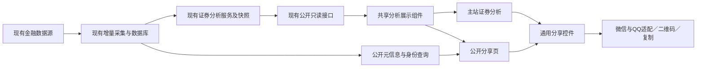

# 证券分析与通用分享开发方案

> 日期：2026-10-22  
> 状态：**0.8.4.9 / 247c898 已生产发布并验收（2026-10-23）**，iOS/Android 微信真机与自定义卡片未验。实际落点、与设计的偏差和验收边界见第十二节。  
> 修订：2026-10-22 按现役代码逐项复核后补强（CSP 内联哈希白名单、带参路由与 `PAGE_FILES` 的冲突、公开字段裁剪、微信签名与 canonical 分离、iOS 卡片缓存限制、`SHARE_PUBLIC_ORIGIN` 唯一性、`knowledge-map.json` 路由缺失）；架构方向与交付范围未变。  
> 核对基线：`a1eb3b8`，`package.json.appVersion=0.8.4.3`；只代表本次设计所查代码。  
> 范围：证券分析公开H5、通用分享控件、微信好友、朋友圈、QQ好友及复制链接。本文固化已讨论方案，当前行为仍以[技术架构](技术架构.md)与现役代码为准。

## 一、目标与交付范围

用户查看闻泰转债等证券的分析页面时，可以点击“分享”，通过微信好友、朋友圈、QQ好友或复制链接发送。接收者无论是否登录，都能直接打开对应证券的完整公共分析内容，并可继续转发。

首期接入证券分析中的股票和可转债，覆盖手机浏览器、电脑浏览器和微信内置浏览器。股票范围沿用当前普通A股接口支持范围，不借本次分享扩大证券市场范围。

通用能力分开处理“分享什么内容、用什么形式、发到哪个渠道”：本期实现H5形式；其他页面、图片、海报、PDF等后续按需求接入。本期不增加分享管理后台、短链服务、访问密码、访问次数限制、分享统计或历史时点快照功能。

## 二、已有能力、复用范围与真正缺口

| 类别 | 已核对的当前实现 | 本次处理 |
|---|---|---|
| 游客访问 | `public/js/access-policy.js` 的公开页键是 `stock-analysis` 与 `bond-safety`；可转债详细分析是 `bond-safety` 下的 `sub=analysis`，`bond-analysis.js` 同时服务这两个栏目，**没有独立的 `bond-analysis` 页面键** | 沿用原权限矩阵；私有账户与写接口继续鉴权 |
| 股票分析 | `server/routes/stockAnalysis.js` 的 `GET /api/stock-analysis/:ts_code` 和 `/:ts_code/statements` 公开读取 | 复用原服务、接口、图表、财务三表与展示口径；响应中的运维字段不得进分享页（见 4.2） |
| 可转债分析 | `server/routes/bondAnalysis.js` 的搜索、列表、详情公开读取；无快照时可按现有服务仅读本地组装 | 复用 `GET /api/bond-analysis/:code` 及既有本地数据兜底 |
| 定位证券 | 主站已有两套深链：旧转债分析 `?main=stock-analysis&code=<代码>` 自动映射为 `main=bond-safety&sub=analysis`（`public/index.html` 初始化段）；估值页用 `?main=bond-safety&sub=valuation&bond=<代码>`（`public/js/bond-valuation.js`） | 原链接保留；新增便于外部分享的统一公开地址 |
| 分析展示 | `public/js/stock-analysis*.js`、`bond-analysis.js` 已有分析渲染能力 | 局部整理共享渲染入口，主站和分享页共用；不复制两份业务模板或计算 |
| 知识文章分享 | `public/share-knowledge.html`、`GET /api/knowledge/share/:token` 已有文章公开分享 | 保留旧地址、发布状态与token权限；后续可接入同一控件 |
| 公共UI和二维码 | 已有 `shared/style.css`、`dialog.js`、`mobile-ui.js`、表格/图表交互及 `qrcode` 依赖；`qrcode` 现役用法见 `server/routes/import.js` 的 `QRCode.toDataURL()`，返回 dataURL（CSP `img-src` 已放行 `data:`） | 样式与交互复用；二维码沿用同一生成方式；手机底部面板属新增能力（见 3.1），`qrcode` 不另行引入依赖 |
| 当前缺口 | 尚无统一分享面板、通用内容登记、独立证券分享页及微信卡片签名适配 | 本方案集中补齐这些能力 |

现有知识分享专项方案处理文章权限、净化与导入等问题，不覆盖本次跨页面分享需求，因此新增本方案；不替代或重写[原知识分享方案](知识分享模块_审查与优化执行方案.md)。

## 三、用户操作与渠道行为

### 3.1 公共交互

证券分析内容加载成功后，在标题区域增加“分享”按钮。点击后显示“微信好友、朋友圈、QQ好友、复制链接”四项。

- 手机使用底部分享面板，电脑使用站内弹窗；复用现有弹层能力和样式。需注意**底部面板本身属新增能力**：`window.MobileUI` 只导出 `syncNavigation`/`closeMenus`（`public/shared/mobile-ui.js` 末尾），`createMenu` 是模块内私有函数；`dialog.js` 只提供 confirm/alert/prompt 三种。面板在 `share.js` 内新建，但要接入 `mobile-ui.js` 已有的滚动锁定与 `.modal-overlay` 焦点陷阱，不另写一套。
- 分享面板绑定已经成功展示的证券，不能使用尚未提交的输入框文字；切换证券时，链接、标题和二维码一起更新（微信卡片受下方缓存限制约束）。
- 公开分享页也提供同一按钮，游客可以再次转发。
- 加载失败且没有可用证券资料时，先显示具体原因，不生成指向其他证券的链接。

微信内置浏览器存在**页面级卡片缓存**：iOS 上微信在页面首次加载时即缓存分享信息，同一页面地址内切换证券后，`updateAppMessageShareData` 改写的内容仍可能被首次进入的卡片覆盖。因此主站内切券只保证链接、标题、二维码和描述同步，**不承诺卡片同步**；需要可靠卡片时，引导用户改用公开分享页地址另行打开。该限制须在真机核验后按实际表现回写本节，不得在未实测时宣称卡片已随切券更新。

### 3.2 手机普通浏览器

| 用户选择 | 执行流程 | 不可用时的处理 |
|---|---|---|
| 微信好友 | 浏览器支持系统分享时，打开系统面板，由用户选择微信 | 面板没有微信、浏览器不支持或调用失败时，提供“复制标题和链接”，提示切换微信粘贴发送 |
| 朋友圈 | 提示“先把链接发给自己，在微信中打开，再点右上角分享到朋友圈”，提供复制按钮 | 始终保留可手动复制的标题和地址 |
| QQ好友 | 默认直接提供“复制标题和链接”，由用户在 QQ 内粘贴发送。`connect.qq.com/widget/shareqq/index.html` 是电脑版扫码页，手机上打开体验差、微信内还会被拦，手机端不作为主路径 | 复制始终可用，不依赖外部应用唤起 |
| 复制链接 | 在用户点击时复制“标题＋换行＋绝对地址” | 剪贴板被拒绝时，显示可选中、可长按复制的完整文本 |

系统分享不会保证出现微信，也不能预先指定微信好友或朋友圈。用户主动取消系统分享时返回原页面，不自动复制、不连续拉起其他应用。需要重试或切换复制时由用户再次点击。

### 3.3 电脑浏览器

| 用户选择 | 执行流程 |
|---|---|
| 微信好友 | 弹出当前公开链接的二维码；提示“用微信扫码打开，再点右上角发送给朋友” |
| 朋友圈 | 弹出同一个公开链接的二维码；提示“用微信扫码打开，再点右上角分享到朋友圈” |
| QQ好友 | 打开QQ官方分享入口，按实际页面提示操作；不可用时提供复制发送 |
| 复制链接 | 直接复制标题和地址；失败时显示手动复制文本 |

二维码编码本站的公开页面地址，不包含登录凭据，不调用微信生成二维码接口。切换分享选项只改变说明文字，不重新请求证券数据。

### 3.4 微信内置浏览器

配置可用时，通过微信官方JS-SDK设置当前证券的分享标题、简介、链接和封面。点击“微信好友”或“朋友圈”后，给出对应的右上角菜单操作提示，最终发送由用户在微信中完成。

公众号接口权限、JS接口安全域名、签名和卡片效果均是开发接入前及真机验收的核验项。本次微信官方文档读取受限，不将账号权限或最新客户端表现写成已确认能力。配置缺失或签名失败时，页面仍能阅读，保留复制与微信菜单操作提示；自定义卡片未核验前不得宣称通过。

提示语必须对应真实动作：“已复制”仅表示复制成功；“分享信息已设置”不能当作已经发送；打开系统面板或QQ入口也不能提示“分享成功”。

## 四、公开页面与内容边界

### 4.1 地址与复制格式

统一地址约定：`/s/security/:kind/:code`，其中 `kind` 首期只接受 `bond` 或 `stock`，`code` 是通过现有证券身份服务校验的标准代码。

闻泰转债示例：

```text
闻泰转债（110081）｜证券分析｜存在小站
{网站地址}/s/security/bond/110081.SH
```

`{网站地址}` 是文档占位符，开发时由服务端公开站点地址配置生成真实HTTPS绝对地址。页面参数、Host请求头或浏览器当前地址不得直接成为任意外部分享地址，也不把不同环境的数据库数字ID放进公开链接。

首期链接打开库内最新可用数据，不冻结分享当时的数据。页面显示实际行情日、报告期、计算日期和待更新状态；不把打开时间当作数据更新时间。

证券身份分两层处理，两层职责不同、不可互相替代：

- **入口层（分享路由、元信息、二维码）**：必须通过 `server/services/securityIdentity.js` 解析标准身份，确认对象存在且 `kind` 与解析结果一致；不自行按数字前缀猜市场。
- **业务层（复用原公开接口）**：转债继续走 `convertibleBondAnalysisCore.normalizeBondCode`，股票继续走 `stockAnalysis.normalizeStockCode`。这两个函数本身就按代码前缀判交易所（`normalizeBondCode` 用 `/^(123|127|128)/` 判深市），属可转债/股票的既定编码规则，本期不改，避免为了分享改动原分析链路。

即“不按前缀猜市场”约束的是对外开放的分享入口；原分析接口的既有规范化不在本期改动范围内。

### 4.2 页面内容

保留名称、代码、数据日期和完整公共分析主体，具体区块随原分析组件同步演进：

- 可转债：概览、基本信息、触发状态、募集用途与条款、转股价调整和不下修历史、持有人资料、利息明细、安全性、纯债和期权分析、正股相关、评级历史、来源链接及数据状态。
- 股票：现有分析指标、图表、事件资料及财务三表等公开内容。

图表切换、表格滚动、原文链接和字段说明继续可用。主站和分享页消费相同公共数据、格式器和渲染规则，不在分享页重复计算收益率、评级或估值。

分享页只加载当前证券所需资源，不初始化账户列表、持仓、自选列表、个人设置或后台配置。首期公开页面为只读展示，不承载刷新数据、加入自选等写操作；这类操作在原站继续按现有权限执行。

**复用原接口不等于原样透传。** 现有 `GET /api/stock-analysis/:ts_code` 的响应带 `diagnostics`、`needs_refresh`、`freshness`、`stale_reason`、`source_updated_at` 等运维字段（`server/routes/stockAnalysis.js`）。分享页元信息与页面内容按以下优先级处理：

1. 服务端只取名称、代码、数据日期等白名单字段写入 HTML 元信息，不把原接口响应整包塞进页面；
2. 前端渲染层显式排除运维字段。

第 1 种是唯一能满足 10.2“不泄露内部诊断”的做法；第 2 种只是不显示，不构成安全边界。分区块缺项照 4.3 处理，不允许为“看起来完整”补造字段。

### 4.3 异常与生命周期

- 未登录、已登录、Cookie过期时，公共内容均可读取，不先跳登录页或要求微信授权登录。
- 退市证券仍按标准身份查询，展示库内已有资料、退市状态和数据日期；不能因搜索列表只显示上市证券而使旧分享链接失效。
- 证券不存在返回404；参数不合法返回400；数据暂不可用显示说明，不能静默换成别的证券。`/s/security/*` 是开放参数空间，任何代码都能拼出地址，404 响应需带 `X-Robots-Tag: noindex`，避免爬虫按无效代码反复抓取。
- 原接口支持的旧快照和本地资料兜底继续使用；缺项保留缺项，禁止为分享访问自动补采、补写或排队刷新。
- 一个区块缺资料不清空其他可用区块。股票和转债切换时，迟到响应不能覆盖当前对象。

## 五、通用控件与扩展约定

### 5.1 三个独立维度

| 维度 | 首期 | 后续扩展方式 |
|---|---|---|
| 内容类型 | `security-analysis`，区分 `bond/stock` | 新页面登记对象解析、公开权限、元信息及展示入口 |
| 分享形式 | `h5` | 新增图片、海报等形式处理器，继续消费同一公开内容描述 |
| 分享渠道 | `wechat-friend`、`wechat-timeline`、`qq`、`copy` | 新增渠道适配，不修改证券业务服务 |

使用普通模块和明确白名单实现，不建设通用插件平台，不提前实现未来形式。

### 5.2 调用约定

拟定调用方式如下，属于待开发接口：

```javascript
Share.open({
  contentType: 'security-analysis',
  resourceKind: 'bond',
  resourceKey: '110081.SH',
  format: 'h5'
});
```

控件内部形成统一内容描述：`contentType/resourceKind/resourceKey/title/description/url/imageUrl/format`。主站可复用当前已加载的公共名称等信息预览；服务端公开路由仍独立校验对象与权限，输出权威标题和地址。前端传入标题或 `public=true` 不能授予公开权限。

内容登记与渠道适配各自集中维护。新增内容必须明确可公开字段和权限，不接受任意内部路径、任意网页URL或任意接口作为分享目标。未来接入知识文章时，仍须校验原token和发布状态，不因使用通用控件公开草稿。

## 六、架构对齐与接口设计

### 6.1 数据链路



架构结论：继续使用Express、PostgreSQL和原生前端；新增分享入口和渠道适配，金融采集、事实表、分析算法、Worker及调度器沿用现有链路。首期不新增分享记录表、不迁移金融数据。

### 6.2 拟新增入口

| 入口 | 职责 | 约束 |
|---|---|---|
| `GET /s/security/:kind/:code` | 返回公开页面壳及服务端生成的标题、简介、封面、canonical和Open Graph元信息 | 校验内容类型及证券身份；元信息只读本地公开资料；**不能挂到 `versionedStaticPages` 的 `PAGE_FILES` 上**（该表是“静态路径→文件”一一映射，带参路径查不到），需独立路由渲染并自行复用 `renderAppVersion()` 替换 `__APP_VERSION__` |
| `GET /api/share/qrcode?contentType=...&resourceKind=...&resourceKey=...` | 用已有 `qrcode` 依赖生成公开链接二维码 | 接受登记对象，服务端生成目标地址；不接受任意URL，不拉取外部内容 |
| `GET /api/share/wechat-config` | 返回当前页面的微信签名配置；签名目标由服务端按 `contentType/resourceKind/resourceKey` 推出 | **不接受前端传入任意 url**，只对识别出的本站主站/分享页地址签名；不返回票据或密钥 |

证券详情与财务三表继续使用原公开接口，不再增加一套分享业务数据API。主站打开分享面板直接利用当前对象信息，不为分享再读一次完整分析。分享页打开后按原组件需要读取当前证券，弹出面板、生成二维码、旋转屏幕或切换渠道不得重复取金融数据。

服务端生成HTML元信息，避免只在JavaScript执行后修改标题，导致分享平台只能识别“存在小站”通用标题。封面首期复用本站已有标识，但 `og:image` 必须是可公网访问的绝对 HTTPS 地址，原图不小于 300×300（微信/QQ 抓取预览的硬性要求），相对路径抓不到；股票、转债名称及描述均按文本转义，不拼接用户提供的HTML。元信息不含未经核验的“实时”或具体即时价格承诺。

微信签名的目标 URL 与分享出去的卡片链接必须分开处理，两者在多数场景并不相同：

- **签名 URL**：必须等于当前页面 `location.href` 去掉 fragment 后的完整地址（含查询参数），否则报 `config:invalid signature`。在主站内点分享时，它就是 `/?main=...&sub=...` 这类主站地址。
- **卡片链接（canonical）**：始终是 `/s/security/:kind/:code`，与签名 URL 无关。

主站与公开分享页各签各自的 location；控件不得把 canonical 当成签名入参，也不得为前端拼出来的地址签名。

公开HTML、二维码和封面的缓存属**本期新增**，不是复用：项目当前没有通用 HTML 缓存实体（`versionedStaticPages` 每次请求都重新读文件并替换版本号，不缓存）。缓存键绑定内容类型、证券标准身份及相关版本；鉴权相关、签名配置或其他个人响应不进入公共缓存。来源资料更新后，站内缓存按原版本失效；微信/QQ自身预览缓存的刷新效果需实测，不承诺立即更新。

## 七、微信配置与外部请求保护

拟新增配置：`SHARE_PUBLIC_ORIGIN`、`WECHAT_APP_ID`、`WECHAT_APP_SECRET`，统一由 `.env` 管理，公开域名须与现有来源白名单对齐。

`SHARE_PUBLIC_ORIGIN` 是**新增且唯一**的站点公开地址来源，没有可复用的等价配置：现有 `ALLOWED_ORIGIN`（对应 `server/config.js` 的 `ALLOWED_HOSTS`）只用于 CSRF 来源校验，是可含端口的 host 列表，不是可分发的站点地址。两者必须指向同一站点，建议加启动校验——`SHARE_PUBLIC_ORIGIN` 的 host 落在 `ALLOWED_HOSTS` 之外时直接告警并拒绝启动，避免“链接能生成、站内打开被拒”的错配。

- 使用微信官方JS-SDK；拟采用 `updateAppMessageShareData`、`updateTimelineShareData` 配置卡片，接入前核对官方当前文档和账号权限，不仿写SDK或猜测包名。
- `access_token/jsapi_ticket` 只在服务端使用，优先复用现有Redis并按平台实际返回有效期缓存；没有Redis时遵守现有单进程运行边界，不新增金融事实表保存这些临时票据。
- 第一次缺少有效票据时获取，后续仅在到期更新；同一凭据并发刷新合并，避免每个访客各调一次。票据过期后失败则降级，不能用过期票据伪造成功或持续重试。
- 平台请求接入现有外部请求保护，未知额度保持未知，不编造调用次数限制，不新增后台定时任务。金融接口首次落库、后续增量的现有规则不变。
- 签名使用当前实际页面URL去掉fragment后的值，保留官方签名要求的查询参数；签名URL与最终分享的canonical URL分开处理。通过服务器白名单校验签名URL，禁止为任意外部域名签名。
- 前端只获得 `appId/timestamp/nonceStr/signature` 等必要配置；票据、AppSecret及含敏感值的上游响应不得进入日志、HTML、仓库或前端错误提示。
- 当前CSP脚本和连接来源较严格。实施时按核验后的官方SDK实际资源需求最小放行，保持 `script-src-attr/style-src-attr 'none'`，不为分享整体放开脚本、内联执行或任意域名。
- **新增页面必须同时处理内联哈希白名单**：`server/middleware/security.js` 的 `inlineHashes()` 只扫描 `index.html`、`login.html`、`admin.html`、`ipo-report.html`、`share-knowledge.html` 五个文件计算 sha256。新增 `public/share.html` 只要含内联 `<script>`/`<style>`，拿不到哈希就会被CSP直接拦死。首选保持新页面零内联（与全站去内联化一致，也避免 `audit-20261021-u15.test.js` 回归失败）；确需内联时必须把文件名加进该数组，否则页面白屏且只在控制台报 CSP 违规。

官方账号资格、后台域名配置和客户端能力需要真实证据。若自定义卡片条件不具备，应如实保留该项待办，继续交付已可用的公开H5、复制和扫码流程，不能宣布全部分享能力验收完成。

## 八、文件修改边界

下表为建议落点，除“复用”项外均尚未开发；实施时按实际最小改动收敛文件数量。

| 文件或位置 | 计划职责 |
|---|---|
| `public/shared/share.js`（新增） | 分享面板（含手机底部面板）、内容描述、渠道选择、复制与降级提示；以 `window.Share.open` 暴露，供 `data-act="Share.open"` 事件委托调用 |
| `public/share.html`、`public/js/share-page.js`（新增） | 统一公开页面壳和当前对象初始化；按去内联化要求脚本/样式一律外链，不写内联 `onclick` 或 `style` |
| `server/routes/share.js`（新增） | 公开HTML、二维码及微信配置入口 |
| `server/services/shareRegistry.js`（新增） | 登记内容、解析身份、校验公开范围和生成元信息/地址 |
| `server/services/wechatShare.js`（新增） | 微信票据缓存及签名；复用现有Redis和外部请求保护 |
| `public/js/stock-analysis*.js`、`bond-analysis.js` | 仅整理当前渲染入口和必要容器依赖，供主站与分享页共用 |
| `public/index.html`、`public/shared/ui-actions.js` | 接入分享按钮与现有事件委托 |
| `public/shared/style.css`、既有证券分析CSS、`dialog.js/mobile-ui.js` | 复用公共样式和交互，只补必要差异 |
| `server/app.js`、`server/middleware/versionedStaticPages.js` | 注册入口；`versionedStaticPages` 是 `PAGE_FILES` 纯静态映射，带参路径无法直接登记，需在中间件增加参数路径匹配并复用 `renderAppVersion()`，或由新路由自行替换 `__APP_VERSION__`；保持中间件安全顺序（静态资源 → CSRF → 业务路由） |
| `server/middleware/security.js` | 核验并最小调整官方SDK所需CSP来源；同时处理 `inlineHashes()` 的文件白名单（见第7节），漏改会白屏 |
| `server/test/` 与全量测试入口 | 增加必要行为、权限及复用回归，纳入现有测试体系 |

共享渲染只覆盖本次证券分析使用范围。若实际实现需要重构整个分析文件或删除核心文件，必须先按项目规则取得用户同意；本方案不构成对大范围重构的授权。

## 九、开发顺序

1. **公开页和数据复用**：确定内容描述与白名单，完成证券标准身份解析、HTML元信息和共享展示，先验证闻泰转债及股票的免登录阅读。
2. **公共控件与基础渠道**：接入主站/公开页按钮、标题加地址复制、电脑微信二维码、手机操作提示及系统分享降级。
3. **平台适配**：核验微信账号条件，接官方SDK和签名缓存；接QQ官方分享入口，检查不同环境的真实行为。
4. **完整验收**：完成接口、权限、数据一致性、移动端和桌面回归，更新权威文档；发布按原标准流程另行执行。

每步以实际完成范围登记，不把“分享入口已出现”当作渠道已发送，也不把单只闻泰样例通过当作全部证券类型通过。

## 十、验收标准

### 10.1 功能与数据

- [ ] 闻泰转债 `110081.SH` 链接、标题、二维码和正文属于同一证券；登录、未登录、过期会话、刷新及再次转发均可打开。
- [ ] 至少覆盖另一只转债、一只已有完整股票分析、退市对象、部分资料缺失对象和不存在对象；记录实际通过数量与异常。
- [ ] 同一数据版本下，主站与分享页区块、字段、单位、评级、图表和三表一致；数据变化不能误判为渲染差异。
- [ ] 复制文本精确包含标题、换行、真实HTTPS地址；缺少剪贴板API或被拒绝时可手动复制。
- [ ] 二维码扫码后直达相同公开页面，不携带会话信息，也不要求登录。
- [ ] 手机系统分享取消、不可用、应用未安装，QQ入口受限，微信配置失败时，各自提示和降级正确，不虚报发送成功。
- [ ] 分享页可继续分享；快速切换证券不出现旧标题配新数据、旧二维码或迟到响应覆盖。
- [ ] iOS 微信内浏览器按 3.1 的卡片缓存限制核验：主站内切券时链接/标题/二维码同步；卡片行为如实记录，不更新属预期，不得算缺陷也不得宣称已同步。

### 10.2 权限与请求

- [ ] 分享页不请求账户、持仓、自选等私有接口，不泄露原访问者身份、内部诊断、任务凭据或配置；HTML 与接口响应中不出现 `diagnostics`/`needs_refresh`/`freshness`/`stale_reason` 等运维字段。
- [ ] 伪造内容类型、证券身份、地址、公开标记或微信签名URL无法绕过校验；原写接口及账户隔离不变。
- [ ] 分享访问、平台预览抓取、刷新页面、切换渠道和旋转屏幕不触发金融外部请求、不排队采集、不写分析快照。
- [ ] 微信有效票据命中缓存不回源，并发更新不重复获取；接口异常和真实过期均有正确降级，敏感值不出服务端。
- [ ] 新页面HTML、CSS/JS资源版本、CSP（含 `inlineHashes()` 白名单是否已覆盖新页面）及原知识分享链接兼容均通过。

### 10.3 手机与电脑

复用项目现有760px正文、900px导航分界；检查320/360/390/430/768/1024/1440px及分界附近布局。操作区至少44px、输入字号16px；宽表格只在容器内横滑，字段不被裁掉，弹层支持触屏、键盘、焦点返回和关闭。

分别实测iOS Safari、Android Chrome、iOS/Android微信内置浏览器及电脑常用浏览器；QQ按实际可用客户端/入口记录版本和结果。按照项目低性能规则，浏览器和真机验收在获得允许后执行；此前只能登记“未实测”，不能用DOM检查代替真机结论。

代码实施完成后执行 `npm.cmd run test:all` 和 `npm.cmd run check:knowledge`；按现有本地运行闭环核对 `/health`、目标页面/接口、静态资源及版本。生产发布按[生产部署流程](生产部署流程.md)执行，平台卡片和扫码效果仍需独立验证。

## 十一、文档同步与当前边界

实施时更新[技术架构](技术架构.md)第4节请求入口、第5节前端/移动端、第7节接口与访问矩阵、第9节相关证券分析和分享说明、第10/12节票据请求/缓存与配置，更新最后核对日期及[知识索引](知识索引.md)的方案状态。涉及新路径或规则时核对 `governance/knowledge-map.json` 的read/update，不另建平行架构文档。

当前 `governance/knowledge-map.json` 里还没有 share 相关路由，`npm.cmd run check:knowledge` 匹配不到本方案。首次实施时必须补一条 `security-share` 路由（read：本方案 + 技术架构第 4/5/7/9/10/12 节；update：同上），否则后续涉及分享的改动不会命中本文档。

本方案自首次新增以来只改文档（本文、知识索引、技术架构入口）；没有修改业务代码、依赖、配置、版本或生产行为。2026-10-22 的复核修订同样只补结论与约束，未执行任何实现。上轮本地 `/health` 和目标分析接口未连通，未启动服务；现状核对来自代码与仓库文档，不能当作本地或生产运行验收。微信权限、自定义卡片、QQ客户端唤起及多端真机均待实施后验证。

## 十二、实施记录与偏差（2026-10-22，本地实现）

本节记录实际落点与第八节设计的差异。差异均为实现时发现更优或更严的做法，不改变交付范围。

| 项目 | 第八节设计 | 实际落点 | 原因 |
|---|---|---|---|
| 公开页模板 | `public/share.html` | `server/views/share.html` | 放 public 会被 `express.static` 直出，访客能看到未替换的 `__SHARE_*` 占位符；放 server/views 后只有路由能输出 |
| 页面初始化 | `public/js/share-page.js` | 同左 | — |
| 分享控件 | `public/shared/share.js` | 同左 | 暴露 `window.Share.open`，由 `data-act` 委托调用 |
| 分享样式 | （未单列） | `public/css/share.css`（新增） | 面板与分享页样式按项目规范归入 `css/` 体系；主站和分享页共用 |
| 封面 | 复用本站已有标识 | 新增 `public/share-cover.png`（512×512） | 站内只有 32×32 SVG 图标，微信/QQ 抓取不支持 SVG 且尺寸不足 300×300 |
| 微信卡片 | 接官方 SDK 设置卡片 | 签名服务已实现并按官方算法回归；**前端不加载 SDK** | 无公众号凭据、JS 安全域名与 `script-src` 放行都需真实账号核验；按第七节"配置缺失时降级"处理，只给复制与菜单提示 |
| `versionedStaticPages` | 注册入口 | 未改该中间件 | 它是 `PAGE_FILES` 纯静态映射，带参路径无法登记；由 share 路由自行替换 `__APP_VERSION__` |
| CSP 内联哈希白名单 | — | 未改 `security.js` | 分享页保持零内联脚本样式，因此不需要加哈希；已写入回归断言防止以后被改成内联 |

实现包含的额外必要处理：分享页需补齐 `username`/`showToast`/`switchMain` 三个被复用分析脚本引用的全局；`bond-analysis.js` 的"请点击刷新数据"提示在分享页被过滤（无写操作入口，属运维字段）；`/api/share/wechat-config` 接受前端传入的页面地址但按同源+路径白名单严格校验，因为签名必须使用主站实际 location。

**本地验收结果**（真实 PG，非 mock）：分享页 200 且标题为「闻泰转债（110081）｜证券分析｜存在小站」；不存在证券 404 且带 `X-Robots-Tag: noindex`；类型不匹配 404；非法 `kind` 400；二维码返回 dataURL；外部域名签名 400；未配置凭据返回 `configured:false`；股票页 200 且标题为「贵州茅台（600519）」。自动化断言 27 项通过，签名算法与越权拒绝均已做破坏性验证（改坏后测试真红）。

**浏览器实测（2026-10-23，Edge/Chromium，非真机）**：分享页与面板均通过，并修掉三处只有真渲染才暴露的问题——深色标题区里 h1 沿用正文深灰导致不可见、缺少 `bond-analysis-message` 容器使"正在读取"提示一直残留、`bond-analysis-updated` 会把"尚有 N 项资料待补全"这类运维信息显示给访客（已从公开页移除，并补三条回归断言）。实测覆盖：面板桌面居中/手机贴底与滚动锁定、四渠道行为（手机降级复制、微信 UA 提示右上角、桌面二维码 240px 正常且朋友圈复用同一张、桌面 QQ 打开官方分享页参数齐全、复制写入剪贴板实际为标题+换行+绝对地址）、主站面板绑定已展示证券（改输入框不提交不生效）、点开面板前后分析接口请求 2→2 未重复取数、320/360/390/430/768/1024/1440px 横向溢出均为 0。自动化断言 29 项通过。

**2026-10-23 面板改版（用户反馈首版"太难看"后重做）**：原 2×2 灰色描边文字按钮改为 iOS 原生风格——无标题栏，顶部直接是应用预览行（站点标识 + 证券名称 + 「证券分析 · 域名」）、四个 50×50 彩色圆角图标配文字、底部独立「取消」行。只动 `public/shared/share.js` 与 `public/css/share.css`，后端、接口、四渠道行为都不变。改版后实测：手机底部面板与桌面居中弹窗形态正常、点微信降级为可复制文本、点取消可关闭并清空预览、桌面二维码 240px 正常渲染；长链接不再裸露在面板上。顶部拖拽条先做后按用户要求去掉——拖动关闭需要额外手势逻辑，而「取消」/点遮罩/Esc 三种关闭方式已足够，不为装饰性控件增加交互复杂度。

**仍未验证**：iOS Safari、Android Chrome、真实微信内置浏览器（本次仅改 UA 模拟，非真微信）、微信自定义卡片效果、QQ 客户端唤起、实际触屏与软键盘；以及生产部署本身。生产 `.env` 的 `SHARE_PUBLIC_ORIGIN` 已于 2026-10-23 配置为 `https://cunzaitouzi.cn`（域名已解析、HTTPS 证书有效、与 `ALLOWED_ORIGIN` 同站），微信凭据仍未配置。

**本轮实测发现的非本次问题**：主站"开始分析"按钮（`data-act="securityAnalysisSubmit"`）走事件委托时没有 `data-arg`，`ui-actions.js` 会把 `MouseEvent` 作为第一个实参传入，`securityAnalysisSubmit` 将其转成字符串去搜索，于是点击按钮报"没有找到符合条件的股票或可转债"；在输入框内回车则正常。属去内联化改造遗留，不影响本次分享功能（分享按钮依赖已展示的证券状态），已登记未修复，待用户决定是否单独处理。

## 十三、依据与参考

- 仓库权威资料：[技术架构](技术架构.md)、[API与自动任务保护方案](自动任务重复执行与API调用保护整改方案_20260815.md)、[本地验证交接文档](../deploy/本地验证交接文档.md)。其中带日期的历史状态按原文边界读取。
- [W3C Web Share规范](https://www.w3.org/TR/web-share/)：系统分享由用户选择目标，目标由浏览器和操作系统提供。
- [QQ官方分享入口](https://connect.qq.com/widget/shareqq/index.html)：已查阅页面提供电脑和手机QQ扫码/菜单分享提示，具体客户端唤起与参数支持须实施时核验。
- [微信官方JS-SDK文档](https://developers.weixin.qq.com/doc/offiaccount/OA_Web_Apps/JS-SDK.html)：本次读取受限，列为开发前复核入口，不作为已确认账号权限或兼容性的证据。
